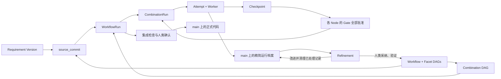

# FacetLoom Design

这组文档描述当前对象、文件与运行规则，按编号阅读。

| 顺序 | 文档 | 解决的问题 |
| --- | --- | --- |
| 00 | 本文 | 系统边界、对象关系和存储位置 |
| 01 | [Workflow](01-workflow.md) | Facet、Node、Combination 与组合 DAG |
| 02 | [Requirement](02-requirement.md) | 需求版本、运行对象和状态推进 |
| 03 | [Governance](03-governance.md) | 四种 Gate 模式、操作边界与 Refinement |
| 04 | [Execution](04-execution.md) | 上下文、Checkpoint、证据与交付 |
| 05 | [Services](05-services.md) | Runtime、Git、容器与 Agent 的职责 |
| 06 | [WebUI](06-user-interface.md) | 查看运行、审核成果、精炼记录 |
| 07 | [Demo](07-demo.md) | 从需求到交付和精炼的完整场景 |

## 一页模型



Workflow 按 Facet 声明顺序从外到内应用 DAG 节点替换积，例如 `feature ▷ layer ▷ verification`。该运算不满足交换律，因此 Facet 顺序是定义的一部分。`exclude` 在完整组合 DAG 上按节点的 Facet→Node 来源映射匹配；删除命中节点后补齐旁路边，再对整个结果做传递约简，保留相同依赖顺序并去除冗余边。具体算法与示例见 [Workflow](01-workflow.md)。

## 对象与存储

| 对象 | 作用 | 保存位置 |
| --- | --- | --- |
| Requirement Version / current.yaml | 完整需求定义及当前版本指针 | main |
| Workflow / Facet / Node / Scope | 执行图与上下文定义 | main |
| Combination / DAG Snapshot | 固定的业务执行图 | 本地运行状态；发布到 main |
| WorkflowRun / CombinationRun / Attempt | 一次运行、一个节点及一次尝试的状态 | 本地持久化；关键节点发布精简档案到 main |
| Context Snapshot / Checkpoint | 固定一次尝试的输入与代码结果 | 本地；发布证据时附持久引用 |
| GateReport / GateDecision | 每项 Gate 的评估证据与人类、AI 或程序决策 | main 的运行档案 |
| IntegrationReport / DeliveryRecord | 最终检查与成功交付回执 | main 的运行档案 |
| Refinement | 筛选记录、提出并落实改进的交互过程 | 本地会话；结果体现在 main 的修改与 Commit 描述 |
| Runtime State | 队列、Worker、容器和未发布操作 | clone-local；SQLite 可选 |

Context Snapshot 保存有效上下文清单，实际初始请求由 Attempt / GateReport 引用持久 Artifact。执行与必要检查完成后冻结审核输入；后续 Gate 报告是审核输出，不回写执行证据。审核定义统一由 source_commit 固定，本地只配置凭据、连接和资源上限。

每个普通 Node 声明或继承一项 Gate：human、ai_assisted、ai、script。Combination 的各项独立审核同一固定输出，全部批准才接受成果；自动异常转交人类。最终代码交付仍需人类确认。

## 单 main 与隔离执行

```text
main                         # 正式定义、已接受代码、精简运行档案
  │ source_commit
  ├── detached Worktree A → 本地 Checkpoint A
  └── detached Worktree B → 本地 Checkpoint B
                                ↓
                         汇聚、Gate、最终检查
                                ↓
                     代码与精简档案提交 main
```

Git 分支只有 `main`。DAG 分支由独立 Worktree 执行；输入与 Checkpoint Commit 是本地执行对象，不需要命名分支。Git Manager 为活动 Worktree 保留本地对象；需要长期或跨 clone 复核的快照导出为持久 Git bundle Artifact。YAML 中的 Commit ID 本身不保证对象可恢复。

每位协作者在自己的 clone 创建不同 `run_id`。同一 Run 由创建它的 Runtime 推进；协作者同步 main 查看已发布档案，向拥有者提交审核请求。首阶段不支持跨 clone 接管活动 Worker。

## 文件布局

```text
.facetloom/
├── requirements/<requirement-id>/
│   ├── current.yaml
│   └── <version>.md
├── workflows/<workflow-id>.yaml
├── facets/<facet-id>/
│   ├── facet.yaml
│   └── scopes.yaml                       # 可选
├── evaluators/<evaluator-id>.yaml         # AI / 脚本评估配置
├── references/
├── runs/<run-id>/                        # main 上的精简档案
│   ├── run.yaml
│   ├── summary.md
│   ├── dag.yaml
│   ├── contexts/<sha256>.yaml
│   ├── combinations/<sha256>.yaml
│   ├── attempts/<attempt-id>.yaml
│   ├── checkpoints/<checkpoint-id>.yaml
│   ├── decisions/<decision-id>.yaml
│   ├── reports/<report-id>.yaml           # GateReport / IntegrationReport
│   └── deliveries/<delivery-id>.yaml
└── .runtime/                             # 加入 gitignore
    ├── runs/<run-id>/                    # 完整状态、待发布记录
    ├── worktrees/<attempt-id>/
    ├── gate-tasks/<report-id>.yaml         # 活动评估、取消与恢复
    ├── logs/
    ├── refinements/<refinement-id>/
    └── runtime.sqlite                    # 可选
```

每个对象独立保存，便于引用和按项清理；文件内容保持简短。main 不收录完整 Agent 对话、心跳与临时输出。大型证据保存在 Git 外的持久位置，档案保存 URI 和摘要。

## 五条不变量

1. **输入固定**：一个 `source_commit` 固定需求、定义、引用资料和代码基线；`.facetloom/runs/` 不参与执行输入。
2. **图固定**：一次 Run 的 `dag.yaml` 创建后不变；重试与恢复复用它。
3. **成果隔离**：Worker 修改发生在独立 Worktree；main 代码更新经过人类确认和最终检查。
4. **恢复有边界**：Git 恢复已发布证据，本地持久状态恢复活动运行；未发布状态不能仅靠 Git 重建。
5. **精炼可追溯**：已处理档案可从当前目录删除；改进 Commit 引用删除前的证据，Git 历史不改写。

只增删运行档案不会使执行输入失效。交付前比较 main 与 `source_commit`，排除 `.facetloom/runs/` 后有任何变化都需要新 Run。具体并发和交付规则见 [Execution](04-execution.md)。

## 术语

- **当前有效成果**：CombinationRun 的 `accepted_attempt_id` 指向的输出；历史 accepted Attempt 不一定仍有效。
- **运行完成**：所有业务 CombinationRun 都为 `satisfied`，不表示已经交付。
- **已发布档案**：main 上最近一次共享的状态；界面须与本地实时状态区分。
- **精炼**：Refinement，目标是减少当前目录与 Agent 上下文中的已处理记录，不清除 Git 历史。
