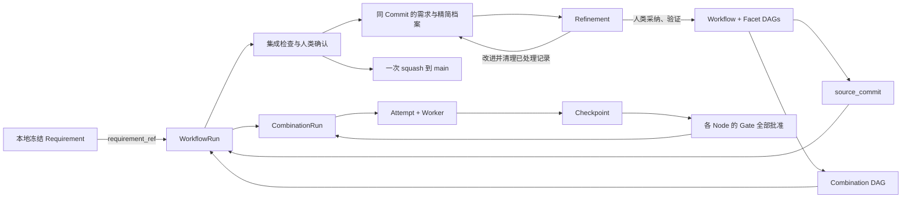

# FacetLoom Design

这组文档描述当前对象、文件与运行规则，按编号阅读。

| 顺序 | 文档 | 解决的问题 |
| --- | --- | --- |
| 00 | 本文 | 系统边界、对象关系和存储位置 |
| 01 | [Workflow](01-workflow.md) | Facet、Node、Combination 与组合 DAG |
| 02 | [Requirement](02-requirement.md) | 独立需求、运行对象和一次采纳 |
| 03 | [Governance](03-governance.md) | 成果审核、错误处置、四种模式与 Refinement |
| 04 | [Execution](04-execution.md) | 上下文、Checkpoint、Artifact 存储与交换、交付 |
| 05 | [Services](05-services.md) | Runtime、Git、容器与 Agent 的职责 |
| 06 | [WebUI](06-user-interface.md) | 查看运行、审核成果、精炼记录 |
| 07 | [Demo](07-demo.md) | 从需求到交付和精炼的完整场景 |

## 一页模型



Workflow 按 Facet 声明顺序从外到内应用 DAG 节点替换积，例如 `feature ▷ layer ▷ verification`。该运算不满足交换律，因此 Facet 顺序是定义的一部分。`exclude` 在完整组合 DAG 上按节点的 Facet→Node 来源映射匹配；删除命中节点后补齐旁路边，再对整个结果做传递约简，保留相同依赖顺序并去除冗余边。具体算法与示例见 [Workflow](01-workflow.md)。

FacetLoom 编排外部 Agent，不实现模型推理或工具循环。Podman 镜像预装 Codex、Claude Code、OpenCode、Pi Agent 等程序与项目环境，Git 中的 runner 固定镜像、原生参数和配置。Agent 可使用原生免审批模式，外层容器隔离、Scope 校验、必要检查与 Gate 仍由 FacetLoom 执行。

## 对象与存储

| 对象 | 作用 | 保存位置 |
| --- | --- | --- |
| Requirement | UUID 标识的一次独立需求，冻结后不可变 | 本地草稿与冻结 Artifact；最终采纳写 main |
| Workflow / Facet / Node / Scope | 执行图与上下文定义 | main |
| Runner / Evaluator | 外部 Agent 调用配置及 AI / 脚本审核定义 | main；Run 固定解析结果与来源 |
| Combination / DAG Snapshot | 固定的业务执行图 | 本地运行状态；采纳时归档 main |
| WorkflowRun / CombinationRun / Attempt | 一次运行、一个节点及一次尝试的状态 | 本地事务生效；采纳时归档必要记录 |
| Context Snapshot / Checkpoint | 固定一次尝试的输入与代码结果 | 本地不可变记录与持久引用 |
| ErrorRecord | 准备、执行或成果拒绝的不可变错误材料 | 本地 errors/，采纳时选入精简档案 |
| GateReport / GateDecision | 成果审核或错误处置的证据与决策 | 本地记录，采纳时加入 main |
| CheckReport | 一个 Attempt 的检查轮次、候选 Tree 与执行结果 | 本地 reports/，采纳时选入精简档案 |
| IntegrationReport / DeliveryRecord | 最终候选、检查与一次成功交付回执 | 本地记录，采纳时加入 main |
| Refinement | 筛选记录、提出并落实改进的交互过程 | 本地会话；结果体现在 main 的修改与 Commit 描述 |
| Worker / Invocation | 一个 Attempt 的执行生命周期及一次外部调用 | clone-local；必要调用证据导出为 Artifact |
| Artifact / Artifact 交换包 | 大型证据及其显式跨 clone 传递 | 本地内容库；交换包经现有渠道独立传递 |
| Runtime State | 队列、容器、本地事务与交付意图 | clone-local；SQLite 可选 |

Attempt 先以 preparing 持久化，再形成输入和 Context Snapshot；准备失败也有可审核的错误记录。Context Snapshot 保存有效上下文清单，交给外部程序的实际输入由 Attempt / GateReport 引用持久 Artifact。执行与必要检查完成后冻结审核输入；后续 Gate 报告是审核输出，不回写执行证据。审核定义统一由 source_commit 固定，本地只配置凭据、连接和资源上限。

每个普通 Node 声明或继承一项 Gate：human、ai_assisted、ai、script。Combination 的各项独立审核同一固定输出，全部批准才接受成果。无法执行或成果被拒绝时，由 Workflow 的独立错误 Gate 决定重试、修复上游、等待或停止；默认人工，自动恢复每个 Run 最多 3 次。处置决策不代表成果被接受。最终代码交付仍需人类确认。

## 单 main 与隔离执行

```text
main                         # 正式定义、已接受代码、精简运行档案
  │ source_commit
  ├── detached Worktree A → 本地 Checkpoint A
  └── detached Worktree B → 本地 Checkpoint B
                                ↓
                         汇聚、Gate、最终检查
                                ↓
                  需求、代码、档案和回执一次 squash 到 main
```

Git 分支只有 `main`。DAG 分支由独立 Worktree 执行；输入与 Checkpoint Commit 是本地执行对象，不需要命名分支。Git Manager 为活动 Worktree 保留本地对象；需要长期或跨 clone 复核的快照导出为持久 Git bundle Artifact。YAML 中的 Commit ID 本身不保证对象可恢复。

每位协作者在自己的 clone 创建不同 `run_id`。同一 Run 由创建它的 Runtime 推进；协作者同步 main 查看已采纳档案；未采纳记录通过显式交换包分享，审核请求由拥有者服务处理。首阶段不支持跨 clone 接管活动 Worker。

## 本地生效与 Git 同步

所有项目使用相同规则，**执行和 Gate 在本地事务完整落地后生效；需求采纳以一次 squash 提交进入本地 main 为边界。** Git remote 仅用于用户按需同步历史，无需 remote 即可执行、审核、采纳和精炼。

```text
本地需求草稿 → 冻结 → Run / Attempt / Gate（本地事务）
                                  ↓ 最终检查、人类确认
main：之前的正式内容 → 一个 Commit：需求 + 代码 + 精简档案 + 回执
                                  ↓ 可选 push / 获取并接纳更新
                             其它 clone
```

冻结后需求内容变化创建新 UUID；需求不变但基线或执行定义变化则创建新 Run。失败、取消和放弃的记录留在本地。已采纳需求的后续变化用新需求，或通过 Git revert 回撤，原采纳历史继续保留。

推送失败只表示尚未同步，不撤销结果。同步后检查正式输入与需求是否已采纳；独立需求不建立版本取代或合并关系。代码分叉按正常 Git 协作处理，系统不承诺离线 clone 间全局唯一。完整边界见 [Services](05-services.md#git-异步同步)。

## 本地优先的证据协作

通常，一个需求由协作者在自己的 clone 中执行，产生的 Artifact 主要用于该 clone 内的审核、排错和恢复。只有跨人复核、问题移交等少数场景需要分享原始材料。因此，Artifact 默认本地持久保存，跨 clone 共享通过显式导出和导入完成，无需为日常运行部署共享存储服务。

```text
clone A                            clone B
Git 精简档案 ──── push/pull ──────→ Git 精简档案
本地 Artifact 库                    本地 Artifact 库
     ↓ 导出                              ↑ 校验并导入
     └── 独立 Artifact 交换包 ────────────┘
             经现有渠道传递
```

Artifact URI 标识内容，不是下载地址。采纳归档前只要求拥有者本地持久可读；其它 clone 可先阅读摘要，缺少的材料通过交换包补齐后再审核或恢复代码。代码恢复用的 Git bundle 是包内的一种 Artifact。存储和传输规则集中见 [Execution](04-execution.md#artifact-存储与交换)。

默认无需 S3、Git LFS 或中心存储服务。内容长期保留，人工 purge 只清理当前 clone 的副本，不能承诺删除协作者或备份中的内容；Refinement 不自动删除 Artifact。

## 文件布局

```text
.facetloom/
├── requirements/<requirement-id>.md      # 采纳时保存冻结需求
├── workflows/<workflow-id>.yaml
├── facets/<facet-id>/
│   ├── facet.yaml
│   └── scopes.yaml                       # 可选
├── runners/<runner-id>.yaml               # 镜像、原生参数与配置引用
├── evaluators/<evaluator-id>.yaml         # AI / 脚本评估配置
├── references/
├── runs/<run-id>/                        # main 上的精简档案
│   ├── run.yaml
│   ├── summary.md
│   ├── dag.yaml
│   ├── contexts/<sha256>.yaml
│   ├── combinations/<sha256>.yaml
│   ├── attempts/<attempt-id>.yaml
│   ├── errors/<error-id>.yaml
│   ├── checkpoints/<checkpoint-id>.yaml
│   ├── decisions/<decision-id>.yaml
│   ├── reports/<report-id>.yaml           # CheckReport / GateReport / IntegrationReport
│   └── deliveries/<delivery-id>.yaml
└── .runtime/                             # 加入 gitignore
    ├── identity.yaml                     # 当前 clone 的稳定 runtime_id
    ├── requirements/<uuid>/
    │   ├── requirement.md                # 本地草稿，冻结后字节不变
    │   └── frozen.yaml                   # ID 与 requirement_ref 的不可变绑定
    ├── runs/<run-id>/                    # 完整记录与 delivery.yaml 交付意图
    ├── transactions/<operation-id>/       # 事务清单、载荷与提交标记
    ├── locks/
    ├── worktrees/<attempt-id>/
    ├── workers/<attempt-id>.yaml          # Worker 与停止意图
    ├── invocations/<invocation-id>.yaml    # 版本、输入、会话与退出状态
    ├── gate-tasks/<report-id>.yaml         # 活动评估、取消与恢复
    ├── artifacts/                        # 持久内容库、导入与本地清理回执
    ├── logs/
    ├── refinements/<refinement-id>/
    └── runtime.sqlite                    # 可选
```

每个对象独立保存，便于引用和按项清理；文件内容保持简短。main 不收录完整 Agent 对话、心跳与临时输出。可追溯输入指 FacetLoom 实际交给外部程序的内容，不能等同于外部 Agent 发给模型的内部请求。大型证据保存在本地 Artifact 库，档案保存内容 URI 和摘要。`.runtime/` 同时包含活动状态与持久内容，不能作为缓存整体清空。

## 五条不变量

1. **输入固定**：source_commit 固定代码、定义与资料；requirement_ref 固定新需求原始字节。runs/ 不参与项目输入。
2. **图固定**：一次 Run 的 dag.yaml 创建后不变，重试和恢复复用它；节点替换积与排除算法见 Workflow。
3. **本地执行，一次采纳**：中间状态及 Gate 不写 main；最终一个 Commit 同时包含需求、代码、精简档案和回执。每个需求最多采纳一次，按 UUID 与 Git 历史去重。
4. **恢复有边界**：本地事务恢复活动运行，Git 恢复已采纳档案；Artifact 另行保留或导入。提交仅在对象库存在不等于采纳成功。
5. **精炼可追溯**：独立维护提交可清理已处理档案，引用删除前证据；不改写 Git 历史、不自动删除 Artifact。

交付前对比 main 与 source_commit，只有 runs/ 变化不使输入失效，其余变化要求新 Run。无代码变化也需检查及人类确认，提交需求、no_change 结论和档案。回执不引用自身提交 OID，实际采纳提交通过 Trailer 查找。详见 [Execution](04-execution.md#输入比较与集成交付)。

## 术语

- **当前有效成果**：CombinationRun 的 `accepted_attempt_id` 指向的输出；历史 accepted Attempt 不一定仍有效。
- **运行完成**：所有业务 CombinationRun 都为 `satisfied`，不表示已经交付。
- **已采纳档案**：与需求和代码一并进入 main 的精简记录；与本地执行状态及同步状态分别展示。
- **采纳顺序**：从 main 的采纳历史生成的阅读顺序；“第几个需求”仅为展示序号，身份始终使用 UUID。
- **精炼**：Refinement，目标是减少当前目录与 Agent 上下文中的已处理记录，不清除 Git 历史。
