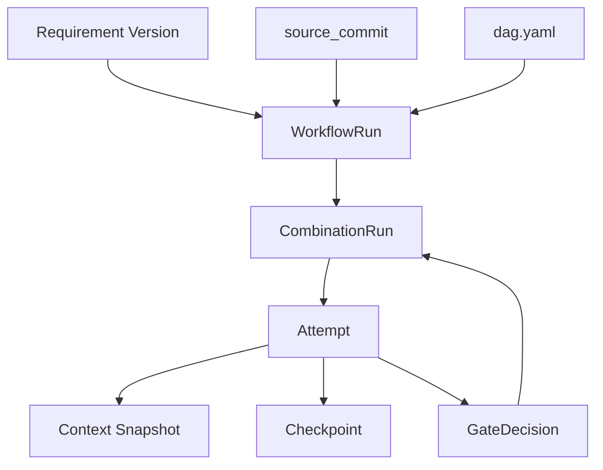
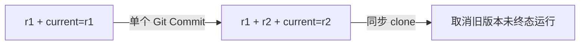
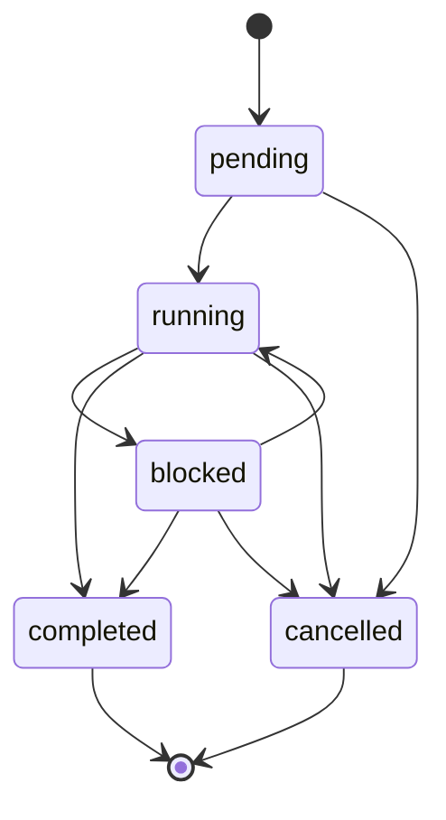
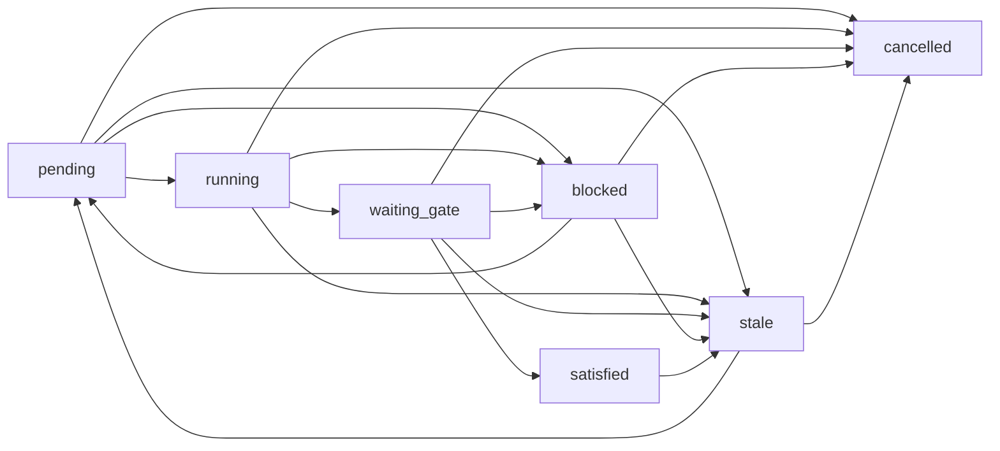
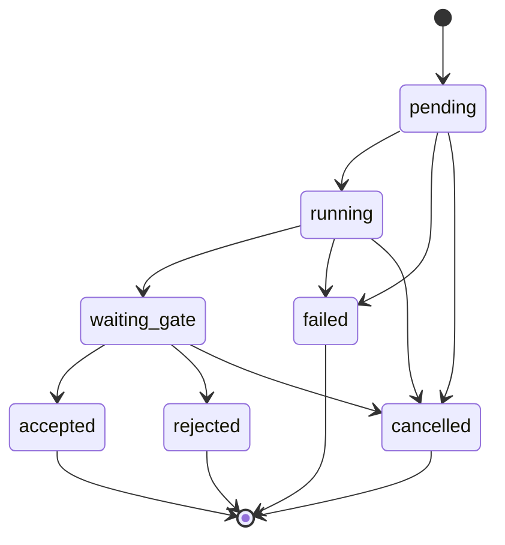

# Requirement

Requirement 是稳定的需求系列 ID；Requirement Version 是该系列一个完整、可独立理解的定义。`REQ-001/r1` 和 `REQ-001/r2` 内容及执行历史分开保存。新版本取代当前版本，不覆盖旧需求文件；运行档案在 Refinement 后可清理，历史由 Git 保留。

## 对象关系



一次 WorkflowRun 固定一个 Requirement Version、一个输入 Commit 和一份组合 DAG。每个业务 Combination 在该 Run 中最多有一条 CombinationRun；每次执行或重试都创建新的 Attempt。

## Requirement Version

版本文件按 `.facetloom/requirements/<requirement-id>/<version>.md` 保存并纳入 Git。Requirement ID 使用 `[A-Za-z0-9][A-Za-z0-9_-]*`；版本号使用 `r[1-9][0-9]*`。确认后的版本不可变；需求内容变化须创建新版本。每个新版本的 `supersedes` 必须指向当前版本，版本历史保持线性。文件使用 Markdown 和 YAML front matter 保存 Requirement ID、版本号、取代版本、标题、目标、验收条件、约束及资料引用。未提交的草稿不能启动 WorkflowRun。

```markdown
---
schema_version: 1
requirement_id: REQ-001
version: r1
supersedes: null
title: 登录失败限制
---

## Goal
登录连续失败五次后暂时限制登录，并显示剩余等待时间。

## Acceptance Criteria
- 连续失败五次后，后续登录请求在限制期内被拒绝。
- 界面显示剩余限制时间。

## Constraints
- 限制期由服务端配置。

## References
- docs/authentication.md
```

版本文件是完整定义，不隐式继承旧版本。目录和 front matter 中的 Requirement ID、版本号必须一致。Requirement Version ID 为 `<requirement_id>/<version>`，例如 `REQ-001/r1`。仓库内资料路径按 `source_commit` 中的仓库根目录解析；外部资料必须使用不可变 Git 引用或内容哈希。凭据不写入 Requirement 文件。

Front matter 中 `schema_version`、`requirement_id`、`version`、`supersedes` 和 `title` 必填；首版 `supersedes` 为 `null`，后续版本填写同一需求系列的前一版本号，例如 `r1`。正文必须提供非空 Goal 和至少一条 Acceptance Criteria；Constraints 与 References 可为空。

## `current.yaml`

项目受保护主分支（本文以 `main` 为例）上的 `.facetloom/requirements/<requirement-id>/current.yaml` 是该需求系列唯一的当前版本指针。隔离 Worktree 中的同名文件可能是旧快照，不用于判断当前版本：

```yaml
schema_version: 1
requirement_id: REQ-001
current_version: r1
```

`schema_version` 必须为 `1`；`requirement_id` 和 `current_version` 均必需。`current_version` 是版本文件名，不含扩展名；它必须指向同目录中 ID 匹配的已提交版本文件。该文件不保存版本历史、需求状态或运行状态。

创建首个版本时，同一 Git Commit 添加版本文件和指针。发布后续版本时，同一 Commit 添加新版本文件并更新指针；新版本的 `supersedes` 必须等于更新前的 `current_version`。指针只能前进到新发布且取代当前版本的定义，不能直接回退；恢复旧语义时发布一个取代当前版本的新版本。提交须基于远端主分支最新头；非快进更新被拒绝后，须重新检查当前指针，不能静默覆盖。



只有主分支 `current.yaml` 指向的版本可启动新 WorkflowRun 或发布、集成成果。WorkflowRun 启动时固定包含该版本的 `source_commit`。其他 clone 同步到新指针后，停止并取消旧版本的未终态运行；已接受成果保留为历史，不得进入新版本。发布或集成前刷新 main 并再次校验指针。仅运行档案变化不使成果失效；其余输入变化则需新 Run。不同运行的档案使用各自 run_id 目录。

## WorkflowRun

WorkflowRun 是一次完整 Combination DAG 的执行。`source_commit` 是唯一运行输入 Commit，固定 Requirement、当前指针、Workflow/Facet、引用资料和根代码基线；`.facetloom/runs/` 不参与执行输入。每个 clone 独立创建 UUIDv4 `run_id`，同时检查本地和 main 是否已使用该 ID；冲突时重新生成。

本地 `.facetloom/.runtime/runs/<run-id>/` 保存完整运行状态，main 的 `.facetloom/runs/<run-id>/` 保存关键节点的精简档案。同一 Run 由创建它的 Runtime 写入，首阶段不支持跨 clone 接管活动 Worker。

WorkflowRun 的必需字段如下：

| 字段 | 必填 | 定义 |
| --- | --- | --- |
| `schema_version` | 是 | WorkflowRun 记录格式版本，当前为 `1`。 |
| `run_id` | 是 | UUIDv4 运行 ID；创建后不变。 |
| `requirement_version_id` | 是 | 固定的 Requirement Version ID。 |
| `source_commit` | 是 | 同一仓库中定义与根代码基线的不可变 Git Commit。 |
| `requirement_path` | 是 | `source_commit` 中 Requirement Version 文件的仓库相对路径。 |
| `current_pointer_path` | 是 | `source_commit` 中 `current.yaml` 的仓库相对路径；启动时验证其指向 `requirement_version_id`。 |
| `workflow_id` | 是 | `source_commit` 中使用的 Workflow 稳定 ID。 |
| `workflow_path` | 是 | `source_commit` 中 Workflow 定义的仓库相对路径。 |
| `dag_snapshot_ref` | 是 | main 中 `.facetloom/runs/<run-id>/dag.yaml` 的固定路径。 |
| `dag_digest` | 是 | `dag_snapshot_ref` 文件字节的 SHA-256 摘要；不是 Git Commit。 |
| `owner_runtime_id` | 是 | 创建运行的 clone-local Runtime UUIDv4；标识本 Run 唯一调度和记录写入者。 |
| `status` | 是 | WorkflowRun 当前状态。 |
| `status_reason` | 条件 | `blocked` 或 `cancelled` 时的原因；结构见本节。 |
| `delivery_abandonment` | 否 | 人类放弃未交付成果时记录 confirmed_by、非空 reason 和 confirmed_at；存在时不可交付。 |
| `created_at`, `updated_at` | 是 | 创建及最近状态更新时间，使用 UTC ISO 8601。 |

启动流程：

1. 获取 main 最新头，固定完整 OID 为 `source_commit`。
2. 校验 current 指针、Requirement、Workflow、Facet 和引用资料；拒绝引用运行档案作为输入。
3. 生成并校验 DAG，将 run.yaml、dag.yaml 和初始状态原子持久化到本地，再发布初始精简档案到 main。
4. 再次同步检查 current 指针。需求已过期则取消；否则调度节点。仅运行档案的提交不影响固定输入。

输入和 `owner_runtime_id` 创建后不变；状态、原因与更新时间可推进。main 的记录提交不能修改 `source_commit`。交付基线规则见 [Execution](04-execution.md)。

| 状态 | 定义 |
| --- | --- |
| `pending` | 已创建，尚未开始调度。 |
| `running` | 正在调度或执行；Combination 可处于不同状态。 |
| `blocked` | 没有任何 Combination 可由 Runtime 或活动 Worker 继续推进，至少一项等待人工或外部条件；条件满足后可恢复。 |
| `completed` | 所有业务 CombinationRun 均为 `satisfied`；最终交付可以仍待处理。 |
| `cancelled` | 已停止调度；活动 Attempt 已取消或停止请求已持久化。 |

`completed` 和 `cancelled` 为终态；需要改变已完成运行的输入或成果时创建新 WorkflowRun。旧版本运行的取消规则见 `current.yaml`，状态转换如下。



本地记录保存实时状态，main 显示最近已发布状态。Worker 的开始与结束在本地持久化后再推进；等待 Gate、Gate 决策、失败、取消、运行完成与交付是档案发布节点。未发布操作重启后重放，不能因 Git 推送失败而丢失。Gate 批准须发布成功后才满足后继依赖。

## 运行档案

```text
.facetloom/runs/<run-id>/
├── run.yaml
├── summary.md                           # 结果、返工原因、未解决问题
├── dag.yaml
├── contexts/<sha256>.yaml
├── combinations/<sha256>.yaml
├── attempts/<attempt-id>.yaml
├── checkpoints/<checkpoint-id>.yaml
├── decisions/<decision-id>.yaml
├── reports/<report-id>.yaml
└── deliveries/<delivery-id>.yaml
```

对象文件只保存身份、输入引用、状态、简短结论和证据引用，不复制完整对话或原始日志。summary.md 是人类阅读的入口，列出目标、结果、关键决策、验证和未解决问题。

Context Snapshot 按文件字节 SHA-256 命名且不可原地修改。CombinationRun 文件名为 `combination_id` UTF-8 字节的 SHA-256 小写十六进制；Attempt、Checkpoint、Decision、Report 和 Delivery 使用各自 UUIDv4。读取时校验 ID、文件名、摘要和引用关系。

**Attempt 必须先在本地原子持久化，再启动 Worker。** 发布节点将关联状态与证据作为一个 main Commit 写入，Git 保留此前已发布状态；不要求每次内部状态变化都提交。其它 clone 同步后看到的是档案，不是活动 Worker 的恢复状态。

WorkflowRun completed 与交付分开；IntegrationReport 和 DeliveryRecord 见 Execution。待交付运行保留所需记录。人类可明确放弃 completed 且未交付运行，在 run.yaml 保存 delivery_abandonment，不改变 Run 终态；此后需新 Run 才能交付。已结束且不再服务恢复、审核或交付的记录可进入 Refinement；按项清理并保留未解决问题，不能删除有效引用的目标而不更新引用。

WorkflowRun 清单 `run.yaml` 示例：

```yaml
schema_version: 1
run_id: 5f6e9c6e-2ee9-4f17-9c75-87234be8e4ba
requirement_version_id: REQ-001/r1
source_commit: 8b8c0f1...
requirement_path: .facetloom/requirements/REQ-001/r1.md
current_pointer_path: .facetloom/requirements/REQ-001/current.yaml
workflow_id: development
workflow_path: .facetloom/workflows/development.yaml
dag_snapshot_ref: .facetloom/runs/5f6e9c6e-2ee9-4f17-9c75-87234be8e4ba/dag.yaml
dag_digest: sha256:7d9a...
owner_runtime_id: 7a93f6e2-5e63-4431-aec9-502b910cc114
status: pending
created_at: "2026-11-04T12:00:00Z"
updated_at: "2026-11-04T12:00:00Z"
```

## CombinationRun

CombinationRun 是一个业务 Combination 在某个 WorkflowRun 中的状态记录，唯一键为 `(run_id, combination_id)`。每个 DAG 业务节点至多一个 CombinationRun；`start` 和 `end` 控制节点没有运行记录。CombinationRun 可按需创建，尚未创建的节点等同 `pending`。只有所有业务直接前驱均为 `satisfied` 的节点可进入执行；控制节点 `start` 视为已满足。WorkflowRun 取消时，尚未满足的节点进入 `cancelled`；已经 `satisfied` 的记录保留为历史。



| 字段 | 必填 | 定义 |
| --- | --- | --- |
| `schema_version` | 是 | CombinationRun 记录格式版本，当前为 `1`。 |
| `run_id` | 是 | 所属 WorkflowRun。 |
| `combination_id` | 是 | DAG 中稳定的 Combination ID。 |
| `status` | 是 | 当前节点运行状态。 |
| `current_attempt_id` | 否 | 当前活动 Attempt，或最近一次用于决定当前状态的 Attempt；尚未执行时为空。 |
| `accepted_attempt_id` | 否 | 当前有效且已接受的 Attempt；仅 `satisfied` 时非空。 |
| `status_reason` | 条件 | `blocked`、`stale` 或 `cancelled` 时的原因。 |
| `updated_at` | 是 | 最近状态更新时间，使用 UTC ISO 8601。 |

CombinationRun 文件示例：

```yaml
schema_version: 1
run_id: 5f6e9c6e-2ee9-4f17-9c75-87234be8e4ba
combination_id: "development/feature:login/layer:domain"
status: pending
current_attempt_id: null
accepted_attempt_id: null
updated_at: "2026-11-04T12:00:00Z"
```

同一 CombinationRun 同时最多有一个活动 Attempt。重试或重新评估创建新 Attempt，并更新 `current_attempt_id`；历史 Attempt 不覆盖。

| 状态 | 定义 |
| --- | --- |
| `pending` | 等待前驱、调度资源或重试。 |
| `running` | 当前 Attempt 已创建，等待 Worker 启动或正在执行。 |
| `waiting_gate` | 当前 Attempt 的结果等待 Gate 决策。 |
| `satisfied` | 当前 Attempt 已按策略接受并登记结果，可满足后继依赖；成果由该 Attempt 的 `output_refs` 提供。 |
| `blocked` | 当前不能自动继续；条件补齐后可重试。 |
| `stale` | 评估上下文或已接受结果因输入、规则或上游变化失效；不可供后继使用，重新评估后回到 `pending`。尚未执行的后继也可能因依赖修复而进入此状态。 |
| `cancelled` | WorkflowRun 取消后不再调度该节点。 |

### 状态如何推进

| 事件 | Attempt | CombinationRun |
| --- | --- | --- |
| 开始执行 | 创建 `pending`，启动后为 `running` | `running` |
| 执行结束，材料完整 | `waiting_gate` | `waiting_gate` |
| Gate `Approved` | `accepted` | `satisfied`，设置 `accepted_attempt_id` |
| Gate `Rejected` | `rejected` | `blocked`；人类确认重试后回到 `pending` |
| Gate `Escalated` / `Blocked` | 保持 `waiting_gate` | 保持 `waiting_gate`，等待后续决策 |
| Worker 失败或丢失 | `failed` | `blocked`；人类确认重试后回到 `pending` |
| 输入失效 | 活动 Attempt 变为 `cancelled` | `stale`，清空 `accepted_attempt_id` |
| WorkflowRun 取消 | 活动 Attempt 变为 `cancelled` | 未满足节点为 `cancelled`，已满足节点保留历史 |

`satisfied` 是唯一满足后继依赖的状态。有效成果只从 `accepted_attempt_id` 指向的 Attempt 读取；`no_change` 和 `not_applicable` 是执行结论，仍须经过验证和 Gate。

### 重试与向上游修复

~~~text
Gate 拒绝并指定修复 domain
    ↓
domain 及全部可达后继 → stale；停止其活动 Attempt
    ↓
domain → pending → 新 Attempt
    ↓
后继在各自前驱重新 satisfied 后依次进入 pending
~~~

默认不自动重试；人类确认重试后创建新 Attempt。输入不变时可复用 Context Snapshot，失败或拒绝的代码仅作为证据参考，不自动成为新输入。

修复范围为目标节点加全部可达后继，未执行的后继也进入 `stale`；无依赖分支继续运行。目标必须是当前节点或其祖先。修复决定及原决策引用写入状态原因，并传入新 Context Snapshot。依赖再次满足后，Runtime 将已由人类确认的修复范围内的 `stale` 节点转回 `pending`。

### 状态原因

三类运行对象都使用相同的 `status_reason` 结构，但必填状态不同：WorkflowRun 在 `blocked`、`cancelled` 时填写；CombinationRun 在 `blocked`、`stale`、`cancelled` 时填写；Attempt 在 `failed`、`cancelled` 时填写。Attempt 的 `rejected` 原因保存在对应 GateDecision 的 `rationale` 中。状态恢复后可清空当前原因；已发布原因由 Git 历史保留，未发布变化由本地状态与操作记录恢复。

```yaml
status_reason:
  code: upstream_invalidated
  message: domain 需修复，重新评估依赖它的结果
  related_refs:
    - type: run_record
      run_id: <run-id>
      path: decisions/<decision-id>.yaml
      digest: sha256:<digest>
```

`code` 是机器可读字符串，`message` 是非空说明，`related_refs` 使用 [Execution](04-execution.md) 的引用格式。原因码包括 `worker_lost`、`execution_failed`、`gate_rejected`、`gate_pending`、`upstream_invalidated`、`requirement_superseded`、`permission_denied`、`user_cancelled` 和 `input_conflict`。

## Attempt

Attempt 是一个 Combination 的一次执行、重试或重新评估。每个 Attempt 隶属一个 CombinationRun；其 `attempt_id` 全局唯一，`attempt_number` 在该 CombinationRun 内从 1 递增。一次 Attempt 最多启动一个 Worker。



| 字段 | 必填 | 定义 |
| --- | --- | --- |
| `schema_version` | 是 | Attempt 记录格式版本，当前为 `1`。 |
| `attempt_id` | 是 | UUIDv4 Attempt ID；冲突时重新生成。 |
| `run_id`, `combination_id` | 是 | 所属 WorkflowRun 和 Combination。 |
| `attempt_number` | 是 | 该 CombinationRun 内从 1 递增的序号。 |
| `context_snapshot_ref` | 是 | 运行档案内 `contexts/<sha256>.yaml` 的不可变路径，固定 Requirement、Workflow、组合上下文、前驱成果和执行限制。 |
| `input_commit` | 是 | 必须等于 Context Snapshot 中的 `input_commit`；此 Attempt 的代码基线。 |
| `status` | 是 | 当前 Attempt 状态。 |
| `outcome` | 条件 | 进入 waiting_gate 时填写 changed、no_change 或 not_applicable；执行失败可为空。 |
| `summary` | 条件 | waiting_gate 或终态时的简短结果；not_applicable 必须说明理由。 |
| `output_refs` | 是 | 带类型的不可变输出引用，初始为空；等待 Gate 时恰有一个 `role: code` 的 Commit 引用。格式见 [Execution](04-execution.md)。 |
| `gate_decision_ref` | 否 | 指向运行档案内最近一次 `decisions/<decision-id>.yaml`；先前决策文件保留。 |
| `status_reason` | 条件 | `failed` 或 `cancelled` 时的原因。 |
| `created_at` | 是 | 创建时间，使用 UTC ISO 8601。 |
| `started_at`, `finished_at` | 否 | Worker 开始及 Attempt 进入终态的时间；尚未发生时为空。 |
| `updated_at` | 是 | 最近状态更新时间，使用 UTC ISO 8601。 |

Attempt 文件示例：

```yaml
schema_version: 1
attempt_id: 57b6629a-2f49-4dbd-8652-3668de77e4bb
run_id: 5f6e9c6e-2ee9-4f17-9c75-87234be8e4ba
combination_id: "development/feature:login/layer:domain"
attempt_number: 1
context_snapshot_ref: contexts/9a41....yaml
input_commit: 8b8c0f1...
status: pending
outcome: null
summary: null
output_refs: []
gate_decision_ref: null
created_at: "2026-11-04T12:00:00Z"
started_at: null
finished_at: null
updated_at: "2026-11-04T12:00:00Z"
```

Attempt 身份和输入字段在首次本地持久化后不可改；`outcome` 和代码输出在进入 `waiting_gate` 时固定。等待评估期间只可追加证据和 Gate 引用；代码或输入变化须创建新 Attempt。`worker_ref` 是本地进程或容器引用，不写入 Git。

| 状态 | 定义 |
| --- | --- |
| `pending` | Attempt 已固定输入，尚未启动 Worker。 |
| `running` | Worker 正在执行。 |
| `waiting_gate` | Worker 执行结束，等待 Gate 决策。 |
| `accepted` | Gate 策略通过，结果已登记为当前有效输出。 |
| `rejected` | Gate 拒绝；结果保留为证据，不可用作后继输入。 |
| `failed` | Worker 或执行基础设施失败。 |
| `cancelled` | Attempt 被停止、取消或其运行已被废弃。 |

`accepted`、`rejected`、`failed` 和 `cancelled` 为终态。失效只撤销 CombinationRun 对成果的引用，不修改已结束 Attempt 的历史状态。

## 持久化与恢复

| 情况 | 恢复方式 |
| --- | --- |
| 同一 clone 的 Runtime 重启 | 从本地状态、活动 Worktree 与容器标记对账；已发布决策从 main 确认 |
| Worker 无法对账 | Attempt failed，CombinationRun blocked；人类确认后新建 Attempt |
| main 推送失败 | 保留待发布操作；同步后校验并重试，不能重复接受或交付 |
| 本地运行状态丢失 | main 可恢复已发布证据，不保证恢复未发布状态或活动 Worker；通常新建 Run |
| 另一 clone 查看运行 | 读取 main 档案；代码复核从持久 bundle 恢复，不接管活动 Worker |

Runtime 状态采用本地文件持久化，SQLite 可作缓存与索引；不是必需依赖，也不是共享事实来源。Git 只保证已发布档案可追溯。Refinement 清理后按历史 Commit 读取原证据，详见 [Governance](03-governance.md)。
