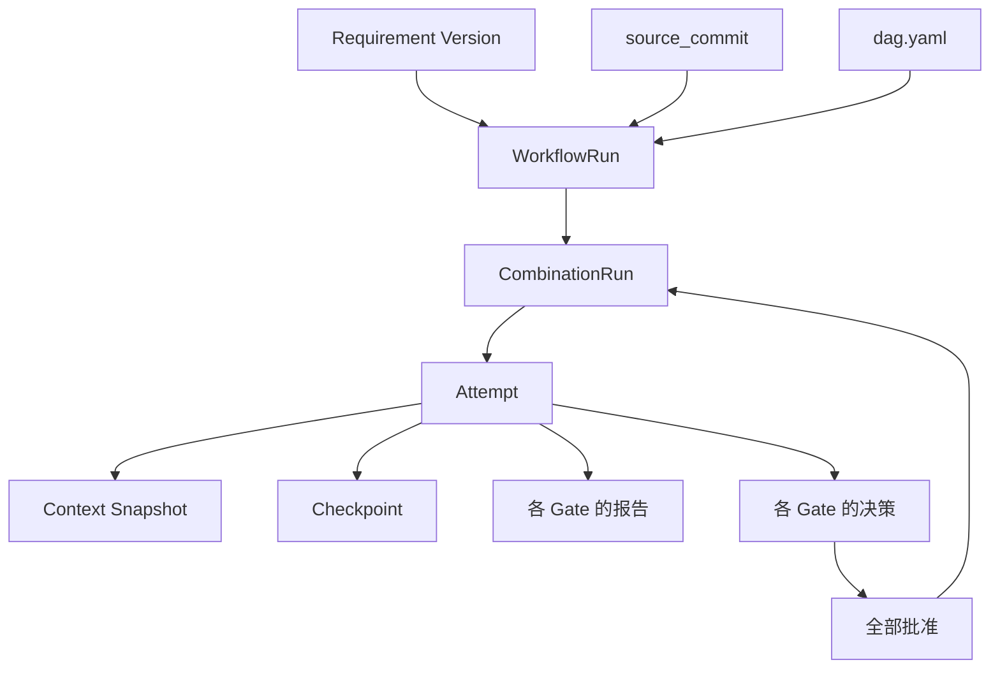
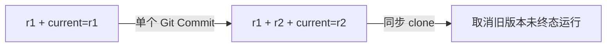
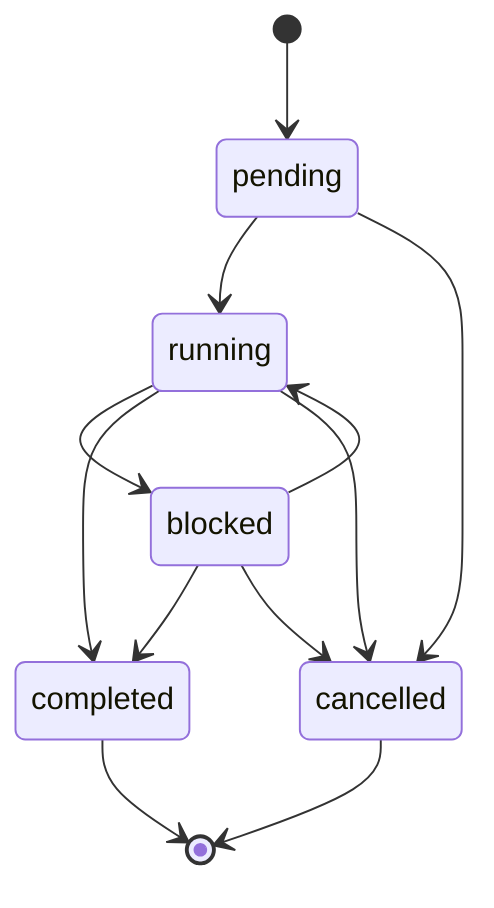
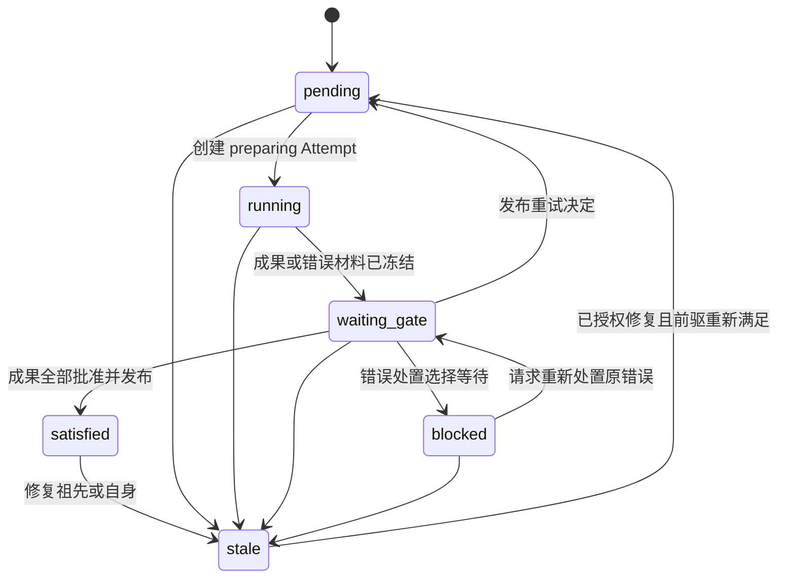
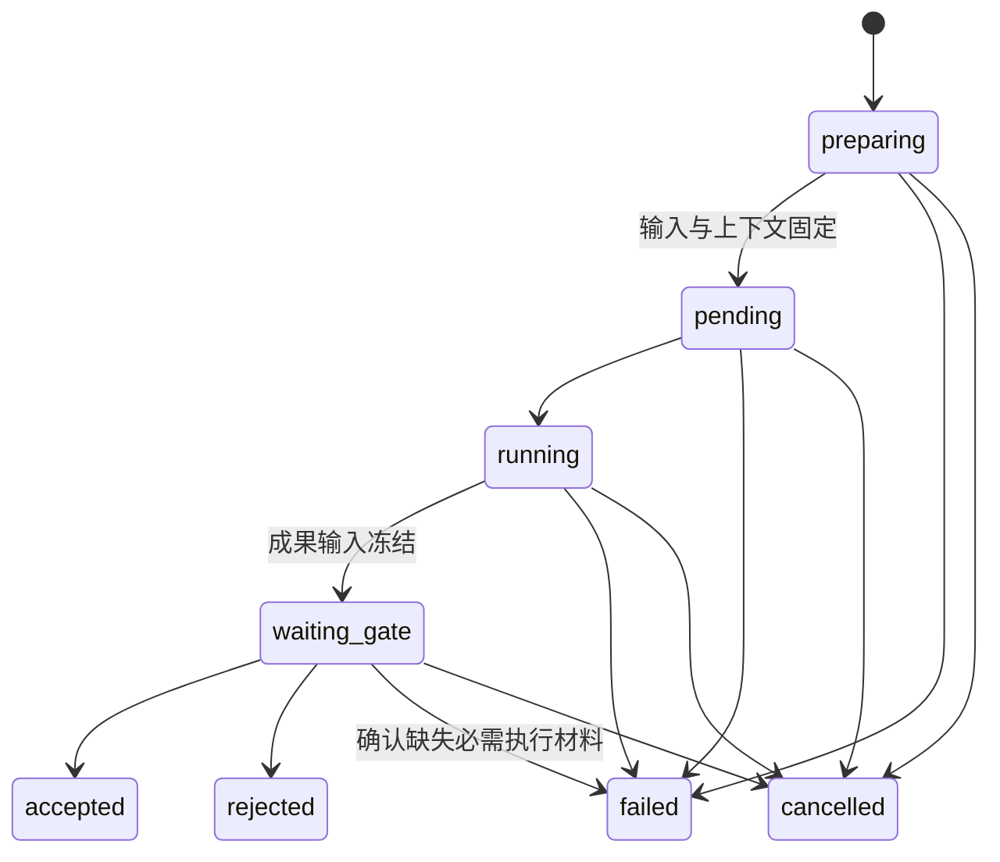

# Requirement

Requirement 是稳定的需求系列 ID；Requirement Version 是该系列一个完整、可独立理解的定义。`REQ-001/r1` 和 `REQ-001/r2` 内容及执行历史分开保存。新版本取代当前版本，不覆盖旧需求文件；运行档案在 Refinement 后可清理，历史由 Git 保留。

## 对象关系



一次 WorkflowRun 固定一个 Requirement Version、一个输入 Commit 和一份组合 DAG。每个业务 Combination 在该 Run 中最多有一条 CombinationRun；每次节点级重试都创建新的 Attempt；同一 Worker 内的代码修复与检查重跑不新建 Attempt。

## Requirement Version

版本文件按 `.facetloom/requirements/<requirement-id>/<version>.md` 保存并纳入 Git。Requirement ID 使用 `[A-Za-z0-9][A-Za-z0-9_-]*`；版本号使用 `r[1-9][0-9]*`。确认后的版本不可变；需求内容变化须创建新版本。每个新版本的 `supersedes` 必须指向当前版本，版本历史保持线性。文件使用 Markdown 和 YAML front matter 保存 Requirement ID、版本号、取代版本、标题、目标、验收条件、约束及资料引用。未提交的草稿不能启动 WorkflowRun。

```markdown
---
schema_version: 1
requirement_id: REQ-001
version: r1
supersedes: null
title: 登录失败限制
---

## Goal
登录连续失败五次后暂时限制登录，并显示剩余等待时间。

## Acceptance Criteria
- 连续失败五次后，后续登录请求在限制期内被拒绝。
- 界面显示剩余限制时间。

## Constraints
- 限制期由服务端配置。

## References
- docs/authentication.md
```

版本文件是完整定义，不隐式继承旧版本。目录和 front matter 中的 Requirement ID、版本号必须一致。Requirement Version ID 为 `<requirement_id>/<version>`，例如 `REQ-001/r1`。仓库内资料路径按 `source_commit` 中的仓库根目录解析；外部资料必须使用不可变 Git 引用或内容哈希。凭据不写入 Requirement 文件。

Front matter 中 `schema_version`、`requirement_id`、`version`、`supersedes` 和 `title` 必填；首版 `supersedes` 为 `null`，后续版本填写同一需求系列的前一版本号，例如 `r1`。正文必须提供非空 Goal 和至少一条 Acceptance Criteria；Constraints 与 References 可为空。

## `current.yaml`

项目受保护主分支（本文以 `main` 为例）上的 `.facetloom/requirements/<requirement-id>/current.yaml` 是该需求系列唯一的当前版本指针。隔离 Worktree 中的同名文件可能是旧快照，不用于判断当前版本：

```yaml
schema_version: 1
requirement_id: REQ-001
current_version: r1
```

`schema_version` 必须为 `1`；`requirement_id` 和 `current_version` 均必需。`current_version` 是版本文件名，不含扩展名；它必须指向同目录中 ID 匹配的已提交版本文件。该文件不保存版本历史、需求状态或运行状态。

创建首个版本时，同一 Git Commit 添加版本文件和指针。发布后续版本时，同一 Commit 添加新版本文件并更新指针；新版本的 `supersedes` 必须等于更新前的 `current_version`。指针只能前进到新发布且取代当前版本的定义，不能直接回退；恢复旧语义时发布一个取代当前版本的新版本。提交须基于远端主分支最新头；非快进更新被拒绝后，须重新检查当前指针，不能静默覆盖。



只有主分支 `current.yaml` 指向的版本可启动新 WorkflowRun、推进有效成果或集成交付。旧版本仍可发布取消、失败及历史证据档案，不能借归档恢复执行或接受新成果。WorkflowRun 启动时固定包含该版本的 `source_commit`。其他 clone 同步到新指针后，停止并取消旧版本的未终态运行；已接受成果保留为历史，不得进入新版本。生效发布或集成前刷新 main 并再次校验指针；取消与历史归档按 Services 的发布分类处理。仅运行档案变化不使成果失效；其余输入变化则需新 Run。不同运行的档案使用各自 run_id 目录。

## WorkflowRun

WorkflowRun 是一次完整 Combination DAG 的执行。`source_commit` 是唯一运行输入 Commit，固定 Requirement、当前指针、Workflow/Facet、引用资料和根代码基线；`.facetloom/runs/` 不参与执行输入。每个 clone 独立创建 UUIDv4 `run_id`，同时检查本地和 main 是否已使用该 ID；冲突时重新生成。

本地 `.facetloom/.runtime/runs/<run-id>/` 保存完整运行状态，main 的 `.facetloom/runs/<run-id>/` 保存关键节点的精简档案。同一 Run 由创建它的 Runtime 写入，首阶段不支持跨 clone 接管活动 Worker。

WorkflowRun 的必需字段如下：

| 字段 | 必填 | 定义 |
| --- | --- | --- |
| `schema_version` | 是 | WorkflowRun 记录格式版本，当前为 `1`。 |
| `run_id` | 是 | UUIDv4 运行 ID；创建后不变。 |
| `requirement_version_id` | 是 | 固定的 Requirement Version ID。 |
| `source_commit` | 是 | 同一仓库中定义与根代码基线的不可变 Git Commit。 |
| `requirement_path` | 是 | `source_commit` 中 Requirement Version 文件的仓库相对路径。 |
| `current_pointer_path` | 是 | `source_commit` 中 `current.yaml` 的仓库相对路径；启动时验证其指向 `requirement_version_id`。 |
| `workflow_id` | 是 | `source_commit` 中使用的 Workflow 稳定 ID。 |
| `workflow_path` | 是 | `source_commit` 中 Workflow 定义的仓库相对路径。 |
| `dag_snapshot_ref` | 是 | main 中 `.facetloom/runs/<run-id>/dag.yaml` 的固定路径。 |
| `dag_digest` | 是 | `dag_snapshot_ref` 文件字节的 SHA-256 摘要；不是 Git Commit。 |
| `owner_runtime_id` | 是 | 创建运行的 clone-local Runtime UUIDv4；标识本 Run 唯一调度和记录写入者。 |
| `status` | 是 | WorkflowRun 当前状态。 |
| `error_gate` | 是 | 完整有效错误策略及 `policy_digest`，含模式、完整 evaluator、审核上下文、来源路径和自动恢复上限；启动时固定。 |
| `runners` | 是 | runner_id → `{profile, source_refs, profile_digest}` 的不可变映射，覆盖执行及 AI 评估所需调用配置。 |
| `merge_engine` | 是 | Runtime 在创建 Run 时固定的 Git 版本、不可变环境引用及有效合并参数；结构见 Execution，Run 内不可切换。 |
| `auto_recoveries_used` | 是 | 已安排的自动恢复动作次数，初始 0；与动作意图在同一事务递增，重启不重置。 |
| `status_reason` | 条件 | `blocked` 或 `cancelled` 时的原因；结构见本节。 |
| `delivery_abandonment` | 否 | 人类放弃未交付成果时记录 confirmed_by、非空 reason 和 confirmed_at；存在时不可交付。 |
| `created_at`, `updated_at` | 是 | 创建及最近状态更新时间，使用 UTC ISO 8601。 |

启动流程：

1. 获取 main 最新头，固定完整 OID 为 `source_commit`。
2. 校验 current 指针、Requirement、Workflow、Facet、必要检查、执行与评估的 runner、成果及错误 Gate 策略、评估器配置和引用资料；拒绝引用运行档案作为定义或资料输入。
3. 生成并校验 DAG，将 run.yaml、dag.yaml 和初始状态原子持久化到本地，再发布初始精简档案到 main。
4. 再次同步检查 current 指针。需求已过期则取消；否则调度节点。仅运行档案的提交不影响固定输入。

输入、`runners`、`error_gate`、`merge_engine` 和 `owner_runtime_id` 创建后不变；状态、原因与更新时间可推进。main 的记录提交不能修改 `source_commit`。交付基线规则见 [Execution](04-execution.md)。

| 状态 | 定义 |
| --- | --- |
| `pending` | 已创建，尚未开始调度。 |
| `running` | 正在调度或执行；Combination 可处于不同状态。 |
| `blocked` | 没有任何 Combination 可由 Runtime 或活动 Worker 继续推进，至少一项等待人工或外部条件；条件满足后可恢复。 |
| `completed` | 所有业务 CombinationRun 均为 `satisfied`；最终交付可以仍待处理。 |
| `cancelled` | 已停止调度；活动 Attempt 已取消或停止请求已持久化。 |

cancelled 表示停止调度；Worker 是否实际退出单独展示，在途发布按 [Services](05-services.md) 对账后确定 Attempt 历史终态。

`completed` 和 `cancelled` 为终态；需要改变已完成运行的输入或成果时创建新 WorkflowRun。旧版本运行的取消规则见 `current.yaml`，状态转换如下。



本地记录保存实时状态，main 显示最近已发布状态。待发布决定不算已生效；Run / 节点状态的生效视图与本地 outbox 分开保存，防止未推送的批准解锁后继。Worker 的开始与结束在本地持久化后再推进；等待 Gate、Gate 决策、失败、取消、运行完成与交付是档案发布节点。未发布操作重启后重放，不能因 Git 推送失败而丢失。全部 Gate 批准须发布成功后才满足后继依赖。

## 运行档案

```text
.facetloom/runs/<run-id>/
├── run.yaml
├── summary.md                           # 结果、返工原因、未解决问题
├── dag.yaml
├── contexts/<sha256>.yaml
├── combinations/<sha256>.yaml
├── attempts/<attempt-id>.yaml
├── errors/<error-id>.yaml
├── checkpoints/<checkpoint-id>.yaml
├── decisions/<decision-id>.yaml
├── reports/<report-id>.yaml              # CheckReport / GateReport / IntegrationReport
└── deliveries/<delivery-id>.yaml
```

对象文件只保存身份、输入引用、状态、简短结论和证据引用，不复制完整对话或原始日志。summary.md 是人类阅读的入口，列出目标、结果、关键决策、验证和未解决问题。

Context Snapshot 按文件字节 SHA-256 命名且不可原地修改。CombinationRun 文件名为 `combination_id` UTF-8 字节的 SHA-256 小写十六进制；Attempt、ErrorRecord、Checkpoint、Decision、Report 和 Delivery 使用各自 UUIDv4。读取时校验 ID、文件名、摘要和引用关系。

**Attempt 必须先在本地原子持久化，再启动 Worker。** 发布节点将关联状态与证据作为一个 main Commit 写入，Git 保留此前已发布状态；不要求每次内部状态变化都提交。其它 clone 同步后看到的是档案，不是活动 Worker 的恢复状态。

WorkflowRun completed 与交付分开；一个 Run 最多一次成功交付，重复请求返回已交付结果。CheckReport、IntegrationReport、交付意图及 DeliveryRecord 见 Execution。待交付运行保留所需记录。人类可明确放弃 completed 且未交付运行；publishing 结果未知时先对账，不能先放弃或清理。在 run.yaml 保存 delivery_abandonment，不改变 Run 终态；此后需新 Run 才能交付。已结束且不再服务恢复、审核或交付的记录可进入 Refinement；按项清理并保留未解决问题，不能删除有效引用的目标而不更新引用。

WorkflowRun 清单 `run.yaml` 示例：

```yaml
schema_version: 1
run_id: 5f6e9c6e-2ee9-4f17-9c75-87234be8e4ba
requirement_version_id: REQ-001/r1
source_commit: 8b8c0f1...
requirement_path: .facetloom/requirements/REQ-001/r1.md
current_pointer_path: .facetloom/requirements/REQ-001/current.yaml
workflow_id: development
workflow_path: .facetloom/workflows/development.yaml
dag_snapshot_ref: .facetloom/runs/5f6e9c6e-2ee9-4f17-9c75-87234be8e4ba/dag.yaml
dag_digest: sha256:7d9a...
owner_runtime_id: 7a93f6e2-5e63-4431-aec9-502b910cc114
status: pending
error_gate:
  policy:
    mode: human
    evaluator: null
    context: {objectives: [], constraints: [], reference_paths: []}
    source_paths: [.facetloom/workflows/development.yaml]
    max_auto_recoveries: 3
  policy_digest: sha256:<policy-digest>
merge_engine:
  git_version: "2.43.0"
  environment_ref: <immutable-environment-ref>
  environment_digest: sha256:<digest>
  strategy: ort
  options: {conflict_style: merge, renames: true, rename_threshold: 50, rename_limit: 0, diff_algorithm: histogram}
runners:
  developer:
    profile:
      schema_version: 1
      id: developer
      adapter: claude_code
      image_ref: registry.example.com/project-agent@sha256:<image-digest>
      args: ["<native-non-interactive-arg>", "<native-bypass-approvals-arg>"]
      config_refs: []
      timeout_seconds: 1800
      network: outbound
    source_refs:
      - type: git_file
        commit: <source-commit-oid>
        path: .facetloom/runners/developer.yaml
        blob_oid: <blob-oid>
        digest: sha256:<file-digest>
    profile_digest: sha256:<runner-profile-digest>
auto_recoveries_used: 0
created_at: "2026-11-04T12:00:00Z"
updated_at: "2026-11-04T12:00:00Z"
```

## CombinationRun

CombinationRun 是一个业务 Combination 在某个 WorkflowRun 中的状态记录，唯一键为 `(run_id, combination_id)`。每个业务节点至多一条，控制节点不创建记录；尚未创建等同 pending。只有全部业务直接前驱 satisfied 时可准备执行；start 视为已满足。



Run 取消时停止活动任务，未满足节点转 cancelled；已经 satisfied 的记录保留历史。任何非 cancelled 状态都可能因 Run 取消而停止推进。

| 字段 | 必填 | 定义 |
| --- | --- | --- |
| schema_version | 是 | 记录格式，当前为 1 |
| run_id、combination_id | 是 | 所属 Run 与 DAG 节点 |
| status | 是 | 当前节点状态 |
| current_attempt_id | 否 | 当前活动或最近决定节点状态的 Attempt |
| accepted_attempt_id | 否 | 当前有效成果，仅 satisfied 时非空 |
| active_error_ref | 否 | 当前待处置或等待条件的 ErrorRecord 类型化引用 |
| error_report_ref、error_decision_ref | 否 | active_error_ref 对应的最新错误报告及决定；错误处理结束或输入失效时一并清空，历史对象保留 |
| status_reason | 条件 | blocked、stale、cancelled 时必填 |
| updated_at | 是 | UTC ISO 8601 |

```yaml
schema_version: 1
run_id: <run-id>
combination_id: development/feature:login/layer:domain
status: pending
current_attempt_id: null
accepted_attempt_id: null
active_error_ref: null
error_report_ref: null
error_decision_ref: null
updated_at: "2026-11-09T12:00:00Z"
```

| 状态 | 含义 |
| --- | --- |
| pending | 等待前驱、调度资源或已批准的新尝试 |
| running | 当前 Attempt 正在准备输入、等待 Worker 或执行 |
| waiting_gate | 等待成果审核，或 active_error_ref 对应的错误处置 |
| satisfied | accepted_attempt_id 的成果有效，可以满足后继 |
| blocked | 错误 Gate 选择 wait，或等待人工接管及外部条件 |
| stale | 因自身或祖先修复失效，不可作为后继输入 |
| cancelled | Run 已取消，不再调度 |

同一 CombinationRun 最多一个活动 Attempt；错误处置期间旧 Attempt 可以已经终态。新 Attempt 不能继承旧批准。no_change 和 not_applicable 必须复用 input_commit，且无未解决冲突；三种 outcome 的代码条件见 Execution，均须完成必要检查与全部成果 Gate。

### 状态如何推进

| 事件 | Attempt | CombinationRun / 后继 |
| --- | --- | --- |
| 前驱满足且获得调度资格 | 创建 preparing | running |
| 输入与上下文准备完成 | pending；Worker 启动后 running | running |
| 准备或执行失败 | failed，冻结 ErrorRecord | waiting_gate，设置 active_error_ref；后继不解锁 |
| 成果、检查和证据完整 | waiting_gate，冻结成果输入 | waiting_gate；active_error_ref 为空 |
| 成果 Gate 部分批准 | 保持 waiting_gate | 等待其他项 |
| 成果 Gate 全部批准且发布成功 | accepted | satisfied，设置 accepted_attempt_id |
| 任一成果 Gate Rejected | rejected，取消其余评估，创建 ErrorRecord | waiting_gate，转错误处置 |
| 发现必需执行材料缺失，决定补测 | failed，保留已有审核记录，创建 ErrorRecord | waiting_gate，转错误处置；不修改冻结成果 |
| 成果评估器故障或无法判断 | 保持 waiting_gate | 原项人工接管或重评，其他项可继续 |
| 错误 Gate 选择 retry_current 并发布 | 旧终态不变，之后创建新 Attempt | pending，清空当前错误引用；后继仍等待 |
| 错误 Gate 选择 repair_upstream 并发布 | 停止失效范围内活动 Attempt | 目标与全部后继 stale，按依赖重新执行 |
| 错误 Gate 选择 wait / 自身故障或额度耗尽 | 旧终态不变 | blocked，保留错误引用与原因 |
| 输入失效 | 活动 Attempt cancelled；终态保持 | stale，清空 accepted_attempt_id |
| Run 取消 | 活动 Attempt cancelled；在途终态发布先对账，既有终态保持 | 未满足节点 cancelled；撤销活动评估 |

只有 satisfied 满足后继依赖。恢复决定获准不等于接受成果；发布成功之前不能执行恢复动作。Run 还有可执行分支、活动 Worker 或自动错误处置时保持 running；没有可继续推进的工作且存在人工或外部等待时为 blocked。

### 重试与向上游修复

```text
准备/执行失败 或 成果拒绝
    ↓
不可变 ErrorRecord → Workflow 错误 Gate
    ├── retry_current → 新 Attempt
    ├── repair_upstream → 祖先及全部后继 stale → 按依赖新建 Attempt
    ├── wait → blocked → 条件补齐后重新处置原错误
    └── stop_run → 取消未结束运行
```

恢复动作必须引用错误决定。自动恢复预算按整个 Run 共享，默认 3 次；一次 retry_current 或 repair_upstream 各计一次，后者触发的后继重执行不另计。AI/脚本决定安排恢复时，Runtime 在同一事务中记录动作 ID、消耗额度和失效范围；重复重放不再扣减。额度耗尽只允许 wait 或 stop_run，继续恢复须人类决策。人工及 ai_assisted 人类确认的恢复不消耗自动额度，也不重置已有计数。

修复目标只能是当前节点的祖先；当前节点重试使用 retry_current。Runtime 原子清除修复目标和全部可达后继的有效成果引用，持久化停止意图，拒收迟到任务结果；无依赖分支继续。目标在其前驱满足后 pending，后继依次等待新成果。历史 accepted、rejected 和 failed Attempt 不改写。

每个新 Attempt 仍按根基线或当前有效前驱构造输入；失败或拒绝的代码仅作显式证据，不自动成为输入。新 Snapshot 包含处置决定、修复要求与原错误引用。输入确实相同时可复用 Snapshot，但全部成果 Gate 重新审核。

错误 Gate 不能修改 Requirement、Scope、执行定义或审核策略；此类变化发布后新建 Run。completed / cancelled Run 不重新打开；最终汇聚或交付失败保留 IntegrationReport，修改成果须新 Run。

### 状态原因

WorkflowRun 在 blocked / cancelled、CombinationRun 在 blocked / stale / cancelled、Attempt 在 failed / cancelled 时填写 status_reason。rejected 的原因见成果 GateDecision。状态恢复后可清空当前原因，已发布历史由 Git 保留。

```yaml
status_reason:
  code: upstream_invalidated
  message: domain 需修复，重新评估其后继
  related_refs:
    - type: run_record
      run_id: <run-id>
      path: decisions/<decision-id>.yaml
      digest: sha256:<digest>
```

code 为机器可读字符串，message 非空，related_refs 使用 Execution 的类型化引用。常用码包括 preparation_failed、worker_lost、execution_failed、gate_rejected、gate_pending、upstream_invalidated、upstream_misaligned、requirement_superseded、permission_denied、input_conflict、recovery_budget_exhausted、error_gate_failed、user_cancelled。

## Attempt

Attempt 是一个 Combination 的一次尝试，涵盖准备、执行与成果审核。attempt_id 为全局唯一 UUIDv4，attempt_number 在 CombinationRun 内从 1 递增；最多创建一个 Worker。Worker 是 Runtime 管理的容器、Worktree 和调用记录，可在检查预算内通过 Adapter 续接外部 Agent 多次修复，不另建 Attempt；一次 Worker 不等于一次进程调用。



accepted、rejected、failed、cancelled 为终态，不因错误处置重新打开。错误报告与决定属于 CombinationRun 的当前错误，不附加到旧 Attempt 的成果审核映射。

| 字段 | 必填 | 定义 |
| --- | --- | --- |
| schema_version、attempt_id | 是 | 格式为 1，ID 为 UUIDv4 |
| run_id、combination_id、attempt_number | 是 | 所属节点与本节点递增序号 |
| context_snapshot_ref | 条件 | preparing 时可空；准备成功时固定为 contexts/<sha256>.yaml，按字节摘要校验 |
| input_commit | 条件 | 与 context_snapshot_ref 一起设置一次，必须等于 Snapshot.input_commit，随后不可变 |
| agent_input_ref | 条件 | 初始请求形成后设置一次，发送前固定；未形成请求可空 |
| pre_assess_ref | 条件 | Worker 启动后引用不可变 PreAssessReport 的运行目录相对路径；未形成报告时为空 |
| status | 是 | 当前 Attempt 状态 |
| outcome | 条件 | Runtime 按 PreAssessReport 与 Git Tree 判定 changed / no_change / not_applicable；执行失败可空 |
| summary | 条件 | waiting_gate 或终态必填；not_applicable 说明理由 |
| execution_result_ref | 条件 | 外部 Agent 最终有效 ExecutionResult 的 Artifact；not_applicable 或执行未启动时为空 |
| output_refs | 是 | 初始为空；成果 waiting_gate 时恰有一个 role: code 引用，并引用 PreAssessReport、最终 CheckReport、Post-AssessReport，以及存在时的 ExecutionResult 和其他必要证据 |
| review_input_digest | 条件 | 成果 waiting_gate 前固定，算法见 Execution；准备失败可空 |
| gate_report_refs、gate_decision_refs | 是 | 成果 gate_id 到最新报告 / 决定引用的映射，初始空 |
| status_reason | 条件 | failed / cancelled 必填 |
| created_at、updated_at | 是 | UTC ISO 8601 |
| started_at、finished_at | 否 | Worker 开始及 Attempt 进入终态的时间 |

```yaml
schema_version: 1
attempt_id: <uuid>
run_id: <run-id>
combination_id: development/feature:login/layer:domain
attempt_number: 1
status: preparing
context_snapshot_ref: null
input_commit: null
agent_input_ref: null
pre_assess_ref: null
outcome: null
execution_result_ref: null
summary: null
output_refs: []
review_input_digest: null
gate_report_refs: {}
gate_decision_refs: {}
created_at: "2026-11-09T12:00:00Z"
updated_at: "2026-11-09T12:00:00Z"
```

| 状态 | 定义 |
| --- | --- |
| preparing | 已记录尝试身份，正在构造输入与上下文 |
| pending | 输入固定，尚未启动 Worker |
| running | Worker 执行及预算内修复重检 |
| waiting_gate | 成果材料冻结，等待各 Node 审核 |
| accepted | 全部成果 Gate 批准并发布，输出可登记为有效成果 |
| rejected | 成果 Gate 拒绝，旧成果仅作证据 |
| failed | 准备或执行失败，或确认必需执行材料缺失 |
| cancelled | 尝试已停止或失效 |

身份创建后不变。preparing 中已形成的部分清单、输入构造结果及错误证据由本地操作记录和 ErrorRecord 引用；不分次改写半成品 Snapshot。准备失败不伪造 input_commit、Snapshot 或输出 Tree。

进入成果 waiting_gate 时 pre_assess_ref、execution_result_ref、outcome、summary、output_refs、review_input_digest 一并冻结；pre_assess_ref 指向的报告须与 output_refs 的 run_record 路径、摘要一致，非空 execution_result_ref 须等于 output_refs 中相应 Artifact 引用。其引用内容不得追加或替换。审核映射键必须来自 Snapshot 的成果 Gate 列表，目标须匹配同一 Attempt、策略、摘要与输出 Tree。审核期间仅推进状态、时间、状态原因与成果报告/决定引用。

worker_ref 属于本地状态，不写入 Git。新 Attempt 最多创建一个 Worker，无法对账的旧 Worker 先确认停止或隔离，再按错误决定恢复；停止意图、原生会话与进程对账见 Services。

## 持久化与恢复

| 情况 | 恢复方式 |
| --- | --- |
| Runtime 重启 | 先恢复已提交文件事务，再对账 Worker、评估任务和待发布操作，最后恢复调度 |
| Worker 无法对账 | Attempt failed，创建 ErrorRecord，按错误 Gate 决定恢复 |
| main 推送失败 | 本地保留待发布操作；对账后重试，不提前解锁或重复恢复 |
| 本地状态丢失 | 从 main 恢复已发布证据；不保证恢复未发布操作或活动 Worker，通常新建 Run |
| 另一 clone 查看 | 读取 main 档案，从 bundle 恢复代码，不接管活动 Worker |

本地文件是恢复依据，SQLite 仅为可选索引和缓存。多对象事务、外部动作对账与崩溃恢复顺序见 [Services](05-services.md)；档案清理见 [Governance](03-governance.md)。
