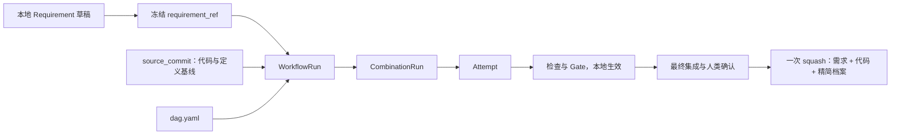
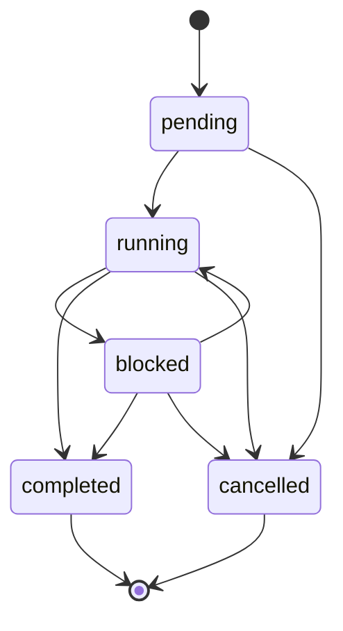
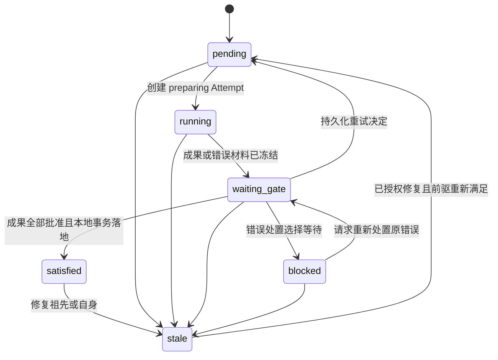
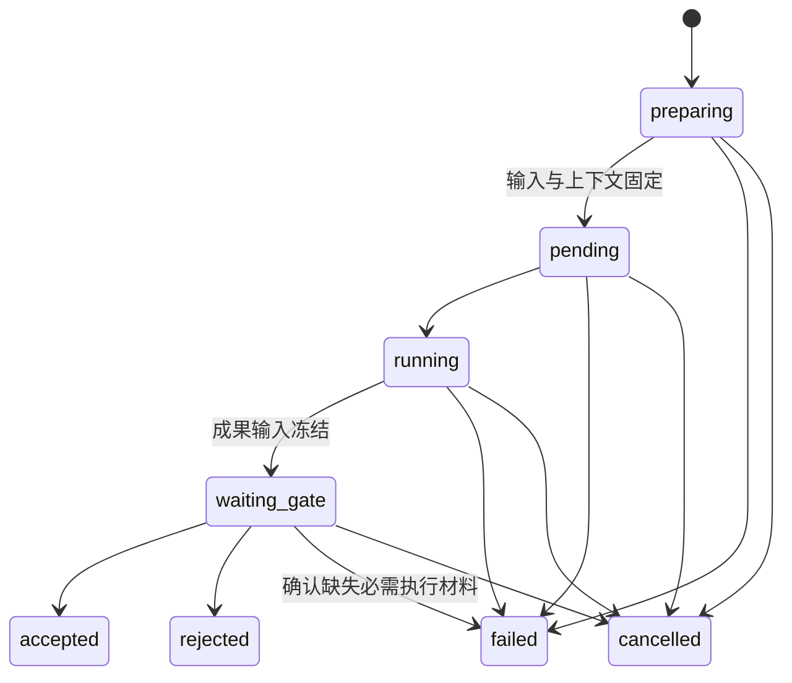

# Requirement

Requirement 是一次独立的需求，以 UUIDv4 标识。**一个需求最多对应 main 上一次 squash 采纳提交**，同时保存需求、代码和精简运行档案。执行失败、取消或放弃均不自动提交 main。

## 对象关系



| 对象 | 身份与边界 |
| --- | --- |
| Requirement | 一个明确目标及验收条件；冻结后内容不可变 |
| WorkflowRun | 固定需求、代码与定义基线、组合 DAG 的一次运行；同一需求可有多次运行 |
| CombinationRun | Run 中一个业务节点的状态；同一节点最多一条 |
| Attempt | 节点的一次准备、执行与审核；重试创建新 Attempt |
| DeliveryRecord | 一次成功采纳的不可变回执；与成果同 Commit 保存 |

## Requirement 文件与生命周期

```text
.facetloom/.runtime/requirements/<requirement-id>/requirement.md  # 本地草稿
    ↓ 人类确认，首次启动前冻结完整原始字节
artifacts://sha256/<digest>                                    # requirement_ref
    ↓ 多次 Run、最终检查、人类确认采纳
.facetloom/requirements/<requirement-id>.md                     # 一次提交 main
```

```markdown
---
schema_version: 1
requirement_id: 9e2c1f78-6a54-4d92-8e31-05b7a19c2f60
title: 登录失败限制
---

## Goal
登录连续失败五次后暂时限制登录，并显示剩余等待时间。

## Acceptance Criteria
- 连续失败五次后，后续登录请求在限制期内被拒绝。
- 界面显示剩余限制时间。

## Constraints
- 限制期由服务端配置。

## References
- docs/authentication.md
```

首次冻结在 Requirement 锁下保存 `.runtime/requirements/<requirement-id>/frozen.yaml`，内容为 `{schema_version: 1, requirement_id, requirement_ref}`；Artifact 先持久化，绑定通过本地文件事务写入且不再修改。后续启动只使用该绑定，校验工作副本与冻结字节一致；它与各 Run 共同参与本地引用保护。此锁不与 Run 锁同时持有。

Front matter 必填 `schema_version: 1`、`requirement_id` 和非空 `title`，ID 与文件路径一致；正文必有非空 Goal 和至少一条 Acceptance Criteria。Constraints 和 References 可为空。仓库资料按所属 Run 的 source_commit 解析；外部引用须固定 Commit 或内容哈希，不写入凭据。

| 阶段 | 规则 |
| --- | --- |
| 草稿 | 仅在本地编辑，尚未启动 Run |
| 冻结 | 首次启动前保存原始 Markdown 字节为 Artifact，生成 requirement_ref；以后各 Run 必须使用相同 ID 和字节摘要 |
| 执行 | Run 与 Gate 通过本地文件事务生效，main 不增加中间记录 |
| 采纳 | 将冻结字节原样写到正式路径，与代码、精简档案和回执一起 squash 到 main |
| 失败、取消或放弃 | 保留本地记录；可显式导出，不自动加入 main |

冻结后修改目标、约束或验收条件，创建新 UUID 的 Requirement；代码基线或执行定义变化而需求字节不变时，可用同一需求创建新 Run。已 completed / cancelled 的 Run 不重新打开。新需求不会自动取消其它独立需求，用户显式停止不再需要的本地运行。

启动及交付前检查 main 的可达历史中是否已有该 requirement_id 的采纳记录，包括已被精炼或 revert 的提交；有则返回已有结果，不再运行或重复交付。多次 Run 中仅一次可采纳，其余本地运行停止或标记不可交付。UUID 提供去中心化身份，不依赖全局编号服务；跨 clone 只有同步已知历史后才能发现重复。

展示按 main 历史中的采纳顺序排列，使用“第几个需求 · 标题 · 短 UUID”；序号是当前视图的位置，不写入身份或用于引用。祖先先于后代；手工 Git 合并形成并列历史时，以 Commit OID 稳定排序，序号可随同步改变。草稿与未采纳运行单独展示，不占采纳序号。

Git revert 可回撤采纳的需求、代码和档案，历史采纳事实仍在，不自动重启或再次交付原需求。后续修改使用新需求；Git 回退不恢复已 purge 的 Artifact。

## WorkflowRun

WorkflowRun 是一次完整 Combination DAG 的执行。`source_commit` 固定 Workflow/Facet、runner、审核配置、引用资料和根代码基线；新需求由独立 `requirement_ref` 固定，不要求预先提交 main。`.facetloom/runs/` 不参与执行输入。每个 clone 独立创建 UUIDv4 `run_id`，同时检查本地和 main 是否已使用该 ID；冲突时重新生成。

本地 `.facetloom/.runtime/runs/<run-id>/` 保存完整运行状态，仅采纳时将精简档案写到 main 的 `.facetloom/runs/<run-id>/`。同一 Run 由创建它的 Runtime 写入，首阶段不支持跨 clone 接管活动 Worker。

WorkflowRun 的必需字段如下：

| 字段 | 必填 | 定义 |
| --- | --- | --- |
| `schema_version` | 是 | WorkflowRun 记录格式版本，当前为 `1`。 |
| `run_id` | 是 | UUIDv4 运行 ID；创建后不变。 |
| `requirement_id` | 是 | 独立需求的 UUIDv4。 |
| `requirement_ref` | 是 | 冻结需求 Markdown 的 ArtifactRef；校验内容摘要及 front matter ID。 |
| `source_commit` | 是 | 同一仓库中定义与根代码基线的不可变 Git Commit。 |
| `replaces_run_id` | 是 | 显式替代的本地未终态 Run；同一 owner_runtime_id，普通运行填 null。按启动流程先停止旧 Run，再创建新 Run；跨 clone 不传递取消控制。 |
| `workflow_id` | 是 | `source_commit` 中使用的 Workflow 稳定 ID。 |
| `workflow_path` | 是 | `source_commit` 中 Workflow 定义的仓库相对路径。 |
| `dag_snapshot_ref` | 是 | 运行目录内 `dag.yaml` 的固定相对路径；本地和最终档案使用相同布局。 |
| `dag_digest` | 是 | `dag_snapshot_ref` 文件字节的 SHA-256 摘要；不是 Git Commit。 |
| `owner_runtime_id` | 是 | 创建运行的 clone-local Runtime UUIDv4；标识本 Run 唯一调度和记录写入者。 |
| `status` | 是 | WorkflowRun 当前状态。 |
| `error_gate` | 是 | 完整有效错误策略及 `policy_digest`，含模式、完整 evaluator、审核上下文、来源路径和自动恢复上限；启动时固定。 |
| `runners` | 是 | runner_id → `{profile, source_refs, profile_digest}` 的不可变映射，覆盖执行及 AI 评估所需调用配置。 |
| `merge_engine` | 是 | Runtime 在创建 Run 时固定的 Git 版本、不可变环境引用及有效合并参数；结构见 Execution，Run 内不可切换。 |
| `auto_recoveries_used` | 是 | 已安排的自动恢复动作次数，初始 0；与动作意图在同一事务递增，重启不重置。 |
| `status_reason` | 条件 | `blocked` 或 `cancelled` 时的原因；结构见本节。 |
| `delivery_abandonment` | 否 | 人类放弃未交付成果时记录 confirmed_by、非空 reason 和 confirmed_at；存在时不可交付。 |
| `created_at`, `updated_at` | 是 | 创建及最近状态更新时间，使用 UTC ISO 8601。 |

启动流程：

1. 校验需求文件并冻结为 Artifact；检查 UUID 未被采纳。读取本地 main 完整 OID 为 source_commit，无需 remote 或先 fetch。
2. 校验 Workflow、Facet、必要检查、runner、成果及错误 Gate、评估器和引用资料；拒绝使用运行档案作为定义或资料输入。
3. 生成并校验 DAG。若显式替代本地未终态 Run，先在旧 Run 锁下持久化替代操作 ID、新 run_id、调度撤销与停止意图，释放锁后再创建新 Run；旧 Run 已停止而新建失败时，以同一操作 ID 幂等重试，不恢复旧执行。不同时持两个 Run 锁。将新 run.yaml、dag.yaml、冻结需求引用及初始状态原子持久化。
4. 再次校验 main 的正式输入仍匹配 source_commit、需求尚未采纳，然后调度节点。启动不写 main；正式输入变化则阻塞，要求固定新基线的新 Run。

输入、`replaces_run_id`、`runners`、`error_gate`、`merge_engine` 和 `owner_runtime_id` 创建后不变。状态、原因与更新时间通过本地事务推进；不得在原 Run 修改 source_commit 或 requirement_ref。交付基线规则见 [Execution](04-execution.md)。

| 状态 | 定义 |
| --- | --- |
| `pending` | 已创建，尚未开始调度。 |
| `running` | 正在调度或执行；Combination 可处于不同状态。 |
| `blocked` | 没有任何 Combination 可由 Runtime 或活动 Worker 继续推进，至少一项等待人工或外部条件；条件满足后可恢复。 |
| `completed` | 所有业务 CombinationRun 均为 `satisfied`；最终交付可以仍待处理。 |
| `cancelled` | 已停止调度；活动 Attempt 已取消或停止请求已持久化。 |

cancelled 表示停止调度；Worker 是否实际退出单独展示。交付在途时先按 [Services](05-services.md) 对账 main，再决定是否可取消或放弃。

`completed` 和 `cancelled` 为终态；需要改变已完成运行的输入或成果时创建新 WorkflowRun。状态转换如下。



本地事务提交并完整落地后，报告、决策、accepted / satisfied 和恢复动作生效；全部成果 Gate 批准才解锁后继。无需向 main 发布正式审核请求或中间状态。事务失败不暴露半状态，恢复先重放再调度；Git 同步状态不进入运行状态机。

## 运行档案

```text
.facetloom/runs/<run-id>/
├── run.yaml
├── summary.md                           # 结果、返工原因、未解决问题
├── dag.yaml
├── contexts/<sha256>.yaml
├── combinations/<sha256>.yaml
├── attempts/<attempt-id>.yaml
├── errors/<error-id>.yaml
├── checkpoints/<checkpoint-id>.yaml
├── decisions/<decision-id>.yaml
├── reports/<report-id>.yaml              # CheckReport / GateReport / IntegrationReport
└── deliveries/<delivery-id>.yaml
```

以上是采纳后 main 中的布局；执行期间相同相对路径位于 `.runtime/runs/<run-id>/`。

| 归档内容 | 选择规则 |
| --- | --- |
| run.yaml、summary.md、dag.yaml | 必选，概括目标、最终结果、关键返工与未解决问题 |
| CombinationRun 与 accepted Attempt | 每个业务节点的最终有效状态与成果必选 |
| Snapshot、检查、Checkpoint、成果决策、IntegrationReport、DeliveryRecord | 保留上述成果的全部必需依据及引用闭包 |
| 历史失败、拒绝和错误处置 | 选取能解释最终成果的必要记录；被保留对象引用时必须收录 |
| 完整调用、日志及大文件 | 留在 Artifact，档案只存引用；不收录 Worker、心跳或队列 |

未选中的历史材料保留本地，不得留下只在本地才能解析的 run_record。归档不改写 Attempt 冻结字段或不可变报告。

对象文件只保存身份、输入引用、状态、简短结论和证据引用，不复制完整对话或原始日志。summary.md 是人类阅读的入口，列出目标、结果、关键决策、验证和未解决问题。

Context Snapshot 按文件字节 SHA-256 命名且不可原地修改。CombinationRun 文件名为 `combination_id` UTF-8 字节的 SHA-256 小写十六进制；Attempt、ErrorRecord、Checkpoint、Decision、Report 和 Delivery 使用各自 UUIDv4。读取时校验 ID、文件名、摘要和引用关系。

**Attempt 必须先在本地原子持久化，再启动 Worker。** 关联状态和证据通过本地事务共同保存；只有最终采纳的精简档案进入 main。其它 clone 看到的是采纳档案，不是活动 Worker 的恢复状态。失败或取消的 Run 可以通过本地记录快照交换包分享。

WorkflowRun completed 与交付分开；一个 Requirement 最多一次成功采纳，因此一个 Run 也最多交付一次；重复请求返回既有结果。CheckReport、IntegrationReport、交付意图及 DeliveryRecord 见 Execution。待交付运行保留所需记录。人类可明确放弃 completed 且未交付运行；publishing 结果未知时先对账，不能先放弃或清理。在 run.yaml 保存 delivery_abandonment，不改变 Run 终态；此后需新 Run 才能交付。已采纳且不再服务恢复或审核的档案可进入 Refinement；未采纳记录只在本地保留或显式导出。精炼按项清理并保留未解决问题，不能删除有效引用的目标而不更新引用。

WorkflowRun 清单 `run.yaml` 示例：

```yaml
schema_version: 1
run_id: 5f6e9c6e-2ee9-4f17-9c75-87234be8e4ba
requirement_id: 9e2c1f78-6a54-4d92-8e31-05b7a19c2f60
requirement_ref:
  type: artifact
  uri: artifacts://sha256/<requirement-digest>
  digest: sha256:<requirement-digest>
  media_type: text/markdown
source_commit: 8b8c0f1...
replaces_run_id: null
workflow_id: development
workflow_path: .facetloom/workflows/development.yaml
dag_snapshot_ref: dag.yaml
dag_digest: sha256:7d9a...
owner_runtime_id: 7a93f6e2-5e63-4431-aec9-502b910cc114
status: pending
error_gate:
  policy:
    mode: human
    evaluator: null
    context: {objectives: [], constraints: [], reference_paths: []}
    source_paths: [.facetloom/workflows/development.yaml]
    max_auto_recoveries: 3
  policy_digest: sha256:<policy-digest>
merge_engine:
  git_version: "2.43.0"
  environment_ref: <immutable-environment-ref>
  environment_digest: sha256:<digest>
  strategy: ort
  options: {conflict_style: merge, renames: true, rename_threshold: 50, rename_limit: 0, diff_algorithm: histogram}
runners:
  developer:
    profile:
      schema_version: 1
      id: developer
      adapter: claude_code
      image_ref: registry.example.com/project-agent@sha256:<image-digest>
      args: ["<native-non-interactive-arg>", "<native-bypass-approvals-arg>"]
      config_refs: []
      timeout_seconds: 1800
      network: outbound
    source_refs:
      - type: git_file
        commit: <source-commit-oid>
        path: .facetloom/runners/developer.yaml
        blob_oid: <blob-oid>
        digest: sha256:<file-digest>
    profile_digest: sha256:<runner-profile-digest>
auto_recoveries_used: 0
created_at: "2026-11-04T12:00:00Z"
updated_at: "2026-11-04T12:00:00Z"
```

## CombinationRun

CombinationRun 是一个业务 Combination 在某个 WorkflowRun 中的状态记录，唯一键为 `(run_id, combination_id)`。每个业务节点至多一条，控制节点不创建记录；尚未创建等同 pending。只有全部业务直接前驱 satisfied 时可准备执行；start 视为已满足。



Run 取消时停止活动任务，未满足节点转 cancelled；已经 satisfied 的记录保留历史。任何非 cancelled 状态都可能因 Run 取消而停止推进。

| 字段 | 必填 | 定义 |
| --- | --- | --- |
| schema_version | 是 | 记录格式，当前为 1 |
| run_id、combination_id | 是 | 所属 Run 与 DAG 节点 |
| status | 是 | 当前节点状态 |
| current_attempt_id | 否 | 当前活动或最近决定节点状态的 Attempt |
| accepted_attempt_id | 否 | 当前有效成果，仅 satisfied 时非空 |
| active_error_ref | 否 | 当前待处置或等待条件的 ErrorRecord 类型化引用 |
| error_report_ref、error_decision_ref | 否 | active_error_ref 对应的最新错误报告及决定；错误处理结束或输入失效时一并清空，历史对象保留 |
| status_reason | 条件 | blocked、stale、cancelled 时必填 |
| updated_at | 是 | UTC ISO 8601 |

```yaml
schema_version: 1
run_id: <run-id>
combination_id: development/feature:login/layer:domain
status: pending
current_attempt_id: null
accepted_attempt_id: null
active_error_ref: null
error_report_ref: null
error_decision_ref: null
updated_at: "2026-11-09T12:00:00Z"
```

| 状态 | 含义 |
| --- | --- |
| pending | 等待前驱、调度资源或已批准的新尝试 |
| running | 当前 Attempt 正在准备输入、等待 Worker 或执行 |
| waiting_gate | 等待成果审核，或 active_error_ref 对应的错误处置 |
| satisfied | accepted_attempt_id 的成果有效，可以满足后继 |
| blocked | 错误 Gate 选择 wait，或等待人工接管及外部条件 |
| stale | 因自身或祖先修复失效，不可作为后继输入 |
| cancelled | Run 已取消，不再调度 |

同一 CombinationRun 最多一个活动 Attempt；错误处置期间旧 Attempt 可以已经终态。新 Attempt 不能继承旧批准。no_change 和 not_applicable 必须复用 input_commit，且无未解决冲突；三种 outcome 的代码条件见 Execution，均须完成必要检查与全部成果 Gate。

### 状态如何推进

| 事件 | Attempt | CombinationRun / 后继 |
| --- | --- | --- |
| 前驱满足且获得调度资格 | 创建 preparing | running |
| 输入与上下文准备完成 | pending；Worker 启动后 running | running |
| Pre-Assess 返回 `blocked`，或结构化输出/证据导入失败 | failed，冻结可形成的 PreAssessReport、Invocation 与 ErrorRecord | waiting_gate，设置 active_error_ref；后继不解锁 |
| 准备或执行失败 | failed，冻结 ErrorRecord | waiting_gate，设置 active_error_ref；后继不解锁 |
| 成果、检查和证据完整 | waiting_gate，冻结成果输入 | waiting_gate；active_error_ref 为空 |
| 成果 Gate 部分批准 | 保持 waiting_gate | 等待其他项 |
| 成果 Gate 全部批准且本地事务成功 | accepted | satisfied，设置 accepted_attempt_id |
| 任一成果 Gate Rejected | rejected，取消其余评估，创建 ErrorRecord | waiting_gate，转错误处置 |
| 发现必需执行材料缺失，决定补测 | failed，保留已有审核记录，创建 ErrorRecord | waiting_gate，转错误处置；不修改冻结成果 |
| 成果评估器故障或无法判断 | 保持 waiting_gate | 原项人工接管或重评，其他项可继续 |
| 错误 Gate 选择 retry_current 并持久化 | 旧终态不变，之后创建新 Attempt | pending，清空当前错误引用；后继仍等待 |
| Pre-Assess 因固定外部引用暂时不可用而 wait | 旧 Attempt 与 ErrorRecord 保留 | blocked，条件恢复后重新处置原错误 |
| 错误 Gate 选择 repair_upstream 并持久化 | 停止失效范围内活动 Attempt | 目标与全部后继 stale，按依赖重新执行 |
| 错误 Gate 选择 wait / 自身故障或额度耗尽 | 旧终态不变 | blocked，保留错误引用与原因 |
| 输入失效 | 活动 Attempt cancelled；终态保持 | stale，清空 accepted_attempt_id |
| Run 取消 | 活动 Attempt cancelled；与本地决定按 Run 锁串行化，既有终态保持 | 未满足节点 cancelled；撤销活动评估 |

只有 satisfied 满足后继依赖。恢复决定获准不等于接受成果；本地事务落地之前不能执行恢复动作。Run 还有可执行分支、活动 Worker 或自动错误处置时保持 running；没有可继续推进的工作且存在人工或外部等待时为 blocked。

### 重试与向上游修复

```text
准备/执行失败 或 成果拒绝
    ↓
不可变 ErrorRecord → Workflow 错误 Gate
    ├── retry_current → 新 Attempt
    ├── repair_upstream → 祖先及全部后继 stale → 按依赖新建 Attempt
    ├── wait（固定外部引用暂不可用）→ blocked → 恢复后重试
    └── stop_run → 取消未结束运行
```

恢复动作必须引用错误决定。自动恢复预算按整个 Run 共享，默认 3 次；一次 retry_current 或 repair_upstream 各计一次，后者触发的后继重执行不另计。AI/脚本决定安排恢复时，Runtime 在同一事务中记录动作 ID、消耗额度和失效范围；重复重放不再扣减。额度耗尽后，自动评估器不能安排恢复；人类仍可决定恢复，或停止 Run。人工及 ai_assisted 人类确认的恢复不消耗自动额度，也不重置已有计数。

修复目标只能是当前节点的祖先；当前节点重试使用 retry_current。Runtime 原子清除修复目标和全部可达后继的有效成果引用，持久化停止意图，拒收迟到任务结果；无依赖分支继续。目标在其前驱满足后 pending，后继依次等待新成果。历史 accepted、rejected 和 failed Attempt 不改写。

每个新 Attempt 仍按根基线或当前有效前驱构造输入；失败或拒绝的代码仅作显式证据，不自动成为输入。新的或变化的任务指令进入新 Context Snapshot，并包含处置决定、修复要求与原错误引用；只有在输入内容完全相同时才可复用 Snapshot，且新 Attempt 的全部成果 Gate 仍须重新审核。

`wait` 仅适用于 Pre-Assess 已确认的固定外部引用暂时不可读取。等待期间 Run 与 CombinationRun 保持 blocked，原 Attempt、ErrorRecord 和 Context Snapshot 不变；Runtime 不自动轮询或重发调用。引用恢复可读后，用户显式请求重新处置同一 ErrorRecord；错误 Gate 按固定模式重新评估并生成决定。决定为 `retry_current` 时，新 Attempt 复用原 Snapshot 并重新运行 Pre-Assess。

需要修改需求时创建新 Requirement；仅调整 Workflow、Facet、Scope、runner 或资料等执行定义时，先由人类提交定义到 main，再创建固定新 source_commit 的 Run，需求未变可继续引用原 requirement_ref。可用 replaces_run_id 显式停止同 Runtime 的未终态旧 Run；其它 clone 的独立运行不受此关联控制。不得修改旧 Snapshot 或在旧 Run 中追加定义输入。错误 Gate 不能扩展需求、Scope 或审核策略。最终汇聚或交付失败保留 IntegrationReport，修改成果须新 Run。

### 状态原因

WorkflowRun 在 blocked / cancelled、CombinationRun 在 blocked / stale / cancelled、Attempt 在 failed / cancelled 时填写 status_reason。rejected 的原因见成果 GateDecision。状态恢复后可清空当前原因，本地不可变决定保留；采纳后由 Git 保存精简档案。

```yaml
status_reason:
  code: upstream_invalidated
  message: domain 需修复，重新评估其后继
  related_refs:
    - type: run_record
      run_id: <run-id>
      path: decisions/<decision-id>.yaml
      digest: sha256:<digest>
```

code 为机器可读字符串，message 非空，related_refs 使用 Execution 的类型化引用。常用码包括 preparation_failed、pre_assess_blocked、pre_assess_failed、post_assess_failed、evidence_import_failed、evidence_reference_invalid、worker_lost、execution_failed、gate_rejected、gate_pending、upstream_invalidated、upstream_misaligned、requirement_already_adopted、permission_denied、input_conflict、recovery_budget_exhausted、error_gate_failed、user_cancelled。

## Attempt

Attempt 是一个 Combination 的一次尝试，涵盖准备、执行与成果审核。attempt_id 为全局唯一 UUIDv4，attempt_number 在 CombinationRun 内从 1 递增；最多创建一个 Worker。Worker 是 Runtime 管理的容器、Worktree 和调用记录，可在检查预算内通过 Adapter 续接外部 Agent 多次修复，不另建 Attempt；一次 Worker 不等于一次进程调用。



accepted、rejected、failed、cancelled 为终态，不因错误处置重新打开。错误报告与决定属于 CombinationRun 的当前错误，不附加到旧 Attempt 的成果审核映射。

| 字段 | 必填 | 定义 |
| --- | --- | --- |
| schema_version、attempt_id | 是 | 格式为 1，ID 为 UUIDv4 |
| run_id、combination_id、attempt_number | 是 | 所属节点与本节点递增序号 |
| context_snapshot_ref | 条件 | preparing 时可空；准备成功时固定为 contexts/<sha256>.yaml，按字节摘要校验 |
| input_commit | 条件 | 与 context_snapshot_ref 一起设置一次，必须等于 Snapshot.input_commit，随后不可变 |
| agent_input_ref | 条件 | 初始请求形成后设置一次，发送前固定；未形成请求可空 |
| pre_assess_ref | 条件 | Worker 启动后引用不可变 PreAssessReport 的运行目录相对路径；未形成报告时为空 |
| status | 是 | 当前 Attempt 状态 |
| outcome | 条件 | Runtime 按 PreAssessReport 与 Git Tree 判定 changed / no_change / not_applicable；执行失败可空 |
| summary | 条件 | waiting_gate 或终态必填；not_applicable 说明理由 |
| execution_result_ref | 条件 | 外部 Agent 最终有效 ExecutionResult 的 Artifact；not_applicable 或执行未启动时为空 |
| output_refs | 是 | 初始为空；成果 waiting_gate 时恰有一个 role: code 引用，并引用 PreAssessReport、最终 CheckReport、Post-AssessReport，以及存在时的 ExecutionResult 和其他必要证据 |
| review_input_digest | 条件 | 成果 waiting_gate 前固定，算法见 Execution；准备失败可空 |
| gate_report_refs、gate_decision_refs | 是 | 成果 gate_id 到最新报告 / 决定引用的映射，初始空 |
| status_reason | 条件 | failed / cancelled 必填 |
| created_at、updated_at | 是 | UTC ISO 8601 |
| started_at、finished_at | 否 | Worker 开始及 Attempt 进入终态的时间 |

```yaml
schema_version: 1
attempt_id: <uuid>
run_id: <run-id>
combination_id: development/feature:login/layer:domain
attempt_number: 1
status: preparing
context_snapshot_ref: null
input_commit: null
agent_input_ref: null
pre_assess_ref: null
outcome: null
execution_result_ref: null
summary: null
output_refs: []
review_input_digest: null
gate_report_refs: {}
gate_decision_refs: {}
created_at: "2026-11-09T12:00:00Z"
updated_at: "2026-11-09T12:00:00Z"
```

| 状态 | 定义 |
| --- | --- |
| preparing | 已记录尝试身份，正在构造输入与上下文 |
| pending | 输入固定，尚未启动 Worker |
| running | Worker 执行及预算内修复重检 |
| waiting_gate | 成果材料冻结，等待各 Node 审核 |
| accepted | 全部成果 Gate 批准且本地事务落地，输出可登记为有效成果 |
| rejected | 成果 Gate 拒绝，旧成果仅作证据 |
| failed | 准备或执行失败，或确认必需执行材料缺失 |
| cancelled | 尝试已停止或失效 |

身份创建后不变。preparing 中已形成的部分清单、输入构造结果及错误证据由本地操作记录和 ErrorRecord 引用；不分次改写半成品 Snapshot。准备失败不伪造 input_commit、Snapshot 或输出 Tree。

进入成果 waiting_gate 时 pre_assess_ref、execution_result_ref、outcome、summary、output_refs、review_input_digest 一并冻结；pre_assess_ref 指向的报告须与 output_refs 的 run_record 路径、摘要一致，非空 execution_result_ref 须等于 output_refs 中相应 Artifact 引用。其引用内容不得追加或替换。审核映射键必须来自 Snapshot 的成果 Gate 列表，目标须匹配同一 Attempt、策略、摘要与输出 Tree。审核期间仅推进状态、时间、状态原因与成果报告/决定引用。

worker_ref 属于本地状态，不写入 Git。新 Attempt 最多创建一个 Worker，无法对账的旧 Worker 先确认停止或隔离，再按错误决定恢复；停止意图、原生会话与进程对账见 Services。

## 持久化与恢复

| 情况 | 恢复方式 |
| --- | --- |
| Runtime 重启 | 先重放文件事务，再对账 Worker、评估和交付意图，最后恢复调度 |
| Worker 无法对账 | Attempt failed，保存 ErrorRecord，由错误 Gate 决定恢复 |
| 本地状态事务失败 | 不暴露半状态；COMMITTED 后必须重放，落地前不解锁后继 |
| 最终 main 更新失败或结果未知 | 保留交付意图，按 UUID、操作 Trailer 和提交内容对账，不重复采纳 |
| main 推送失败或暂时离线 | 仅同步未完成，不回退本地执行或已完成的采纳 |
| 本地状态丢失 | Git 恢复已采纳档案；Artifact 从保留库或交换包恢复。未采纳运行依赖本地备份，不保证恢复活动 Worker |
| 另一 clone 查看 | 已采纳档案通过 Git；未采纳记录可显式导出快照。材料导入不接管 Worker、不恢复调度 |

本地文件是恢复依据，SQLite 仅为可选索引和缓存。多对象事务、外部动作对账与崩溃恢复顺序见 [Services](05-services.md)；档案清理见 [Governance](03-governance.md)。
