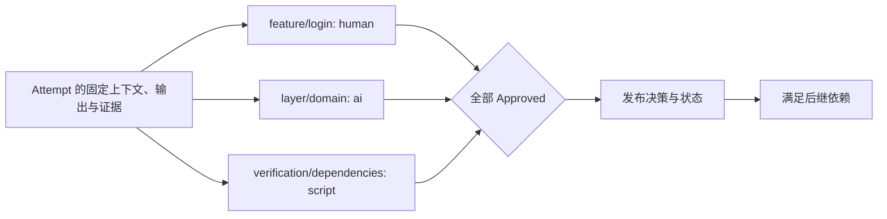
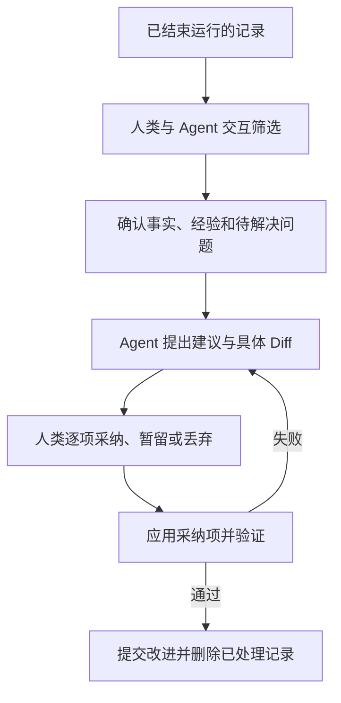

# Governance：Gate 与 Refinement

Gate 按 Node 的审核要求评估 Combination 成果，Refinement 将运行经验转化为改进。正式定义发布、最终代码交付和精炼采纳由人类确认。

## 对象与职责

| 对象或机制 | 内容 | 保存位置 |
| --- | --- | --- |
| GatePolicy | 模式、审核上下文和评估器配置 | Workflow / Node 声明；有效值固定在 Context Snapshot |
| GateReport | AI 建议、自动评估结果或故障证据 | main 的运行档案 reports/；大日志使用 Artifact 引用 |
| GateDecision | 某个 Attempt 的一项 Gate 决策 | main 的运行档案 decisions/ |
| Refinement | 人机筛选记录、落实改进的会话 | 本地 `.runtime/refinements/` |
| 改进 Commit | 已落实改动、验证结论、证据来源及清理范围 | main 的 Git 历史 |
| 执行边界 | 文件、工具、网络、资源与凭据限制 | 本地 Runtime 配置和隔离环境 |

普通定义修改由人类审阅 Diff 后提交 main；Requirement 内容变化须发布新版本并更新 current.yaml。Refinement 是根据运行记录主动改进的入口。所有 main 写入都遵守 Git 凭据与分支保护。

## Gate 模式与组合

| gate.mode | 评估方式 | 最终决策者 |
| --- | --- | --- |
| human | 人类直接审阅材料，不自动请求 AI 建议 | 人类 |
| ai_assisted | AI 生成建议，人类确认或作出不同结论 | 人类 |
| ai | AI 独立评审并给出决策 | AI |
| script | 程序按规则评审并返回结构化结果 | 程序 |

每个选中 Node 都贡献一项 Gate，未声明字段继承 Workflow 默认；解析规则见 [Workflow](01-workflow.md)。`gate_id = facet_id/node_id`，在当前 Combination 内唯一。Gate 评估该 Combination 的当前 Attempt；Requirement 不另设 Gate，最终交付保持人类确认。



各项可并行，相同模式不自动合并。人类可以一次确认多项，但每项分别保存 Decision。Runtime 汇总全部结果，不增加一次额外总审核。Worker 的 Post-Assess 是自检证据；AI Gate 使用独立评审会话，不直接沿用执行会话的自我批准。

## 评估器与执行边界

`gate.evaluator` 只引用 source_commit 中的 `.facetloom/evaluators/<id>.yaml`；审核指令、模型、参数、脚本及环境定义统一进入 Git。引用不存在或类型不匹配时校验失败，没有本地定义回退。格式如下；尖括号值在实际配置中替换为具体值。

```yaml
schema_version: 1
id: domain-reviewer
kind: ai
adapter: codex
model: <model-id>
parameters: {}
instruction: 根据审核要求检查固定输出，逐项引用证据，无法判断时说明缺失信息。
timeout_seconds: 300
execution:
  environment_ref: <immutable-environment-ref>
  tools: [read, test]
  network: disabled
```

| kind | 必填配置 |
| --- | --- |
| ai | adapter、非空 model、parameters 对象、非空 instruction |
| script | 非空 argv 参数数组，例如 `[python3, tools/check_dependencies.py]` |
| 两者共同 | schema_version=1、id、kind、正整数 timeout_seconds、execution |

`id` 与文件名一致，格式同 Node ID。`execution` 固定可恢复的环境引用、工具列表和网络限制；`ai` 与 `ai_assisted` 要求 kind=ai，`script` 要求 kind=script。有效配置完整写入 Snapshot。

本地只提供凭据、服务连接和资源上限，不能替换模型、审核指令、脚本、环境或工具权限。连接须提供配置指定的服务能力；无法满足固定配置时阻塞并说明原因，不通过缩减工具或切换模型继续。凭据只记录类别与用途；更新 Git 中的审核定义后需新 Run。

```text
Worker               → 生成代码与自检证据
AI / 脚本评估器       → 审核固定成果，返回报告
人类                 → 人工决策、异常接管、发布与交付确认
Runtime / Git Manager → 校验主体与策略，保存决策，汇总并发布状态
```

评估器不持有 main 推送凭据、不直接修改运行记录或被评估成果。评估环境使用固定输出的隔离副本，允许测试产生临时文件；不能把修改后的内容当作原输出审核。脚本从 source_commit 取得可信脚本及评估配置，以固定输出副本为工作目录；不执行 Attempt 擅自改写的审核脚本。AI 工具输出和脚本返回值不能指定人类身份，主体由 Runtime 根据受信会话或评估调用填写。

## GateReport 与评估协议

路径：`.facetloom/runs/<run-id>/reports/<report-id>.yaml`。GateReport 不可变，schema_version 为 1，report_id 使用 UUIDv4，report_type 为 `gate`。

| 字段 | 定义 |
| --- | --- |
| run_id、combination_id、attempt_id、gate_id | 所属执行与审核项 |
| context_snapshot_ref、evaluated_tree、gate_policy_digest | 被评估的固定输入与策略 |
| review_input_digest | 必须匹配 Attempt 的固定审核输入摘要 |
| request_input_ref | 实际初始评估请求的持久 Artifact 引用；仅请求尚未形成即失败时可为 null |
| previous_decision_id | 发起评估时该 Gate 的前一决策，首次为 null |
| evaluator | 评估器 ID、kind；实际解析的模型/工具版本等运行信息另记在此 |
| status | completed 或 error |
| result | completed 时为 Approved、Rejected、Escalated 或 Blocked；error 时为 null |
| rationale、evidence_refs | 非空说明和证据引用列表；error 时说明故障 |
| created_at | UTC ISO 8601 |

Runtime 在调用前分配 report_id，持久化本地任务与实际初始请求；发布报告前将请求保存为持久 Artifact 并校验引用，留存范围见 [Execution](04-execution.md)。请求固定上述身份、上下文、策略、输入/输出 Commit 和冻结的执行证据。审核者可读取 Requirement、任务上下文及自己的审核要求；运行档案只按显式证据引用提供，不作为项目定义输入。

脚本通过 stdin 接收 JSON 请求：`schema_version`、`report_id`、`run_id`、`combination_id`、`attempt_id`、`gate_id`、`context_snapshot_ref`、`gate_policy_digest`、`review_input_digest`、`previous_decision_id`、`input_commit`、`output_commit`、`evaluated_tree`、`evidence_refs`，以及已解析的 `context_snapshot` 和完整 `review_input`。review_input 是 Execution 定义的五字段摘要对象，请求中重复出现的字段必须一致。请求中的 evidence_refs 只取固定 output_refs 的执行证据，不包含其他 Gate 的报告。引用由 Runtime 提供只读材料供评估器访问。stdout 仅返回一个 JSON 对象，日志写 stderr：

```json
{
  "result": "Approved",
  "rationale": "领域依赖检查通过",
  "evidence_refs": []
}
```

AI Adapter 返回同样的结果结构。`rationale` 必须非空，证据沿用 [Execution](04-execution.md) 的类型化引用。脚本正常退出且返回有效结果才为 completed；退出非零、超时、无效输出或缺失证据引用为 error，不能把退出码直接当成拒绝。程序可以正常退出并返回 Rejected。

`ai_assisted` 的报告只提供建议，不推进状态；人类 Decision 必须引用该报告，可以不同意建议并说明理由。`ai` / `script` 的 completed 报告由 Runtime 转成相同 result 的 Decision；错误报告没有决策主体，不伪造 AI / 程序决策。报告可随 Attempt 的 gate_report_refs 独立发布，使人工审核与故障处理有可共享的依据。

Gate 运行检查产生的报告属于审核输出：检查失败可以返回 Rejected，不能把该报告补入 Attempt 的 output_refs。每项 Gate 都读取固定执行材料，不自动消费其他 Gate 的结果；ai_assisted 的人类可读取本项 AI 建议，人工接管可读取本项故障/升级记录。

## GateDecision

路径：`.facetloom/runs/<run-id>/decisions/<decision-id>.yaml`。

| 字段 | 必填 | 定义 |
| --- | --- | --- |
| schema_version、decision_id | 是 | 格式为 1；ID 为 UUIDv4 |
| run_id、combination_id、attempt_id、gate_id | 是 | 被评估对象及审核项 |
| context_snapshot_ref | 是 | contexts/<sha256>.yaml，由文件名校验内容摘要 |
| evaluated_tree、gate_policy_digest | 是 | 固定输出 Tree 与该项有效策略摘要 |
| review_input_digest | 是 | Attempt 的固定审核输入摘要；与报告及评估请求一致 |
| expected_attempt_digest | 是 | Runtime 本次写入前校验的已发布 Attempt 文件 SHA-256 |
| previous_decision_id | 是 | 同 Attempt、同 gate_id 的前一决策，首次为 null |
| result | 是 | Approved、Rejected、Escalated 或 Blocked |
| rationale、evidence_refs | 是 | 非空理由与证据引用列表，可无额外证据 |
| report_ref | 条件 | AI 辅助、AI 或脚本决策必填；指向 GateReport 的类型化引用 |
| decided_by | 是 | `{kind: human/ai/script, id: <主体 ID>}`，Runtime 填写 |
| takeover | 条件 | 人工接管自动 Gate 时填写 reason 和 source_refs |
| repair_target_combination_id、repair_instruction | 条件 | Rejected 时可指定当前节点或同 Run 的祖先及修复要求 |
| created_at | 是 | UTC ISO 8601 |

```yaml
schema_version: 1
decision_id: <uuid>
run_id: <run-id>
combination_id: development/feature:login/layer:domain
attempt_id: <attempt-id>
gate_id: feature/login
context_snapshot_ref: contexts/<sha256>.yaml
evaluated_tree: <full-tree-oid>
review_input_digest: sha256:<review-input-digest>
expected_attempt_digest: sha256:<attempt-file-digest>
previous_decision_id: null
gate_policy_digest: sha256:<gate-policy-digest>
result: Approved
rationale: 锁定与恢复行为均符合需求
evidence_refs: []
decided_by:
  kind: human
  id: user:ling
created_at: "2026-11-09T12:00:00Z"
```

`human` / `ai_assisted` 只接受 human 主体；`ai` / `script` 正常决策主体必须与模式及报告评估器一致。自动模式异常或明确无法判断时暂停该项，允许人类补充决策或请求原模式重评；人工接管需记录原因、原报告或升级决策引用，保留原策略。ai_assisted 建议生成失败时，人类可引用错误报告继续审核并记录原因。没有自动失败重试循环。缺少必要执行证据时返回 Blocked / Escalated；人工接管不能靠追加材料绕过缺失项。需要补测、重新执行或修改代码时，由人类确认终止旧 Attempt 并创建新 Attempt；单纯解释已有材料写入 Decision 的 rationale。

### 汇总、并发与发布

Attempt 使用 `gate_decision_refs` 按 gate_id 保存各项最新 Decision；GateReport 用 `gate_report_refs` 记录各项最新报告。未产生决策的项视为待审，不单独建立 GateRun 对象。

| 情况 | Attempt / CombinationRun |
| --- | --- |
| 部分 Approved，其余未完成 | 保持 waiting_gate |
| 全部最新决策为 Approved | accepted / satisfied，发布成功才解锁后继 |
| 任一 Rejected | rejected / blocked，取消其余未完成评估；人类确认后才创建新 Attempt |
| Escalated、Blocked 或评估 error | 保持 waiting_gate，转交人类处理；其他独立项可继续 |
| 输入失效、取消或已有终态 | 取消活动评估，不接收迟到结果 |

发起评估、人工确认和人工接管都绑定同一 `(attempt_id, gate_id, review_input_digest, context_snapshot_ref, evaluated_tree, gate_policy_digest, previous_decision_id)`；报告任务还绑定 report_id。同一审核项同时最多一个活动评估任务。接管或明确重评前撤销旧任务，本地持久化撤销信息；迟到报告不进入有效引用，也不能自动生成 Decision。

Runtime 串行接收各项结果，校验 Run 有效、Attempt 仍为当前 waiting_gate，并重新计算 review_input_digest、校验引用内容及该项前一决策。分项报告、决策和状态不参与 review_input_digest；其他 Gate 更新导致完整 Attempt 文件摘要变化时，可以在重新校验后合并，不要求重新评审未变的成果。`expected_attempt_digest` 记录合并时实际读取的版本，Git Manager 仍以该摘要进行原子校验。该项前一决策变化或材料变化时拒绝过期操作。新报告不允许替换已 Approved 的项；Rejected 后整个 Attempt 已终止。

Decision 与关联状态作为同一 main Commit 发布；引用的报告须同 Commit 发布或已存在且内容匹配。失败时保留本地待发布操作，不提前接受成果。以报告/决策 ID 去重，重启或重放不得重复生成决策。新评估使用新 ID，历史文件不覆盖。新 Attempt 的所有 Gate 都须重新审核，即使复用 Context Snapshot 也不能继承批准。

## Refinement：运行精炼

Refinement 将已结束运行的有效经验转化为具体改进，同时清理已处理档案。界面入口为「运行精炼」，CLI 为 `facetloom refine`。



### 会话与输入

会话 ID 为 UUIDv4，状态保存于 `.facetloom/.runtime/refinements/<id>/session.yaml`，Diff、交互内容和验证输出位于同目录。会话状态为 `selecting → suggesting → reviewing → validating → completed`；验证失败返回 reviewing，取消为 cancelled。本地原子保存，浏览器断开不取消会话。

```yaml
schema_version: 1
refinement_id: <uuid>
status: reviewing
base_commit: <main-commit>
items:
  - id: restore-on-expiry
    source_refs:
      - type: git_file
        commit: <main-commit>
        path: .facetloom/runs/<run-id>/summary.md
        blob_oid: <blob-oid>
        digest: sha256:<digest>
    finding: 多次返工来自未明确锁定到期后的恢复行为
    recommendation: 在领域上下文中补充边界状态检查
    disposition: adopt
    target_paths: [.facetloom/facets/layer/facet.yaml]
    cleanup_paths: []
approved_diff_digest: null
```

`disposition` 为 `adopt`、`keep` 或 `discard`，均由人类确认；未选择按 keep 处理。来源固定到 Commit、路径与摘要。建议可修改需求、Workflow、Facet、引用资料、实现或测试；人类审阅的 Diff 包含实际改进和拟清理内容，确认后记录摘要，Diff 变化必须重新确认。

### 清理规则

| 情况 | 处理 |
| --- | --- |
| 活动运行、待 Gate、待交付或仍用于恢复的记录 | 不进入清理范围 |
| 采纳但未应用或验证失败 | 保留原记录与本地会话 |
| 已应用且验证通过 | 可清理对应已解决记录 |
| 人类明确丢弃且无其它依赖 | 可清理，Commit 说明丢弃理由 |
| 暂留或未处理问题 | 保留，并在 summary 中继续列出 |
| 同一文件含多个问题 | 仅整理已处理部分；未处理内容与引用保留 |
| 仍被保留的有效记录引用 | 保留文件；引用来源可更新时，先固定到删除前 Git Commit |

一个 Run 完成不代表可立即删除：已完成但等待交付的记录仍受保护。未交付且不再需要交付的成果，先由人类在 run.yaml 确认 delivery_abandonment，再重新评估清理条件。清理前检查全项目保留记录的引用，而不只检查本次选择。不可变 Decision、Context Snapshot 等文件可整体删除或保留，不在原路径改写其评估内容或引用；Attempt 的冻结字段也不得为了清理而改写。保留的有效引用仍依赖目标时，目标一并保留。历史由 Git 保存。

### 应用与提交

1. 刷新 main，确认来源和目标文件仍匹配会话基线；变化则重新筛选或生成 Diff，并重新确认。
2. 在隔离 Worktree 应用采纳项。验证定义 Schema、引用和 DAG；代码改动运行相关测试；有 integration.checks 时执行最终检查。仅丢弃记录也要校验引用完整性。
3. 一个 main Commit 同时包含改进、必要引用更新和已处理记录的清理。Git Manager 校验确认的 Diff 摘要，推送成功才将会话设为 completed。
4. 推送被拒时刷新并复核；只有无关运行目录变化可自动重新构造提交。所选来源、引用依赖或目标变化时重新审核和验证。

Commit 描述包含：`FacetLoom-Refinement: <id>`、人类确认主体、问题与改进、验证结论、清理或丢弃理由，以及删除前的 `<commit>:<path>`。应用后崩溃时按 Trailer 查找并校验已提交内容，恢复会话，避免重复应用。

不生成永久的精炼审批目录。回退改进 Commit 会同时恢复该 Commit 删除的记录；Requirement 版本恢复旧语义时仍按新版本发布，不将 current 指针倒退。

### 保留目标

精炼控制 main 当前目录和 Agent 上下文大小。Git 历史保留原记录，不执行历史重写，也不承诺减小历史仓库体积。完整对话和大日志在进入 Git 前就分离；外部 Artifact 的物理删除不属于此流程。
