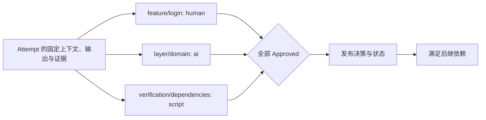
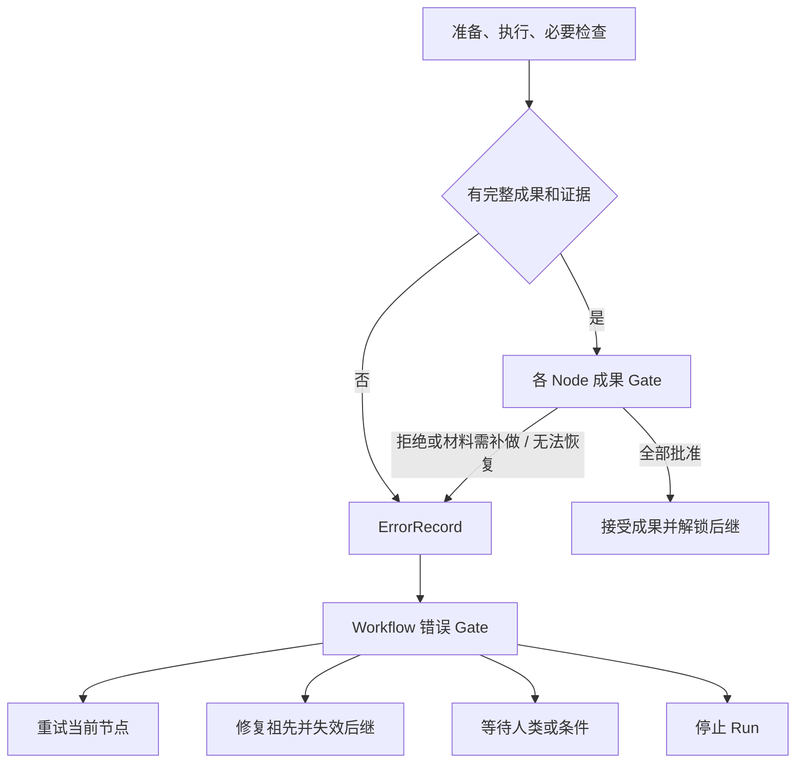
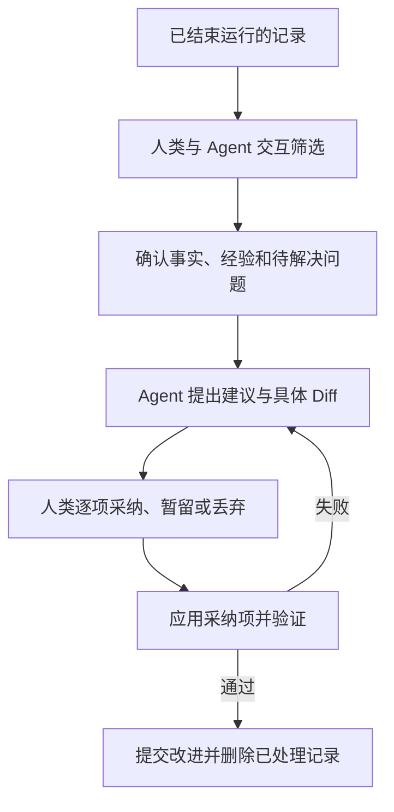

# Governance：Gate 与 Refinement

成果 Gate 按 Node 要求审核 Combination 输出；错误 Gate 决定执行失败或成果拒绝后的处理动作。Refinement 将运行经验转化为改进。正式定义发布、最终代码交付和精炼采纳由人类确认。

## 对象与职责

| 对象或机制 | 内容 | 保存位置 |
| --- | --- | --- |
| GatePolicy | 模式、上下文和评估器配置 | 成果策略固定在 Context Snapshot；错误策略固定在 run.yaml |
| ErrorRecord | 不可变错误材料及相关输入、前驱和证据 | main 的运行档案 errors/ |
| PreAssessReport / CheckReport / Post-AssessReport | 预检、Runtime 实际检查与只读自检证据；均不作 Gate 决策 | main 的运行档案 reports/ |
| GateReport | AI 建议、自动评估结果或故障证据 | main 的运行档案 reports/；大日志使用 Artifact 引用 |
| GateDecision | 某项成果审核或错误处置决定 | main 的运行档案 decisions/ |
| Refinement | 人机筛选记录、落实改进的会话 | 本地 `.runtime/refinements/` |
| 改进 Commit | 已落实改动、验证结论、证据来源及清理范围 | main 的 Git 历史 |
| 执行边界 | 固定 runner、文件与网络隔离、资源和凭据限制 | Git 定义及 Run 快照；本地 Runtime 实施隔离 |

普通定义修改由人类审阅 Diff 后提交 main；Requirement 内容变化须发布新版本并更新 current.yaml。Refinement 是根据运行记录主动改进的入口。所有 main 写入都遵守 Git 凭据与分支保护。

## Gate 模式与职责

| gate.mode | 评估方式 | 最终决策者 |
| --- | --- | --- |
| human | 人类直接审阅材料，不自动请求 AI 建议 | 人类 |
| ai_assisted | AI 生成建议，人类确认或作出不同结论 | 人类 |
| ai | AI 独立评审并给出决策 | AI |
| script | 程序按规则评审并返回结构化结果 | 程序 |

以上四种模式同时适用于成果 Gate 和错误 Gate。每个选中 Node 都贡献一项成果 Gate，未声明字段继承 Workflow 默认；解析规则见 [Workflow](01-workflow.md)。`gate_id = facet_id/node_id`，在当前 Combination 内唯一。Gate 评估该 Combination 的当前 Attempt；Requirement 不另设 Gate，最终交付保持人类确认。



各项可并行，相同模式不自动合并。人类可以一次确认多项，但每项分别保存 Decision。Runtime 汇总全部结果，不增加一次额外总审核。Post-Assess 是隔离的只读自检证据，不产生 Gate 决策；AI Gate 使用独立评审会话，不直接沿用执行会话的自我批准。

## 评估器与执行边界

`gate.evaluator` 只引用 source_commit 中的 `.facetloom/evaluators/<id>.yaml`；评估目标、指令和程序定义进入 Git，没有本地定义回退。AI 评估同样调用外部 Agent，使用 runner 选择镜像、原生参数及配置。

~~~yaml
schema_version: 1
id: domain-reviewer
kind: ai
runner: reviewer
instruction: 根据固定审核材料逐项引用证据，输出要求的结构化结论，无法判断时说明原因。
timeout_seconds: 300
~~~

| kind | 必填配置 |
| --- | --- |
| ai | runner、非空 instruction；runner 必须存在于 source_commit |
| script | 非空 argv 参数数组，以及 execution.environment_ref 与 execution.network |
| 两者共同 | schema_version=1、id、kind、正整数 timeout_seconds |

id 与文件名一致，格式同 Node ID。ai 与 ai_assisted 要求 kind=ai，script 要求 kind=script。script 的 environment_ref 固定到不可变环境；network 为 disabled / outbound；不调用 Agent、不要求 runner。

有效 AI policy.evaluator 保存完整评估定义及解析出的 runner_profile_digest，完整 runner 由 Run.runners 提供；审核 Snapshot 或错误策略同时绑定其摘要。模型与工具由外部 Agent 原生配置决定，评估器对象只保存调用引用和审核指令。

本地仅注入凭据、连接和资源限制，不能替换 runner 或审核指令。无法满足固定调用配置时记录评估故障并允许人工接管。关闭外部 Agent 的原生审批不会批准 FacetLoom Gate；任何审核仍使用独立于执行 Worker 的新会话与隔离副本。

AI 评估的时限取 evaluator.timeout_seconds 与 runner.timeout_seconds 的较小值，超时为评估故障；不消耗节点执行的修复轮次。实际模型、工具及 Agent 版本仅记录程序可观测信息，不能把缺失信息补成确定值。

```text
Worker               → 生成代码与自检证据
AI / 脚本评估器       → 审核固定成果，返回报告
人类                 → 人工决策、异常接管、发布与交付确认
Runtime / Git Manager → 校验主体与策略，保存决策，汇总并发布状态
```

评估器不持有 main 推送凭据、不直接修改运行记录或被评估成果。评估环境使用固定输出的隔离副本，允许测试产生临时文件；不能把修改后的内容当作原输出审核。脚本从 source_commit 取得可信脚本及评估配置，以固定输出副本为工作目录；不执行 Attempt 擅自改写的审核脚本。AI 工具输出和脚本返回值不能指定人类身份，主体由 Runtime 根据受信会话或评估调用填写。

## 成果 GateReport 与评估协议

路径：`.facetloom/runs/<run-id>/reports/<report-id>.yaml`。GateReport 不可变，schema_version 为 1，report_id 使用 UUIDv4，report_type 为 `gate`。本节为 `review_kind: result`；错误协议见下文。

| 字段 | 定义 |
| --- | --- |
| review_kind | result；与错误处置协议区分 |
| run_id、combination_id、attempt_id、gate_id | 所属执行与审核项 |
| context_snapshot_ref、evaluated_tree、gate_policy_digest | 被评估的固定输入与策略 |
| review_input_digest | 必须匹配 Attempt 的固定审核输入摘要 |
| request_input_ref | 实际初始评估请求的持久 Artifact 引用；仅请求尚未形成即失败时可为 null |
| previous_decision_id | 发起评估时该 Gate 的前一决策，首次为 null |
| evaluator | 评估器 ID、kind；实际外部 Agent 与 Adapter 版本、runner 摘要、原生会话及可观测模型/工具信息另记在此；未知项为 null |
| status | completed 或 error |
| result | completed 时为 Approved、Rejected、Escalated 或 Blocked；error 时为 null |
| rationale、evidence_refs | 非空说明和证据引用列表；error 时说明故障。AI 原始输出的引用只能选自本次请求提供的白名单 |
| evidence_files | 仅 AI 原始输出使用：本次调用生成证据的相对路径；Adapter 导入后只在持久 GateReport 中保存 Artifact `evidence_refs` |
| created_at | UTC ISO 8601 |

Runtime 在调用前分配 report_id，持久化本地任务与实际初始请求；发布报告前将请求保存为持久 Artifact 并校验引用，留存范围见 [Execution](04-execution.md)。请求固定上述身份、上下文、策略、输入/输出 Commit 和冻结的执行证据。审核者可读取 Requirement、任务上下文及自己的审核要求；运行档案只按显式证据引用提供，不作为项目定义输入。

Artifact 的可读性按执行审核的 clone 检查。Git 已同步但本地未持有材料时，先导入匹配原引用的交换包；不把本地缺失当作成果被拒绝，也不能跳过材料直接批准。补齐原内容不改变冻结审核输入；新增执行证据仍须新 Attempt。

脚本通过 stdin 接收 JSON 请求：`schema_version`、`review_kind: result`、`report_id`、`run_id`、`combination_id`、`attempt_id`、`gate_id`、`context_snapshot_ref`、`gate_policy_digest`、`review_input_digest`、`previous_decision_id`、`input_commit`、`output_commit`、`evaluated_tree`、`evidence_refs`，以及已解析的 `context_snapshot` 和完整 `review_input`。review_input 是 Execution 定义的五字段摘要对象，请求中重复出现的字段必须一致。请求中的 evidence_refs 只取固定 output_refs 的执行证据，包括最终 CheckReport，不包含其他 Gate 的报告。引用由 Runtime 提供只读材料供评估器访问。stdout 仅返回一个 JSON 对象，日志写 stderr：

```json
{
  "result": "Approved",
  "rationale": "领域依赖检查通过",
  "evidence_refs": [],
  "evidence_files": []
}
```

外部 Agent 经 Adapter 返回同样的结果结构。其 `evidence_refs` 只能包含评估请求显式提供的证据引用；`evidence_files` 按 [Execution](04-execution.md) 的统一协议验证和导入。持久 GateReport 只保存规范化的类型化 `evidence_refs`，不保留 `evidence_files`。原生成功退出但未返回完整有效结构时为 error，不由 Runtime 用另一模型补写决策。`rationale` 必须非空。脚本正常退出且返回有效结果才为 completed；退出非零、超时、无效输出或缺失/越权引用为 error，不能把退出码直接当成拒绝。程序可以正常退出并返回 Rejected。

AI 调用的初始请求与执行回执按 Execution 规则留存，实际后续输入和原生事件通过本项报告证据引用。

`ai_assisted` 的报告只提供建议，不推进状态；人类 Decision 必须引用该报告，可以不同意建议并说明理由。`ai` / `script` 的 completed 报告由 Runtime 转成相同 result 的 Decision；错误报告没有决策主体，不伪造 AI / 程序决策。报告可随 Attempt 的 gate_report_refs 独立发布，使人工审核与故障处理有可共享的依据。

Gate 运行检查产生的报告属于审核输出：检查失败可以返回 Rejected，不能把该报告补入 Attempt 的 output_refs。每项 Gate 都读取固定执行材料，不自动消费其他 Gate 的结果；ai_assisted 的人类可读取本项 AI 建议，人工接管可读取本项故障/升级记录。

## 成果 GateDecision

路径：`.facetloom/runs/<run-id>/decisions/<decision-id>.yaml`。

| 字段 | 必填 | 定义 |
| --- | --- | --- |
| schema_version、decision_id | 是 | 格式为 1；ID 为 UUIDv4 |
| review_kind | 是 | result |
| run_id、combination_id、attempt_id、gate_id | 是 | 被评估对象及审核项 |
| context_snapshot_ref | 是 | contexts/<sha256>.yaml，由文件名校验内容摘要 |
| evaluated_tree、gate_policy_digest | 是 | 固定输出 Tree 与该项有效策略摘要 |
| review_input_digest | 是 | Attempt 的固定审核输入摘要；与报告及评估请求一致 |
| expected_attempt_digest | 是 | Runtime 本次写入前校验的已发布 Attempt 文件 SHA-256 |
| previous_decision_id | 是 | 同 Attempt、同 gate_id 的前一决策，首次为 null |
| result | 是 | Approved、Rejected、Escalated 或 Blocked |
| rationale、evidence_refs | 是 | 非空理由与证据引用列表，可无额外证据 |
| report_ref | 条件 | AI 辅助、AI 或脚本决策必填；指向 GateReport 的类型化引用 |
| decided_by | 是 | `{kind: human/ai/script, id: <主体 ID>}`，Runtime 填写 |
| takeover | 条件 | 人工接管自动 Gate 时填写 reason 和 source_refs |
| created_at | 是 | UTC ISO 8601 |

```yaml
schema_version: 1
decision_id: <uuid>
review_kind: result
run_id: <run-id>
combination_id: development/feature:login/layer:domain
attempt_id: <attempt-id>
gate_id: feature/login
context_snapshot_ref: contexts/<sha256>.yaml
evaluated_tree: <full-tree-oid>
review_input_digest: sha256:<review-input-digest>
expected_attempt_digest: sha256:<attempt-file-digest>
previous_decision_id: null
gate_policy_digest: sha256:<gate-policy-digest>
result: Approved
rationale: 锁定与恢复行为均符合需求
evidence_refs: []
decided_by:
  kind: human
  id: user:ling
created_at: "2026-11-09T12:00:00Z"
```

`human` / `ai_assisted` 只接受 human 主体；`ai` / `script` 正常决策主体必须与模式及报告评估器一致。自动模式异常或明确无法判断时暂停该项，允许人类补充决策或请求原模式重评；人工接管需记录原因、原报告或升级决策引用，保留原策略。ai_assisted 建议生成失败时，人类可引用错误报告继续审核并记录原因。评估器故障不自动循环重试。

缺少必要执行证据时返回 Blocked / Escalated。仅本地副本缺失时先导入原内容；Runtime 确认证据从未形成、已不可恢复或需要新增时，才将 Attempt 标记 failed，创建 ErrorRecord 交给错误 Gate。需要补测、重新执行或修改代码时，通过错误处置安排新 Attempt；人工接管不能追加材料绕过冻结规则。单纯解释已有材料写入 Decision 的 rationale。审核者额外要求新增测试时以 Rejected 说明理由，再由错误 Gate 安排新 Attempt，不能把额外要求当成已配置检查缺失。

### 汇总、并发与发布

Attempt 使用 `gate_decision_refs` 按 gate_id 保存各项最新 Decision；GateReport 用 `gate_report_refs` 记录各项最新报告。未产生决策的项视为待审，不单独建立 GateRun 对象。

| 情况 | Attempt / CombinationRun |
| --- | --- |
| 部分 Approved，其余未完成 | 保持 waiting_gate |
| 全部最新决策为 Approved | accepted / satisfied，发布成功才解锁后继 |
| 任一 Rejected | Attempt rejected，取消其余评估；创建 ErrorRecord，CombinationRun waiting_gate 等待错误处置 |
| Escalated、Blocked 或评估 error | 保持 waiting_gate，转交人类处理；其他独立项可继续 |
| 输入失效、取消或已有终态 | 取消该 Attempt 的成果评估，不接收迟到结果；failed / rejected 的错误处置另行校验 |

发起评估、人工确认和人工接管都绑定同一 `(attempt_id, gate_id, review_input_digest, context_snapshot_ref, evaluated_tree, gate_policy_digest, previous_decision_id)`；报告任务还绑定 report_id。同一审核项同时最多一个活动评估任务。接管或明确重评前撤销旧任务，本地持久化撤销信息；迟到报告不进入有效引用，也不能自动生成 Decision。

Runtime 串行接收各项结果，校验 Run 有效、Attempt 仍为当前 waiting_gate，并重新计算 review_input_digest、校验引用内容及该项前一决策。分项报告、决策和状态不参与 review_input_digest；其他 Gate 更新导致完整 Attempt 文件摘要变化时，可以在重新校验后合并，不要求重新评审未变的成果。`expected_attempt_digest` 记录合并时实际读取的版本，Git Manager 仍以该摘要进行原子校验。该项前一决策变化或材料变化时拒绝过期操作。新报告不允许替换已 Approved 的项；Rejected 后整个 Attempt 已终止。

Decision 与关联状态作为同一 main Commit 发布；引用的报告须同 Commit 发布或已存在且内容匹配。失败时保留本地待发布操作，不提前接受成果。以报告/决策 ID 去重，重启或重放不得重复生成决策。新评估使用新 ID，历史文件不覆盖。新 Attempt 的所有成果 Gate 都须重新审核，即使复用 Context Snapshot 也不能继承批准。

## 错误 Gate：处置执行问题



错误 Gate 复用 human、ai_assisted、ai、script 模式及 GateReport / GateDecision，不增加 GateRun。每个节点同一时刻只有一个 active_error_ref，对应唯一 `gate_id: workflow/error`。不同节点的错误可分别评估，恢复动作由 Runtime 串行校验；重叠修复范围先撤销过期错误任务，避免重复恢复。

| 情况 | 路径 |
| --- | --- |
| 输入构造失败、上下文冲突、Applicability 未知、Worker 丢失 | failed Attempt → ErrorRecord → 错误 Gate |
| Pre-Assess 输入不足 / 发现风险 | 输入不足转错误 Gate；风险作为固定证据交成果 Gate，不新增审核项 |
| 越界冲突、Agent 发现上游需求或行为不对齐 | 保存路径、前驱 ID 与证据 → 错误 Gate |
| 检查修复次数用尽，但最终代码和失败证据完整 | 成果 Gate，可接受或拒绝，不直接报执行错误 |
| 成果 Gate Rejected | rejected Attempt → ErrorRecord → 错误 Gate |
| 成果评估器异常或无法判断 | 原成果项人工接管或对原材料重评 |
| 错误评估器异常、无法形成请求或无法提出有效动作 | 保留故障报告，blocked，交给人类；不递归错误处置 |
| Git 发布或发布方本地 Artifact 持久化暂不可用 | 本地保留待发布操作，不假装正式审核已开始 |
| 完成后最终汇聚或交付失败 | IntegrationReport blocked / failed；修改成果须新 Run |

### ErrorRecord

路径：`.facetloom/runs/<run-id>/errors/<error-id>.yaml`。ID 为 UUIDv4，文件创建后不可变；大日志只存引用。

| 字段 | 定义 |
| --- | --- |
| schema_version、error_id | 格式为 1，UUIDv4 |
| run_id、combination_id、attempt_id | 所属失败或拒绝的尝试 |
| stage | preparation / pre_assess / execution / checks / post_assess / result_review |
| code、message | 机器可读原因码与非空说明；常用原因包括 `pre_assess_blocked`、`pre_assess_failed`、`post_assess_failed`、`evidence_import_failed`、`evidence_reference_invalid` |
| context_snapshot_ref、input_commit | 已形成的固定输入；未形成可为 null |
| evidence_refs | 已保存的实际材料；不要求有代码输出或 Agent 请求 |
| wait_condition | 可空；仅对有效的 `pre_assess` / `pre_assess_blocked` ErrorRecord，且其 PreAssessReport 的 `missing_inputs[].source_refs` 列出该引用时填写 `{kind: fixed_reference_unavailable, source_ref, observation, checked_at}`。`source_ref` 是 Snapshot 中完整类型化引用，摘要必须匹配；`checked_at` 为 UTC ISO 8601。Agent 自述不能单独建立此字段 |
| related_predecessors | 相关 combination_id、attempt_id、output_commit；未知时空列表 |
| trigger_decision_ref | 成果拒绝时必填；其他情况可空 |
| created_at | UTC ISO 8601 |

```yaml
schema_version: 1
error_id: <uuid>
run_id: <run-id>
combination_id: development/feature:login/layer:presentation
attempt_id: <attempt-id>
stage: preparation
code: permission_denied
message: src/shared/config.py 的汇聚冲突超出有效写入范围
context_snapshot_ref: null
input_commit: null
evidence_refs: []
wait_condition: null
related_predecessors: []
trigger_decision_ref: null
created_at: "2026-11-09T12:00:00Z"
```

示例省略的冲突详情应以 evidence_refs 保存，实际记录须能定位路径和各方内容。Runtime 先持久化错误事实和可用材料，再发布错误档案；不为满足成果审核字段而创建虚假 Commit 或 Snapshot。

### 错误评估协议与决定

错误 GateReport 和 GateDecision 都使用 `review_kind: error`，保存在现有 reports/、decisions/，沿用 UUID、时间、主体、报告、接管和证据引用规则。其余差异如下：

| 字段 | 规则 |
| --- | --- |
| run_id、combination_id、attempt_id | 必须匹配 active_error_ref 的所属对象 |
| gate_id | 固定 workflow/error |
| error_ref | 必填，ErrorRecord 的类型化引用 |
| gate_policy_digest | 必须匹配 run.yaml 的有效错误策略 |
| review_input_digest | 错误审核摘要，算法见下文 |
| previous_decision_id | 同一错误的上一决定；首次 null，wait 后可以新决定继续处置 |
| result | 不使用此字段，避免把动作解释成成果批准 |
| action | completed 报告及 Decision 必填：retry_current / repair_upstream / wait / stop_run；`wait` 仅用于固定外部引用暂时不可读取 |
| repair_target_combination_id、repair_instruction | repair_upstream 必填；其他动作不填 |
| context_snapshot_ref、evaluated_tree | 不作为错误协议字段；可用输入从 ErrorRecord 读取 |
| expected_combination_digest | Decision 必填，替代 expected_attempt_digest，保护当前错误与节点状态 |

review_input_digest 为 `{review_kind: "error", error_ref, gate_policy_digest}` 按 RFC 8785 JCS 规范化后的 SHA-256。审核请求带完整 ErrorRecord、错误策略、当前节点状态、剩余额度及此摘要对象；状态和额度是操作可行性提示，不属于不可变错误事实，落地前必须重新校验。

脚本仍由 stdin 接收 JSON，stdout 返回一个对象；AI Adapter 使用相同返回结构。AI 原始输出可另含 `evidence_files`，Script Gate 不支持该字段：

```json
{
  "action": "retry_current",
  "rationale": "环境已恢复，按原固定输入重新执行",
  "evidence_refs": [],
  "evidence_files": []
}
```

报告沿用 status=completed / error。AI 原始 `evidence_refs` 限于审核请求提供的白名单，`evidence_files` 使用统一证据导入协议；持久 GateReport 仅保留规范化类型化引用。error 报告不填 action，保存实际 request_input_ref；请求未形成才允许 null。human / ai_assisted 最终决定由人类作出，ai / script 的有效报告由 Runtime 转成同一动作的 Decision。人工接管保留原策略与故障依据。错误报告只更新 CombinationRun.error_report_ref，不写入旧 Attempt 的成果映射。

Runtime 在生成 Decision 前按 ErrorRecord 和当前外部引用状态校验恢复动作。`wait` 仅在 `wait_condition` 非空且引用仍因暂时性可用性故障不可读时有效。若无等待条件，或引用已经恢复可读，评估器返回的 `wait` 都按无效动作处理为评估故障，不生成 Decision，也不改变 CombinationRun 状态；转人工接管或重新评估。人类界面同样不提供不符合条件的 wait 操作。恢复后由用户显式请求按固定 Gate 模式重新评估，Runtime 不自动轮询。

| 动作 | Runtime 校验与效果 |
| --- | --- |
| retry_current | 原节点输入仍有效，旧 Worker 已停止或隔离；发布后新建 Attempt。对 `pre_assess_blocked`，仅在 `wait_condition` 非空且 Runtime 确认同一引用已恢复、内容摘要匹配时可重试，并须复用原 Context Snapshot；若缺少需求信息或需变更输入，不能在该 Run 重试，必须创建替代 Run |
| repair_upstream | 目标为同 Run 祖先，指令非空；发布后目标及全部后继失效、按 DAG 重执行 |
| wait | 仅当 ErrorRecord.wait_condition 非空且该引用仍暂时不可读时有效；节点 blocked 并保留 active_error_ref，不自动轮询或重发。引用恢复后需显式按固定 Gate 模式重新评估；retry_current 创建的新 Attempt 复用原 Snapshot |
| stop_run | 取消尚未结束的 Run，停止其活动任务；已接受历史不改写 |

错误决定文件示例：

~~~yaml
schema_version: 1
decision_id: <uuid>
review_kind: error
run_id: <run-id>
combination_id: development/feature:login/layer:presentation
attempt_id: <failed-attempt-id>
gate_id: workflow/error
error_ref:
  type: run_record
  run_id: <run-id>
  path: errors/<error-id>.yaml
  digest: sha256:<error-record-digest>
gate_policy_digest: sha256:<error-policy-digest>
review_input_digest: sha256:<error-review-digest>
expected_combination_digest: sha256:<combination-file-digest>
previous_decision_id: null
action: wait
rationale: 需人类调整 Scope 定义并启动新 Run
evidence_refs: []
decided_by: {kind: human, id: "user:ling"}
created_at: "2026-11-09T12:00:00Z"
~~~

AI/脚本的 retry_current、repair_upstream 每次消耗一个 Run 级额度；默认 3 次。Runtime 在同一事务中校验并增加 auto_recoveries_used、记录动作 ID、关联状态和待发布意图；同一决定不重复扣减。耗尽后保留报告交给人类，不执行超额动作。人类恢复不消耗自动额度，不重置计数。

决定发布前重新校验 Run 非终态、当前需求有效、当前错误及前一决定未变、有效策略和材料摘要匹配、修复范围和额度可用。记录并发写入用 expected_combination_digest；Run 计数也在同一事务比较更新。其他错误决定若已让该节点 stale、替换 Attempt 或取消 Run，当前动作作废。旧错误及决定保留，不能自动重放成新动作。

Decision、额度和关联状态作为同一个 main Commit 发布，成功后才安排恢复 Worker。错误处置永不设置 accepted_attempt_id；新 Attempt 的所有成果 Gate 重新审核。定义与权限边界不能通过动作扩展，需要改 Requirement、Scope 或策略时由人类发布定义并新建 Run。

## Refinement：运行精炼

Refinement 将已结束运行的有效经验转化为具体改进，同时清理已处理档案。界面入口为「运行精炼」，CLI 为 `facetloom refine`。



### 会话与输入

会话 ID 为 UUIDv4，状态保存于 `.facetloom/.runtime/refinements/<id>/session.yaml`，Diff、交互内容和验证输出位于同目录。

会话创建时固定最新 main 为 base_commit，从中选择 runner，并以与 Run.runners 相同的结构将完整 profile、摘要及来源保存到 session.yaml 的 runners 映射；runner_id 指定本会话使用项。不继承执行或评审会话。每次 AI 请求使用独立调用记录，实际时限取该 runner.timeout_seconds。

会话状态为 `selecting → suggesting → reviewing → validating → completed`；验证失败返回 reviewing，取消为 cancelled。本地原子保存，浏览器断开不取消会话。以下示例省略 runners 映射内容，实际须完整保存。

```yaml
schema_version: 1
refinement_id: <uuid>
status: reviewing
base_commit: <main-commit>
runner_id: developer
runners: {}  # 此处省略；实际保存与 Run.runners 相同的完整映射
items:
  - id: restore-on-expiry
    source_refs:
      - type: git_file
        commit: <main-commit>
        path: .facetloom/runs/<run-id>/summary.md
        blob_oid: <blob-oid>
        digest: sha256:<digest>
    finding: 多次返工来自未明确锁定到期后的恢复行为
    recommendation: 在领域上下文中补充边界状态检查
    disposition: adopt
    target_paths: [.facetloom/facets/layer/facet.yaml]
    cleanup_paths: []
approved_diff_digest: null
```

`disposition` 为 `adopt`、`keep` 或 `discard`，均由人类确认；未选择按 keep 处理。来源固定到 Commit、路径与摘要。建议可修改需求、Workflow、Facet、引用资料、实现或测试；人类审阅的 Diff 包含实际改进和拟清理内容，确认后记录摘要，Diff 变化必须重新确认。

### 清理规则

| 情况 | 处理 |
| --- | --- |
| 活动运行、待 Gate、待交付或仍用于恢复的记录 | 不进入清理范围 |
| 采纳但未应用或验证失败 | 保留原记录与本地会话 |
| 已应用且验证通过 | 可清理对应已解决记录 |
| 人类明确丢弃且无其它依赖 | 可清理，Commit 说明丢弃理由 |
| 暂留或未处理问题 | 保留，并在 summary 中继续列出 |
| 同一文件含多个问题 | 仅整理已处理部分；未处理内容与引用保留 |
| 仍被保留的有效记录引用 | 保留文件；引用来源可更新时，先固定到删除前 Git Commit |

一个 Run 完成不代表可立即删除：已完成但等待交付的记录仍受保护。未交付且不再需要交付的成果，先由人类在 run.yaml 确认 delivery_abandonment，再重新评估清理条件。清理前检查全项目保留记录的引用（包括 ErrorRecord 和错误处置决定），而不只检查本次选择。不可变 Decision、Context Snapshot 等文件可整体删除或保留，不在原路径改写其评估内容或引用；Attempt 的冻结字段也不得为了清理而改写。保留的有效引用仍依赖目标时，目标一并保留。历史由 Git 保存。

### 应用与提交

1. 刷新 main，确认来源和目标文件仍匹配会话基线；变化则重新筛选或生成 Diff，并重新确认。
2. 在隔离 Worktree 应用采纳项。验证定义 Schema、引用和 DAG；代码改动运行相关测试；有 integration.checks 时执行最终检查。仅丢弃记录也要校验引用完整性。
3. 一个 main Commit 同时包含改进、必要引用更新和已处理记录的清理。Git Manager 校验确认的 Diff 摘要，推送成功才将会话设为 completed。
4. 推送被拒时刷新并复核；只有无关运行目录变化可自动重新构造提交。所选来源、引用依赖或目标变化时重新审核和验证。

Commit 描述包含：`FacetLoom-Refinement: <id>`、人类确认主体、问题与改进、验证结论、清理或丢弃理由，以及删除前的 `<commit>:<path>`。应用后崩溃时按 Trailer 查找并校验已提交内容，恢复会话，避免重复应用。

不生成永久的精炼审批目录。回退改进 Commit 会同时恢复该 Commit 删除的 Git 记录，但不会恢复另行 purge 的 Artifact；缺失内容须从仍持有的交换包或其它副本导入。Requirement 版本恢复旧语义时仍按新版本发布，不将 current 指针倒退。

### 保留目标

精炼控制 main 当前目录和 Agent 上下文大小。Git 历史保留原记录，不执行历史重写，也不承诺减小历史仓库体积。完整对话和大日志在进入 Git 前就分离；外部 Artifact 的物理删除不属于此流程。需要释放本地空间时，另行执行 [Artifact 人工 purge](04-execution.md#保留与人工-purge)，检查当前保留记录、活动状态及完整依赖后确认；Git 历史保留引用不保证 Artifact 仍有副本可读取。
