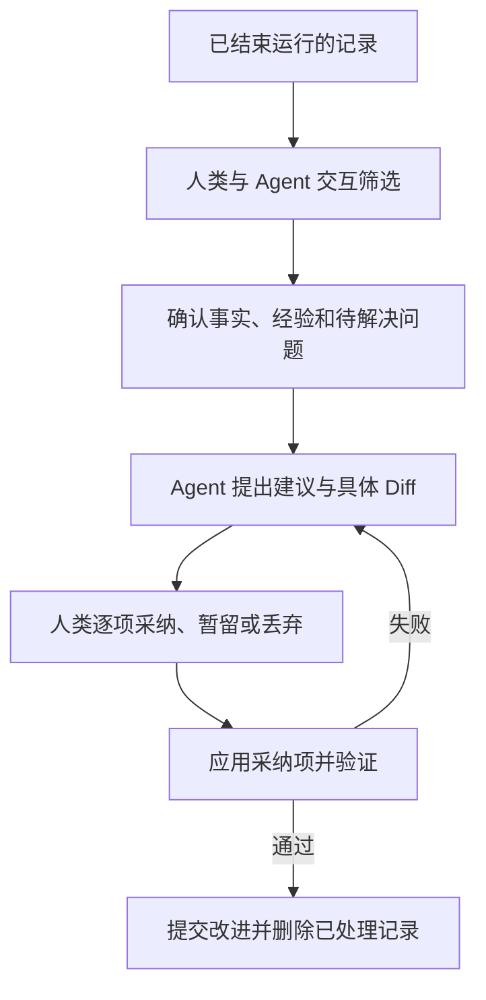

# Governance：Gate 与 Refinement

治理由人类审核、固定执行边界和运行精炼组成。正式修改与决策进入 main；执行与精炼会话在本地持久化。

## 对象与职责

| 对象或机制 | 内容 | 保存位置 |
| --- | --- | --- |
| GatePolicy | Workflow 的结果评估方式，当前为 human | Workflow 文件 |
| GateDecision | 对固定 Attempt 输出的人类决策 | main 的运行档案 |
| Refinement | 人机筛选记录、生成建议、采纳与验证的会话 | 本地 `.runtime/refinements/` |
| 改进 Commit | 已落实改动、验证结论、证据来源及清理范围 | main 的 Git 历史 |
| 执行边界 | 文件、工具、网络、资源与凭据限制 | 本地 Runtime 配置和隔离环境 |

普通 Requirement、Workflow、Facet 和资料修改由人类审阅 Diff 后提交 main。Requirement 内容变化须发布新版本并同 Commit 更新 `current.yaml`；Workflow 和 Facet 通过校验后供新 Run 使用。Refinement 是根据运行记录主动改进的入口，不是所有修改的必经审批层。

## 操作边界

```text
Worker / Agent
├── 在指定 Worktree、路径和工具范围内执行
├── 提交结果、测试证据、Checkpoint 请求和改进建议
└── 不持有 main 推送凭据，不自行写入人类决策

Runtime / Git Manager
├── 校验输入、状态、修改范围和证据
├── 发布精简档案
└── 根据明确的人类确认执行定义发布或集成交付

人类
└── 确认需求、审核 Gate、选择改进、批准发布与交付
```

main 写入由 Git 凭据与分支保护控制；不要求额外 PR 分支。项目如使用托管平台审核，Git Manager 遵守其既有保护。Worker 的 Scope 不自动授予访问权，实际范围由 Runtime 与容器限制。AI 可提供评估建议，Gate 的最终决策主体为人类。

## GateDecision

Gate 评估一个 Combination 的当前 Attempt，不设独立 Requirement Gate。需求级验证由 Verification Facet 和最终集成检查完成。Workflow 的 `gate.mode` 当前只接受 `human`。

路径：`.facetloom/runs/<run-id>/decisions/<decision-id>.yaml`。

| 字段 | 必填 | 定义 |
| --- | --- | --- |
| `schema_version`、`decision_id` | 是 | 格式为 1；ID 为 UUIDv4 |
| `run_id`、`combination_id`、`attempt_id` | 是 | 被评估对象 |
| `context_snapshot_ref` | 是 | `contexts/<sha256>.yaml`，由文件名校验内容摘要 |
| `evaluated_tree` | 是 | 当前 Attempt 代码输出的 Git Tree |
| `expected_attempt_digest` | 是 | 审核时已发布 Attempt 文件的 SHA-256 |
| `previous_decision_id` | 是 | 本 Attempt 的前一决策；首次为 null |
| `gate_policy_digest` | 是 | 固定 Gate 策略的 SHA-256 |
| `result` | 是 | Approved、Rejected、Escalated 或 Blocked |
| `rationale`、`evidence_refs` | 是 | 理由和证据列表，可无额外证据 |
| `decided_by` | 是 | 人类稳定主体 ID，由受信会话确认 |
| `repair_target_combination_id`、`repair_instruction` | 条件 | Rejected 时可指定当前节点或同 Run 的祖先节点及修复要求 |
| `created_at` | 是 | UTC ISO 8601 |

```yaml
schema_version: 1
decision_id: <uuid>
run_id: <run-id>
combination_id: development/feature:login/layer:domain
attempt_id: <attempt-id>
context_snapshot_ref: contexts/<sha256>.yaml
evaluated_tree: <full-tree-oid>
expected_attempt_digest: sha256:<attempt-file-digest>
previous_decision_id: null
gate_policy_digest: sha256:<digest>
result: Approved
rationale: 锁定与恢复行为均通过验证
evidence_refs: []
decided_by: user:ling
created_at: "2026-11-06T12:00:00Z"
```

写入前校验 Run 仍有效、Attempt 仍为当前 `waiting_gate`、上下文与输出 Tree 未变，并比较 Attempt 摘要及前一决策 ID。过期请求重新加载后再审核。AI 建议不能填充 `decided_by` 冒充人类确认。

| 结果 | 状态变化 |
| --- | --- |
| Approved | Attempt → accepted；CombinationRun → satisfied |
| Rejected | Attempt → rejected；CombinationRun → blocked，修复规则见 Requirement |
| Escalated / Blocked | 保持 waiting_gate；补齐条件后创建新的 Decision |

Decision 不编辑覆盖；新评估产生新 ID。决策及相关 Attempt、CombinationRun、WorkflowRun 状态同 Commit 发布。发布成功后才解锁后继；推送失败时本地保留待发布操作，不提前接受成果。

## Refinement：运行精炼

Refinement 将已结束运行的有效经验转化为具体改进，同时清理已处理档案。界面入口为「运行精炼」，CLI 为 `facetloom refine`。



### 会话与输入

会话 ID 为 UUIDv4，状态保存于 `.facetloom/.runtime/refinements/<id>/session.yaml`，Diff、交互内容和验证输出位于同目录。会话状态为 `selecting → suggesting → reviewing → validating → completed`；验证失败返回 reviewing，取消为 cancelled。本地原子保存，浏览器断开不取消会话。

```yaml
schema_version: 1
refinement_id: <uuid>
status: reviewing
base_commit: <main-commit>
items:
  - id: restore-on-expiry
    source_refs:
      - type: git_file
        commit: <main-commit>
        path: .facetloom/runs/<run-id>/summary.md
        blob_oid: <blob-oid>
        digest: sha256:<digest>
    finding: 多次返工来自未明确锁定到期后的恢复行为
    recommendation: 在领域上下文中补充边界状态检查
    disposition: adopt
    target_paths: [.facetloom/facets/layer/facet.yaml]
    cleanup_paths: []
approved_diff_digest: null
```

`disposition` 为 `adopt`、`keep` 或 `discard`，均由人类确认；未选择按 keep 处理。来源固定到 Commit、路径与摘要。建议可修改需求、Workflow、Facet、引用资料、实现或测试；人类审阅的 Diff 包含实际改进和拟清理内容，确认后记录摘要，Diff 变化必须重新确认。

### 清理规则

| 情况 | 处理 |
| --- | --- |
| 活动运行、待 Gate、待交付或仍用于恢复的记录 | 不进入清理范围 |
| 采纳但未应用或验证失败 | 保留原记录与本地会话 |
| 已应用且验证通过 | 可清理对应已解决记录 |
| 人类明确丢弃且无其它依赖 | 可清理，Commit 说明丢弃理由 |
| 暂留或未处理问题 | 保留，并在 summary 中继续列出 |
| 同一文件含多个问题 | 仅整理已处理部分；未处理内容与引用保留 |
| 仍被保留的有效记录引用 | 保留文件；引用来源可更新时，先固定到删除前 Git Commit |

一个 Run 完成不代表可立即删除：已完成但等待交付的记录仍受保护。未交付且不再需要交付的成果，先由人类在 run.yaml 确认 delivery_abandonment，再重新评估清理条件。清理前检查全项目保留记录的引用，而不只检查本次选择。不可变 Decision、Context Snapshot 等文件可整体删除或保留，不在原路径改写其评估内容或引用；若其引用来源需要保留，目标也保留。历史由 Git 保存。

### 应用与提交

1. 刷新 main，确认来源和目标文件仍匹配会话基线；变化则重新筛选或生成 Diff，并重新确认。
2. 在隔离 Worktree 应用采纳项。验证定义 Schema、引用和 DAG；代码改动运行相关测试；有 integration.checks 时执行最终检查。仅丢弃记录也要校验引用完整性。
3. 一个 main Commit 同时包含改进、必要引用更新和已处理记录的清理。Git Manager 校验确认的 Diff 摘要，推送成功才将会话设为 completed。
4. 推送被拒时刷新并复核；只有无关运行目录变化可自动重新构造提交。所选来源、引用依赖或目标变化时重新审核和验证。

Commit 描述包含：`FacetLoom-Refinement: <id>`、人类确认主体、问题与改进、验证结论、清理或丢弃理由，以及删除前的 `<commit>:<path>`。应用后崩溃时按 Trailer 查找并校验已提交内容，恢复会话，避免重复应用。

不生成永久的精炼审批目录。回退改进 Commit 会同时恢复该 Commit 删除的记录；Requirement 版本恢复旧语义时仍按新版本发布，不将 current 指针倒退。

### 保留目标

精炼控制 main 当前目录和 Agent 上下文大小。Git 历史保留原记录，不执行历史重写，也不承诺减小历史仓库体积。完整对话和大日志在进入 Git 前就分离；外部 Artifact 的物理删除不属于此流程。
