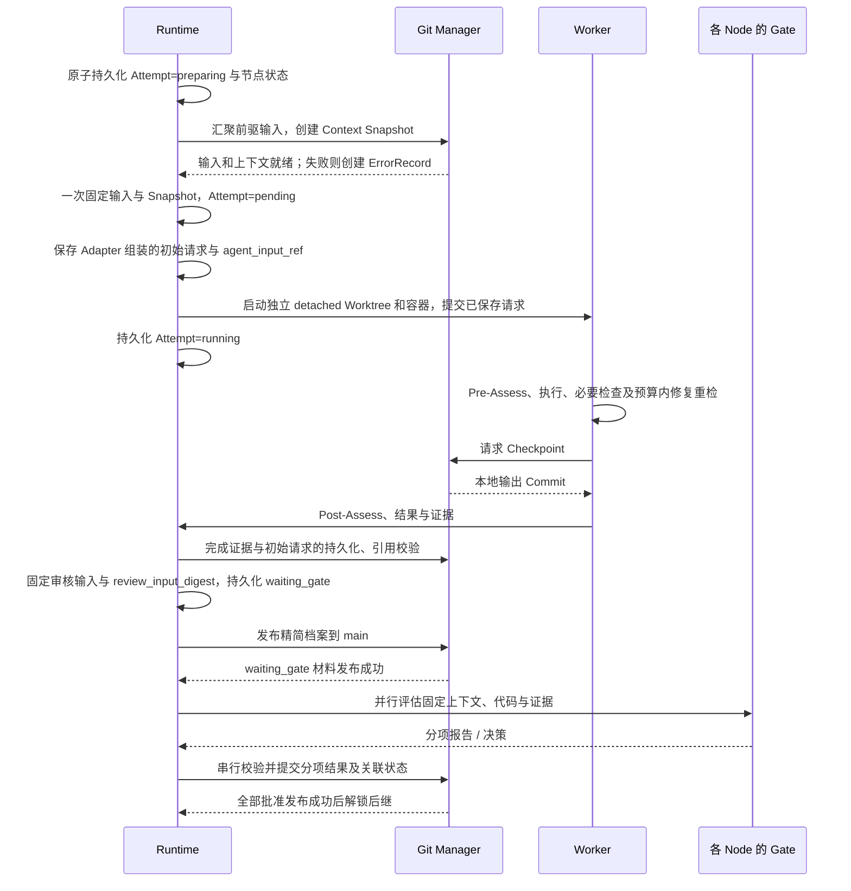

# Execution

一次 Attempt 固定输入，在隔离 Worktree 中执行；本地 Checkpoint 支持汇聚，精简证据在关键节点发布到 main。最终只有人类接受并通过检查的代码进入 main。

## 执行时序



main 暂不可写时，本地保存待发布操作。发布 waiting_gate 前不展示为可正式审核；决策发布前不解锁后继。创建 Worker 无需逐状态提交 Git，但必须有可恢复的本地记录。

## Context Snapshot

路径：`.facetloom/runs/<run-id>/contexts/<sha256>.yaml`。先在本地运行目录构造，发布 Gate 材料时同步到 main。文件按字节 SHA-256 命名，输入变化创建新文件与新 Attempt。

```yaml
schema_version: 1
run_id: <run-id>
source_commit: <full-commit-oid>
requirement_version_id: REQ-001/r1
workflow_id: development
combination_id: development/feature:login/layer:domain
input_commit: <full-commit-oid>
direct_predecessors: []
input_merge_ref: null                 # 多前驱时引用汇聚清单 Artifact
merge_conflicts: []
scope_paths: [src/auth/**, test/auth/**]
context:
  objectives: [实现登录失败限制领域规则]
  source_paths:
    - .facetloom/requirements/REQ-001/r1.md
    - .facetloom/workflows/development.yaml
    - .facetloom/facets/feature/facet.yaml
    - .facetloom/facets/layer/facet.yaml
  constraints: [不依赖具体基础设施实现]
  reference_paths: [docs/authentication.md]
gates:
  - gate_id: feature/login
    policy:
      mode: human
      evaluator: null
      context:
        objectives: []
        constraints: []
        reference_paths: []
      source_paths: [.facetloom/workflows/development.yaml, .facetloom/facets/feature/facet.yaml]
    policy_digest: sha256:<feature-gate-policy-digest>
  - gate_id: layer/domain
    policy:
      mode: ai
      evaluator:
        schema_version: 1
        id: domain-reviewer
        kind: ai
        adapter: codex
        model: <model-id>
        parameters: {}
        instruction: 根据审核要求检查固定输出，逐项引用证据，无法判断时说明缺失信息。
        timeout_seconds: 300
        execution:
          environment_ref: <immutable-environment-ref>
          tools: [read, test]
          network: disabled
      context:
        objectives: [审核领域模型及业务边界]
        constraints: []
        reference_paths: [.facetloom/references/domain-review.md]
      source_paths: [.facetloom/workflows/development.yaml, .facetloom/facets/layer/facet.yaml, .facetloom/evaluators/domain-reviewer.yaml]
    policy_digest: sha256:<domain-gate-policy-digest>
execution:
  adapter: codex
  environment_digest: sha256:<digest>
  tools: [test]
  read_paths: ["**"]
  write_paths: [src/auth/**, test/auth/**]
  checks:
    - check_id: workflow/unit
      argv: [pytest, -q]
      timeout_seconds: 900
      source_path: .facetloom/workflows/development.yaml
  max_check_retries: 2
  network: disabled
```

| 内容 | 规则 |
| --- | --- |
| 来源文件 | source_paths 和 reference_paths 均相对仓库根，由 source_commit 固定；不含运行档案 |
| Node 与 Scope | 按 DAG members 解析，目标与约束合成，来源仍可追溯 |
| 前驱输入 | direct_predecessors 各项固定 combination_id、attempt_id、output_commit |
| 执行环境 | 固定 Adapter、工具、独立的读写范围、检查列表及预算、网络和环境摘要；凭据只记录类别与用途 |
| 修复要求 | 记录错误处置授权的修复/补测指令及原错误、报告和决定引用；失败代码不自动成为新输入 |
| Gate 策略 | gates 按 Facet 声明顺序列出每个选中 Node 的 gate_id、完整有效 policy 与 policy_digest；缺项、重复项或来源不匹配时拒绝启动 |

`policy.context.objectives` 按 Workflow → Node 顺序累积目标，其他约束和资料同样累积并保留来源；任务上下文仍作为共同审核输入。`policy.evaluator` 保存完整有效配置，不能只有 ID 或摘要。审核指令、模型、参数、脚本及环境定义统一来自 source_commit；本地只提供凭据、连接和资源上限，无法满足固定执行配置时进入错误 Gate；评估器自身故障则人工接管。

`policy_digest` 对 policy 按 RFC 8785（JCS）规范化后的 UTF-8 JSON 字节求 SHA-256；仅允许该规范支持的 JSON 值。Decision / GateReport 的 gate_policy_digest 必须等于对应项摘要。Snapshot 文件名仍对完整 YAML 文件字节求摘要。任务输入变化需要新 Snapshot 与新 Attempt；Workflow、Node 或评估器定义变化需要新 Run。

## 前驱代码汇聚

根节点复用 source_commit；直接前驱取最终约简 DAG 快照中每个节点的当前有效输出。只有前驱全部 satisfied 才开始准备。

```text
有效前驱及来源映射
    ↓ 按 Combination ID 排序
Commit 去重 → 去掉被其他输入包含的祖先 Commit
    ↓
累积输入 M + 下一个前驱 H
    ↓ 从真实历史计算共同祖先，执行三方合并
候选 Tree + 冲突清单 → 保留 M、H 为父提交的临时 Commit
    ↓ 重复至全部前驱合并
固定 input_commit → Agent 解决全部冲突 → 执行与检查
```

### 确定性算法

1. 保存所有前驱的 combination_id、attempt_id、output_commit。相同 OID 只参与一次计算，以字典序最小 Combination ID 作为排序键；祖先判定使用 Git 提交图，不比较 Tree。去重和祖先消除不能删除来源映射。
2. 只有一个独立输入时直接复用，不创建空汇聚提交；多个输入按上述键升序折叠。
3. 每一步使用 `git merge-tree --write-tree M H` 的 ort 三方合并。共同祖先由 Git 在双方真实历史中计算；多个最佳共同祖先由固定版本 Git 合成虚拟基线，不任意挑一个，不固定使用 source_commit。不允许无共同历史合并。
4. 每步返回的候选 Tree 写成父提交为 `[M, H]` 的临时 Commit，供下一步计算祖先。临时提交的作者与提交者固定为 `FacetLoom <runtime@facetloom.local>`，时间固定为 `2000-01-01T00:00:00Z`，消息为 `facetloom input merge <step>`（末尾一个 LF，step 从 1 递增），保持同一输入 OID 集合的中间 OID 与冲突标签稳定；最终 input_commit 保留整个父链。
5. Git 工具环境使用 run.yaml.merge_engine 的不可变环境，默认 Git 2.43.0、ort、conflict_style=merge、renames=true、rename_threshold=50%、rename_limit=0（不限制）、diff_algorithm=histogram。隔离用户/系统 Git 配置，禁用 rerere、外部合并驱动、过滤器和换行转换，不允许本地属性覆盖；仓库属性来自固定输入。完整有效参数进入清单，Run 内不切换环境。
6. 退出码 0 为干净结果，1 为有冲突的候选结果，其他值为输入准备错误。缺失对象或共同历史、工具故障及不支持的合并能力进入错误 Gate。

相同输入 OID、顺序和工具环境必须生成相同候选 Tree 与冲突清单。正式输入和 Checkpoint Commit 的时间等元数据不要求跨次 OID 相同。最终多个终端成果的交付汇聚使用相同算法；若有未解决冲突，保存 blocked IntegrationReport，不能在已 completed Run 内修改成果。

### 冲突与输入清单

每步冲突都累积保留，即使后续步骤对同一路径未报冲突，也不能自动删除旧冲突。文本候选保留 Git 冲突标记；二进制、重命名、删改及文件/目录冲突保留 Git 候选 Tree，并在清单列出所有涉及路径、类型、步骤、两侧提交、共同祖先以及各 stage 的 Blob OID / 模式，删除的一侧为 null。清单和需要的 Git 对象随 bundle 持久保存，不能只保留屏幕日志。

~~~yaml
schema_version: 1
kind: input_merge
predecessors: []              # 全部来源，包括去重或被包含的输入
independent_heads: []         # 实际参与计算的有序 Commit
engine: <run.yaml.merge_engine 的完整有效配置>
steps: []                     # M、H、最佳共同祖先、候选 Tree、中间 Commit、冲突
input_commit: <commit-oid>
conflicts: []                 # 各步冲突并集，不自动标记已解决
~~~

清单作为不可变 Artifact，通过 Context Snapshot.input_merge_ref 引用。Agent 必须逐项给出解决结果与证据，Runtime 校验路径范围、Git 对象完整性以及无未合并 index 项；不能只用搜索文本标记判断二进制冲突是否解决。冲突未解决不能进入成果 Gate，但可以携带实际材料进入错误 Gate。

汇聚 Agent 负责正常的代码集成冲突。冲突路径超出有效写入范围时在准备阶段报 permission_denied，不启动有越界权限的 Worker。Agent 判断问题来自前驱已批准行为与需求不对齐时，报 upstream_misaligned，引用具体前驱和证据，由错误 Gate 决定是否修复上游；不得静默更改上游责任。

## 必要检查与同次修复

Runtime 从 Workflow 和选中 Node 累积必要检查，将限定 ID、argv、超时、来源、环境和 max_check_retries 固定到 Snapshot。检查由 Runtime 调度并记录真实退出结果，Worker 自报通过不能替代检查记录。命令配置来自 source_commit；受信检查入口脚本从该 Commit 提供，不能被候选代码替换。被检查的实现和测试内容来自本轮候选 Tree。

```text
Agent 执行 / 解决冲突
    ↓ 固定本轮候选 Tree
全部必要检查
    ├── 全部通过 → 最终 Checkpoint → 只读 Post-Assess → 冻结成果材料
    ├── 检查失败且还有额度 → 同一 Worker 修复 → 全量重检
    ├── 额度耗尽且证据完整 → 最终 Checkpoint → 只读 Post-Assess → 成果 Gate
    └── 无法执行或材料缺失 → ErrorRecord → 错误 Gate
```

- 默认先检查一次，失败后最多修复并重检 2 次；max_check_retries=0 时首轮之后直接提交完整结果。
- 每轮按有效列表顺序执行全部检查，不因首项失败跳过其余项。每项记录 check_id、round（从 1 开始）、evaluated_tree、passed / failed、退出码或 timeout、证据引用及使用环境。
- 检查在该候选 Tree 的隔离副本运行，可写临时产物；不能把测试生成或修改的受跟踪文件带回成果。任何 Agent 代码修改都会使已有检查结果对新 Tree 失效，需要全量重检。
- 已启动命令的非零退出或超时属于 failed 证据。命令无法启动、环境不可用或结果证据丢失属于执行错误，不用虚假 failed 结果补齐列表。
- 修复轮次用尽后只允许对最终已检查 Tree 生成正式 Checkpoint；代码再变化必须新 Attempt。零项检查记录空清单，不能虚称有测试通过。
- 每轮日志保存在 Artifact；精简档案保留最终 Tree、有效检查结论、修复次数及各轮证据引用。最终 Checkpoint Tree 必须等于最后一轮 evaluated_tree。

检查修复预算只约束当前 Worker；错误 Gate 创建新 Attempt 或安排上游修复使用独立的 Run 级自动恢复额度。最终 integration.checks 仍须全部通过才可交付。

## 实际初始输入

Context Snapshot 是有效输入清单；Adapter 实际提交的初始消息、工具声明及附件清单作为 Artifact 留存。附件内容内联或使用可恢复的不可变引用，不能只记录临时路径。动态工具结果与后续对话按日志规则保存，不要求写入初始输入 Artifact。

| 引用 | 所属记录 | 保存时机 |
| --- | --- | --- |
| agent_input_ref | Attempt | 启动 Agent 前保存实际初始请求；waiting_gate 前验证持久可读 |
| request_input_ref | GateReport | 调用自动评估器前保存实际初始请求；发布报告前验证持久可读 |

```yaml
agent_input_ref:
  type: artifact
  uri: artifacts://inputs/<immutable-key>
  digest: sha256:<input-file-bytes-digest>
  media_type: application/json
```

Adapter 先组装并本地原子保存请求，再发送同一内容，不能事后根据定义重新生成来代替原请求。引用在请求形成时分配不可变 URI 与摘要，本地待上传状态单独记录；上传使用同一内容和引用，不改写 Attempt 输入。传输结果未知时按本地调用记录对账，不能声称请求一定送达或自动重复发送。

留存内容只覆盖 FacetLoom 可观测的实际请求；服务认证凭据由传输层注入，不进入消息或 Artifact。不记录服务商内部提示或模型内部状态，也不承诺相同输入产生相同输出。Gate 请求不包含自身 request_input_ref，避免摘要自引用。

## 固定审核输入

```text
执行、必要测试与 Post-Assess 完成
    ↓
代码、执行证据及初始请求持久化并校验
    ↓
固定审核输入 → 发布 waiting_gate
    ↓
各 Gate 审核 → 分项报告与决策 → 全部批准
```

进入成果 waiting_gate 前，Runtime 确认全部必要检查有最终代码对应的结果、执行结论已形成、所有引用可读且摘要匹配。检查结束不等于检查通过；预算耗尽后的失败结论可以交由成果 Gate 判断。无法形成必要材料时创建 ErrorRecord，走错误 Gate。

`review_input_digest` 为以下五个字段组成对象按 RFC 8785（JCS）规范化后的 UTF-8 JSON 字节的 SHA-256，格式为 `sha256:<hex>`：

```json
{
  "context_snapshot_ref": "contexts/<sha256>.yaml",
  "input_commit": "<full-commit-oid>",
  "outcome": "changed",
  "summary": "实现登录失败限制，执行检查已完成",
  "output_refs": [
    {"role": "code", "ref": {"type": "git_object", "object_type": "commit", "oid": "<output-commit-oid>"}}
  ]
}
```

示例仅展示摘要结构；实际 output_refs 包含全部执行证据及必要的 bundle 引用。上述字段进入 waiting_gate 后冻结，连同引用内容均不得修改、追加或替换。代码引用解析出的 Tree 必须等于 evaluated_tree；agent_input_ref 在发送前已固定，不随审核变化。

状态、时间及 gate_report_refs / gate_decision_refs 可继续推进，但不进入审核输入摘要。各 Gate 的报告、建议和决策理由是审核输出，不写回 output_refs，也不自动成为其他 Gate 的输入。评估请求、GateReport 和 GateDecision 都携带 review_input_digest；Runtime 重新计算并校验，不能仅相信记录中的摘要。

缺少执行证据时成果 Gate 返回 Blocked / Escalated；Runtime 确认缺失后将旧 Attempt 置为 failed，通过 ErrorRecord 交由错误 Gate 决定是否新建 Attempt。成果拒绝同样转错误处置；全部成果 Gate 必须重新审核，不新增审核轮次或仅审核的 Attempt 类型。评估器故障可由人类请求对原固定材料重评；人类仅解释已有材料时，将理由记录在 Decision 中。

## Checkpoint 与代码保留

```text
source_commit
    ├── detached Worktree A → output A
    └── detached Worktree B → output B
                                  ↓
                         汇聚 input_commit
                                  ↓
                        Worker → output_commit
```

Git Manager 为有代码变化的 Attempt 创建一个输出 Commit，以 input_commit 为唯一父提交；无修改沿用输入 Commit，不创建空 Commit。Post-Assess 必须基于该固定输出，不能在生成 Checkpoint 后继续改代码；进入 waiting_gate 前只登记最终 Checkpoint，较早的未发布本地快照不作为正式输出。修改范围由 Runtime 校验，Worker 不能修改已发布定义或 `.facetloom/runs/`。资料和定义的改善由人类发布或 Refinement 完成。

| Checkpoint 字段 | 定义 |
| --- | --- |
| schema_version、checkpoint_id | 格式为 1，ID 为 UUIDv4 |
| run_id、combination_id、attempt_id | 所属对象 |
| input_commit、output_commit、output_tree | 代码输入与结果 |
| changed_paths | 仓库相对路径列表 |
| recovery_bundle_ref | 发布代码证据时必填，指向持久 Git bundle Artifact |
| created_at | UTC ISO 8601 |

本地使用 `.runtime/worktrees/` 下的 detached Worktree 锚定仍需恢复的输入与输出 Commit；中间对象在有后继锚定或 bundle 验证通过前不移除 Worktree。无需 Run、Input 或 Checkpoint 命名分支。

跨 clone 或长期引用的代码输出，必须先导出自包含 Git bundle，覆盖复核所需的输入、输出、父提交与 Tree，再保存到持久 Artifact 位置。用空临时仓库验证 bundle 可导入且包含所需对象，校验摘要后才发布引用。日志中的裸 OID 不作为持久化保证。没有代码变化也需保证 input_commit 来自 main 可达历史或已有有效 bundle。

## 证据引用

小型对象留在运行档案；实际初始请求、大日志、完整对话、截图与 bundle 留在 Git 外。main 只保存简短结论、URI 和摘要。以下是 output_refs 的代码引用及恢复来源：

```yaml
output_refs:
  - role: code
    ref:
      type: git_object
      object_type: commit
      oid: <full-commit-oid>
      recovery_bundle_ref:
        type: artifact
        uri: artifacts://<immutable-bundle-key>
        digest: sha256:<bundle-digest>
        media_type: application/x-git-bundle
  - role: evidence
    ref:
      type: artifact
      uri: artifacts://<immutable-test-report-key>
      digest: sha256:<digest>
      media_type: application/json
```

已经由 main 可达历史保留的代码 Commit 可以省略 recovery_bundle_ref。持久引用不得依赖仅在某个 clone 存在的路径。Artifact Store 的具体实现不限定，但发布前必须验证内容可读、摘要匹配且位置持久；普通临时文件路径不满足要求。

仓库文件引用固定到 Commit，Refinement 清理后仍可解析：

```yaml
evidence_refs:
  - role: evidence
    ref:
      type: git_file
      commit: <full-commit-oid>
      path: .facetloom/runs/<run-id>/summary.md
      blob_oid: <full-blob-oid>
      digest: sha256:<file-bytes-digest>
```

同一 Run 中的不可变小文件可按内容引用，避免新文件引用自身所在 Commit 的循环：

```yaml
related_refs:
  - type: run_record
    run_id: <run-id>
    path: decisions/<decision-id>.yaml
    digest: sha256:<file-bytes-digest>
```

run_record 的路径相对对应运行目录，不得越出目录。Context Snapshot、ErrorRecord、Decision、Checkpoint 和 Report 引用的目标必须同 Commit 发布或已存在且内容匹配。清理时保留有效引用目标；仅当引用字段可更新时，才可先转换成删除前 Commit 的 git_file。不可变对象或 Attempt 的冻结字段仍被保留时，其依赖也保留。Attempt 用稳定 ID 关联；审核材料由 review_input_digest 校验，记录并发写入另用完整 Attempt 文件摘要。

output_refs 在成果 waiting_gate 前可为空；Attempt 处于 waiting_gate 时必须有且仅有一个 role: code 引用。错误 Gate 不要求代码输出，使用独立 ErrorRecord。outcome 为 changed、no_change 或 not_applicable；不适用结论须有可核对的理由，且经过该 Attempt 的全部 Gate。拒绝、失败或取消的输出不能满足后继。

## 输入比较与集成交付

定义 `project_tree(commit)`：保留该 Commit 的所有被 Git 跟踪的路径、内容和模式，仅移除 `.facetloom/runs/` 子树以及移除后为空的目录。定义、资料和代码均在比较范围内。运行档案不作为项目定义或代码输入；只向执行者和审核者提供明确引用的前驱结果、修复决策或评估证据，不挂载整个档案目录。

```text
最新 main：正式输入 + 各 Run 档案
                 ↓ 比较 project_tree
与 source_commit 的正式输入相同？
    ├── 否 → 新 WorkflowRun
    └── 是 → 应用有效成果的代码变更，保留最新档案
                      ↓
               最终检查 + 人类交付确认
                      ↓
               main 单个集成 Commit
```

1. 所有业务 Combination satisfied 后 Run 为 completed。Runtime 汇聚终端有效输出；冲突阻塞交付，不静默覆盖。
2. 获取最新 main；确认无 delivery_abandonment，验证 current 指针和 `project_tree(main) == project_tree(source_commit)`。需求过期或正式输入不同则拒绝旧运行交付。
3. 在隔离 Worktree 中把成果相对 source_commit 的代码变更应用到最新 main，保留最新 `.facetloom/runs/`。变化范围仍受既定执行范围约束。
4. 执行 Workflow 的全部 integration.checks，保存不可变 IntegrationReport。检查可写临时产物，但不能改变被检查的候选输入。
5. 人类确认报告与候选代码；Git Manager 检查当前头，创建以最新目标头为唯一父提交的集成 Commit，推送 main。

候选代码用 `candidate_tree` 表示，即候选结果的 project_tree。报告和后续运行记录不参与该 Tree。最终 result_commit 的 project_tree 必须等于报告 candidate_tree，实际完整 Tree 还包含最新档案；不要求整个 Tree 等于执行 Worktree 的旧 Tree。

### IntegrationReport

路径：`.facetloom/runs/<run-id>/reports/<report-id>.yaml`。

| 字段 | 定义 |
| --- | --- |
| schema_version、report_type、report_id、run_id | 格式为 1，report_type 为 integration，Report UUIDv4，所属 Run |
| source_commit | 固定运行输入 |
| target_branch、target_head_before | main 与检查时读取的 main 头 |
| candidate_tree | 被检查的候选 project_tree |
| checks | Workflow 中每个 check_id 的状态及 evidence_refs |
| status | passed、failed 或 blocked |
| reason | failed / blocked 时必填 |
| created_at | UTC ISO 8601 |

```yaml
schema_version: 1
report_type: integration
report_id: <uuid>
run_id: <run-id>
source_commit: <full-commit-oid>
target_branch: main
target_head_before: <full-commit-oid>
candidate_tree: <project-tree-oid>
status: passed
checks:
  - check_id: regression
    status: passed
    evidence_refs: []
created_at: "2026-11-06T13:00:00Z"
```

全部配置检查通过才为 passed；合并冲突、环境不可用或缺少检查配置为 blocked。相同代码候选可以重跑失败检查，保存新 Report；代码修改需要新 Run。

main 在检查后只有档案变化时，刷新头并保留新档案，重新构造完整提交；candidate_tree、Gate、证据仍有效则可复用代码检查与确认。正式输入、候选代码或审核材料变化时重新评估；输入基线变化必须新 Run。

### DeliveryRecord

集成提交使用 `FacetLoom-Run` 和 `FacetLoom-Delivery` trailers 标记；交付回执在集成成功后的独立 main Commit 中追加，避免 result_commit 自引用。

```yaml
schema_version: 1
delivery_id: <uuid>
run_id: <run-id>
requirement_version_id: REQ-001/r1
target_branch: main
integration_report_ref:
  type: run_record
  run_id: <run-id>
  path: reports/<report-id>.yaml
  digest: sha256:<digest>
target_head_before: <actual-parent-commit>
result_commit: <integration-commit>
verified_main_commit: <actual-parent-commit>
applied_by: user:ling
applied_at: "2026-11-06T13:10:00Z"
```

ID 为 UUIDv4，文件名为 deliveries/<delivery-id>.yaml。target_head_before 是实际集成父提交，verified_main_commit 是对 current 指针与正式输入做最后校验的同一 Commit；不要求等于 source_commit 或 Report 记录的早期目标头。applied_by 来自人类交付确认。

集成前在本地持久化交付 ID、候选摘要、人类确认与 Report 引用。推送成功后崩溃时，通过 Trailer 找到结果并验证输入、project_tree 和人类确认，再补回执；若确认无法对账则等待人类处理，不重复集成。任何 main 写入都不强推。
