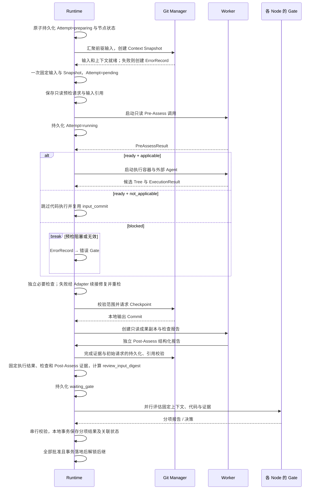
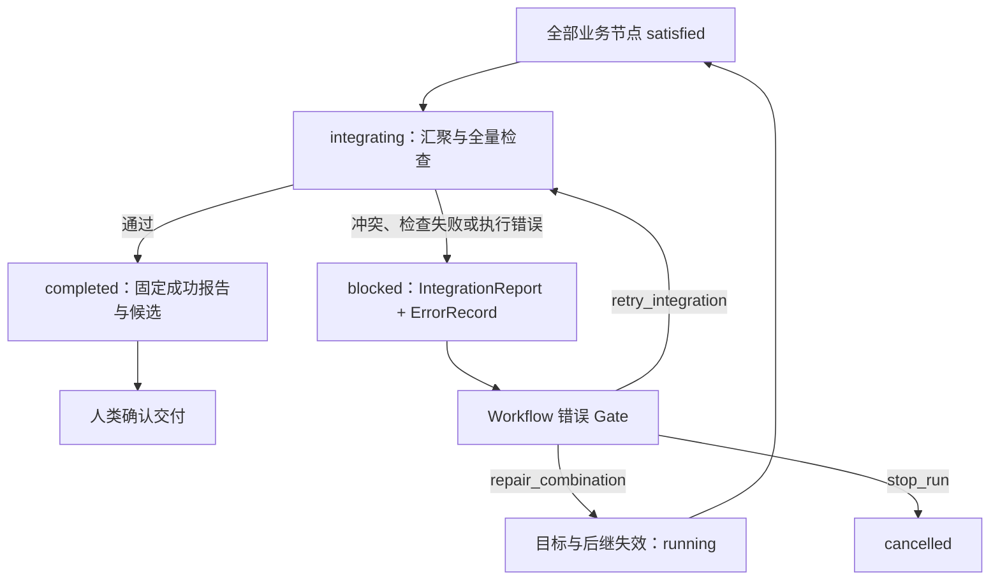

# Execution

一次 Attempt 固定输入，在隔离 Worktree 中执行；Checkpoint、检查和 Gate 通过本地持久状态支持汇聚。最终人类采纳时，一次 squash 提交需求、代码与精简档案到 main。

本文的运行对象路径以最终 `.facetloom/runs/<run-id>/` 表示；执行期间对应 `.facetloom/.runtime/runs/<run-id>/`，相对路径和字节摘要保持一致。保存报告、冻结输入和接受成果均不要求中间 Git 提交。

## 执行时序



本地 waiting_gate 事务落地后即可审核，决策及关联状态事务落地后解锁后继。main 暂不可写只影响最终采纳；本地持久化暂不可用则停止相关推进，先恢复事务，不暴露半状态。

## Context Snapshot

路径：`.facetloom/runs/<run-id>/contexts/<sha256>.yaml`。先在本地运行目录构造，仅最终采纳时随精简档案提交 main。文件按字节 SHA-256 命名，输入变化创建新文件与新 Attempt。

```yaml
schema_version: 1
run_id: <run-id>
source_commit: <full-commit-oid>
requirement_id: 9e2c1f78-6a54-4d92-8e31-05b7a19c2f60
requirement_ref:
  type: artifact
  uri: artifacts://sha256/<requirement-digest>
  digest: sha256:<requirement-digest>
  media_type: text/markdown
workflow_id: development
combination_id: development/feature:login/layer:domain
input_commit: <full-commit-oid>
direct_predecessors: []
input_merge_ref: null                 # 多前驱时引用汇聚清单 Artifact
merge_conflicts: []
recovery_context: null               # 普通首次执行无恢复上下文
context:
  objectives: [实现登录失败限制领域规则]
  source_paths:
    - .facetloom/workflows/development.yaml
    - .facetloom/facets/feature/facet.yaml
    - .facetloom/facets/layer/facet.yaml
  constraints: [不依赖具体基础设施实现]
  reference_paths: [docs/authentication.md]
gates:
  - gate_id: feature/login
    policy:
      mode: human
      evaluator: null
      context:
        objectives: []
        constraints: []
        reference_paths: []
      source_paths: [.facetloom/workflows/development.yaml, .facetloom/facets/feature/facet.yaml]
    policy_digest: sha256:<feature-gate-policy-digest>
  - gate_id: layer/domain
    policy:
      mode: ai
      evaluator:
        schema_version: 1
        id: domain-reviewer
        kind: ai
        runner: reviewer
        runner_profile_digest: sha256:<reviewer-runner-digest>
        instruction: 根据审核要求检查固定输出，逐项引用证据，返回结构化结论。
        timeout_seconds: 300
      context:
        objectives: [审核领域模型及业务边界]
        constraints: []
        reference_paths: [.facetloom/references/domain-review.md]
      source_paths: [.facetloom/workflows/development.yaml, .facetloom/facets/layer/facet.yaml, .facetloom/evaluators/domain-reviewer.yaml]
    policy_digest: sha256:<domain-gate-policy-digest>
execution:
  runner_id: developer
  runner_profile_digest: sha256:<developer-runner-digest>
  resources: {cpus: 2, memory_mb: 4096}
  check_environment:
    image_ref: registry.example.com/project-agent@sha256:<image-digest>
    network: disabled
  read_paths: ["**"]
  write_scope:
    all_of:
      - source: feature/login
        paths: [src/auth/**, test/auth/**]
      - source: layer/domain
        paths: [src/**, test/**]
      - source: runtime
        paths: ["**"]
  checks:
    - check_id: workflow/unit
      argv: [pytest, -q]
      timeout_seconds: 900
      source_path: .facetloom/workflows/development.yaml
  max_check_retries: 2
```

| 内容 | 规则 |
| --- | --- |
| 来源文件 | source_paths 和 reference_paths 相对仓库根，由 source_commit 固定；需求另由 requirement_ref 固定；不含运行档案 |
| Node 与 Scope | 按 DAG members 解析；write_scope.all_of 保留每组路径与来源，禁止把交集压平成路径并集 |
| 前驱输入 | direct_predecessors 各项固定 combination_id、attempt_id、output_commit |
| 执行环境 | 引用 Run.runners 中的固定调用配置及摘要，记录独立读写范围、资源限制、检查环境、检查列表与预算；凭据只记录用途 |
| 修复要求 | recovery_context 引用授权决定、上一 Attempt 与必要证据；指令从决定解析，旧代码仅作参考；规则见下节 |
| Gate 策略 | gates 按 Facet 声明顺序列出每个选中 Node 的 gate_id、完整有效 policy 与 policy_digest；缺项、重复项或来源不匹配时拒绝启动 |

`execution.write_scope.all_of` 按 Facet 顺序保留有 Scope 的 Node，最后一组为 Runtime 写入策略；无 Scope 的 Node 不增加组。某路径只有同时匹配每组 paths 中至少一条规则才允许写入；组内 paths 为空即拒绝全部写入。Scope 不允许写入的定义、资料及运行档案仍由 Runtime 固定规则保护。read_paths 独立生效。

例如上面的范围只允许 `src/auth/**` 和 `test/auth/**`；不能因另一组包含 `src/**` 而放宽到整个 src。Snapshot 保存匹配规则，执行时对实际路径判断，无需枚举未来可能创建的文件。

`policy.context.objectives` 按 Workflow → Node 顺序累积目标，其他约束和资料保留来源。policy.evaluator 保存完整有效审核定义，AI 项再带 runner_profile_digest；执行 runner 和 AI 审核 runner 的摘要都必须与所属 Run.runners 一致。解析时校验 Run、profile 及固定 Git 来源；保存 Snapshot / Attempt 时必须保留所属 Run 和 DAG，不允许清理其固定配置来源。

runner 包含镜像、原生参数与配置，FacetLoom 不重建外部 Agent 的模型或工具系统。本地仅提供凭据、连接和资源上限；无法满足执行配置进入错误 Gate，评估器故障人工接管。check_environment 与 Agent 调用分开，默认使用执行 runner 的镜像并禁网；需要网络等额外检查环境时必须显式固定在 Workflow.execution.check_environment，不根据 Agent 的联网配置自动放宽检查。

`policy_digest` 对 policy 按 RFC 8785（JCS）规范化后的 UTF-8 JSON 字节求 SHA-256；仅允许该规范支持的 JSON 值。Decision / GateReport 的 gate_policy_digest 必须等于对应项摘要。Snapshot 文件名仍对完整 YAML 文件字节求摘要。任务输入变化需要新 Snapshot 与新 Attempt；Workflow、Node 或评估器定义变化需要新 Run。

### 恢复上下文与旧成果

新 Attempt 的工作代码仍从根基线或当前有效前驱生成。Runtime 将旧实现作为只读参考交给 Agent，由 Agent 在当前输入上重新应用合适的改动；不自动 checkout、cherry-pick 或合并旧节点输出。旧检查结果与 Gate 批准不继承。

| 字段 | 定义 |
| --- | --- |
| Attempt.recovery_decision_ref | 触发本次执行的 GateDecision 类型化引用；普通首次执行为 null，恢复及受影响后继重执行时必填，创建后不变 |
| Snapshot.recovery_context | 普通首次执行为 null；需传递恢复材料时保存下列三个字段 |
| decision_refs | 当前仍需遵守的恢复决定引用，按 Runtime 授权落地顺序去重；修复指令从决定解析，不复制正文 |
| prior_attempt_ref | 本节点被替代的上一 Attempt 的 run_record 引用；尚无旧 Attempt 时为 null |
| evidence_refs | 本次所需的 ErrorRecord、失败报告、相关旧成果等类型化引用；旧输入与输出可经 prior_attempt_ref 解析，用于查看差异 |

恢复 Snapshot 的字段片段：

```yaml
recovery_context:
  decision_refs:
    - type: run_record
      run_id: <run-id>
      path: decisions/<decision-id>.yaml
      digest: sha256:<decision-digest>
  prior_attempt_ref:
    type: run_record
    run_id: <run-id>
    path: attempts/<prior-attempt-id>.yaml
    digest: sha256:<prior-attempt-digest>
  evidence_refs:
    - type: run_record
      run_id: <run-id>
      path: errors/<error-id>.yaml
      digest: sha256:<error-digest>
```

恢复事务在清除有效成果引用前，将各受影响节点的旧 Attempt 身份、已固定的输入/输出引用及继承的恢复要求写入现有恢复操作意图，与决定、额度和失效范围一起保存。准备新 Snapshot 只读取这组固定来源，不重新查询“最近一次运行”。旧 Attempt 尚在执行时先撤销并停止或隔离，终态落地后才固定其 run_record 摘要；新 Attempt 不引用仍会变化的记录。无旧输入或输出时明确标为未形成，不使用遗留工作目录拼出旧成果。

decision_refs 保留上一轮尚未完成的恢复要求，再追加本次决定；本节点的新成果被接受前，不因再次失败、取消或换一个恢复动作而丢弃要求。已完成的旧指令通过历史引用追溯，不自动当作新任务；新授权不得静默覆盖旧约束。受影响后继结合自身职责执行修复后的重新对齐，不机械照搬目标节点的任务。材料不足或指令冲突按现有 preparation 错误流程处理，仅缺原材料副本时先补齐。

仅恢复固定外部引用可用性的 retry_current 继续复用原 Snapshot：本次决定只记录在新 Attempt.recovery_decision_ref，原 recovery_context 保持不变，不新增指令。其他改变任务要求或加入恢复材料的情况生成新 Snapshot；普通恢复的 decision_refs 包含本次 recovery_decision_ref。拒绝后的 retry_current 从 ErrorRecord 及其成果拒绝决定解析原因，不把 rationale 当作可扩展需求或 Scope 的授权。

实际 Agent 请求按以下结构明确区分材料，并通过 agent_input_ref 留存：

```text
当前工作代码   → 新 input_commit，可在有效 Scope 内修改
旧成果参考     → 上一 Attempt、旧输入/输出与差异，只读
失败原因       → ErrorRecord、节点或集成失败报告
授权修复要求   → recovery_decision_ref 与 recovery_context.decision_refs 中的决定
```

Adapter 将解析出的必要引用加入本次证据白名单；不存在的旧输出显示“未形成”，不能声称已提供。差异由固定旧输入与输出计算；若作为独立文件交给 Agent，则先保存为 Artifact 并记录引用。所有恢复引用参与既有可读性、摘要校验、Artifact 保护、导出及归档依赖闭包，不改写旧报告或历史 Attempt。

## 前驱代码汇聚

根节点复用 source_commit；直接前驱取最终约简 DAG 快照中每个节点的当前有效输出。只有前驱全部 satisfied 才开始准备。

```text
有效前驱及来源映射
    ↓ 按 Combination ID 排序
Commit 去重 → 去掉被其他输入包含的祖先 Commit
    ↓
累积输入 M + 下一个前驱 H
    ↓ 从真实历史计算共同祖先，执行三方合并
候选 Tree + 冲突清单 → 保留 M、H 为父提交的临时 Commit
    ↓ 重复至全部前驱合并
固定 input_commit → Agent 解决全部冲突 → 执行与检查
```

### 确定性算法

1. 保存所有前驱的 combination_id、attempt_id、output_commit。相同 OID 只参与一次计算，以字典序最小 Combination ID 作为排序键；祖先判定使用 Git 提交图，不比较 Tree。去重和祖先消除不能删除来源映射。
2. 只有一个独立输入时直接复用，不创建空汇聚提交；多个输入按上述键升序折叠。
3. 每一步使用 `git merge-tree --write-tree M H` 的 ort 三方合并。共同祖先由 Git 在双方真实历史中计算；多个最佳共同祖先由固定版本 Git 合成虚拟基线，不任意挑一个，不固定使用 source_commit。不允许无共同历史合并。
4. 每步返回的候选 Tree 写成父提交为 `[M, H]` 的临时 Commit，供下一步计算祖先。临时提交的作者与提交者固定为 `FacetLoom <runtime@facetloom.local>`，时间固定为 `2000-01-01T00:00:00Z`，消息为 `facetloom input merge <step>`（末尾一个 LF，step 从 1 递增），保持同一输入 OID 集合的中间 OID 与冲突标签稳定；最终 input_commit 保留整个父链。
5. Git 工具环境使用 run.yaml.merge_engine 的不可变环境，默认 Git 2.43.0、ort、conflict_style=merge、renames=true、rename_threshold=50%、rename_limit=0（不限制）、diff_algorithm=histogram。隔离用户/系统 Git 配置，禁用 rerere、外部合并驱动、过滤器和换行转换，不允许本地属性覆盖；仓库属性来自固定输入。完整有效参数进入清单，Run 内不切换环境。
6. 退出码 0 为干净结果，1 为有冲突的候选结果，其他值为输入准备错误。缺失对象或共同历史、工具故障及不支持的合并能力进入错误 Gate。

相同输入 OID、顺序和工具环境必须生成相同候选 Tree 与冲突清单。正式输入和 Checkpoint Commit 的时间等元数据不要求跨次 OID 相同。最终多个终端成果的集成汇聚使用相同算法；若有未解决冲突，保存 blocked IntegrationReport 和集成 ErrorRecord，由错误 Gate 在原 Run 内安排节点修复。

### 冲突与输入清单

每步冲突都累积保留，即使后续步骤对同一路径未报冲突，也不能自动删除旧冲突。文本候选保留 Git 冲突标记；二进制、重命名、删改及文件/目录冲突保留 Git 候选 Tree，并在清单列出所有涉及路径、类型、步骤、两侧提交、共同祖先以及各 stage 的 Blob OID / 模式，删除的一侧为 null。清单和需要的 Git 对象随 bundle 持久保存，不能只保留屏幕日志。

~~~yaml
schema_version: 1
kind: input_merge
predecessors: []              # 全部来源，包括去重或被包含的输入
independent_heads: []         # 实际参与计算的有序 Commit
engine: <run.yaml.merge_engine 的完整有效配置>
steps: []                     # M、H、最佳共同祖先、候选 Tree、中间 Commit、冲突
input_commit: <commit-oid>
conflicts: []                 # 各步冲突并集；每项含确定性 conflict_id，不自动标记已解决
~~~

清单作为不可变 Artifact，通过 Context Snapshot.input_merge_ref 引用。每个冲突项的 conflict_id 为 `sha256:` 加该项按 RFC 8785 规范化 JSON 的摘要，摘要输入为 step、排序后的路径及各路径冲突类型。Agent 必须逐项给出解决结果与证据，Runtime 校验 conflict_id 集合完整且不重复、路径范围、Git 对象完整性以及无未合并 index 项；不能只用搜索文本标记判断二进制冲突是否解决。任一冲突 unresolved 时不进入成果 Gate，保留实际材料进入错误 Gate。

汇聚 Agent 负责正常的代码集成冲突。冲突路径超出有效写入范围时在准备阶段报 permission_denied，不启动有越界权限的 Worker。Agent 判断问题来自前驱已批准行为与需求不对齐时，报 upstream_misaligned，引用具体前驱和证据，由错误 Gate 决定是否修复上游；不得静默更改上游责任。

## Agent 输出证据协议

Pre-Assess、执行/修复、Post-Assess、AI Gate 与 Refinement 的外部 Agent 使用同一证据输出协议。每次 Invocation 获得一个全新的专用可写目录 `evidence-out/`，在容器内固定挂载为 `/facetloom/evidence-out`；它只用于提交本次调用生成的证据，不是项目工作目录。调用输入明确指示 Agent 将新文件写入该目录，并在结构化输出的 `evidence_files` 中给出相对路径。已有证据仍通过 `evidence_refs` 引用，但每个引用必须与本次 Invocation 输入中的引用完全一致；不得自行构造 URI 或引用未提供的 Artifact。

Adapter 逐个验证并导入文件到不可变 Artifact Store，之后把 Agent 引用与新生成的类型化 Artifact 引用合并到规范化结果的 `evidence_refs`。Agent 引用必须是本次输入白名单中的引用且不得重复；规范化结果按 Agent 引用的原有次序保留，再按 `evidence_files` 声明次序追加导入引用。导入引用包含 URI、内容摘要和媒体类型；Invocation 记录提交路径、摘要及导入结果。`evidence_files` 只存在于 Agent 原始输出，不写入正式 Report、GateReport 或 Decision。

Invocation 的导入回执保留 Agent 路径到不可变 Artifact 的映射：

```yaml
evidence_imports:
  - submitted_path: pre-assess/input-check.json
    status: committed
    byte_length: 821
    digest: sha256:<file-digest>
    media_type: application/json
    artifact_ref:
      type: artifact
      uri: artifacts://sha256/<file-digest-hex>
      digest: sha256:<file-digest-hex>
```

`status` 为 `committed` / `rejected` / `not_imported`；仅 `committed` 项有 `artifact_ref`。只有整批导入清单提交成功后才能将项目标为 committed。批次失败时记录错误路径及原因，其余未导入项目不产生 Artifact 引用。

```json
{
  "evidence_refs": [
    {"type": "artifact", "uri": "artifacts://sha256/<hex>", "digest": "sha256:<hex>"}
  ],
  "evidence_files": ["pre-assess/input-check.json", "screenshots/login.png"]
}
```

导入器只接受专用目录内的普通文件；调用结束并确认容器退出后冻结目录，再拒绝绝对路径、`.` / `..` 路径段、非规范相对路径、反斜线、任一层级的符号链接、硬链接、重复路径、目录及其它非普通文件。每次调用最多 100 个文件，单文件最多 10 MiB，合计最多 100 MiB。Adapter 先把全部文件暂存并验证摘要，再一次性发布导入清单；任一文件校验、读取或持久化失败时，整份结构化结果无效，不发布部分 Report 或 `evidence_refs`。未引用的暂存 Artifact 不作为运行证据，可在确认无引用后清理。

Agent 可以省略 `evidence_files`，视为空列表。无效路径、超限、重复/未提供的引用或证据导入失败均使该调用无效。Worker 的 Pre-Assess、执行与 Post-Assess 故障进入 Workflow 错误 Gate；AI Gate 以 `GateReport.status: error` 交人类接管，不递归调用错误 Gate；Refinement 保留失败会话供人处理。Adapter 不猜测、改写或补造证据。Script Gate 继续直接返回已校验的类型化 `evidence_refs`，不使用文件导入协议。

## Pre-Assess

每个 Attempt 先由 Adapter 使用固定 runner 发起独立只读调用与新原生会话。输入为 Context Snapshot、Requirement、选中 Node 上下文及已接受前驱证据；不挂载可写 Worktree、Git 凭据、Git 元数据或 Podman Socket。Adapter 必须在 `probe` 时确认原生结构化输出能力，不从自然语言推测字段。

~~~json
{
  "schema_version": 1,
  "readiness": "ready",
  "applicability": "applicable",
  "summary": "输入足以实现并验证锁定期限行为。",
  "missing_inputs": [],
  "risk_findings": [],
  "evidence_refs": [],
  "evidence_files": []
}
~~~

| 字段 | 规则 |
| --- | --- |
| readiness | `ready` 或 `blocked` |
| applicability | `ready` 时必填 `applicable` 或 `not_applicable`；`blocked` 时必须为 null |
| summary | 非空说明 |
| missing_inputs | `blocked` 时至少一项，`ready` 时为空；每项含说明、可选的 Snapshot `source_refs` 和支撑说明的 evidence_refs |
| risk_findings | 风险说明及 evidence_refs；只传入成果 Gate，不动态新增 Gate，不阻塞执行 |
| evidence_refs | Agent 原始输出只能引用本次输入明确提供的类型化证据；规范化 Report 保存校验后的引用。not_applicable 至少一项 |
| evidence_files | Agent 原始输出中的新证据相对路径列表，按本节协议导入；不进入 PreAssessReport |

`ready + applicable` 才启动代码执行。`ready + not_applicable` 跳过代码执行并复用 input_commit，但仍执行必要检查、Post-Assess 和所有成果 Gate；若 input_merge 清单含未解决冲突，则不能据此跳过冲突处理，转错误 Gate。有效 `blocked` 报告创建 stage=`pre_assess`、code=`pre_assess_blocked` 的 ErrorRecord，不启动执行；Runtime 保留报告供恢复决策。只有报告在 `missing_inputs[].source_refs` 明确列出 Snapshot 中的固定引用，且 Runtime 验证它当前仅因可恢复的外部可用性故障暂不可读时，才记录 `wait_condition` 并允许错误 Gate 选择 wait。需求内容本身不足、引用不存在、摘要不匹配、输出结构无效或 Applicability 不明确都不能 wait；修改需求需创建新 Requirement；仅执行定义变化时提交定义并创建新 Run。风险发现是固定成果审核输入的一部分，不临时扩充策略。

PreAssessReport 保存在 `.facetloom/runs/<run-id>/reports/<report-id>.yaml`，`report_type: pre_assess`，内容不可变。报告包含 schema_version、report_id、run_id、combination_id、attempt_id、invocation_ref、readiness、applicability、summary、missing_inputs、risk_findings、evidence_refs、created_at。invocation_ref 是不含报告自身的不可变 Invocation 证据 Artifact。有效报告通过 Attempt.pre_assess_ref 引用；blocked 时 ErrorRecord.evidence_refs 引用报告。预检未形成有效报告时，ErrorRecord 引用可用的调用输入、原生输出与故障证据，不伪造报告。输入不足不伪造成 ExecutionResult 或 CheckReport。

~~~yaml
schema_version: 1
report_type: pre_assess
report_id: <uuid>
run_id: <run-id>
combination_id: <combination-id>
attempt_id: <attempt-id>
invocation_ref:
  type: artifact
  uri: artifacts://sha256/<invocation-digest-hex>
  digest: sha256:<invocation-digest-hex>
readiness: ready
applicability: applicable
summary: 输入足以完成本节点任务。
missing_inputs: []
risk_findings: []
evidence_refs: []
created_at: "2026-11-09T12:00:00Z"
~~~

## 外部执行结果

每次执行或修复调用都要求 Adapter 从 Agent 原生结构化输出解析 `ExecutionResult`。运行时要求的结构化输出能力由 Adapter `probe` 确认；缺失、格式错误、字段越界或证据引用无效均为执行故障，进入错误 Gate，不从自然语言猜测结论。

~~~json
{
  "schema_version": 1,
  "summary": "实现锁定期限校验与剩余时间返回。",
  "evidence_refs": [],
  "evidence_files": [],
  "conflict_resolutions": []
}
~~~

| 字段 | 规则 |
| --- | --- |
| schema_version | 必须为 1 |
| summary | 非空简述 |
| evidence_refs | Agent 原始输出只能引用本次输入明确提供的类型化证据；规范化 ExecutionResult 保存校验后的引用 |
| evidence_files | Agent 原始输出中的新证据相对路径列表，按本节协议导入；不进入 ExecutionResult |
| conflict_resolutions | 无输入冲突时为空；有冲突时必须逐项覆盖输入清单中的每个 conflict_id，记录 `resolved` 和 evidence_refs；resolved=false 时转错误 Gate |

`ExecutionResult` 不声明是否适用或是否有代码变化。Runtime 比较最终输出与 input_commit 的 Git Tree，结合 PreAssessReport、Scope 和冲突清单决定 outcome：适用且有改动为 `changed`；适用且无改动为 `no_change`；预检不适用且无改动为 `not_applicable`。修复调用必须返回完整新 `ExecutionResult`；Runtime 只采用最终候选对应的结果，旧结果保留为 Invocation 历史。不适用 Attempt 不产生 ExecutionResult，其 Post-AssessReport 将 execution_result_ref 设为 null 并引用 PreAssessReport。

## 必要检查与同次修复

三类检查分别回答不同问题：

| 检查 | 执行与记录 | 对接受或交付的作用 |
| --- | --- | --- |
| 节点必要检查 | Runtime 检查当前候选，写入 CheckReport | 必须完整执行；失败证据可由成果 Gate 按当前节点职责判断 |
| Gate 审核检查 | 评估器检查固定成果，写入 GateReport | 支持本项审核决定，不补写或替换 Attempt 的冻结材料 |
| 最终集成检查 | Runtime 检查完整交付候选，写入 IntegrationReport | 非空 integration.checks 必须全部通过，才允许请求人类交付确认 |

“必要”指必须执行并形成完整证据，不表示每项失败都自动拒绝节点成果。成果接受规则见 [成果 Gate](03-governance.md#gate-模式与职责)；检查事实与审核决定分别保留。

Runtime 从 Workflow 和选中 Node 累积必要检查，将限定 ID、argv、超时、来源、环境和 max_check_retries 固定到 Snapshot。检查程序由 Runtime 在独立候选副本中运行，不依赖外部 Agent 自己执行或汇报。检查由 Runtime 调度并记录真实退出结果，Worker 自报通过不能替代检查记录。命令配置来自 source_commit；受信检查入口脚本从该 Commit 提供，不能被候选代码替换。被检查的实现和测试内容来自本轮候选 Tree。

```text
Agent 执行 / 解决冲突
    ↓ 固定本轮候选 Tree
全部必要检查
    ├── 全部通过 → 最终 Checkpoint → 独立只读 Post-Assess → 冻结成果材料
    ├── 检查失败、任务适用且还有额度 → 同一 Worker 修复 → 全量重检
    ├── 检查失败且任务不适用 → 保留失败报告 → Post-Assess → 成果 Gate
    ├── 额度耗尽且证据完整 → 最终 Checkpoint → 独立只读 Post-Assess → 成果 Gate
    └── 无法执行或必要证据未形成 / 不可恢复 → ErrorRecord → 错误 Gate
```

仅当前 clone 缺少已形成证据的副本时，暂停依赖该材料的操作并补齐原引用内容；不伪造失败结果，也不重新生成冻结证据。

- 默认先检查一次，失败后最多修复并重检 2 次；max_check_retries=0 时首轮之后直接提交完整结果。
- 每轮按有效列表顺序执行全部检查，不因测试失败跳过其余项；命令无法启动等执行错误可中止该轮，其余项记 not_run。每项记录 check_id、round（从 1 开始）、evaluated_tree、passed / failed、退出码或 timeout、证据引用及使用环境。
- 检查在该候选 Tree 的隔离副本运行，可写临时产物；不能把测试生成或修改的受跟踪文件带回成果。任何 Agent 代码修改都会使已有检查结果对新 Tree 失效，需要全量重检。
- 已启动命令的非零退出或超时属于 failed 证据。命令无法启动、环境不可用或结果证据丢失属于执行错误，不用虚假 failed 结果补齐列表。
- 任务适用且检查失败时，Adapter 续接执行会话反馈，外部 Agent 自行修复；每次续接先返回新的 ExecutionResult。无法安全续接则报错转错误 Gate，不在 Runtime 内实现模型/工具循环。不适用时没有执行会话，不启动修复；检查结果完整即交成果 Gate。修复轮次用尽后只允许对最终已检查 Tree 生成正式 Checkpoint；代码再变化必须新 Attempt。零项检查记录空清单，不能虚称有测试通过。
- 每轮日志保存在 Artifact；精简档案保留最终 Tree、有效检查结论、修复次数及各轮证据引用。最终 Checkpoint Tree 必须等于最后一轮 evaluated_tree。

检查修复预算只约束当前 Worker；错误 Gate 创建新 Attempt 或安排上游修复使用独立的 Run 级自动恢复额度。最终交付条件见 [IntegrationReport](#integrationreport)。

### Post-Assess

Post-Assess 由 Adapter 使用同一固定 runner 发起独立调用和新原生会话。输入是最终 Checkpoint、对应 CheckReport、PreAssessReport、可选 ExecutionResult 与只读审核任务；不适用 Attempt 没有 ExecutionResult。容器将成果和报告只读挂载，另提供隔离的可写临时目录，不挂载 Git 写入凭据、Git 元数据或 Podman Socket。Runtime 核验候选 Tree 未变化；尝试写入只读成果、退出失败、超时或返回无效结构均为错误 Gate。容器和 Invocation 与执行阶段分别记录，但计入同一 Worker 的 deadline；不创建第二个 Worker。

~~~json
{
  "schema_version": 1,
  "status": "complete",
  "summary": "代码变更满足任务范围，检查报告覆盖最终 Tree。",
  "findings": [],
  "evidence_refs": [],
  "evidence_files": []
}
~~~

`status` 为 `complete` 或 `concerns`。`concerns` 必须带非空 findings；两种状态都须有非空 summary。Agent 原始输出的 `evidence_refs` 只能引用本次输入明确提供的证据，`evidence_files` 按统一协议导入；规范化 Post-AssessReport 仅保存类型化 `evidence_refs`。报告按 Attempt 的 output_refs 固定为执行证据。`concerns` 不自动判失败，由成果 Gate 审核；只读调用试图改成果、退出失败、超时或返回无效结构均使 Post-Assess 失败，形成 ErrorRecord 并进入错误 Gate。不得重新运行自检来覆盖此前报告。

Post-AssessReport 保存在 `.facetloom/runs/<run-id>/reports/<report-id>.yaml`，`report_type: post_assess`，内容不可变。必需字段为 schema_version、report_id、run_id、combination_id、attempt_id、evaluated_tree、pre_assess_ref、check_report_ref、execution_result_ref、invocation_ref、status、summary、findings、evidence_refs、created_at。invocation_ref 是不含报告自身的不可变调用证据 Artifact；execution_result_ref 在 not_applicable 时为 null，其它 outcome 必须引用有效结果。本地保存前校验报告 Tree 等于最终 Checkpoint Tree、输入引用均可读取且匹配摘要；报告自身作为 role=evidence 的 run_record 加入 Attempt.output_refs。

```yaml
schema_version: 1
report_type: post_assess
report_id: <uuid>
run_id: <run-id>
combination_id: <combination-id>
attempt_id: <attempt-id>
evaluated_tree: <full-tree-oid>
pre_assess_ref: reports/<pre-assess-report-id>.yaml
check_report_ref: reports/<check-report-id>.yaml
execution_result_ref: null
invocation_ref:
  type: artifact
  uri: artifacts://sha256/<invocation-digest-hex>
  digest: sha256:<invocation-digest-hex>
status: complete
summary: 检查报告覆盖最终 Tree，变更符合任务范围。
findings: []
evidence_refs: []
created_at: "2026-11-09T12:00:00Z"
```

### CheckReport

路径：`.facetloom/runs/<run-id>/reports/<report-id>.yaml`。这是 Runtime 的检查执行记录，不是 GateReport。每个 Attempt 结束检查或因检查报错时固定一份，后续不覆盖；轮次中的实时进度只存本地。

| 字段 | 定义 |
| --- | --- |
| schema_version、report_type、report_id | 格式为 1，report_type=checks，UUIDv4 |
| run_id、combination_id、attempt_id | 所属尝试 |
| context_snapshot_ref | 包含完整有效检查清单和环境的 Snapshot |
| max_check_retries、repairs_used | 固定预算与已使用修复次数 |
| rounds | 按 round 升序记录候选 Tree 与各项执行结果 |
| status | passed / failed / error；error 表示无法形成完整的节点最后一轮检查结论 |
| final_round | passed / failed 时必填，指向完整最终轮次；error 时 null |
| reason、created_at | failed / error 的原因，以及 UTC 时间 |

~~~yaml
schema_version: 1
report_type: checks
report_id: <uuid>
run_id: <run-id>
combination_id: development/feature:login/layer:domain
attempt_id: <attempt-id>
context_snapshot_ref: contexts/<sha256>.yaml
max_check_retries: 2
repairs_used: 0
status: passed
final_round: 1
rounds:
  - round: 1
    evaluated_tree: <full-tree-oid>
    results:
      - check_id: workflow/unit
        status: passed
        exit_code: 0
        timed_out: false
        evidence_refs: []
created_at: "2026-11-09T12:00:00Z"
~~~

每轮 results 按 Snapshot 清单逐项对应，状态为 passed / failed / error / not_run。passed 要求命令真实启动、正常退出且 exit_code=0；超时为 failed、timed_out=true；无法启动为 error，之后未执行项为 not_run。没有真实退出码时 exit_code=null，日志经 evidence_refs 引用。

仅最终轮次完整、每项均为 passed / failed 时可填写 final_round；全部 passed 则报告 passed，否则为 failed。error / not_run 不能算作已经完成的必要检查。零项检查记录 results=[]，报告 passed 只表示没有待完成的配置检查，不声称执行过测试。

成果 output_refs 必须有 role=evidence 的 run_record 引用指向该 CheckReport；final_round 的 evaluated_tree 必须等于代码输出 Tree，且 repairs_used 不超过预算。任务适用且检查失败、仍有修复额度时继续修复；不适用且检查完整时不修复，保留失败结果交成果 Gate。检查错误时把报告引用写入 ErrorRecord.evidence_refs，不能把 error 报告包装成完整成果。

## 实际初始输入

Context Snapshot 是有效输入清单；Adapter 实际交给外部 Agent 的初始任务、启动参数、工作目录、配置摘要及附件清单作为 Artifact 留存；工具声明仅在调用协议实际提供时记录。附件内容内联或使用可恢复的不可变引用，不能只记录临时路径。动态工具结果与后续对话按日志规则保存，不要求写入初始输入 Artifact。

| 引用 | 所属记录 | 保存时机 |
| --- | --- | --- |
| agent_input_ref | Attempt | 首次 Pre-Assess 调用前保存实际初始请求；waiting_gate 前验证持久可读 |
| request_input_ref | GateReport | 调用自动评估器前保存实际初始请求；保存报告前验证持久可读 |

```yaml
agent_input_ref:
  type: artifact
  uri: artifacts://sha256/<input-file-bytes-digest-hex>
  digest: sha256:<input-file-bytes-digest-hex>
  media_type: application/json
```

Adapter 先将实际输入原子保存到本地 Artifact 库并计算摘要，再传入同一内容，不能事后根据定义重新生成来代替原请求。引用在请求形成时固定，后续导出或导入不改变它，也不改写 Attempt 输入。调用是否送达未知时按本地调用记录对账，不能声称请求一定送达或自动重复发送。

留存内容只覆盖 FacetLoom 交给外部 Agent 的输入；它不等于 Agent 发给模型服务的完整请求。凭据由运行环境或连接层注入，不进入留存内容。不记录无法观测的原生系统提示、模型内部状态或内部压缩结果；Agent 未报告的模型及工具版本记 null，不宣称已固定。Gate 请求不包含自身 request_input_ref，避免自引用。

每次启动或续接都分配独立 invocation_id，先保存输入再调用。同次修复反馈携带实际检查结果与请求引用；不能用 agent_input_ref 代表后续全部对话。完整调用清单作为不可变 Artifact，至少记录 runner/profile 摘要、镜像 digest、Adapter 与程序版本、原生 session_id（可空）、各次输入引用、实际 argv（脱敏）、事件/结果日志和退出状态。

成果冻结前将调用清单加入 output_refs 的 evidence；执行失败加入 ErrorRecord 证据；Gate 使用 GateReport.evidence_refs；Refinement 保存于本地会话及其提交依据。它们不记录原生隐藏推理，也不把原生 exit_code=0 当作检查或审核通过。调用清单不得引用包含它的对象，避免循环摘要。

## 固定审核输入

```text
执行、必要测试与 Post-Assess 完成
    ↓
代码、执行证据及初始请求持久化并校验
    ↓
固定审核输入 → 本地事务保存 waiting_gate
    ↓
各 Gate 审核 → 分项报告与决策 → 全部批准
```

进入成果 waiting_gate 前，Runtime 确认有效 PreAssessReport、全部必要检查和 Post-Assess 对应最终代码，适用任务还有执行结论，所有引用可读且摘要匹配。检查结束不等于检查通过；预算耗尽或不适用时的完整失败结论可以交由成果 Gate 判断。无法形成必要材料时创建 ErrorRecord，走错误 Gate。

`review_input_digest` 为以下五个字段组成对象按 RFC 8785（JCS）规范化后的 UTF-8 JSON 字节的 SHA-256，格式为 `sha256:<hex>`：

```json
{
  "context_snapshot_ref": "contexts/<sha256>.yaml",
  "input_commit": "<full-commit-oid>",
  "outcome": "changed",
  "summary": "实现登录失败限制，执行检查已完成",
  "output_refs": [
    {"role": "code", "ref": {"type": "git_object", "object_type": "commit", "oid": "<output-commit-oid>"}}
  ]
}
```

示例仅展示摘要结构；实际 output_refs 包含全部执行证据及必要的 bundle 引用。上述字段进入 waiting_gate 后冻结，连同引用内容均不得修改、追加或替换。代码引用解析出的 Tree 必须等于 evaluated_tree；agent_input_ref 在发送前已固定，不随审核变化。

状态、时间及 gate_report_refs / gate_decision_refs 可继续推进，但不进入审核输入摘要。各 Gate 的报告、建议和决策理由是审核输出，不写回 output_refs，也不自动成为其他 Gate 的输入。评估请求、GateReport 和 GateDecision 都携带 review_input_digest；Runtime 重新计算并校验，不能仅相信记录中的摘要。

缺少执行证据时成果 Gate 返回 Blocked / Escalated。仅当前 clone 缺少已固定引用的内容时，先导入原内容，不修改审核材料、不使 Attempt 失败，也不新建 Attempt；需要这些材料的审核暂停。Runtime 确认必需证据从未形成、已不可恢复或必须新增材料时，将旧 Attempt 置为 failed，通过 ErrorRecord 交由错误 Gate 决定是否新建 Attempt。成果拒绝同样转错误处置；新 Attempt 的全部成果 Gate 必须重新审核，不新增审核轮次或仅审核的 Attempt 类型。评估器故障可由人类请求对原固定材料重评；人类仅解释已有材料时，将理由记录在 Decision 中。

## Checkpoint 与代码保留

```text
source_commit
    ├── detached Worktree A → output A
    └── detached Worktree B → output B
                                  ↓
                         汇聚 input_commit
                                  ↓
                        Worker → output_commit
```

Git Manager 为有代码变化的 Attempt 创建一个输出 Commit，以 input_commit 为唯一父提交；无修改沿用输入 Commit，不创建空 Commit。Post-Assess 必须基于该固定输出，不能在生成 Checkpoint 后继续改代码；进入 waiting_gate 前只登记最终 Checkpoint，较早的中间本地快照不作为正式输出。修改范围由 Runtime 校验，Worker 不能修改固定定义、任何 Requirement 文件或 `.facetloom/runs/`；采纳时由 Git Manager 写入冻结需求。资料和定义的改善由人类发布或 Refinement 完成。

| Checkpoint 字段 | 定义 |
| --- | --- |
| schema_version、checkpoint_id | 格式为 1，ID 为 UUIDv4 |
| run_id、combination_id、attempt_id | 所属对象 |
| input_commit、output_commit、output_tree | 代码输入与结果 |
| changed_paths | 仓库相对路径列表 |
| recovery_bundle_ref | 输出仅在本地存在时必填；main 历史已保留或已有持久 bundle 时可引用既有恢复来源 |
| created_at | UTC ISO 8601 |

本地使用 `.runtime/worktrees/` 下的 detached Worktree 锚定仍需恢复的输入与输出 Commit；中间对象在有后继锚定或 bundle 验证通过前不移除 Worktree。无需 Run、Input 或 Checkpoint 命名分支。

跨 clone 或长期引用、且未由 main 历史保留的代码输出，必须先导出自包含 Git bundle，覆盖复核所需的输入、输出、父提交与 Tree，再保存到本地 Artifact 库。用空临时仓库验证 bundle 可导入且包含所需对象，校验摘要后才保存引用。跨 clone 传递时将该文件收入 Artifact 交换包；接收方校验后才能从中恢复对象。日志中的裸 OID 不作为持久化保证。没有代码变化也需保证 input_commit 来自 main 可达历史或已有有效 bundle。

## Artifact 存储与交换

Artifact Store 是每个 clone 自有的持久文件库。单 clone 执行不依赖 S3、Git LFS 或共享存储；Git 共享档案与引用，Artifact 内容按需用独立文件传递。S3 等后端留作后续扩展。

日常证据主要在产生它的 clone 内使用。导出 Artifact 交换包是可选协作操作，不是运行完成或采纳的前置条件；代码恢复所需 Git bundle 的本地生成与保留要求仍按上节执行。

### 对象与目录

| 对象 | 定义 | 保存位置 |
| --- | --- | --- |
| ArtifactRef | 文件原始字节的 SHA-256 身份，不包含存储位置或凭据 | 运行记录及其它类型化证据 |
| 本地 Artifact 库 | 按摘要保存的不可变文件及依赖元数据 | 当前 clone 的 `.facetloom/.runtime/artifacts/` |
| Artifact 交换包 | 清单与完整依赖文件的独立归档，供协作者手动传递 | 用户指定的 Git 外路径 |
| Git bundle | 自包含的代码恢复文件，也是普通 Artifact | 本地库；需要分享时收入交换包 |
| 本地清理回执 | 一次人工 purge 的范围、原因、进度与结果 | 本地库，不进入 main |

```text
.facetloom/.runtime/artifacts/       # 持久数据，不作为临时缓存清空
├── objects/sha256/<hex>            # 原始文件；同 clone 内按摘要去重
├── entries/<hex>.yaml              # 大小、类型及直接 dependency_refs
├── staging/<operation-id>/         # 尚未提交的导入或导出材料
├── imports/<operation-id>.yaml     # 整包导入回执
└── purges/<operation-id>.yaml      # 本地清理回执 / tombstone
```

各项目 clone 使用独立目录，不跨项目共享对象。内容身份只由字节确定，媒体类型描述用途，不参与摘要。ArtifactRef 沿用 `{type, uri, digest, media_type}`；URI 固定为 `artifacts://sha256/<64位小写hex>`，digest 为相同值的 `sha256:<hex>`。URI 不是网络下载地址，也不说明其它 clone 是否持有内容。

写入先暂存、计算摘要、fsync，再原子发布文件与有效 entry；entry 的提交复用本地文件事务。已有对象重新校验后复用，不能覆盖摘要不符的文件。Runtime 在保存结构化输入、调用清单等内容时，同时登记其中的直接类型化依赖；普通日志、图片等无依赖。导入失败留下的文件不生成有效 entry，不可通过目录扫描冒充已提交内容。完整日志的持久引用须先进入此库，临时日志路径不能作为 ArtifactRef。

### 可用性与使用边界

| 当前 clone 的情况 | 展示与处理 |
| --- | --- |
| 有有效 entry，文件及摘要匹配 | 本地可用 |
| 无内容且没有清理回执 | 尚未导入；列出缺失摘要 |
| 内容已由本地 purge 删除 | 已在本地清理；展示原因，可重新导入相同内容 |
| 已登记但文件丢失或摘要不符 | 缺失或损坏；阻止使用，不视为检查失败 |

可用性按当前文件检查，不写回不可变引用或审核摘要；重新导入成功后优先显示本地可用，旧清理回执仍保留。拥有者采纳归档前验证所需内容已在自己的库中持久可读，不要求其它 clone 已持有。同步 Git 只获得记录；从 Git 回退记录也不会恢复已删除的 Artifact。

查看摘要无需所有文件。审核、执行、代码恢复或导出需要的材料缺失时，列出缺项并暂停该操作，不能跳过检查或视为通过。导入既有引用的原内容不属于追加执行证据，不改变冻结字段。界面只读查看仍可继续；恢复内容后由用户重试原操作，不自动推进活动 Run。

### 显式导出与导入

```text
clone A：固定 Git 记录 或 本地不可变快照 → 收集依赖 → 导出交换包
                                                        ↓ 现有渠道
clone B：校验来源、摘要与依赖闭包 → 原子导入本地库 → 按需复核
```

交换包是独立未压缩 tar，包内只有 `manifest.yaml` 和 `objects/sha256/<hex>` 普通文件。来源有两种，可在同一包中组合：

```yaml
schema_version: 1
kind: artifact_exchange
source_records:
  - type: git_file                     # 已采纳档案，Git 历史另行同步
    commit: <full-commit-oid>
    path: .facetloom/runs/<run-id>/attempts/<attempt-id>.yaml
    blob_oid: <blob-oid>
    digest: sha256:<record-file-digest>
  - type: local_snapshot               # 未采纳、失败或取消的本地记录
    run_id: <run-id>
    index_ref:
      type: artifact
      uri: artifacts://sha256/<snapshot-index-digest>
      digest: sha256:<snapshot-index-digest>
      media_type: application/yaml
artifacts:
  - digest: sha256:<hex>
    byte_length: 821
    media_type: application/yaml
    dependency_refs: []
```

| 来源 | 固定方式与校验 |
| --- | --- |
| git_file | 校验 Commit、路径、Blob 和字节摘要；本地缺少历史时先通过 Git 补齐，不强制联网 |
| local_snapshot | Run 锁下冻结选中记录及其闭合依赖，各文件原始字节保存为 Artifact；索引按路径排序，列出 `{run_id, path, record_ref}`，record_ref 为文件 ArtifactRef；索引本身也是 Artifact |

本地快照使用相对运行目录的路径解析 run_record；引用其它 Run 的不可变记录时也列入索引，无法固定其内容或同一 `(run_id, path)` 对应不同摘要时拒绝导出。run_record 的 digest 必须等于 record_ref.digest。索引和结构化记录的 entry 登记真实类型化依赖；run_record 经该索引解析，不能混用同路径的当前运行文件。固定完成后在锁外打包，所需 Artifact 保持保护。它是只读证据快照，不携带队列、Worker 身份、凭据或恢复执行的权限。

1. **导出**：选择 Git 记录或本地 Run 记录。沿 run_record、git_file、git_object 的恢复来源及 Artifact.dependency_refs 收集完整传递依赖，按内容去重，拒绝非法循环。结构化对象按已知 Schema 识别引用，不扫描任意文本猜测；缺少必要记录或内容时整包失败，列出缺项。
2. **形成文件**：只打包必需 Artifact，包括本地快照的索引与记录字节；不打包整个 `.runtime/`。临时文件全部校验并持久化后原子改名到用户指定 Git 外路径。git_file 指向的历史仍由 Git 传递，快照不冒充 main 中的已采纳记录。
3. **校验**：核对来源、依赖闭包、大小和逐文件摘要；拒绝缺项、多余成员、重复条目/摘要、链接、非普通文件、绝对或越界路径。只流式读取规定成员，不任意解压。清单大小、文件数和总字节数受本地资源上限约束，导入前展示总量；不套用单次 Agent 证据上限，以允许较大的 bundle。
4. **导入**：全部校验后，通过本地事务一次提交 entry 与整包回执；重复内容复核后复用。未提交内容不可见，已提交事务幂等重放；失败不发布有效的部分导入结果。快照只存为 Artifact，不覆盖 `.runtime/runs/` 或 main 档案。

摘要证明内容匹配，不代表来源可信或成果已批准。导入不执行脚本、不修改 main、不采纳需求、不接管 Worker，也不启动或恢复 Run。代码恢复是后续显式操作，仍须验证 Git bundle。

### 保留与人工 purge

默认长期保留，不自动按 TTL 删除，也不因导出成功删除源内容。Refinement 仅整理 Git 记录，与物理清理独立。

| 引用或使用情况 | 本地删除规则 |
| --- | --- |
| 活动运行、待审核、待交付、交付在途、仍用于恢复 | 保护其完整依赖，不允许 purge |
| main 当前保留的其它有效记录仍依赖 | 保留，包括经 git_file 固定到历史文件的依赖 |
| 本地精炼会话、未完成事务或导入/导出正在使用 | 暂时保护；完成或显式结束后重新评估 |
| 仅 Git 历史记录依赖，或已确认无引用 | 人工预览、确认后可 purge；历史内容将无法在本地取回 |

purge 先重新读取本地 main，扫描当前保留记录与全部本地使用者的传递依赖，生成包含对象、字节数、历史影响和阻止原因的预览。无需联网或获取远端更新，也不承诺检查其它 clone 尚未同步的引用。无法完成本地引用检查时不允许删除；预览后有新引用或状态变化须重新计算并确认，不依靠“Run 已完成”判断。

确认后先持久化本地回执，记录 operation_id、对象摘要、操作者、原因、确认范围摘要及进度，再逐项删除文件和有效 entry 并验证。新引用、导入/导出和删除使用同一库锁协调；锁内重新检查保护范围。中断后按回执重放，已不存在的目标按已删除处理；删除失败保留待完成状态，不虚报成功。并发锁及重放职责见 [Services](05-services.md)。

回执只说明当前 clone 的副本已被清理，不表示全局销毁。它不进入 Git，不改写 ArtifactRef、Attempt 或历史决策。重新导入相同字节恢复本地可用性；导出包、其它 clone 和备份由各持有者管理。普通运行目录或 Worktree 回收必须保留 Artifact 库；项目备份与迁移需显式包含它。

## 证据引用

引用本体使用 `{type, ...}`，例如 git_object、git_file、artifact、run_record。`output_refs` 使用 `{role, ref}` 包装引用本体；`evidence_refs`、`related_refs` 及单个通用引用字段直接使用本体，不再套 role/ref。已明确定义为内部路径的 context_snapshot_ref 等字段保持其紧凑格式。

小型对象留在运行档案；实际初始请求、大日志、完整对话、截图与 bundle 留在 Git 外。main 只保存简短结论、URI 和摘要。以下是 output_refs 的代码引用及恢复来源：

```yaml
output_refs:
  - role: code
    ref:
      type: git_object
      object_type: commit
      oid: <full-commit-oid>
      recovery_bundle_ref:
        type: artifact
        uri: artifacts://sha256/<bundle-digest-hex>
        digest: sha256:<bundle-digest-hex>
        media_type: application/x-git-bundle
  - role: evidence
    ref:
      type: artifact
      uri: artifacts://sha256/<digest-hex>
      digest: sha256:<digest-hex>
      media_type: application/json
```

已经由 main 可达历史保留的代码 Commit 可以省略 recovery_bundle_ref。Artifact 引用使用内容身份，不使用发布方本地路径；发布前验证发布方本地库中的内容可读且摘要匹配。其它 clone 通过交换包获取内容，Git 中的引用本身不保证当地可用；普通临时文件路径不满足持久化要求。

仓库文件引用固定到 Commit，Refinement 清理后仍可解析：

```yaml
evidence_refs:
  - type: git_file
    commit: <full-commit-oid>
    path: .facetloom/runs/<run-id>/summary.md
    blob_oid: <full-blob-oid>
    digest: sha256:<file-bytes-digest>
```

同一 Run 中的不可变小文件可按内容引用，避免新文件引用自身所在 Commit 的循环：

```yaml
related_refs:
  - type: run_record
    run_id: <run-id>
    path: decisions/<decision-id>.yaml
    digest: sha256:<file-bytes-digest>
```

run_record 的路径相对对应运行目录，不得越出目录。Context Snapshot、ErrorRecord、Decision、Checkpoint 和 Report 引用的目标须在本地完成视图中存在且摘要匹配；本地快照按索引解析。最终归档时所有 run_record 目标须同 Commit 收录或已存在于保留档案中，不能留下只在拥有者本地可解析的小文件引用。清理时保留有效引用目标；仅当引用字段可更新时，才可先转换成删除前 Commit 的 git_file。不可变对象或 Attempt 的冻结字段仍被保留时，其依赖也保留。Attempt 用稳定 ID 关联；审核材料由 review_input_digest 校验，记录并发写入另用完整 Attempt 文件摘要。

### 执行结论与代码一致性

| outcome | 代码条件 | 额外条件 |
| --- | --- | --- |
| changed | 输出 Tree 不同于 input_commit 的 Tree | 全部变更满足有效写入范围，冲突已逐项解决 |
| no_change | 输出 Commit 直接复用 input_commit | 任务适用，已有输入满足目标，无需修改 |
| not_applicable | 输出 Commit 直接复用 input_commit | PreAssessReport 声明不适用，附原因和证据 |

比较包含路径、内容和 Git 文件模式，不能仅比较文件列表。输入仍有未解决冲突时不得以 no_change / not_applicable 绕过解决义务。changed 和 no_change 要求 PreAssessReport.applicability=applicable；not_applicable 要求预检明确不适用且零变更。三种结论都需要最终 CheckReport、只读 Post-Assess 和全部成果 Gate；not_applicable 不删除 DAG 节点或跳过必要检查。

output_refs 在成果 waiting_gate 前可为空；Attempt 处于 waiting_gate 时必须有且仅有一个 role: code 引用。错误 Gate 不要求代码输出，使用独立 ErrorRecord。outcome 为 changed、no_change 或 not_applicable；不适用结论须有可核对的理由，且经过该 Attempt 的全部 Gate。拒绝、失败或取消的输出不能满足后继。

## 输入比较与集成交付

**一次采纳对应一个 main Commit**，同时包含冻结需求、最终代码、精简档案和 DeliveryRecord。成功边界是该提交进入本地 main；push/pull 仅同步历史。

定义 `project_tree(commit)`：保留所有 Git 跟踪路径、内容与模式，仅移除 `.facetloom/runs/` 子树及因此为空的目录。代码、执行定义、资料和已采纳需求均参与基线比较。运行档案仅按显式证据提供，不作为项目输入。

```text
project_tree(main) == project_tree(source_commit)？
    ├── 否 → 阻塞旧交付，用最新基线创建新 Run
    └── 是 → 应用有效终端代码 + 写入冻结需求文件
                          ↓
                   candidate_tree（不含 runs/）
                          ↓ 最终集成检查、人类确认
             加入精简档案和回执 → 一次 squash 到 main
```

1. 所有业务 Combination satisfied 后 Run 自动进入 integrating。先保存稳定 operation_id、report_id、终端成果清单与集成任务意图，再汇聚有效输出；同一 Run 同时最多一个活动集成任务。
2. 校验需求未被采纳、没有 delivery_abandonment，且最新 main 与 source_commit 的 project_tree 相同。冻结需求的正式路径必须不存在；历史已有采纳时返回既有结果。
3. 在隔离 Worktree 上应用相对 source_commit 的成果变更，保留最新 main 档案。Worker 的变更仍受执行 Scope 约束；Git Manager 将 requirement_ref 的原始字节写到 `.facetloom/requirements/<requirement-id>.md`，此受信写入独立于 Worker Scope。
4. 固定 candidate_ref 和 candidate_tree，运行 source_commit 中全部 integration.checks，保存 IntegrationReport。检查可以生成临时文件，不得改写候选的被跟踪内容。全部通过且输入仍有效时，将成功报告与 completed 状态同事务保存；失败或可恢复的执行问题交集成错误 Gate。
5. 人类确认 completed Run 已绑定的成功报告、需求与候选；交付不重新执行集成检查。Git Manager 重验 main 后加入精简档案及 DeliveryRecord，以最新 main 为唯一父提交创建一个 squash Commit，并更新 main。

`candidate_tree = project_tree(candidate_ref)`，**包含本次需求文件**，因此即使无代码变化也不是空提交。最终采纳提交的 project_tree 必须等于 candidate_tree。档案和回执不参与此 Tree，避免报告或回执引用自身所在 Commit 的循环。

DeliveryRecord.kind 的判定另比较候选在移除本次新需求文件后的 project_tree 与 source_commit：不同为 applied，相同为 no_change。不得排除其它需求或执行定义。两种情况均检查和确认，再提交需求、结论和档案；no_change 不创建额外空代码提交。

### IntegrationReport

路径：`.facetloom/runs/<run-id>/reports/<report-id>.yaml`，创建后不可变。汇聚或基线校验阶段失败也保存报告，不伪造候选代码。

| 字段 | 定义 |
| --- | --- |
| schema_version、report_type、report_id、run_id | 格式为 1，report_type=integration，UUIDv4 |
| source_commit、target_branch | 固定运行输入与 main |
| target_head_before | 本次读取的 main 头；读取失败时可空 |
| terminal_outputs | 最终 DAG 中直连 end 的全部业务节点，按 Combination ID 排序，含 accepted_attempt_id 与可恢复 output_ref |
| merge_input_ref | 多输入汇聚清单 Artifact；尚未形成或无需合并时 null |
| candidate_ref | 可恢复的候选 Commit 类型化引用；尚未形成完整候选时 null |
| candidate_tree | project_tree(candidate_ref)，无完整候选时 null |
| checks | 最终配置检查的逐项结果，格式同 CheckReport.results，不包含修复轮次 |
| evidence_refs | 汇聚冲突、基线校验、实际环境及其他阶段材料的类型化引用列表 |
| status、reason | passed / failed / blocked；非 passed 必填原因 |
| created_at | UTC ISO 8601 |

~~~yaml
schema_version: 1
report_type: integration
report_id: <uuid>
run_id: <run-id>
source_commit: <full-commit-oid>
target_branch: main
target_head_before: <full-commit-oid>
terminal_outputs:
  - combination_id: development/feature:login/layer:presentation
    accepted_attempt_id: <attempt-id>
    output_ref:
      type: git_object
      object_type: commit
      oid: <output-commit-oid>
      recovery_bundle_ref: <artifact-ref>
merge_input_ref: null
candidate_ref:
  type: git_object
  object_type: commit
  oid: <candidate-commit-oid>
  recovery_bundle_ref: <artifact-ref>
candidate_tree: <project-tree-oid>
status: passed
evidence_refs: []
checks:
  - check_id: regression
    status: passed
    exit_code: 0
    timed_out: false
    evidence_refs: []
created_at: "2026-11-09T12:00:00Z"
~~~

| 情况 | 报告结论 |
| --- | --- |
| 完整候选、基线有效、非空 integration.checks 全部通过 | passed；本地事务绑定报告并将 Run 置 completed，允许请求人类交付确认 |
| 检查完整结束，至少一项失败 | failed，保留候选与失败证据，交集成错误 Gate |
| 输入汇聚冲突、环境不可用、证据未形成或不可恢复 | blocked，保存已形成材料，交集成错误 Gate |
| 基线过期或需求已采纳 | blocked，阻止继续；不提供同 Run 恢复动作 |
| 仅缺已有材料的本地副本 | blocked，先补齐原引用内容，不创建新的错误事实 |

合并冲突时可以保留候选冲突 Tree 的证据，但 candidate_ref / candidate_tree 仍为 null；它不属于可交付候选。未运行的检查记 not_run，无法启动的项记 error；只要存在 error / not_run 就不能报告 passed / failed。启动前已要求非空检查；若运行中发现固定配置无效，按数据完整性错误阻塞并交人工处理，不能以 checks=[] 通过。

节点全部被接受只表示可以进入 integrating，不代表 Run 完成。IntegrationReport 为 failed / blocked 时不能交付；节点 Gate 的批准与人类交付确认都不能豁免最终集成检查。

检查命令与受信入口来自 source_commit，实际环境、日志和结果进入证据；不能用候选代码改写审核入口。candidate_ref 必须在报告本地保存前可由 main 历史或自包含 bundle 恢复，报告的 candidate_tree 从恢复出的 Commit 重新计算。

集成失败后的重检通过 retry_integration 授权，保存新报告；需要修改代码时通过 repair_combination 安排节点修复。只有 completed 后需要修改或重检才创建新 Run。新报告不覆盖旧报告；未完成集成时不存在交付确认。

main 在检查后只有 runs/ 变化时，可保留最新档案重构尚未采纳的完整 Commit，复用相同候选与报告的确认。代码、定义或已采纳需求变化要求新 Run；completed 后候选、有效成果或报告不匹配时拒绝交付，不能通过重新确认原地替换。

### 集成恢复与任务一致性



集成报告、ErrorRecord、run.yaml 的引用与 blocked 状态同事务落地后才发起错误评估；材料持久化失败先恢复本地事务。恢复动作、额度和任务意图也共用本地事务。动作的字段与范围见 [错误评估协议](03-governance.md#错误评估协议与决定)。修复后新 Snapshot 明确引用失败报告和旧成果作为证据，根基线及前驱输入规则不变。

任务使用现有本地操作日志，不新增 IntegrationRun 文件。绑定 operation_id、report_id、run_id、source_commit、按 Combination ID 排序的终端 accepted_attempt_id 与输出引用、可空的恢复决定引用；报告只可由该活动任务发布一次。Runtime 在 Run 锁下复核任务未撤销、Run 仍 integrating、终端成果和正式输入未变后，才接收报告并推进状态。重检分配新操作与报告 ID；旧报告不可替换新任务结果。

重启先重放已提交事务并对账集成进程及已有报告；结果未知时保持待对账，不自动重复启动。取消或修复先持久化撤销与停止意图；旧进程必须停止或隔离后才安排新任务，迟到结果仅保留诊断，不能完成 Run 或覆盖有效引用。补齐原材料只恢复未完成任务；若需重新执行已结束的检查，须由错误 Gate 批准重检。基线失效或需求已采纳时停止推进，不能以恢复动作或旧 passed 报告完成 Run。

### 交付意图与确认

只有 completed 且绑定有效 passed IntegrationReport 的 Run 才能创建交付意图。报告与候选从 run.yaml.integration_report_ref 读取，接口不能另选报告；交付只校验绑定、可读性及输入有效性，不重跑检查。

同一 Run 在拥有者 Runtime 中最多一份活动交付意图，保存在 `.runtime/runs/<run-id>/delivery.yaml`，使用既有文件事务持久化。

~~~yaml
schema_version: 1
delivery_id: <uuid>
run_id: <run-id>
status: ready
integration_report_ref: <typed-report-ref>
candidate_tree: <project-tree-oid>
confirmation: null
result_commit: null
~~~

状态为 preparing → ready → confirmed → publishing → delivered；publishing 指正在将候选提交到本地 main，与远端同步无关。材料暂不可读、工作目录暂不可写或正式输入变化时为 blocked。材料补齐、工作目录恢复干净后可重新准备同一成功候选；正式输入变化则要求新 Run，不能原地重检；本地提交结果未知时保持 publishing，完成对账之前不新建交付。completed 的候选与报告不可替换；不匹配则拒绝操作，delivery_id 不用于另一份不同成果的交付。

人类确认记录 `confirmed_by`、`confirmed_at`，并固定以下对象的 JCS SHA-256 摘要为 confirmation.digest：

~~~json
{
  "delivery_id": "<uuid>",
  "run_id": "<run-id>",
  "requirement_id": "<requirement-id>",
  "requirement_ref": {
    "type": "artifact",
    "uri": "artifacts://sha256/<requirement-digest>",
    "digest": "sha256:<requirement-digest>",
    "media_type": "text/markdown"
  },
  "target_branch": "main",
  "source_commit": "<source-commit-oid>",
  "integration_report_ref": {
    "type": "run_record",
    "run_id": "<run-id>",
    "path": "reports/<report-id>.yaml",
    "digest": "sha256:<report-digest>"
  },
  "candidate_tree": "<project-tree-oid>"
}
~~~

报告引用包含内容摘要；需求 UUID 未采纳、冻结需求、有效终端成果、基线、候选 Tree 和报告必须重新校验。确认不绑定会因档案变化而更新的 main 头，也不允许用旧确认替换报告或候选。

```text
固定报告与候选 → 人类确认并持久化
    ↓ 读取本地 main，查已有交付，再次校验正式输入
只有档案变化 → 保留档案，复用确认
正式输入变化 → blocked，要求新 Run
    ↓
一次提交需求、代码、档案和回执到 main → 对账结果
```

Runtime 串行安排交付，Git Manager 在仓库发布锁下重新读取本地 main，再按 [Services](05-services.md#main-提交保护) 的预期头和工作目录保护规则提交。本地更新结果未知时先对账是否已经成功；未成功且仅档案变化时使用同一 delivery_id 重构尚未生效的提交，不能覆盖并发正式代码。已生效交付即使 push 失败也不回退到 publishing。

重复点击或请求重放返回同一活动意图；已经有成功 DeliveryRecord 或匹配的交付提交时直接返回结果。即使请求带不同 operation_id，也不能为同一 Run 或 Requirement 重复交付。同步到档案被精炼删除的状态时，仍通过 Git 历史 Trailer 查已完成交付。

### DeliveryRecord

DeliveryRecord 是成功采纳的不可变回执，路径为 `deliveries/<delivery-id>.yaml`，**与需求、代码和精简档案同 Commit**。schema_version 为 1，所有 ID 均为 UUIDv4。

```yaml
schema_version: 1
delivery_id: <uuid>
operation_id: <operation-id>
kind: applied                         # applied / no_change
run_id: <run-id>
requirement_id: 9e2c1f78-6a54-4d92-8e31-05b7a19c2f60
requirement_ref:
  type: artifact
  uri: artifacts://sha256/<requirement-digest>
  digest: sha256:<requirement-digest>
  media_type: text/markdown
target_branch: main
integration_report_ref:
  type: run_record
  run_id: <run-id>
  path: reports/<report-id>.yaml
  digest: sha256:<report-digest>
target_head_before: <actual-parent-commit>
candidate_tree: <project-tree-oid>
confirmation_digest: sha256:<confirmation-digest>
confirmed_at: "2026-11-06T13:09:00Z"
applied_by: user:ling
applied_at: "2026-11-06T13:10:00Z"
```

回执不保存自身所在提交的 OID。实际采纳提交从 main 可达历史查找以下 Trailer，再验证提交内容和唯一父提交 `target_head_before`；不能仅凭 Trailer 文本或本地时间宣告成功。

```text
FacetLoom-Requirement: <requirement-id>
FacetLoom-Run: <run-id>
FacetLoom-Delivery: <delivery-id>
FacetLoom-Operation: <operation-id>
```

candidate_tree 与报告一致，包含冻结需求文件；confirmation_digest 可由回执身份、报告和固定候选重算，applied_by 和 confirmed_at 来自本地人类确认。applied_at 是提交中记录的 UTC 时间。仅本地交付意图可在成功后填 `result_commit` 作为派生缓存，不再为它追加 main 提交。

| 中断点 | 恢复 |
| --- | --- |
| 候选 Commit 仅存在对象库 | 未采纳；校验基线、确认和保护规则后可用原 delivery_id 继续 |
| main 更新结果未知 | 保持 publishing，先查询 Trailer、需求 UUID 和实际文件；不创建第二个意图 |
| main 已包含完整采纳提交，本地未记 delivered | 校验 project_tree、冻结需求、档案闭包、同 Commit 回执和确认摘要，再补本地状态；不追加回执提交 |
| 当前档案被精炼删除或成果被 revert | 查 Git 历史认定已采纳，不重新运行或交付原需求；需要变化时创建新需求 |

成功后即使 main 又发生代码变化，该 Run 也不再次交付；需要重新应用或变更成果时创建新 Requirement。所有回执引用的报告、候选和确认依据都受 Refinement 的引用与保留规则约束，不能在交付结果待对账期间清理。
