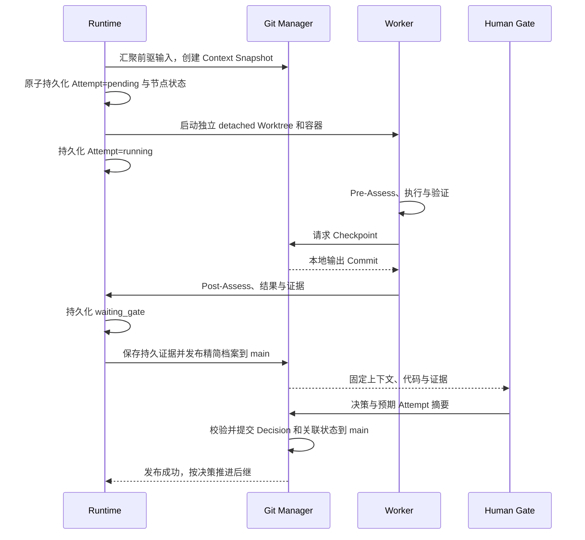

# Execution

一次 Attempt 固定输入，在隔离 Worktree 中执行；本地 Checkpoint 支持汇聚，精简证据在关键节点发布到 main。最终只有人类接受并通过检查的代码进入 main。

## 执行时序



main 暂不可写时，本地保存待发布操作。发布 waiting_gate 前不展示为可正式审核；决策发布前不解锁后继。创建 Worker 无需逐状态提交 Git，但必须有可恢复的本地记录。

## Context Snapshot

路径：`.facetloom/runs/<run-id>/contexts/<sha256>.yaml`。先在本地运行目录构造，发布 Gate 材料时同步到 main。文件按字节 SHA-256 命名，输入变化创建新文件与新 Attempt。

```yaml
schema_version: 1
run_id: <run-id>
source_commit: <full-commit-oid>
requirement_version_id: REQ-001/r1
workflow_id: development
combination_id: development/feature:login/layer:domain
input_commit: <full-commit-oid>
direct_predecessors: []
merge_conflicts: []
scope_paths: [src/auth/**, test/auth/**]
context:
  objectives: [实现登录失败限制领域规则]
  source_paths:
    - .facetloom/requirements/REQ-001/r1.md
    - .facetloom/workflows/development.yaml
    - .facetloom/facets/feature/facet.yaml
    - .facetloom/facets/layer/facet.yaml
  constraints: [不依赖具体基础设施实现]
  reference_paths: [docs/authentication.md]
gate_policy_digest: sha256:<digest>
execution:
  adapter: codex
  environment_digest: sha256:<digest>
  tools: [test]
  allowed_paths: [src/auth/**, test/auth/**]
  network: disabled
```

| 内容 | 规则 |
| --- | --- |
| 来源文件 | source_paths 和 reference_paths 均相对仓库根，由 source_commit 固定；不含运行档案 |
| Node 与 Scope | 按 DAG members 解析，目标与约束合成，来源仍可追溯 |
| 前驱输入 | direct_predecessors 各项固定 combination_id、attempt_id、output_commit |
| 执行环境 | 固定 Adapter、工具、有效路径、网络和环境摘要；凭据只记录类别与用途 |
| 修复要求 | 有修复请求时记录指令与原决策的不可变引用；失败代码不会自动成为新输入 |

根节点以 source_commit 为代码基线。单前驱可复用其有效输出 Commit；多前驱按 Combination ID 排序、去重输出 Commit 后合并，记录有序父提交列表。相同输入集合使用相同合并策略与工具版本生成相同 Tree；时间等元数据不要求产生相同 Commit OID。

文本冲突可在输入 Tree 中保存标记并列出路径，由汇聚 Worker 先解决；二进制或删改冲突记录冲突类型和各方内容引用。无法安全形成或解决输入时 Attempt failed、节点 blocked，等待人类处理；未解决冲突不能提交 Gate。

## Checkpoint 与代码保留

```text
source_commit
    ├── detached Worktree A → output A
    └── detached Worktree B → output B
                                  ↓
                         汇聚 input_commit
                                  ↓
                        Worker → output_commit
```

Git Manager 为有代码变化的 Attempt 创建一个输出 Commit，以 input_commit 为唯一父提交；无修改沿用输入 Commit，不创建空 Commit。Post-Assess 必须基于该固定输出，不能在生成 Checkpoint 后继续改代码；进入 waiting_gate 前只登记最终 Checkpoint，较早的未发布本地快照不作为正式输出。修改范围由 Runtime 校验，Worker 不能修改已发布定义或 `.facetloom/runs/`。资料和定义的改善由人类发布或 Refinement 完成。

| Checkpoint 字段 | 定义 |
| --- | --- |
| schema_version、checkpoint_id | 格式为 1，ID 为 UUIDv4 |
| run_id、combination_id、attempt_id | 所属对象 |
| input_commit、output_commit、output_tree | 代码输入与结果 |
| changed_paths | 仓库相对路径列表 |
| recovery_bundle_ref | 发布代码证据时必填，指向持久 Git bundle Artifact |
| created_at | UTC ISO 8601 |

本地使用 `.runtime/worktrees/` 下的 detached Worktree 锚定仍需恢复的输入与输出 Commit；中间对象在有后继锚定或 bundle 验证通过前不移除 Worktree。无需 Run、Input 或 Checkpoint 命名分支。

跨 clone 或长期引用的代码输出，必须先导出自包含 Git bundle，覆盖复核所需的输入、输出、父提交与 Tree，再保存到持久 Artifact 位置。用空临时仓库验证 bundle 可导入且包含所需对象，校验摘要后才发布引用。日志中的裸 OID 不作为持久化保证。没有代码变化也需保证 input_commit 来自 main 可达历史或已有有效 bundle。

## 证据引用

小型对象留在运行档案；大日志、完整对话、截图与 bundle 留在 Git 外。main 只保存简短结论、URI 和摘要。以下是 output_refs 的代码引用及恢复来源：

```yaml
output_refs:
  - role: code
    ref:
      type: git_object
      object_type: commit
      oid: <full-commit-oid>
      recovery_bundle_ref:
        type: artifact
        uri: artifacts://<immutable-bundle-key>
        digest: sha256:<bundle-digest>
        media_type: application/x-git-bundle
  - role: evidence
    ref:
      type: artifact
      uri: artifacts://<immutable-test-report-key>
      digest: sha256:<digest>
      media_type: application/json
```

已经由 main 可达历史保留的代码 Commit 可以省略 recovery_bundle_ref。持久引用不得依赖仅在某个 clone 存在的路径。Artifact Store 的具体实现不限定，但发布前必须验证内容可读、摘要匹配且位置持久；普通临时文件路径不满足要求。

仓库文件引用固定到 Commit，Refinement 清理后仍可解析：

```yaml
evidence_refs:
  - role: evidence
    ref:
      type: git_file
      commit: <full-commit-oid>
      path: .facetloom/runs/<run-id>/summary.md
      blob_oid: <full-blob-oid>
      digest: sha256:<file-bytes-digest>
```

同一 Run 中的不可变小文件可按内容引用，避免新文件引用自身所在 Commit 的循环：

```yaml
related_refs:
  - type: run_record
    run_id: <run-id>
    path: decisions/<decision-id>.yaml
    digest: sha256:<file-bytes-digest>
```

run_record 的路径相对对应运行目录，不得越出目录。Context Snapshot、Decision、Checkpoint 和 Report 引用的目标必须同 Commit 发布或已存在且内容匹配。清理时保留有效引用目标；仅当引用来源可更新时，才可先转换成删除前 Commit 的 git_file。不可变来源保留时，其依赖也保留。可变 Attempt 用稳定 ID 关联，审核并发控制另用其文件摘要。

output_refs 在 waiting_gate 前可为空；waiting_gate 必须有且仅有一个 role: code 引用。outcome 为 changed、no_change 或 not_applicable；不适用结论须有可核对的理由，且经过人类 Gate。拒绝、失败或取消的输出不能满足后继。

## 输入比较与集成交付

定义 `project_tree(commit)`：保留该 Commit 的所有被 Git 跟踪的路径、内容和模式，仅移除 `.facetloom/runs/` 子树以及移除后为空的目录。定义、资料和代码均在比较范围内。运行档案不作为执行上下文，也不通过容器挂载暴露为项目输入。

```text
最新 main：正式输入 + 各 Run 档案
                 ↓ 比较 project_tree
与 source_commit 的正式输入相同？
    ├── 否 → 新 WorkflowRun
    └── 是 → 应用有效成果的代码变更，保留最新档案
                      ↓
               最终检查 + 人类交付确认
                      ↓
               main 单个集成 Commit
```

1. 所有业务 Combination satisfied 后 Run 为 completed。Runtime 汇聚终端有效输出；冲突阻塞交付，不静默覆盖。
2. 获取最新 main；确认无 delivery_abandonment，验证 current 指针和 `project_tree(main) == project_tree(source_commit)`。需求过期或正式输入不同则拒绝旧运行交付。
3. 在隔离 Worktree 中把成果相对 source_commit 的代码变更应用到最新 main，保留最新 `.facetloom/runs/`。变化范围仍受既定执行范围约束。
4. 执行 Workflow 的全部 integration.checks，保存不可变 IntegrationReport。检查可写临时产物，但不能改变被检查的候选输入。
5. 人类确认报告与候选代码；Git Manager 检查当前头，创建以最新目标头为唯一父提交的集成 Commit，推送 main。

候选代码用 `candidate_tree` 表示，即候选结果的 project_tree。报告和后续运行记录不参与该 Tree。最终 result_commit 的 project_tree 必须等于报告 candidate_tree，实际完整 Tree 还包含最新档案；不要求整个 Tree 等于执行 Worktree 的旧 Tree。

### IntegrationReport

路径：`.facetloom/runs/<run-id>/reports/<report-id>.yaml`。

| 字段 | 定义 |
| --- | --- |
| schema_version、report_id、run_id | 格式为 1，Report UUIDv4，所属 Run |
| source_commit | 固定运行输入 |
| target_branch、target_head_before | main 与检查时读取的 main 头 |
| candidate_tree | 被检查的候选 project_tree |
| checks | Workflow 中每个 check_id 的状态及 evidence_refs |
| status | passed、failed 或 blocked |
| reason | failed / blocked 时必填 |
| created_at | UTC ISO 8601 |

```yaml
schema_version: 1
report_id: <uuid>
run_id: <run-id>
source_commit: <full-commit-oid>
target_branch: main
target_head_before: <full-commit-oid>
candidate_tree: <project-tree-oid>
status: passed
checks:
  - check_id: regression
    status: passed
    evidence_refs: []
created_at: "2026-11-06T13:00:00Z"
```

全部配置检查通过才为 passed；合并冲突、环境不可用或缺少检查配置为 blocked。相同代码候选可以重跑失败检查，保存新 Report；代码修改需要新 Run。

main 在检查后只有档案变化时，刷新头并保留新档案，重新构造完整提交；candidate_tree、Gate、证据仍有效则可复用代码检查与确认。正式输入、候选代码或审核材料变化时重新评估；输入基线变化必须新 Run。

### DeliveryRecord

集成提交使用 `FacetLoom-Run` 和 `FacetLoom-Delivery` trailers 标记；交付回执在集成成功后的独立 main Commit 中追加，避免 result_commit 自引用。

```yaml
schema_version: 1
delivery_id: <uuid>
run_id: <run-id>
requirement_version_id: REQ-001/r1
target_branch: main
integration_report_ref:
  type: run_record
  run_id: <run-id>
  path: reports/<report-id>.yaml
  digest: sha256:<digest>
target_head_before: <actual-parent-commit>
result_commit: <integration-commit>
verified_main_commit: <actual-parent-commit>
applied_by: user:ling
applied_at: "2026-11-06T13:10:00Z"
```

ID 为 UUIDv4，文件名为 deliveries/<delivery-id>.yaml。target_head_before 是实际集成父提交，verified_main_commit 是对 current 指针与正式输入做最后校验的同一 Commit；不要求等于 source_commit 或 Report 记录的早期目标头。applied_by 来自人类交付确认。

集成前在本地持久化交付 ID、候选摘要、人类确认与 Report 引用。推送成功后崩溃时，通过 Trailer 找到结果并验证输入、project_tree 和人类确认，再补回执；若确认无法对账则等待人类处理，不重复集成。任何 main 写入都不强推。
