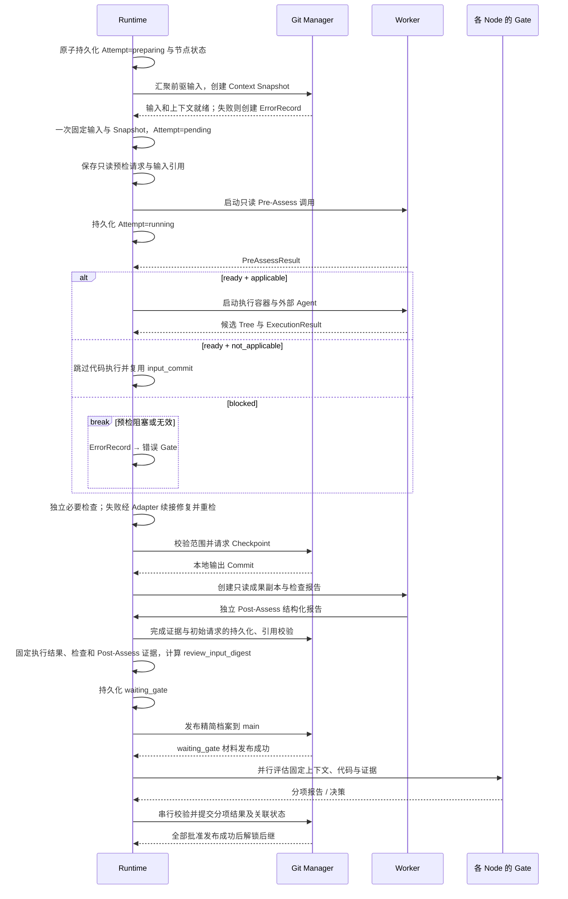

# Execution

一次 Attempt 固定输入，在隔离 Worktree 中执行；本地 Checkpoint 支持汇聚，精简证据在关键节点发布到 main。最终只有人类接受并通过检查的代码进入 main。

## 执行时序



main 暂不可写时，本地保存待发布操作。发布 waiting_gate 前不展示为可正式审核；决策发布前不解锁后继。创建 Worker 无需逐状态提交 Git，但必须有可恢复的本地记录。

## Context Snapshot

路径：`.facetloom/runs/<run-id>/contexts/<sha256>.yaml`。先在本地运行目录构造，发布 Gate 材料时同步到 main。文件按字节 SHA-256 命名，输入变化创建新文件与新 Attempt。

```yaml
schema_version: 1
run_id: <run-id>
source_commit: <full-commit-oid>
requirement_version_id: REQ-001/r1
workflow_id: development
combination_id: development/feature:login/layer:domain
input_commit: <full-commit-oid>
direct_predecessors: []
input_merge_ref: null                 # 多前驱时引用汇聚清单 Artifact
merge_conflicts: []
context:
  objectives: [实现登录失败限制领域规则]
  source_paths:
    - .facetloom/requirements/REQ-001/r1.md
    - .facetloom/workflows/development.yaml
    - .facetloom/facets/feature/facet.yaml
    - .facetloom/facets/layer/facet.yaml
  constraints: [不依赖具体基础设施实现]
  reference_paths: [docs/authentication.md]
gates:
  - gate_id: feature/login
    policy:
      mode: human
      evaluator: null
      context:
        objectives: []
        constraints: []
        reference_paths: []
      source_paths: [.facetloom/workflows/development.yaml, .facetloom/facets/feature/facet.yaml]
    policy_digest: sha256:<feature-gate-policy-digest>
  - gate_id: layer/domain
    policy:
      mode: ai
      evaluator:
        schema_version: 1
        id: domain-reviewer
        kind: ai
        runner: reviewer
        runner_profile_digest: sha256:<reviewer-runner-digest>
        instruction: 根据审核要求检查固定输出，逐项引用证据，返回结构化结论。
        timeout_seconds: 300
      context:
        objectives: [审核领域模型及业务边界]
        constraints: []
        reference_paths: [.facetloom/references/domain-review.md]
      source_paths: [.facetloom/workflows/development.yaml, .facetloom/facets/layer/facet.yaml, .facetloom/evaluators/domain-reviewer.yaml]
    policy_digest: sha256:<domain-gate-policy-digest>
execution:
  runner_id: developer
  runner_profile_digest: sha256:<developer-runner-digest>
  resources: {cpus: 2, memory_mb: 4096}
  check_environment:
    image_ref: registry.example.com/project-agent@sha256:<image-digest>
    network: disabled
  read_paths: ["**"]
  write_scope:
    all_of:
      - source: feature/login
        paths: [src/auth/**, test/auth/**]
      - source: layer/domain
        paths: [src/**, test/**]
      - source: runtime
        paths: ["**"]
  checks:
    - check_id: workflow/unit
      argv: [pytest, -q]
      timeout_seconds: 900
      source_path: .facetloom/workflows/development.yaml
  max_check_retries: 2
```

| 内容 | 规则 |
| --- | --- |
| 来源文件 | source_paths 和 reference_paths 均相对仓库根，由 source_commit 固定；不含运行档案 |
| Node 与 Scope | 按 DAG members 解析；write_scope.all_of 保留每组路径与来源，禁止把交集压平成路径并集 |
| 前驱输入 | direct_predecessors 各项固定 combination_id、attempt_id、output_commit |
| 执行环境 | 引用 Run.runners 中的固定调用配置及摘要，记录独立读写范围、资源限制、检查环境、检查列表与预算；凭据只记录用途 |
| 修复要求 | 记录错误处置授权的修复/补测指令及原错误、报告和决定引用；失败代码不自动成为新输入 |
| Gate 策略 | gates 按 Facet 声明顺序列出每个选中 Node 的 gate_id、完整有效 policy 与 policy_digest；缺项、重复项或来源不匹配时拒绝启动 |

`execution.write_scope.all_of` 按 Facet 顺序保留有 Scope 的 Node，最后一组为 Runtime 写入策略；无 Scope 的 Node 不增加组。某路径只有同时匹配每组 paths 中至少一条规则才允许写入；组内 paths 为空即拒绝全部写入。Scope 不允许写入的定义、资料及运行档案仍由 Runtime 固定规则保护。read_paths 独立生效。

例如上面的范围只允许 `src/auth/**` 和 `test/auth/**`；不能因另一组包含 `src/**` 而放宽到整个 src。Snapshot 保存匹配规则，执行时对实际路径判断，无需枚举未来可能创建的文件。

`policy.context.objectives` 按 Workflow → Node 顺序累积目标，其他约束和资料保留来源。policy.evaluator 保存完整有效审核定义，AI 项再带 runner_profile_digest；执行 runner 和 AI 审核 runner 的摘要都必须与所属 Run.runners 一致。解析时校验 Run、profile 及固定 Git 来源；保存 Snapshot / Attempt 时必须保留所属 Run 和 DAG，不允许清理其固定配置来源。

runner 包含镜像、原生参数与配置，FacetLoom 不重建外部 Agent 的模型或工具系统。本地仅提供凭据、连接和资源上限；无法满足执行配置进入错误 Gate，评估器故障人工接管。check_environment 与 Agent 调用分开，默认使用执行 runner 的镜像并禁网；需要网络等额外检查环境时必须显式固定在 Workflow.execution.check_environment，不根据 Agent 的联网配置自动放宽检查。

`policy_digest` 对 policy 按 RFC 8785（JCS）规范化后的 UTF-8 JSON 字节求 SHA-256；仅允许该规范支持的 JSON 值。Decision / GateReport 的 gate_policy_digest 必须等于对应项摘要。Snapshot 文件名仍对完整 YAML 文件字节求摘要。任务输入变化需要新 Snapshot 与新 Attempt；Workflow、Node 或评估器定义变化需要新 Run。

## 前驱代码汇聚

根节点复用 source_commit；直接前驱取最终约简 DAG 快照中每个节点的当前有效输出。只有前驱全部 satisfied 才开始准备。

```text
有效前驱及来源映射
    ↓ 按 Combination ID 排序
Commit 去重 → 去掉被其他输入包含的祖先 Commit
    ↓
累积输入 M + 下一个前驱 H
    ↓ 从真实历史计算共同祖先，执行三方合并
候选 Tree + 冲突清单 → 保留 M、H 为父提交的临时 Commit
    ↓ 重复至全部前驱合并
固定 input_commit → Agent 解决全部冲突 → 执行与检查
```

### 确定性算法

1. 保存所有前驱的 combination_id、attempt_id、output_commit。相同 OID 只参与一次计算，以字典序最小 Combination ID 作为排序键；祖先判定使用 Git 提交图，不比较 Tree。去重和祖先消除不能删除来源映射。
2. 只有一个独立输入时直接复用，不创建空汇聚提交；多个输入按上述键升序折叠。
3. 每一步使用 `git merge-tree --write-tree M H` 的 ort 三方合并。共同祖先由 Git 在双方真实历史中计算；多个最佳共同祖先由固定版本 Git 合成虚拟基线，不任意挑一个，不固定使用 source_commit。不允许无共同历史合并。
4. 每步返回的候选 Tree 写成父提交为 `[M, H]` 的临时 Commit，供下一步计算祖先。临时提交的作者与提交者固定为 `FacetLoom <runtime@facetloom.local>`，时间固定为 `2000-01-01T00:00:00Z`，消息为 `facetloom input merge <step>`（末尾一个 LF，step 从 1 递增），保持同一输入 OID 集合的中间 OID 与冲突标签稳定；最终 input_commit 保留整个父链。
5. Git 工具环境使用 run.yaml.merge_engine 的不可变环境，默认 Git 2.43.0、ort、conflict_style=merge、renames=true、rename_threshold=50%、rename_limit=0（不限制）、diff_algorithm=histogram。隔离用户/系统 Git 配置，禁用 rerere、外部合并驱动、过滤器和换行转换，不允许本地属性覆盖；仓库属性来自固定输入。完整有效参数进入清单，Run 内不切换环境。
6. 退出码 0 为干净结果，1 为有冲突的候选结果，其他值为输入准备错误。缺失对象或共同历史、工具故障及不支持的合并能力进入错误 Gate。

相同输入 OID、顺序和工具环境必须生成相同候选 Tree 与冲突清单。正式输入和 Checkpoint Commit 的时间等元数据不要求跨次 OID 相同。最终多个终端成果的交付汇聚使用相同算法；若有未解决冲突，保存 blocked IntegrationReport，不能在已 completed Run 内修改成果。

### 冲突与输入清单

每步冲突都累积保留，即使后续步骤对同一路径未报冲突，也不能自动删除旧冲突。文本候选保留 Git 冲突标记；二进制、重命名、删改及文件/目录冲突保留 Git 候选 Tree，并在清单列出所有涉及路径、类型、步骤、两侧提交、共同祖先以及各 stage 的 Blob OID / 模式，删除的一侧为 null。清单和需要的 Git 对象随 bundle 持久保存，不能只保留屏幕日志。

~~~yaml
schema_version: 1
kind: input_merge
predecessors: []              # 全部来源，包括去重或被包含的输入
independent_heads: []         # 实际参与计算的有序 Commit
engine: <run.yaml.merge_engine 的完整有效配置>
steps: []                     # M、H、最佳共同祖先、候选 Tree、中间 Commit、冲突
input_commit: <commit-oid>
conflicts: []                 # 各步冲突并集；每项含确定性 conflict_id，不自动标记已解决
~~~

清单作为不可变 Artifact，通过 Context Snapshot.input_merge_ref 引用。每个冲突项的 conflict_id 为 `sha256:` 加该项按 RFC 8785 规范化 JSON 的摘要，摘要输入为 step、排序后的路径及各路径冲突类型。Agent 必须逐项给出解决结果与证据，Runtime 校验 conflict_id 集合完整且不重复、路径范围、Git 对象完整性以及无未合并 index 项；不能只用搜索文本标记判断二进制冲突是否解决。任一冲突 unresolved 时不进入成果 Gate，保留实际材料进入错误 Gate。

汇聚 Agent 负责正常的代码集成冲突。冲突路径超出有效写入范围时在准备阶段报 permission_denied，不启动有越界权限的 Worker。Agent 判断问题来自前驱已批准行为与需求不对齐时，报 upstream_misaligned，引用具体前驱和证据，由错误 Gate 决定是否修复上游；不得静默更改上游责任。

## Pre-Assess

每个 Attempt 先由 Adapter 使用固定 runner 发起独立只读调用与新原生会话。输入为 Context Snapshot、Requirement、选中 Node 上下文及已接受前驱证据；不挂载可写 Worktree、Git 凭据、Git 元数据或 Podman Socket。Adapter 必须在 `probe` 时确认原生结构化输出能力，不从自然语言推测字段。

~~~json
{
  "schema_version": 1,
  "readiness": "ready",
  "applicability": "applicable",
  "summary": "输入足以实现并验证锁定期限行为。",
  "missing_inputs": [],
  "risk_findings": [],
  "evidence_refs": []
}
~~~

| 字段 | 规则 |
| --- | --- |
| readiness | `ready` 或 `blocked` |
| applicability | `ready` 时必填 `applicable` 或 `not_applicable`；`blocked` 时必须为 null |
| summary | 非空说明 |
| missing_inputs | `blocked` 时至少一项，`ready` 时为空；每项含说明和 evidence_refs |
| risk_findings | 风险说明及 evidence_refs；只传入成果 Gate，不动态新增 Gate，不阻塞执行 |
| evidence_refs | 支持结论的类型化证据引用；not_applicable 至少一项 |

`ready + applicable` 才启动代码执行。`ready + not_applicable` 跳过代码执行并复用 input_commit，但仍执行必要检查、Post-Assess 和所有成果 Gate；若 input_merge 清单含未解决冲突，则不能据此跳过冲突处理，转错误 Gate。`blocked` 创建 ErrorRecord 并进入 Workflow 错误 Gate，不启动执行；Runtime 保留预检报告供恢复决策。结构无效、Applicability 不明确、矛盾字段或证据引用无效均作为预检故障进入错误 Gate。风险发现是固定成果审核输入的一部分，不临时扩充策略。

PreAssessReport 保存在 `.facetloom/runs/<run-id>/reports/<report-id>.yaml`，`report_type: pre_assess`，内容不可变。报告包含 schema_version、report_id、run_id、combination_id、attempt_id、invocation_ref、readiness、applicability、summary、missing_inputs、risk_findings、evidence_refs、created_at。invocation_ref 是不含报告自身的不可变 Invocation 证据 Artifact。有效报告通过 Attempt.pre_assess_ref 引用；blocked 时 ErrorRecord.evidence_refs 引用报告。预检未形成有效报告时，ErrorRecord 引用可用的调用输入、原生输出与故障证据，不伪造报告。输入不足不伪造成 ExecutionResult 或 CheckReport。

~~~yaml
schema_version: 1
report_type: pre_assess
report_id: <uuid>
run_id: <run-id>
combination_id: <combination-id>
attempt_id: <attempt-id>
invocation_ref:
  type: artifact
  uri: artifacts://invocations/<immutable-key>
  digest: sha256:<digest>
readiness: ready
applicability: applicable
summary: 输入足以完成本节点任务。
missing_inputs: []
risk_findings: []
evidence_refs: []
created_at: "2026-11-09T12:00:00Z"
~~~

## 外部执行结果

每次执行或修复调用都要求 Adapter 从 Agent 原生结构化输出解析 `ExecutionResult`。运行时要求的结构化输出能力由 Adapter `probe` 确认；缺失、格式错误、字段越界或证据引用无效均为执行故障，进入错误 Gate，不从自然语言猜测结论。

~~~json
{
  "schema_version": 1,
  "summary": "实现锁定期限校验与剩余时间返回。",
  "evidence_refs": [],
  "conflict_resolutions": []
}
~~~

| 字段 | 规则 |
| --- | --- |
| schema_version | 必须为 1 |
| summary | 非空简述 |
| evidence_refs | 可核对的类型化执行证据引用 |
| conflict_resolutions | 无输入冲突时为空；有冲突时必须逐项覆盖输入清单中的每个 conflict_id，记录 `resolved` 和 evidence_refs；resolved=false 时转错误 Gate |

`ExecutionResult` 不声明是否适用或是否有代码变化。Runtime 比较最终输出与 input_commit 的 Git Tree，结合 PreAssessReport、Scope 和冲突清单决定 outcome：适用且有改动为 `changed`；适用且无改动为 `no_change`；预检不适用且无改动为 `not_applicable`。修复调用必须返回完整新 `ExecutionResult`；Runtime 只采用最终候选对应的结果，旧结果保留为 Invocation 历史。不适用 Attempt 不产生 ExecutionResult，其 Post-AssessReport 将 execution_result_ref 设为 null 并引用 PreAssessReport。

## 必要检查与同次修复

Runtime 从 Workflow 和选中 Node 累积必要检查，将限定 ID、argv、超时、来源、环境和 max_check_retries 固定到 Snapshot。检查程序由 Runtime 在独立候选副本中运行，不依赖外部 Agent 自己执行或汇报。检查由 Runtime 调度并记录真实退出结果，Worker 自报通过不能替代检查记录。命令配置来自 source_commit；受信检查入口脚本从该 Commit 提供，不能被候选代码替换。被检查的实现和测试内容来自本轮候选 Tree。

```text
Agent 执行 / 解决冲突
    ↓ 固定本轮候选 Tree
全部必要检查
    ├── 全部通过 → 最终 Checkpoint → 独立只读 Post-Assess → 冻结成果材料
    ├── 检查失败、任务适用且还有额度 → 同一 Worker 修复 → 全量重检
    ├── 检查失败且任务不适用 → 保留失败报告 → Post-Assess → 成果 Gate
    ├── 额度耗尽且证据完整 → 最终 Checkpoint → 独立只读 Post-Assess → 成果 Gate
    └── 无法执行或材料缺失 → ErrorRecord → 错误 Gate
```

- 默认先检查一次，失败后最多修复并重检 2 次；max_check_retries=0 时首轮之后直接提交完整结果。
- 每轮按有效列表顺序执行全部检查，不因测试失败跳过其余项；命令无法启动等执行错误可中止该轮，其余项记 not_run。每项记录 check_id、round（从 1 开始）、evaluated_tree、passed / failed、退出码或 timeout、证据引用及使用环境。
- 检查在该候选 Tree 的隔离副本运行，可写临时产物；不能把测试生成或修改的受跟踪文件带回成果。任何 Agent 代码修改都会使已有检查结果对新 Tree 失效，需要全量重检。
- 已启动命令的非零退出或超时属于 failed 证据。命令无法启动、环境不可用或结果证据丢失属于执行错误，不用虚假 failed 结果补齐列表。
- 任务适用且检查失败时，Adapter 续接执行会话反馈，外部 Agent 自行修复；每次续接先返回新的 ExecutionResult。无法安全续接则报错转错误 Gate，不在 Runtime 内实现模型/工具循环。不适用时没有执行会话，不启动修复；检查结果完整即交成果 Gate。修复轮次用尽后只允许对最终已检查 Tree 生成正式 Checkpoint；代码再变化必须新 Attempt。零项检查记录空清单，不能虚称有测试通过。
- 每轮日志保存在 Artifact；精简档案保留最终 Tree、有效检查结论、修复次数及各轮证据引用。最终 Checkpoint Tree 必须等于最后一轮 evaluated_tree。

检查修复预算只约束当前 Worker；错误 Gate 创建新 Attempt 或安排上游修复使用独立的 Run 级自动恢复额度。最终 integration.checks 仍须全部通过才可交付。

### Post-Assess

Post-Assess 由 Adapter 使用同一固定 runner 发起独立调用和新原生会话。输入是最终 Checkpoint、对应 CheckReport、PreAssessReport、可选 ExecutionResult 与只读审核任务；不适用 Attempt 没有 ExecutionResult。容器将成果和报告只读挂载，另提供隔离的可写临时目录，不挂载 Git 写入凭据、Git 元数据或 Podman Socket。Runtime 核验候选 Tree 未变化；尝试写入只读成果、退出失败、超时或返回无效结构均为错误 Gate。容器和 Invocation 与执行阶段分别记录，但计入同一 Worker 的 deadline；不创建第二个 Worker。

~~~json
{
  "schema_version": 1,
  "status": "complete",
  "summary": "代码变更满足任务范围，检查报告覆盖最终 Tree。",
  "findings": [],
  "evidence_refs": []
}
~~~

`status` 为 `complete` 或 `concerns`。`concerns` 必须带非空 findings；两种状态都须有非空 summary。报告按 Attempt 的 output_refs 固定为执行证据。`concerns` 不自动判失败，由成果 Gate 审核；只读调用试图改成果、退出失败、超时或返回无效结构均使 Post-Assess 失败，形成 ErrorRecord 并进入错误 Gate。不得重新运行自检来覆盖此前报告。

Post-AssessReport 保存在 `.facetloom/runs/<run-id>/reports/<report-id>.yaml`，`report_type: post_assess`，内容不可变。必需字段为 schema_version、report_id、run_id、combination_id、attempt_id、evaluated_tree、pre_assess_ref、check_report_ref、execution_result_ref、invocation_ref、status、summary、findings、evidence_refs、created_at。invocation_ref 是不含报告自身的不可变调用证据 Artifact；execution_result_ref 在 not_applicable 时为 null，其它 outcome 必须引用有效结果。发布前校验报告 Tree 等于最终 Checkpoint Tree、输入引用均可读取且匹配摘要；报告自身作为 role=evidence 的 run_record 加入 Attempt.output_refs。

```yaml
schema_version: 1
report_type: post_assess
report_id: <uuid>
run_id: <run-id>
combination_id: <combination-id>
attempt_id: <attempt-id>
evaluated_tree: <full-tree-oid>
pre_assess_ref: reports/<pre-assess-report-id>.yaml
check_report_ref: reports/<check-report-id>.yaml
execution_result_ref: null
invocation_ref:
  type: artifact
  uri: artifacts://invocations/<immutable-key>
  digest: sha256:<digest>
status: complete
summary: 检查报告覆盖最终 Tree，变更符合任务范围。
findings: []
evidence_refs: []
created_at: "2026-11-09T12:00:00Z"
```

### CheckReport

路径：`.facetloom/runs/<run-id>/reports/<report-id>.yaml`。这是 Runtime 的检查执行记录，不是 GateReport。每个 Attempt 结束检查或因检查报错时固定一份，后续不覆盖；轮次中的实时进度只存本地。

| 字段 | 定义 |
| --- | --- |
| schema_version、report_type、report_id | 格式为 1，report_type=checks，UUIDv4 |
| run_id、combination_id、attempt_id | 所属尝试 |
| context_snapshot_ref | 包含完整有效检查清单和环境的 Snapshot |
| max_check_retries、repairs_used | 固定预算与已使用修复次数 |
| rounds | 按 round 升序记录候选 Tree 与各项执行结果 |
| status | passed / failed / error；error 表示无法形成完整最终检查结论 |
| final_round | passed / failed 时必填，指向完整最终轮次；error 时 null |
| reason、created_at | failed / error 的原因，以及 UTC 时间 |

~~~yaml
schema_version: 1
report_type: checks
report_id: <uuid>
run_id: <run-id>
combination_id: development/feature:login/layer:domain
attempt_id: <attempt-id>
context_snapshot_ref: contexts/<sha256>.yaml
max_check_retries: 2
repairs_used: 0
status: passed
final_round: 1
rounds:
  - round: 1
    evaluated_tree: <full-tree-oid>
    results:
      - check_id: workflow/unit
        status: passed
        exit_code: 0
        timed_out: false
        evidence_refs: []
created_at: "2026-11-09T12:00:00Z"
~~~

每轮 results 按 Snapshot 清单逐项对应，状态为 passed / failed / error / not_run。passed 要求命令真实启动、正常退出且 exit_code=0；超时为 failed、timed_out=true；无法启动为 error，之后未执行项为 not_run。没有真实退出码时 exit_code=null，日志经 evidence_refs 引用。

仅最终轮次完整、每项均为 passed / failed 时可填写 final_round；全部 passed 则报告 passed，否则为 failed。error / not_run 不能算作已经完成的必要检查。零项检查记录 results=[]，报告 passed 只表示没有待完成的配置检查，不声称执行过测试。

成果 output_refs 必须有 role=evidence 的 run_record 引用指向该 CheckReport；final_round 的 evaluated_tree 必须等于代码输出 Tree，且 repairs_used 不超过预算。任务适用且检查失败、仍有修复额度时继续修复；不适用且检查完整时不修复，保留失败结果交成果 Gate。检查错误时把报告引用写入 ErrorRecord.evidence_refs，不能把 error 报告包装成完整成果。

## 实际初始输入

Context Snapshot 是有效输入清单；Adapter 实际交给外部 Agent 的初始任务、启动参数、工作目录、配置摘要及附件清单作为 Artifact 留存；工具声明仅在调用协议实际提供时记录。附件内容内联或使用可恢复的不可变引用，不能只记录临时路径。动态工具结果与后续对话按日志规则保存，不要求写入初始输入 Artifact。

| 引用 | 所属记录 | 保存时机 |
| --- | --- | --- |
| agent_input_ref | Attempt | 首次 Pre-Assess 调用前保存实际初始请求；waiting_gate 前验证持久可读 |
| request_input_ref | GateReport | 调用自动评估器前保存实际初始请求；发布报告前验证持久可读 |

```yaml
agent_input_ref:
  type: artifact
  uri: artifacts://inputs/<immutable-key>
  digest: sha256:<input-file-bytes-digest>
  media_type: application/json
```

Adapter 先组装并本地原子保存外部调用输入，再传入同一内容，不能事后根据定义重新生成来代替原请求。引用在请求形成时分配不可变 URI 与摘要，本地待上传状态单独记录；上传使用同一内容和引用，不改写 Attempt 输入。传输结果未知时按本地调用记录对账，不能声称请求一定送达或自动重复发送。

留存内容只覆盖 FacetLoom 交给外部 Agent 的输入；它不等于 Agent 发给模型服务的完整请求。凭据由运行环境或连接层注入，不进入留存内容。不记录无法观测的原生系统提示、模型内部状态或内部压缩结果；Agent 未报告的模型及工具版本记 null，不宣称已固定。Gate 请求不包含自身 request_input_ref，避免自引用。

每次启动或续接都分配独立 invocation_id，先保存输入再调用。同次修复反馈携带实际检查结果与请求引用；不能用 agent_input_ref 代表后续全部对话。完整调用清单作为不可变 Artifact，至少记录 runner/profile 摘要、镜像 digest、Adapter 与程序版本、原生 session_id（可空）、各次输入引用、实际 argv（脱敏）、事件/结果日志和退出状态。

成果冻结前将调用清单加入 output_refs 的 evidence；执行失败加入 ErrorRecord 证据；Gate 使用 GateReport.evidence_refs；Refinement 保存于本地会话及其提交依据。它们不记录原生隐藏推理，也不把原生 exit_code=0 当作检查或审核通过。调用清单不得引用包含它的对象，避免循环摘要。

## 固定审核输入

```text
执行、必要测试与 Post-Assess 完成
    ↓
代码、执行证据及初始请求持久化并校验
    ↓
固定审核输入 → 发布 waiting_gate
    ↓
各 Gate 审核 → 分项报告与决策 → 全部批准
```

进入成果 waiting_gate 前，Runtime 确认有效 PreAssessReport、全部必要检查和 Post-Assess 对应最终代码，适用任务还有执行结论，所有引用可读且摘要匹配。检查结束不等于检查通过；预算耗尽或不适用时的完整失败结论可以交由成果 Gate 判断。无法形成必要材料时创建 ErrorRecord，走错误 Gate。

`review_input_digest` 为以下五个字段组成对象按 RFC 8785（JCS）规范化后的 UTF-8 JSON 字节的 SHA-256，格式为 `sha256:<hex>`：

```json
{
    "context_snapshot_ref": "contexts/<sha256>.yaml",
  "input_commit": "<full-commit-oid>",
  "outcome": "changed",
  "summary": "实现登录失败限制，执行检查已完成",
  "output_refs": [
    {"role": "code", "ref": {"type": "git_object", "object_type": "commit", "oid": "<output-commit-oid>"}}
  ]
}
```

示例仅展示摘要结构；实际 output_refs 包含全部执行证据及必要的 bundle 引用。上述字段进入 waiting_gate 后冻结，连同引用内容均不得修改、追加或替换。代码引用解析出的 Tree 必须等于 evaluated_tree；agent_input_ref 在发送前已固定，不随审核变化。

状态、时间及 gate_report_refs / gate_decision_refs 可继续推进，但不进入审核输入摘要。各 Gate 的报告、建议和决策理由是审核输出，不写回 output_refs，也不自动成为其他 Gate 的输入。评估请求、GateReport 和 GateDecision 都携带 review_input_digest；Runtime 重新计算并校验，不能仅相信记录中的摘要。

缺少执行证据时成果 Gate 返回 Blocked / Escalated；Runtime 确认缺失后将旧 Attempt 置为 failed，通过 ErrorRecord 交由错误 Gate 决定是否新建 Attempt。成果拒绝同样转错误处置；全部成果 Gate 必须重新审核，不新增审核轮次或仅审核的 Attempt 类型。评估器故障可由人类请求对原固定材料重评；人类仅解释已有材料时，将理由记录在 Decision 中。

## Checkpoint 与代码保留

```text
source_commit
    ├── detached Worktree A → output A
    └── detached Worktree B → output B
                                  ↓
                         汇聚 input_commit
                                  ↓
                        Worker → output_commit
```

Git Manager 为有代码变化的 Attempt 创建一个输出 Commit，以 input_commit 为唯一父提交；无修改沿用输入 Commit，不创建空 Commit。Post-Assess 必须基于该固定输出，不能在生成 Checkpoint 后继续改代码；进入 waiting_gate 前只登记最终 Checkpoint，较早的未发布本地快照不作为正式输出。修改范围由 Runtime 校验，Worker 不能修改已发布定义或 `.facetloom/runs/`。资料和定义的改善由人类发布或 Refinement 完成。

| Checkpoint 字段 | 定义 |
| --- | --- |
| schema_version、checkpoint_id | 格式为 1，ID 为 UUIDv4 |
| run_id、combination_id、attempt_id | 所属对象 |
| input_commit、output_commit、output_tree | 代码输入与结果 |
| changed_paths | 仓库相对路径列表 |
| recovery_bundle_ref | 输出仅在本地存在时必填；main 历史已保留或已有持久 bundle 时可引用既有恢复来源 |
| created_at | UTC ISO 8601 |

本地使用 `.runtime/worktrees/` 下的 detached Worktree 锚定仍需恢复的输入与输出 Commit；中间对象在有后继锚定或 bundle 验证通过前不移除 Worktree。无需 Run、Input 或 Checkpoint 命名分支。

跨 clone 或长期引用的代码输出，必须先导出自包含 Git bundle，覆盖复核所需的输入、输出、父提交与 Tree，再保存到持久 Artifact 位置。用空临时仓库验证 bundle 可导入且包含所需对象，校验摘要后才发布引用。日志中的裸 OID 不作为持久化保证。没有代码变化也需保证 input_commit 来自 main 可达历史或已有有效 bundle。

## 证据引用

引用本体使用 `{type, ...}`，例如 git_object、git_file、artifact、run_record。`output_refs` 使用 `{role, ref}` 包装引用本体；`evidence_refs`、`related_refs` 及单个通用引用字段直接使用本体，不再套 role/ref。已明确定义为内部路径的 context_snapshot_ref 等字段保持其紧凑格式。

小型对象留在运行档案；实际初始请求、大日志、完整对话、截图与 bundle 留在 Git 外。main 只保存简短结论、URI 和摘要。以下是 output_refs 的代码引用及恢复来源：

```yaml
output_refs:
  - role: code
    ref:
      type: git_object
      object_type: commit
      oid: <full-commit-oid>
      recovery_bundle_ref:
        type: artifact
        uri: artifacts://<immutable-bundle-key>
        digest: sha256:<bundle-digest>
        media_type: application/x-git-bundle
  - role: evidence
    ref:
      type: artifact
      uri: artifacts://<immutable-test-report-key>
      digest: sha256:<digest>
      media_type: application/json
```

已经由 main 可达历史保留的代码 Commit 可以省略 recovery_bundle_ref。持久引用不得依赖仅在某个 clone 存在的路径。Artifact Store 的具体实现不限定，但发布前必须验证内容可读、摘要匹配且位置持久；普通临时文件路径不满足要求。

仓库文件引用固定到 Commit，Refinement 清理后仍可解析：

```yaml
evidence_refs:
  - type: git_file
    commit: <full-commit-oid>
    path: .facetloom/runs/<run-id>/summary.md
    blob_oid: <full-blob-oid>
    digest: sha256:<file-bytes-digest>
```

同一 Run 中的不可变小文件可按内容引用，避免新文件引用自身所在 Commit 的循环：

```yaml
related_refs:
  - type: run_record
    run_id: <run-id>
    path: decisions/<decision-id>.yaml
    digest: sha256:<file-bytes-digest>
```

run_record 的路径相对对应运行目录，不得越出目录。Context Snapshot、ErrorRecord、Decision、Checkpoint 和 Report 引用的目标必须同 Commit 发布或已存在且内容匹配。清理时保留有效引用目标；仅当引用字段可更新时，才可先转换成删除前 Commit 的 git_file。不可变对象或 Attempt 的冻结字段仍被保留时，其依赖也保留。Attempt 用稳定 ID 关联；审核材料由 review_input_digest 校验，记录并发写入另用完整 Attempt 文件摘要。

### 执行结论与代码一致性

| outcome | 代码条件 | 额外条件 |
| --- | --- | --- |
| changed | 输出 Tree 不同于 input_commit 的 Tree | 全部变更满足有效写入范围，冲突已逐项解决 |
| no_change | 输出 Commit 直接复用 input_commit | 任务适用，已有输入满足目标，无需修改 |
| not_applicable | 输出 Commit 直接复用 input_commit | PreAssessReport 声明不适用，附原因和证据 |

比较包含路径、内容和 Git 文件模式，不能仅比较文件列表。输入仍有未解决冲突时不得以 no_change / not_applicable 绕过解决义务。changed 和 no_change 要求 PreAssessReport.applicability=applicable；not_applicable 要求预检明确不适用且零变更。三种结论都需要最终 CheckReport、只读 Post-Assess 和全部成果 Gate；not_applicable 不删除 DAG 节点或跳过必要检查。

output_refs 在成果 waiting_gate 前可为空；Attempt 处于 waiting_gate 时必须有且仅有一个 role: code 引用。错误 Gate 不要求代码输出，使用独立 ErrorRecord。outcome 为 changed、no_change 或 not_applicable；不适用结论须有可核对的理由，且经过该 Attempt 的全部 Gate。拒绝、失败或取消的输出不能满足后继。

## 输入比较与集成交付

定义 `project_tree(commit)`：保留该 Commit 的所有被 Git 跟踪的路径、内容和模式，仅移除 `.facetloom/runs/` 子树以及移除后为空的目录。定义、资料和代码均在比较范围内。运行档案不作为项目定义或代码输入；只向执行者和审核者提供明确引用的前驱结果、修复决策或评估证据，不挂载整个档案目录。

```text
最新 main：正式输入 + 各 Run 档案
                 ↓ 比较 project_tree
与 source_commit 的正式输入相同？
    ├── 否 → 新 WorkflowRun
    └── 是 → 应用有效成果的代码变更，保留最新档案
                      ↓
               最终检查 + 人类交付确认
                      ↓
               main 代码集成与成功回执（无代码变化只写回执）
```

1. 所有业务 Combination satisfied 后 Run 为 completed。Runtime 汇聚终端有效输出；冲突阻塞交付，不静默覆盖。
2. 获取最新 main；确认无 delivery_abandonment，验证 current 指针和 `project_tree(main) == project_tree(source_commit)`。需求过期或正式输入不同则拒绝旧运行交付。
3. 在隔离 Worktree 中把成果相对 source_commit 的代码变更应用到最新 main，保留最新 `.facetloom/runs/`。变化范围仍受既定执行范围约束。
4. 执行 Workflow 的全部 integration.checks，保存不可变 IntegrationReport。检查可写临时产物，但不能改变被检查的候选输入。
5. 人类确认固定报告与候选；Git Manager 检查当前头及已有交付。存在代码差异时创建以最新头为唯一父提交的集成 Commit，再追加回执；无差异时只发布 no_change 回执。

候选代码用 `candidate_tree` 表示，即候选结果的 project_tree。报告和后续运行记录不参与该 Tree。最终 result_commit 的 project_tree 必须等于报告 candidate_tree，实际完整 Tree 还包含最新档案；不要求整个 Tree 等于执行 Worktree 的旧 Tree。

### IntegrationReport

路径：`.facetloom/runs/<run-id>/reports/<report-id>.yaml`，创建后不可变。汇聚或基线校验阶段失败也保存报告，不伪造候选代码。

| 字段 | 定义 |
| --- | --- |
| schema_version、report_type、report_id、run_id | 格式为 1，report_type=integration，UUIDv4 |
| source_commit、target_branch | 固定运行输入与 main |
| target_head_before | 本次读取的 main 头；读取失败时可空 |
| terminal_outputs | 最终 DAG 中直连 end 的全部业务节点，按 Combination ID 排序，含 accepted_attempt_id 与可恢复 output_ref |
| merge_input_ref | 多输入汇聚清单 Artifact；尚未形成或无需合并时 null |
| candidate_ref | 可恢复的候选 Commit 类型化引用；尚未形成完整候选时 null |
| candidate_tree | project_tree(candidate_ref)，无完整候选时 null |
| checks | 最终配置检查的逐项结果，格式同 CheckReport.results，不包含修复轮次 |
| evidence_refs | 汇聚冲突、基线校验、实际环境及其他阶段材料的类型化引用列表 |
| status、reason | passed / failed / blocked；非 passed 必填原因 |
| created_at | UTC ISO 8601 |

~~~yaml
schema_version: 1
report_type: integration
report_id: <uuid>
run_id: <run-id>
source_commit: <full-commit-oid>
target_branch: main
target_head_before: <full-commit-oid>
terminal_outputs:
  - combination_id: development/feature:login/layer:presentation
    accepted_attempt_id: <attempt-id>
    output_ref:
      type: git_object
      object_type: commit
      oid: <output-commit-oid>
      recovery_bundle_ref: <artifact-ref>
merge_input_ref: null
candidate_ref:
  type: git_object
  object_type: commit
  oid: <candidate-commit-oid>
  recovery_bundle_ref: <artifact-ref>
candidate_tree: <project-tree-oid>
status: passed
evidence_refs: []
checks:
  - check_id: regression
    status: passed
    exit_code: 0
    timed_out: false
    evidence_refs: []
created_at: "2026-11-09T12:00:00Z"
~~~

| 情况 | 报告结论 |
| --- | --- |
| 完整候选、基线有效、非空 integration.checks 全部通过 | passed，允许请求人类交付确认 |
| 检查完整结束，至少一项失败 | failed，保留候选与失败证据 |
| 输入汇聚冲突、基线过期、环境不可用、证据缺失或未配置最终检查 | blocked，保存已形成材料及原因 |

合并冲突时可以保留候选冲突 Tree 的证据，但 candidate_ref / candidate_tree 仍为 null；它不属于可交付候选。未运行的检查记 not_run，无法启动的项记 error；只要存在 error / not_run 就不能报告 passed / failed。全部配置项都未声明时 checks=[] 且 blocked。

检查命令与受信入口来自 source_commit，实际环境、日志和结果进入证据；不能用候选代码改写审核入口。candidate_ref 必须在报告发布前可由 main 历史或自包含 bundle 恢复，报告的 candidate_tree 从恢复出的 Commit 重新计算。

相同代码候选可重跑最终检查并保存新报告；修改成果需新 Run。新报告不能覆盖旧报告或继承旧报告的人类确认。

main 在检查后只有档案变化时，可在保留最新档案的基础上重新构造完整 Commit；已通过报告及绑定它的确认可以复用。正式输入变化需新 Run；候选、有效成果或所选报告变化时必须重新确认。

### 交付意图与确认

同一 Run 在拥有者 Runtime 中最多一份活动交付意图，保存在 `.runtime/runs/<run-id>/delivery.yaml`，使用既有文件事务持久化。

~~~yaml
schema_version: 1
delivery_id: <uuid>
run_id: <run-id>
status: ready
integration_report_ref: <typed-report-ref>
candidate_tree: <project-tree-oid>
confirmation: null
result_commit: null
~~~

状态为 preparing → ready → confirmed → publishing → delivered；尚未形成候选、检查失败或正式输入变化时为 blocked。blocked 在条件恢复后可重新准备；结果未知时保持 publishing，完成对账之前不新建交付。候选或报告变化清空旧确认，delivery_id 不用于另一份不同成果的交付。

人类确认记录 `confirmed_by`、`confirmed_at`，并固定以下对象的 JCS SHA-256 摘要为 confirmation.digest：

~~~json
{
  "delivery_id": "<uuid>",
  "run_id": "<run-id>",
  "target_branch": "main",
  "source_commit": "<source-commit-oid>",
  "integration_report_ref": {
    "type": "run_record",
    "run_id": "<run-id>",
    "path": "reports/<report-id>.yaml",
    "digest": "sha256:<report-digest>"
  },
  "candidate_tree": "<project-tree-oid>"
}
~~~

报告引用包含内容摘要；当前 current 指针、有效终端成果、基线、候选 Tree 和报告必须重新校验。确认不绑定会因档案变化而更新的 main 头，也不允许用旧确认替换报告或候选。

```text
固定报告与候选 → 人类确认并持久化
    ↓ 刷新 main，查已有交付，再次校验正式输入
只有档案变化 → 保留档案，复用确认
正式输入变化 → blocked，要求新 Run
    ↓
正常推送 → 对账结果 → 发布回执
```

Runtime 串行安排交付，Git Manager 在仓库发布锁下重新读取 main，再正常 fast-forward Push。推送被拒后先对账是否已经成功；未成功且仅档案变化时使用同一 delivery_id 重构提交，不能覆盖并发正式代码。

重复点击或请求重放返回同一活动意图；已经有成功 DeliveryRecord 或匹配的交付提交时直接返回结果。即使请求带不同 operation_id，也不能为同一 Run 重复交付。同步到档案被精炼删除的状态时，仍通过 Git 历史 Trailer 查已完成交付。

### DeliveryRecord

一个 Run 最多一次成功交付，DeliveryRecord 为不可变回执。

| kind | 提交与回执 |
| --- | --- |
| applied | 候选相对当前正式输入有变化：创建集成 Commit，再用独立档案 Commit 追加回执 |
| no_change | 候选等于当前正式输入：不创建空代码 Commit，直接提交回执；result_commit 指向已验证的 main 头 |

集成提交和 no_change 回执提交都带 `FacetLoom-Run`、`FacetLoom-Delivery` 与 `FacetLoom-Operation` Trailer。no_change 同样要求最终检查通过及人类确认；它表示没有代码需要应用，不豁免验收。

```yaml
schema_version: 1
delivery_id: <uuid>
kind: applied
run_id: <run-id>
requirement_version_id: REQ-001/r1
target_branch: main
integration_report_ref:
  type: run_record
  run_id: <run-id>
  path: reports/<report-id>.yaml
  digest: sha256:<digest>
target_head_before: <actual-parent-commit>
result_commit: <integration-commit>
verified_main_commit: <actual-parent-commit>
confirmation_digest: sha256:<confirmation-digest>
confirmed_at: "2026-11-06T13:09:00Z"
applied_by: user:ling
applied_at: "2026-11-06T13:10:00Z"
```

ID 为 UUIDv4，文件名为 deliveries/<delivery-id>.yaml。applied 时 target_head_before 是实际集成父提交；no_change 时 result_commit、target_head_before 与 verified_main_commit 都是回执提交前验证的 main 头。verified_main_commit 是对 current 指针与正式输入做最后校验的 Commit；不要求等于 source_commit 或 Report 记录的早期目标头。applied_by、confirmed_at 来自已持久化的人类确认，confirmation_digest 可用回执及其报告重新计算；applied_at 为回执中登记的 UTC 时间；成功须由 main 可达的集成提交或 no_change 回执确认，不能仅凭本地时间判断。

applied 推送成功后崩溃，通过 Trailer 找到结果，验证 project_tree(result_commit)=candidate_tree 及已持久化的人类确认，再补回执。no_change 回执本身就是成功记录，按同一 delivery_id 和操作 ID 对账，不再应用代码。无法确认结果或人类确认依据时等待人工处理，不重复交付。

成功后即使 main 又发生代码变化，该 Run 也不再次交付；需要重新应用成果时创建新 Run。所有回执引用的报告、候选和确认依据都受 Refinement 的引用与保留规则约束，不能在补回执期间清理。
