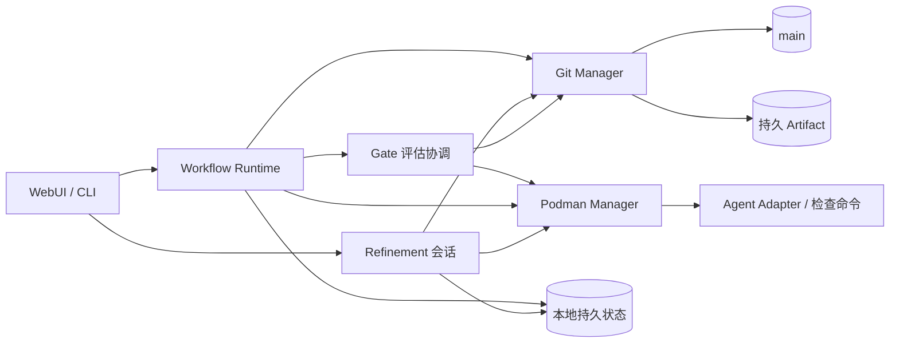

# Services

服务实现 [Requirement](02-requirement.md)、[Governance](03-governance.md) 和 [Execution](04-execution.md) 的协议。本地执行状态与 main 已发布档案各自有明确边界。

## 组件关系



## Workflow Runtime

| 输入 | 动作 |
| --- | --- |
| 固定 DAG、CombinationRun | 调度 pending 且所有直接前驱 satisfied 的节点 |
| 本地 Attempt、Worker 与容器 | 对账、恢复或标记 failed；不重复启动 |
| main 当前需求指针 | 同步后取消被新版取代的未终态 Run |
| Gate 报告与分项决策 | 串行校验并汇总；全部批准发布后接受成果，拒绝时取消其余评估，异常时转交人类 |
| 关键运行事件 | 整理结果与证据，进入待发布队列 |

创建 Attempt、变更状态、接收取消和准备交付，先在本地原子持久化。每个 clone 独立限制并发；同一 Run 由创建它的 Runtime 写入。其它 clone 只读同步，或经拥有者受信接口提交人类操作；首阶段不实现活动运行接管和远程实时状态共享。

```text
.facetloom/.runtime/
├── runs/<run-id>/             # 完整状态、不可变快照和待发布操作
├── worktrees/<attempt-id>/    # detached Worktree
├── workers/<attempt-id>.yaml  # 进程、容器和恢复标记
├── evaluators/<id>.yaml       # 可选的本地评估器定义
├── gate-tasks/<report-id>.yaml # 评估任务、取消、接管与恢复标记
├── logs/                     # 完整日志与对话
├── refinements/<id>/          # 会话、候选 Diff、验证结果
├── locks/
└── runtime.sqlite            # 可选索引或缓存
```

本地文件是未发布运行的恢复依据，SQLite 不是必需依赖。丢失本地状态后只能从 Git 恢复已发布证据，不能声称可重建未发布操作或继续原 Worker。

## Gate 评估协调

这是 Runtime 内的一项职责，不另设持久 GateRun：

1. 启动 Run 时校验 Node 继承后的模式、评估器与引用；创建 Attempt 时把完整有效配置固定到 Context Snapshot。
2. waiting_gate 材料发布后，按 gate_id 发起独立评估；human 等待人类，ai_assisted 先生成建议，ai / script 返回自动结果。
3. 调用前保存 report_id、固定材料、前一决策 ID 和本地任务状态。同一项同时最多一个活动评估；不同项可并行，限制沿用 clone 的并发配置。
4. 验证评估输出，保存 GateReport；按模式收集或生成 GateDecision，再串行合并分项引用。自动故障或无法判断时暂停该项并提示人工处理。
5. 接管、取消、拒绝或输入失效时，先持久化撤销任务，再停止评估进程；迟到结果不能推进状态。重启对账已有报告和决策，不重复决定；无法恢复的评估记录故障并等待人工处理。

评估器使用固定代码与审核材料的隔离副本，测试只能产生临时文件。脚本从 source_commit 解析，不能被候选代码替换。AI 评审会话与 Worker 执行会话独立；工具、网络和环境由 Snapshot 中的有效配置约束。协议与汇总规则见 [Governance](03-governance.md)。

## Git Manager

Git Manager 是唯一执行受信 Git 写入的组件；管理 main、隔离 Worktree、本地 Checkpoint、bundle 和精简档案。

| 操作 | 校验 |
| --- | --- |
| 创建运行 | source_commit、当前需求、定义、DAG 与 Run ID 唯一性 |
| 保存 Checkpoint | Attempt、输入、修改范围、取消或失效状态 |
| 发布档案 | owner_runtime_id、预期记录摘要、ID、引用和持久证据 |
| 保存 Gate | 分项策略、实际决策主体与报告/接管依据、当前 Attempt 摘要、同 gate_id 前一决策和 evaluated_tree |
| 发布定义 | 人类审阅、Requirement 新版规则、定义和 DAG 校验 |
| 集成交付 | current、project_tree、有效输出、Report、人类确认 |
| Refinement 提交 | 来源与目标摘要、确认 Diff、验证结果、清理引用完整性 |

发布档案使用独立的 main 发布 Worktree，不切换用户工作目录，不混入其它未提交修改。先读取远端头，在其上应用仅限本次操作的路径补丁，再正常 Commit 与 fast-forward Push。成功后记录已发布头与本地操作 ID。

### main 并发写入

```text
A 与 B 基于同一个 main 头
    ↓
A 推送成功；B 推送被拒
    ↓
B 获取最新头，检查自己的预期输入
    ↓
无冲突 → 在最新头重新构造提交并推送
状态或内容已变 → 阻塞原操作，重新审核
```

- 不同 Run 的目录可以自动重新追加；不得用整个旧 Tree 覆盖 main。
- 同一 Run 先串行化本地写入，远端以预期文件摘要和操作 ID 去重。Gate 按 gate_id 校验前一决策；其他 Gate 的更新可在复核固定材料后合并，冲突不采用最后写入者覆盖。
- 已发布后重试先核对操作是否存在，避免重复决策、交付或复活已清理档案。
- main 新增或清理 `.facetloom/runs/` 不改变正式输入；其余路径变化按 Execution 的基线规则处理。
- 同步不可用时保存本地待发布操作，需在线确认的 Gate 与交付等待；不强推，不自动改写历史。

### 本地代码与持久证据

根输入来自 source_commit，汇聚输入来自直接前驱当前有效输出。活动 Worktree 锚定需要的本地 Commit；关闭前保证有后继 Worktree 或已验证的持久 bundle。记录发布前上传所需 Artifact，验证 bundle 在空仓库中可恢复输入与输出。不用额外命名分支维持快照。

正式成果交付时，保留最新 main 档案，在其上应用已接受代码变更并校验 project_tree。运行完成和交付分别记录；交付回执写入后续 Commit。

## Refinement 协调

Refinement 是 Runtime 提供的本地交互功能，不是独立共享审批服务。会话保存输入 Commit、选中项、采纳/暂留/丢弃决定、候选 Diff 和验证结果。Agent 生成建议，UI/CLI 收集人类确认，Git Manager 负责最后提交与清理。

提交前刷新来源、目标与引用依赖；有并发变化则重新筛选或生成 Diff。验证失败保留原记录；成功提交后再结束会话。用 `FacetLoom-Refinement` Trailer 对账中断恢复，外部 Artifact 不在精炼中自动删除。

## Podman Manager

为每个并行 Attempt 创建独立 Rootless 容器及 Worktree，限制路径、工具、网络、CPU、内存、超时和凭据。共享 Git 元数据、main 工作目录和推送凭据不以可写方式暴露给 Worker。

Gate 评估、最终检查与 Refinement 验证也在隔离环境执行，输入由 Git Manager 固定；测试产生的临时文件不进入候选代码。停止 Worker 后由 Runtime 确认状态，再回收容器和不再需要的 Worktree。

## Agent Adapter

执行与精炼输入为固定上下文、Worktree、允许工具、限制和取消信号；输出为简短结论、变更路径、证据及 Checkpoint 请求。Gate 评审输入为固定审核材料和有效策略，输出为 result、rationale、evidence_refs。AI 模式下该输出可作为决策依据；Adapter 不自行写入 Decision 或接受成果，不扩大范围，不冒充人类确认，实际状态由 Runtime 推进。
