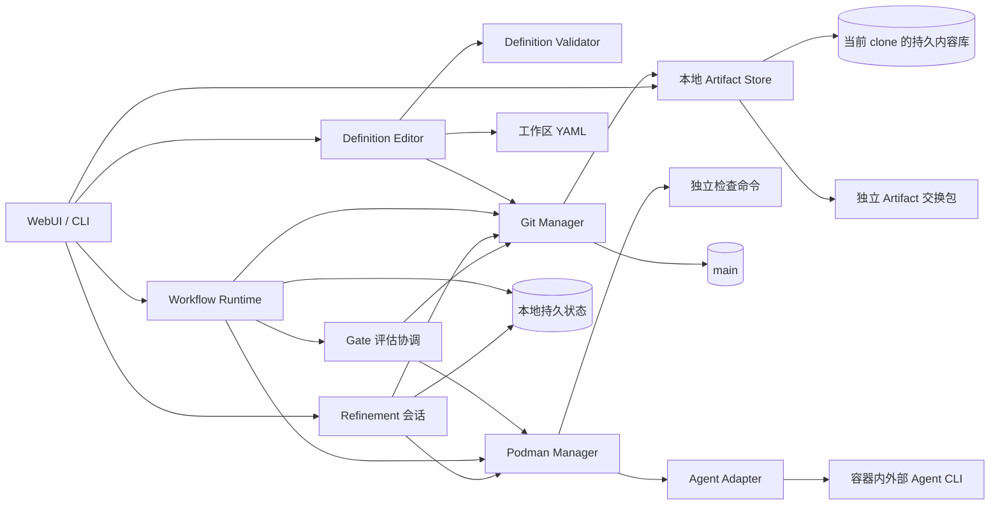

# Services

服务实现 [Requirement](02-requirement.md)、[Governance](03-governance.md) 和 [Execution](04-execution.md) 的协议。本地执行状态、main 已采纳档案与 Git 同步状态分别管理。

## 组件关系



## 定义编辑服务

| 组件 | 职责 |
| --- | --- |
| Definition Editor | 源 DAG 与属性编辑、YAML 往返序列化、摘要比较和工作区保存 |
| Definition Validator | 固定输入解析、引用与图校验、有效配置和影响分析；不执行 Agent 或检查脚本 |
| Git Manager | 已确认定义的 main 维护提交、索引保护和操作恢复 |

服务供 CLI 与 WebUI 共用，用户流程见 [可视化编辑与发布](01-workflow.md#可视化编辑与发布)。编辑器绑定已检出 main 的工作区，不自动切换分支；其它分支可读取 main 预览，保存与发布须由用户先切回 main。

### 工作区保存协议

保存请求为一批 `writes`，每项含仓库相对 path、before_digest 和完整 UTF-8 content；新增的 before_digest 为 null，删除的 content 为 null。请求来自 UI 缓冲区或 CLI stdin。目标限于 Workflow、Facet、Scope 定义文件；runner、evaluator 和资料可通过文本编辑维护。拒绝越界、重复目标、符号链接以及 `.runtime/`、runs/、Requirement 正文作为目标。

1. 在内存中应用整批候选，校验文件、引用及所有受影响 Workflow。无效时保持磁盘内容，保留编辑缓冲区。
2. 获取 clone 定义写入锁，复核 HEAD、目标摘要及本轮引用文件摘要；新增路径已存在、外部修改或索引有未合并项时拒绝保存。
3. 在 `.runtime/definition-operations/<operation-id>/` 保存 kind=save、目标清单、前后摘要、原字节、新载荷及 COMMITTED 标记并 fsync。这是恢复日志，不是独立配置版本。
4. 各文件在目标目录写临时文件、fsync、再次核对原摘要后原子 rename，并 fsync 父目录；删除只移除摘要匹配的目标。全批完成后写 APPLIED。多文件批次未完成时服务拒绝预览、发布和启动，不消费中间状态。
5. 崩溃后逐项对账：等于 after_digest 视为完成，等于 before_digest 继续应用，两者都不符则暂停并保留外部内容，交人工协调，不强制覆盖。

保存不改变 Git 索引。目标位于仓库工作区，不能复用仅允许 `.runtime/` 相对路径的运行事务写入器。外部编辑器不服从服务锁，摘要能检测已发生的修改，但不能承诺与任意外部写入原子互斥；保存期间避免同时写同一文件，恢复时再次核对字节。

### 定义发布协议

发布是独立的人类确认维护提交。预览绑定 base_commit、明确文件集合及摘要，展示 Git Diff、全部受影响 Workflow 的源图、组合图和配置变化。集合仅包含用户选择的定义、配置和引用资料，可以包含相应 runner、evaluator、原生配置和资料；不能混入代码成果、Requirement 或运行档案。

候选从 main 加上所选集合构造并重新校验，未选择的工作区修改不能充当依赖。缺少依赖时要求补选或修复，不自动纳入脏文件。main 已检出且有待发布定义修改时，使用以下专用路径：

1. 人类确认 base_commit、文件集合与候选 Tree。索引须干净，受跟踪工作区改动须全部属于发布集合；无关修改先由用户处理。不相关且不会被写入的未跟踪文件保留。
2. 在 definition-operations 中保存 kind=publish、operation_id、基线、候选和确认。锁顺序为定义写入锁 → 仓库发布锁，不持有 Run 锁。重新检查 main、HEAD、索引和文件摘要，变化则要求刷新确认。
3. 使用临时索引从确认的字节构造一个普通 Commit，父提交为 base_commit，带 `FacetLoom-Operation` Trailer。持有 Git 索引锁，以预期头比较更新 main，再同步索引为候选 Tree；工作区已是确认内容，不执行 stash、reset 或整树覆盖。
4. main 更新后索引尚未同步或结果未知时，暂停新 Git 写入，按 Trailer、Commit、Tree 及工作区/索引摘要对账；已发布只完成匹配的索引同步和回执，不重复提交。发现外部改动则保留并交人工协调。发布不自动推送或启动 Run。

这条路径允许提交已审阅的定义改动；最终采纳和 Refinement 仍要求干净工作区。用户直接通过 Git 提交定义同样有效，后续操作校验提交内容。新定义不改写旧 Run，基线变化按现有规则阻塞推进并要求新 Run。恢复日志在实际文件或 main/索引状态确认完成前保留。

## Workflow Runtime

| 输入 | 动作 |
| --- | --- |
| 固定 DAG、CombinationRun | 调度 pending 且所有直接前驱 satisfied 的节点 |
| 本地 Attempt、Worker 与容器 | 对账、恢复；无法恢复则 failed 并创建 ErrorRecord，不重复启动 |
| main 正式输入、采纳历史与 replaces_run_id | 检测基线变化、阻止重复采纳；显式替代仅停止同 Runtime 的本地 Run |
| Gate 报告与决策 | 成果全部批准后以本地事务接受；拒绝转错误 Gate；恢复动作与额度同事务落地后执行 |
| 运行完成与采纳 | 本地整理结果和证据；仅最终采纳向 main 提交需求、代码与精简档案 |

创建 Attempt、变更状态、接收取消和准备交付，先在本地原子持久化。每个 clone 独立限制并发；同一 Run 由创建它的 Runtime 写入。其它 clone 只读同步，或经拥有者受信接口提交人类操作；首阶段不实现活动运行接管和远程实时状态共享。

Runtime 首次使用 clone 时生成 UUIDv4，保存为 `.runtime/identity.yaml` 的 `runtime_id`，后续启动复用。它是运行拥有者标识，不是人类身份或授权凭据。新 clone 生成自己的身份；同一 Git common directory 的 linked Worktree 共用原 clone 的 Runtime、身份与状态目录，不创建第二个调度者。

```text
.facetloom/.runtime/
├── identity.yaml             # schema_version: 1、runtime_id；不进入 Git
├── settings.yaml            # 当前 clone 的起草默认模式与 runner
├── requirements/<uuid>/      # requirement.md、drafting.yaml、frozen.yaml
├── runs/<run-id>/             # 完整状态、不可变快照与交付意图
├── transactions/<operation-id>/ # manifest、payloads、COMMITTED、APPLIED
├── definition-operations/<id>/ # 工作区保存与定义发布恢复日志
├── worktrees/<attempt-id>/    # detached Worktree
├── workers/<attempt-id>.yaml  # Worker 身份、停止意图及调用引用
├── invocations/<invocation-id>.yaml # 外部调用、原生会话与输入记录
├── gate-tasks/<report-id>.yaml # 评估任务、取消、接管与恢复标记
├── artifacts/                # 按摘要保存的持久内容、导入与清理回执
├── logs/                     # 完整日志与对话
├── refinements/<id>/          # 会话、候选 Diff、验证结果
├── locks/
└── runtime.sqlite            # 可选索引或缓存
```

本地文件是未采纳运行的恢复依据，SQLite 不是必需依赖。丢失本地状态后，Git 只恢复已采纳档案，Artifact 字节须从保留库或交换包恢复；不能声称可重建丢失的本地操作或继续原 Worker。回收 Worktree、Worker 或临时日志时不清空 Artifact 库，备份和迁移须将其作为持久数据。

## 本地文件事务

文件是本地执行状态的事实来源；SQLite 可以从文件重建。事务覆盖 Requirement 草稿、起草请求与冻结绑定、Run、CombinationRun、Attempt、Worker、Invocation、评估任务标记、恢复额度及外部动作意图，避免逐个 YAML 写入造成半更新。

```text
transactions/<operation-id>/
├── manifest.yaml       # 操作身份、顺序与目标摘要
├── payloads/<n>        # 完整新内容
├── COMMITTED           # 事务决定已持久化，可重放
└── APPLIED             # 全部目标已落地
```

~~~yaml
schema_version: 1
operation_id: <uuid>
aggregate: {kind: run, id: <run-id>}
sequence: 12
kind: schedule_recovery
writes:
  - path: runs/<run-id>/run.yaml
    before_digest: sha256:<old>
    after_digest: sha256:<new>
    payload: payloads/0
side_effects:
  - id: <stable-worker-id>
    kind: start_worker
    depends_on: []                     # 决定、额度和新 Attempt 已在本事务落地
~~~

路径相对 `.runtime/`，禁止越界。新增文件的 before_digest 为 null；删除文件的 after_digest 与 payload 为 null。载荷摘要必须匹配 manifest；side_effects 固定调用对象、输入摘要、参数引用和依赖，实际内容随操作载荷保存。凭据不写入事务。operation_id 用于请求去重；sequence 在同一 aggregate 内递增。

### 提交协议

1. 获取该 Run 的进程级排他文件锁，检查 operation_id、预期摘要、sequence 与运行有效性。同一 Run 的状态、任务和额度变更共用此锁；Refinement 使用会话锁。草稿保存、起草请求、模式切换与冻结使用 Requirement 锁及 `aggregate: {kind: requirement, id: <requirement-id>}`，释放后再获取 Run 锁。settings.yaml 使用 clone 设置锁与 `aggregate: {kind: settings, id: local}`，默认设置复制到草稿时不同时持有两类锁。
2. 写入完整 payloads 与 manifest，逐个 fsync 文件和目录。此时不改目标文件，不执行外部动作。
3. COMMITTED 内容包含 manifest 的 SHA-256，通过临时文件与 rename 发布，再 fsync 文件及事务目录；事务目录首次创建也须 fsync transactions 父目录。此刻事务已提交，之后必须完成重放，不能回滚成未发生。
4. 对每个目标使用同文件系统临时文件、fsync、原子 rename 和目录 fsync 完成替换。删除操作使用 unlink 并 fsync 父目录。当前摘要已是 after_digest 则跳过；等于 before_digest 才写入；两者均不符则隔离该 Run 并报恢复错误，不能覆盖未知更新。
5. 全部目标完成后持久化 APPLIED。释放锁之后，才允许读取完成视图和调度已提交的外部动作。

所有 Runtime 读者通过服务在同一锁下读取，或读取该服务发布的完整版本；不得直接读取落地中的多文件组合。API 请求先在锁内完成遗留重放。提交成功但 APPLIED 尚未落地时对调用者报告“恢复中”，不能暴露半状态。

需要同时持锁时先 Run 锁、后仓库发布锁；不同时获取多个 Run 锁。耗时网络调用在锁外执行，回来后重新校验预期版本。进程退出释放操作系统锁，不靠删除锁文件接管活动运行。

### 恢复顺序与外部动作

```text
暂停调度
    ↓
无 COMMITTED：丢弃暂存事务
有 COMMITTED 无 APPLIED：按 aggregate / sequence 重放
    ↓
验证状态与引用 → 对账 main / Artifact / Worker / 评估调用
    ↓
恢复交付及其它外部意图 → 恢复有效评估与执行调度
```

- 同一 aggregate 的后续事务只能在前一事务 APPLIED 后创建，故恢复时不存在合法的越序覆盖。恢复完毕前不启动新 Worker。
- 启动 Worker、评估请求、Artifact 导入/导出/清理及 Git 提交都先持久化意图。容器按稳定 worker ID 查询；调用按 report ID / 请求摘要对账；Artifact 按内容摘要及本地操作回执校验；Git 按本地 main 的操作 Trailer 与目标内容校验。
- 本地 main 更新结果未知时先在历史中查找操作 ID。即使 Refinement 已清理当前档案，也不能重新追加已执行操作或复活旧记录。push 确认丢失只需核对远端是否已含原提交，不重放业务操作。
- 外部动作状态为 pending / running / succeeded / failed / unknown / cancelled，确认失败记录原因并等待重试或人工处理；状态变化也通过文件事务保存。恢复动作的扣减、状态和动作意图同事务提交，重放不重复扣减；取消后不返还已安排额度。
- 错误恢复 Worker 依赖相应决定和额度事务 APPLIED；成果接受同样在本地落地后生效。只有最终采纳及独立 Refinement 等 Git 写入等待 main 确认，普通执行与 Gate 不提交 Git。
- 无幂等接口且发送结果未知时，先保留 unknown 并对账；无法确认则等待人类，不自动重发，不保证网络调用恰好执行一次。
- APPLIED 事务仅在所有必要动作已对账并完成后才可回收；保留本地操作 ID 去重索引。Git 写入结果仍以本地 Git 历史 Trailer 校验，不以可选 SQLite 为唯一依据，也不等待远端同步。

## Gate 评估协调

这是 Runtime 内的一项职责，不另设持久 GateRun：

1. 启动 Run 时校验成果及错误策略、检查、评估器与引用；错误策略固定在 run.yaml，成果策略在准备成功后固定到 Context Snapshot。能力不足按执行错误或评估器故障分别处理。
2. 成果材料完整后本地冻结 Attempt.waiting_gate；节点出错或成果拒绝后持久化 ErrorRecord 及 CombinationRun.waiting_gate。本地事务落地后才发起对应成果项或 workflow/error 的正式评估；四种模式共用调用基础设施。
3. 调用前保存 report_id、review_input_digest、实际初始评估请求、前一决策 ID 和本地任务状态。保存报告前持久化 request_input_ref，只有请求尚未形成即失败时可为空。任务身份包含 review_kind；错误任务还绑定 error_ref，同一审核对象同时最多一个活动评估。不同项可并行，限制沿用 clone 的并发配置。
4. 按 review_kind 验证结果或处置动作。成果报告引用更新 Attempt，错误报告引用更新 CombinationRun；AI/脚本恢复动作同时校验 Run 级额度和失效范围。评估器自身故障交给人类，不递归调用错误 Gate。
5. 接管、取消、成果拒绝或输入失效时，先持久化撤销相关任务，再停止进程。成果拒绝只撤销原成果评估，另发起错误审核。重启按 report_id 对账；迟到或已失效任务不能推进状态。

成果评估器使用固定代码与审核材料的隔离副本，测试只能产生临时文件；错误评估器读取 ErrorRecord 与可用输入，没有代码时仍可处置。脚本从 source_commit 解析，不能被候选代码替换。AI 评审使用 Run.runners 中的固定配置及独立会话，脚本按评估器的有效环境与网络配置运行。协议与汇总规则见 [Governance](03-governance.md)。

## Git Manager

Git Manager 是唯一执行受信 Git 写入的组件；管理 main、隔离 Worktree、本地 Checkpoint、bundle 和精简档案。

| 操作 | 校验 |
| --- | --- |
| 准备运行与 Checkpoint | source_commit、UUID、DAG、Scope、outcome、输入/输出 Tree 与取消状态 |
| 固定审核材料 | 最终 Tree 的实际检查、请求与执行证据本地持久可读，冻结字段和 review_input_digest 一致 |
| 保存 Gate | Runtime 以本地事务校验主体、材料、策略、前一决定、状态与额度；Git Manager 不将其逐次提交 main |
| 导入 Agent 证据 | 输入白名单、文件路径与类型、数量/大小上限、摘要及持久性 |
| 最终采纳 | 需求未采纳、基线有效、终端成果、报告与确认匹配；需求、代码、档案及回执一次提交 |
| 定义 / Refinement 维护 | 人类确认 Diff、定义和 DAG 校验、证据与清理引用完整性 |

### 本地执行与最终采纳

```text
执行 / Gate / 恢复决定 → 本地事务 COMMITTED → APPLIED → 生效与继续调度
                                                           ↓ 最终检查、人类确认
                                    需求 + 代码 + 精简档案 + DeliveryRecord
                                                           ↓ 一次 squash
                                                       本地 main
                                                           ↓ 可选、显式 Git 同步
                                                       其它 clone
```

一个 Requirement 对应一次采纳提交；运行过程中不写 main。失败、取消和放弃的记录留在本地，可显式导出。定义维护及 Refinement 是各自独立的人类确认操作，不是原需求的追加日志提交。remote 只同步历史，无需 remote 即可完成全部本地操作。

### main 提交保护

以下通用协议用于最终采纳和 Refinement；定义维护使用前述 [定义发布协议](#定义发布协议)，同样遵守预期头保护、操作去重与恢复对账。

1. 先保存本地操作意图。在 detached Worktree 中基于最新 main 构造候选，以当前头为唯一父提交；不混入用户修改，不创建命名执行分支。候选带 `FacetLoom-Operation` Trailer，采纳再带 Requirement、Run、Delivery 标识。
2. 最终采纳持有 Run 锁后再取仓库写入锁，重查操作、需求采纳历史、确认及基线。预期头变化时先查是否已成功；未成功且只有 runs/ 变化可保留最新档案重构，正式输入变化要求新 Run，不把多个需求的成果自动合并。
3. main 未检出时以预期旧 OID 比较更新引用；已检出时，最终采纳与 Refinement 要求工作区和索引干净、无将被覆盖的未跟踪文件，才正常快进并同步文件。定义维护按 [定义发布协议](#定义发布协议) 提交已审阅的工作区文件。不切换其它分支，不自动 stash、reset 或覆盖用户修改。
4. 提交进入 main 的可达历史才成功，候选仅存在对象库不算成功。结果未知时先核对 main、Git 索引和 Trailer，校验需求字节、候选 Tree、档案闭包和同 Commit 回执，再完成本地确认。无法判断工作目录是否完整落地时暂停新 Git 写入，人工处理后恢复。

锁串行化当前 clone 的受信写入，同时使用 Git 引用/索引锁与预期头校验。仅 main 工作目录中的普通代码改动不会阻塞本地执行或 Gate，但会阻塞采纳；未提交定义按 Workflow 规则阻止新 Run 启动。重复请求按 operation_id、delivery_id、run_id 和 requirement_id 对账；档案已被精炼删除也查历史，不能重新采纳或复活记录。

### 取消与并发

本地成果接受、恢复和取消共用 Run 锁及文件事务，按实际提交顺序确定结果。取消先封禁执行身份、持久化停止与撤销意图；迟到报告不推进状态。accepted / rejected 等既有终态保留，节点失效则清除当前有效引用。取消不向 main 追加日志。

最终采纳也持有 Run 锁；未进入 publishing 时可取消意图，publishing 或 main 结果未知时须先对账。采纳已进入 main 则保留成功事实，不再取消或重放；撤回正式成果使用 Git revert。completed Run 的未交付成果可由人类明确放弃，规则见 Execution。

不同需求可并行执行；main 采纳串行进行。先采纳的需求改变正式输入后，其它旧基线 Run 需在新 source_commit 下重跑，即使文本可自动合并也不复用旧候选检查。仅 runs/ 的精炼清理不改变执行输入。Run 目录有不同 UUID 只解决文件命名，不证明代码或定义兼容。

### Git 异步同步

不区分本地与远程项目。未配置 remote 时无需同步；配置后由用户执行正常 Git 操作，FacetLoom 不增加自动同步服务，也不要求每次执行前 fetch。

| 情况 | 处理 |
| --- | --- |
| push 成功 | 共享已采纳提交和维护提交；不重放其中的 Gate 或交付 |
| 网络失败、push 被拒或确认丢失 | 保留本地结果，核对远端包含关系后再同步；不重复采纳 |
| 接收更新可快进 | 校验定义、UUID、档案和引用，按 main 工作目录保护规则更新 |
| 历史分叉或代码冲突 | 停止自动接纳，由用户按 Git 协作流程协调；不提供需求版本合并、自动重放或强推流程 |
| 同一需求 UUID 出现多次采纳或不一致内容 | 报告冲突，由人类处理；文本可合并不能视为业务合法 |

Git 同步不要求同时导入所有 Artifact；可先读摘要，所需原始内容另用交换包补齐。同步采用保留固定 Commit 引用的历史；外部重写导致引用不可恢复时须人工修复，不静默换 OID。

接纳更新后，在调度、接收决定与交付前重新检查 main 的正式输入及需求采纳历史：基线变化阻塞旧 Run 并要求新 Run，同一需求已采纳则停止本地其它运行。fetch 仅获取对象，未进入本地 main 的更新不成为执行输入。其它独立需求不会因名称或时间关系而自动取代本地需求，也没有跨 clone 运行取消服务。

通过普通 Git 在服务外更新 main 时执行同样校验；无效定义、重复 UUID 或破损档案暂停相关操作。历史采纳和 Gate 保留原上下文，不证明同步后代码已经通过旧检查，也不承诺离线 clone 间即时唯一或即时停止。

### 本地代码与持久证据

根输入来自 source_commit，汇聚输入来自最终约简 DAG 快照的直接前驱当前有效输出，按 Execution 的稳定逐步三方合并协议构造。活动 Worktree 锚定需要的本地 Commit；关闭前保证有后继 Worktree 或已验证的持久 Git bundle。记录持久化前将所需 Artifact 保存到拥有者本地库，验证 Git bundle 在空仓库中可恢复输入与输出。不用额外命名分支维持快照，也不要求上传到共享服务。

最终交付时，在最新 main 上应用成果并加入冻结需求文件，保留既有档案；候选及最终检查报告先本地持久化，再获取绑定候选的人类确认。applied / no_change 均在同一个 squash Commit 中写入需求、精简档案和 DeliveryRecord，不追加回执提交。

本地 `.runtime/runs/<run-id>/delivery.yaml` 保存活动交付意图和确认。调度、取消及交付共用 Run 锁；准备 main 提交时再获取仓库发布锁。本地预期头变化必须重验；publishing 表示正在提交本地 main，结果未知时先查 Trailer，不创建第二个 delivery_id。后续 push 不参与交付状态。协议与字段见 Execution。

## 本地 Artifact Store

这是 Runtime 内的存储职责，不是独立部署的服务。Git Manager 与 Adapter 通过它保存、解析和校验内容；Worker 只获得本次输入的只读材料和独立证据输出目录，不直接挂载整个库。

| 操作 | 责任 |
| --- | --- |
| 保存 / 读取 | 校验字节摘要，原子登记文件及直接依赖；解析内容 URI 为当前 clone 的受控文件 |
| 检查可用性 | 区分本地可用、尚未导入、已在本地清理及缺失/损坏；缺内容不改运行事实 |
| 导出 / 导入 | 按固定 Git 记录或本地记录快照收集闭合依赖，校验独立交换包，整包提交；不操作正式代码或活动 Run |
| 预览 / purge | 检查全部本地使用者及本地 main 的保留引用，人工确认后记录回执并删除；无需联网 |

协议和文件结构统一见 [Execution](04-execution.md#artifact-存储与交换)。存储写入、引用登记与保护标记使用同一 clone 级库锁；本地运行、交付意图、精炼和交换操作在使用前登记保护，结束后释放。登记与有效状态通过文件事务一起提交，恢复时先重放并重建保护集合，再允许 purge。

需要多类锁时，顺序为 Run 或 Refinement 会话锁 → Artifact 库锁 → 仓库发布锁，不同时获取多个 Run 锁。purge 在库锁下读取已提交的引用/保护视图，不反向获取 Run 锁；发现变化或无法核对完整依赖则中止并重新预览。耗时打包与 Git 同步在锁外进行，使用期间持久保护所需对象。删除意图提交后，相关对象不可新增引用或开始导出，直到删除完成；再次导入须先完成或对账该清理操作。

库自身的导入与清理事务使用 `aggregate: {kind: artifact_store, id: <runtime-id>}`，以库锁串行化；仍遵循 COMMITTED / APPLIED 协议。导入原子发布 entry 和回执，未提交字节不对外可用；purge 先记录清理意图，再幂等删除并逐项更新结果。清理失败保留待完成回执，恢复时优先对账，不报全局删除成功。该锁只约束当前 clone，不声称保护其它离线副本；未来 S3 或 LFS 后端不属于当前依赖。

## Refinement 协调

Refinement 是 Runtime 提供的本地交互功能，不是独立共享审批服务。会话保存输入 Commit、选中项、采纳/暂留/丢弃决定、候选 Diff 和验证结果。Agent 生成建议，UI/CLI 收集人类确认，Git Manager 负责最后提交与清理。

提交前刷新来源、目标与引用依赖；有并发变化则重新筛选或生成 Diff。验证失败保留原记录；成功提交后再结束会话。用 `FacetLoom-Refinement` Trailer 对账中断恢复，外部 Artifact 不在精炼中自动删除。

## Podman Manager

镜像在运行前安装对应外部 Agent、项目语言与依赖。Runtime 按 runner.image_ref 的 digest 启动 Rootless Podman；不在 Attempt 内安装、升级 Agent 或修复镜像环境。每个 Worker 使用独立 Worktree、配置与会话目录，执行 main 的 Git 凭据和共享 Git 元数据不以可写方式暴露。

允许 runner.args 使用对应 Agent 支持的免交互、绕过审批及关闭内部沙箱参数。外层 Podman 承担文件挂载、网络、进程与资源边界；Runtime 继续独立校验 Scope、必要检查和 Gate，免审批不等于免审核。Scope 的路径规则与最终 Diff 都要校验，不依赖 Agent 自律执行。

启动前 Adapter 在同一镜像环境中探测程序是否存在、实际版本、原生参数及输入/输出能力。程序缺失、参数不支持或配置无法加载时保存明确错误；不可静默降级为交互模式。模型服务认证或连接错误同样保存实际失败证据。

网络为 disabled / outbound；outbound 供外部 Agent 访问模型服务，并受 Runtime 可实施的网络策略限制。只有明确提供可达本地服务或不需要联网的任务才可使用 disabled；纯脚本及必要检查可独立禁网。拒绝无法满足的配置，不将禁网失败误报为代码测试失败。

成果 AI Gate 在新容器/会话中读取固定候选的只读副本，缓存和临时产物位于独立可写目录；错误 Gate 读取 ErrorRecord 与可用证据。支持证据文件输出的 Agent Invocation 另有新的专用 `evidence-out/` 目录，以只读输入和可写输出挂载给容器；它与项目 Worktree、原始候选和 Artifact Store 隔离。AI Gate 与 Refinement 的外部 Agent 使用同一证据文件导入协议；Script Gate 只返回已校验的类型化证据引用。即使原生 Agent 关闭内部沙箱，也不能写原 Worker 成果或 main。最终检查与精炼验证使用独立候选副本。

### Worker、调用与会话

| 对象 | 含义 | 本地位置 |
| --- | --- | --- |
| Worker | 一个 Attempt 的 Worktree 和执行生命周期；可先后持有执行及 Post-Assess 容器 | workers/<attempt-id>.yaml |
| Invocation | 一次外部 CLI 启动或原生协议请求，含 task_kind | invocations/<invocation-id>.yaml |
| Native session | 外部 Agent 自己维护的会话；ID 可为空 | 每次任务独立目录；Invocation 保存引用 |

一个 Attempt 最多创建一个 Worker；同一 Worker 可在预算内发起多个串行 Invocation，不能并行修改同一 Worktree。Pre-Assess 与 Post-Assess 分别使用独立的只读容器和新会话；不创建额外 Worker。只读指项目输入与候选成果，证据输出目录单独可写。只有原生支持并能核实身份时才续接执行/修复会话；续接失败进入错误 Gate，预检和自检不续接执行会话。

~~~yaml
schema_version: 1
worker_id: <attempt-id>
run_id: <run-id>
attempt_id: <attempt-id>
owner_runtime_id: <runtime-id>
runner_id: developer
runner_profile_digest: sha256:<profile-digest>
execution_container_id: <podman-container-id>
pre_assess_container_ids: []
post_assess_container_ids: []
status: running
invocation_ids: [<invocation-id>]
started_at: "2026-11-09T12:00:00Z"
deadline_at: "2026-11-09T12:30:00Z"
stop_requested_at: null
stop_reason: null
stop_grace_seconds: 30
stop_deadline_at: null
stopped_at: null
~~~

Worker 状态为 pending / running / stop_requested / stopped / unknown，独立于 Attempt 状态。进程引用不能只记 PID：同时记录容器 ID、进程启动身份与 invocation_id，避免 PID 复用误停止其他任务。退出状态以原生调用结果与实际容器对账为准。

Invocation 文件使用以下字段；支持证据文件输出的调用将独立目录挂载为 `/facetloom/evidence-out`。AI Gate、Refinement 和需求起草也共用此记录，不为它们创建业务 Attempt 或 Worker；draft 的 evidence_dir 为 null，evidence_imports 与 evidence_refs 为空列表。

| 字段 | 定义 |
| --- | --- |
| schema_version、invocation_id | 格式为 1，调用 ID 为 UUIDv4 |
| owner、task_kind | owner 为 `{kind: worker/gate/refinement/requirement, id: <所属 ID>}`；task_kind 为 pre_assess / execute / repair / post_assess / evaluate / refine / draft |
| runner_id、runner_profile_digest | 所属 Run、精炼会话或起草请求内的固定调用配置 |
| adapter_version、agent_version、image_ref | 实际 Adapter / Agent 版本及镜像 digest；程序尚未探测成功时版本可为 null |
| argv、input_ref、native_output_ref、result_ref | 实际参数、发送前固定的输入 Artifact、原生结构化输出与 Adapter 规范化结果；不含凭据。失败时规范化结果可为空 |
| evidence_dir、evidence_imports、evidence_refs | 每次调用独立的临时输出目录、逐文件导入回执及成功导入的不可变证据引用；目录本身不是持久引用 |
| native_session_id、previous_invocation_id | 原生会话与上一调用；首次或原生不支持时可为 null |
| container_id、process_identity | 本次调用的容器及进程启动身份；启动前可为空 |
| status | pending / running / stop_requested / succeeded / failed / cancelled / unknown；succeeded 只表示原生调用成功退出 |
| started_at、deadline_at、finished_at | UTC ISO 8601；未开始或未结束的相应字段为 null，执行调用不得超出 Worker deadline |
| stop_requested_at、stop_reason、stop_deadline_at | 持久化停止意图、原因与强制终止截止时间；无停止请求时为 null |
| exit_code、event_refs | 实际退出码与可观测事件引用；未形成时为空 |

支持证据文件输出的 Invocation 在调用前创建空的独立 `evidence-out/`，只将该目录挂载到对应容器。容器退出确认后 Adapter 冻结该目录，保存原生输出，校验结构化响应与本次输入提供的证据引用白名单，再按 [Execution](04-execution.md) 的路径规则、单文件和总量上限暂存、摘要校验并导入文件。全部文件导入成功后才生成 `result_ref` 与规范化 `evidence_refs`；失败时两者均不得作为成功结果发布，Invocation 记录故障，ErrorRecord 可引用原生输出及可用诊断材料。导入中已写入但无有效引用的 Artifact 不构成部分 Report，可在确认没有引用后回收。

续接只能引用同一 Attempt 的 execute / repair 调用、相同固定 runner 的原生会话；Post-Assess 不得复用可写执行容器或会话。恢复时重新核实镜像、程序版本及 Adapter 兼容性，不能静默切换运行方式。

runner.timeout_seconds 从首次 Pre-Assess 调用发出前持久化 started_at / deadline_at 开始计时，覆盖预检、执行、同次修复、检查和只读 Post-Assess；排队、输入准备、Gate 等待和最终采纳不计入。Runtime 重启不重置 deadline。达到总时限为 execution_timeout，停止当前调用或检查并保存实际结果，Attempt failed 后转错误 Gate；单个检查自身先超时仍按 CheckReport 的 failed 处理。每次 Agent 调用还受同一 runner.timeout_seconds 单次限制。AI Gate 评估、Refinement 与需求起草不属于 Attempt，采用各自调用的时限。

### 停止与恢复

1. 在本地事务保存 stop_requested、停止原因和原任务撤销标记，立即禁止其迟到结果推进状态；取消、同一需求已采纳、上游修复及执行超时使用同一协议。
2. 请求原生调用正常退出，停止 Worker 容器；默认宽限期 30 秒，实际值及停止截止时间随意图持久化，超时强制终止。
3. 确认进程及容器退出后记 stopped，再回收 Worktree、会话与资源额度。查询失败记 unknown，不当作已退出，也不重复启动。
4. 无法停止则保留资源引用，隔离旧任务并转人工对账。隔离须确认旧任务无法再访问新 Worktree 或受信写入接口；仅写一个“已隔离”标记不够。

Runtime 重启先恢复文件事务，再按容器/Invocation 身份对账；已有活跃进程可重新监控，不新启动第二个进程。只有支持原生恢复且能证明原调用已退出时才恢复同一会话；若不能安全恢复，原 Attempt 失败，经错误 Gate 创建新 Attempt。Gate、精炼和起草调用同样先撤销、再停止，迟到输出不恢复旧任务。

## 起草调用协调

需求起草由 Runtime 协调，文件和交互规则见 [Requirement](02-requirement.md#需求起草)。Invocation 使用 `owner: {kind: requirement, id: <requirement-id>}`、`task_kind: draft`，不创建 Run、Attempt 或 Worker。

每次请求使用新的隔离容器和原生会话。调用输入 Artifact 保存草稿原始字节及摘要、用户指令、提供的交互记录、当时 main 的 base_commit、资料引用，以及与 Run.runners 同结构的完整 runner 配置和来源。Adapter 的 input_ref 记录实际发送内容，禁止只留文件名或依赖易变的 main 引用。请求时限为固定 runner.timeout_seconds。

容器仅挂载草稿副本、固定项目资料的只读副本与独立输出目录；不挂载真实 `.runtime/`、可写主仓库或 Git 管理凭据。没有 Workflow 时仍可使用同一 Podman 与 Adapter 能力。起草输出使用独立的最小结构：

```json
{
  "schema_version": 1,
  "requirement_id": "9e2c1f78-6a54-4d92-8e31-05b7a19c2f60",
  "candidate_markdown": "<完整候选 Markdown，保留原 UUID 和 front matter>",
  "summary": "整理验收条件，限制期仍需用户明确。",
  "questions": ["限制期应配置为多长？"]
}
```

candidate_markdown 和 summary 为非空文本，questions 为字符串列表，可空；候选允许未完成的草稿，但身份与格式必须有效。questions 是待澄清内容，不作验收事实。本阶段不接收 draft 的 evidence_files 或 evidence_refs；用户输入与固定资料随 input_ref 留存，候选随 result_ref 留存，Diff 由原文和候选计算，不增加独立报告或证据协议。

发起请求前先持久化 Invocation、drafting.yaml 请求项与调用意图；input_ref 必须已持久可读。完成时校验结构化结果并保存候选 Artifact，再在 Requirement 锁下复核摘要与请求有效性，将草稿写回、applied 结果及 active_invocation_id 清空作为同一事务提交。需要人工查看的候选记 needs_review；故障记 failed，撤销记 cancelled。任何终态都清除匹配的 active_invocation_id，不清除后来创建的新请求；撤销后的迟到输出不改变 cancelled 结果。原生 succeeded 不等于已应用草稿，重放按 invocation_id 与已保存处理结果去重。

没有有效 runner、启动失败或超时均显示起草故障，保持草稿可手动编辑。恢复先重放事务，再按容器和进程身份对账；unknown 不重复启动。调用已退出且结果可验证时执行同样的写回检查，否则记录失败供用户重试。旧调用尚未确认退出或隔离时，不启动新的起草调用；已撤销调用不能阻止人工编辑或冻结。取消、切换模式与冻结共用停止协议，停止不要求 Agent 自己同意。

起草相关 Artifact 在请求开始前登记保护，候选发布与引用登记复用库协议；锁顺序为 Requirement → Artifact 库，不持有 Run 锁。请求历史和 frozen.yaml 分别保留其引用，默认不自动清理；它们在 purge 时与其它本地有效记录一起检查。项目默认设置仅在新草稿创建时复制，起草模式不影响 Gate 策略。

## Agent Adapter

Adapter 是外部程序协议适配层，不实现模型推理、工具循环或上下文压缩。面向 codex、claude_code、opencode、pi_agent 分别处理版本与原生参数，不假设其参数、输出或会话 API 相同。首阶段优先非交互 CLI；每个 Adapter 声明支持的程序版本和能力。

| 操作 / 能力 | 规则 |
| --- | --- |
| probe | 探测版本、参数、任务输入、所需任务的结构化结果及事件能力；draft 校验候选协议，其它 Agent 任务校验包含 `evidence_refs` 与可选 `evidence_files` 的协议；不支持时显式报错 |
| start | 使用固定 runner 启动外部 Agent，传入工作目录、任务及资料；args 不经 Shell 展开 |
| continue | 把检查失败或用户反馈传给原生会话；不支持时进入错误处置，不自己补一个 Agent 循环 |
| recover | 可选；核实已有进程、原生会话及调用状态，不能把 unknown 当作未发送 |
| stop | 按调用身份停止，配合容器退出确认 |

Adapter 先保存每次实际调用输入，再原样传入外部程序；首次 Pre-Assess 输入使用 agent_input_ref，执行与修复等后续调用分别由 Invocation 引用输入，审核输入使用 GateReport.request_input_ref。证据输出由 Agent 通过 `evidence_files` 提交，已有证据使用 `evidence_refs`；导入规则及上限见 [Execution](04-execution.md)。AI Gate 与 Refinement 也使用该协议，Refinement 会话记录其导入引用，Script Gate 只能引用输入中已有且已校验的类型化证据。模型服务凭据由环境或连接层注入，不进入记录；不挂载宿主机原生配置或跨 Attempt 共享会话。

draft 调用按起草协议解析候选；pre_assess 调用的原生结构化输出解析成 PreAssessReport 内容，execute / repair 解析成 ExecutionResult，post_assess 解析成 Post-AssessReport 内容，均存于 result_ref。AI Gate 输出解析为 result 或 action、rationale、evidence_refs、evidence_files 及条件必填修复字段；Refinement 返回的建议使用相同的证据字段。Adapter 将 `evidence_files` 转为正式 Artifact `evidence_refs` 后才保存规范化结果；持久报告不包含 Agent 临时路径。结构化输出不完整、证据引用越权、导入失败或仅有成功退出码时，调用不能视为成功；Adapter 不发起第二模型调用补写结果，不创建 Decision 或接受成果。

FacetLoom 只承诺保存自己提供的输入和可观测事件；外部 Agent 的内部系统提示、隐藏推理、压缩过程及未暴露的模型/工具信息不在可追溯承诺内。任务执行、AI 评估、精炼与需求起草使用各自隔离的原生会话。接入协议属于设计目标，不表示四种 Adapter 已全部实现。
