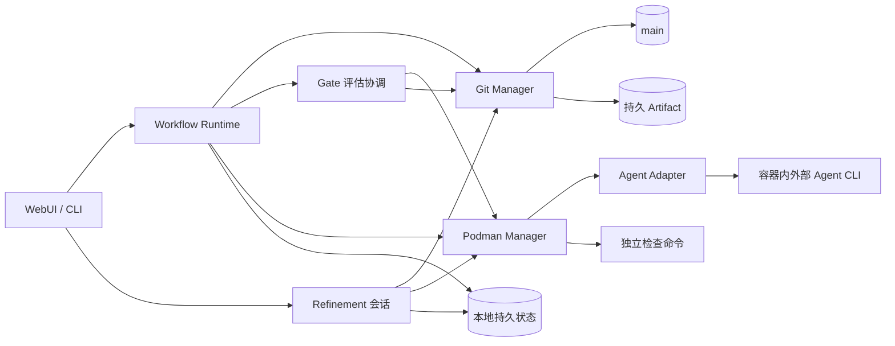
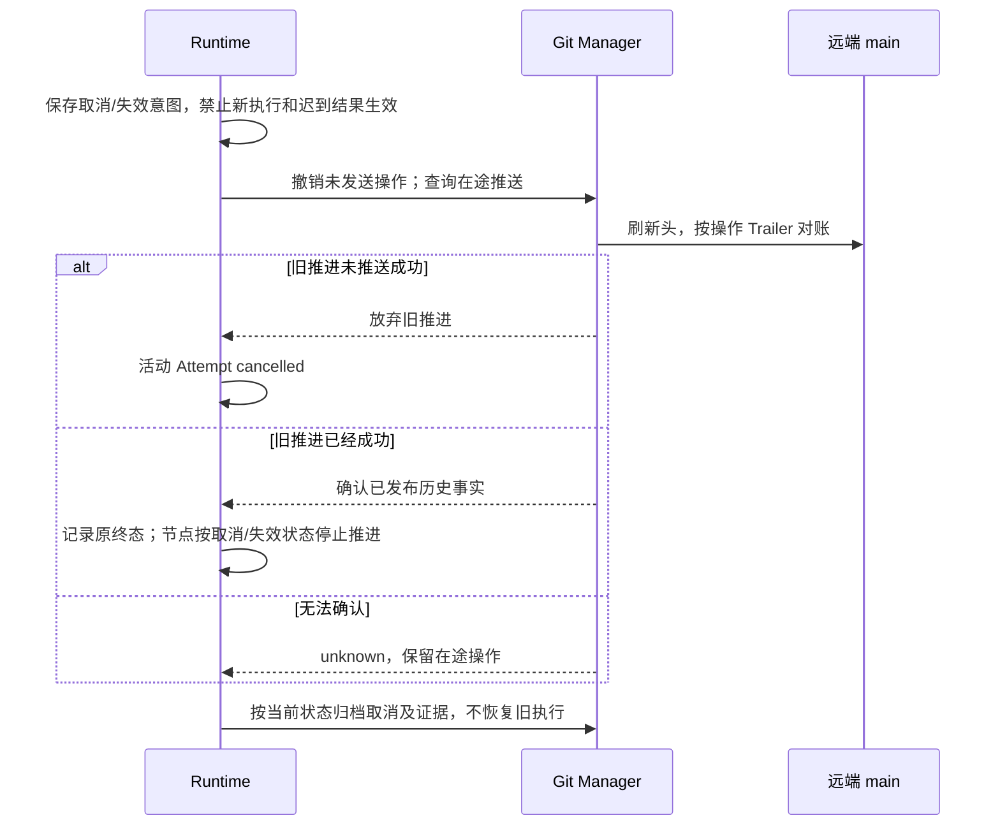

# Services

服务实现 [Requirement](02-requirement.md)、[Governance](03-governance.md) 和 [Execution](04-execution.md) 的协议。本地执行状态与 main 已发布档案各自有明确边界。

## 组件关系



## Workflow Runtime

| 输入 | 动作 |
| --- | --- |
| 固定 DAG、CombinationRun | 调度 pending 且所有直接前驱 satisfied 的节点 |
| 本地 Attempt、Worker 与容器 | 对账、恢复；无法恢复则 failed 并创建 ErrorRecord，不重复启动 |
| main 当前需求指针 | 同步后取消被新版取代的未终态 Run |
| Gate 报告与决策 | 成果全部批准发布后接受；拒绝转错误 Gate；错误动作串行校验额度与依赖，发布后执行 |
| 关键运行事件 | 整理结果与证据，进入待发布队列 |

创建 Attempt、变更状态、接收取消和准备交付，先在本地原子持久化。每个 clone 独立限制并发；同一 Run 由创建它的 Runtime 写入。其它 clone 只读同步，或经拥有者受信接口提交人类操作；首阶段不实现活动运行接管和远程实时状态共享。

```text
.facetloom/.runtime/
├── runs/<run-id>/             # 完整状态、不可变快照和待发布操作
├── transactions/<operation-id>/ # manifest、payloads、COMMITTED、APPLIED
├── worktrees/<attempt-id>/    # detached Worktree
├── workers/<attempt-id>.yaml  # Worker 身份、停止意图及调用引用
├── invocations/<invocation-id>.yaml # 外部调用、原生会话与输入记录
├── gate-tasks/<report-id>.yaml # 评估任务、取消、接管与恢复标记
├── logs/                     # 完整日志与对话
├── refinements/<id>/          # 会话、候选 Diff、验证结果
├── locks/
└── runtime.sqlite            # 可选索引或缓存
```

本地文件是未发布运行的恢复依据，SQLite 不是必需依赖。丢失本地状态后只能从 Git 恢复已发布证据，不能声称可重建未发布操作或继续原 Worker。

## 本地文件事务

文件是未发布状态的事实来源；SQLite 可以从文件重建。事务覆盖 Run、CombinationRun、Attempt、Worker、Invocation、评估任务标记、恢复额度及待发布意图，避免逐个 YAML 写入造成半更新。

```text
transactions/<operation-id>/
├── manifest.yaml       # 操作身份、顺序与目标摘要
├── payloads/<n>        # 完整新内容
├── COMMITTED           # 事务决定已持久化，可重放
└── APPLIED             # 全部目标已落地
```

~~~yaml
schema_version: 1
operation_id: <uuid>
aggregate: {kind: run, id: <run-id>}
sequence: 12
kind: schedule_recovery
writes:
  - path: runs/<run-id>/run.yaml
    before_digest: sha256:<old>
    after_digest: sha256:<new>
    payload: payloads/0
side_effects:
  - id: <stable-effect-id>
    kind: publish_records
    publication_kind: advance
    depends_on: []
  - id: <stable-worker-id>
    kind: start_worker
    depends_on: [<stable-effect-id>]
~~~

路径相对 `.runtime/`，禁止越界。新增文件的 before_digest 为 null；删除文件的 after_digest 与 payload 为 null。载荷摘要必须匹配 manifest；side_effects 固定调用对象、输入摘要、参数引用和依赖，实际内容随操作载荷保存。凭据不写入事务。operation_id 用于请求去重；sequence 在同一 aggregate 内递增。

### 提交协议

1. 获取该 Run 的进程级排他文件锁，检查 operation_id、预期摘要、sequence 与运行有效性。同一 Run 的状态、任务和额度变更共用此锁；Refinement 使用会话锁。
2. 写入完整 payloads 与 manifest，逐个 fsync 文件和目录。此时不改目标文件，不执行外部动作。
3. COMMITTED 内容包含 manifest 的 SHA-256，通过临时文件与 rename 发布，再 fsync 文件及事务目录；事务目录首次创建也须 fsync transactions 父目录。此刻事务已提交，之后必须完成重放，不能回滚成未发生。
4. 对每个目标使用同文件系统临时文件、fsync、原子 rename 和目录 fsync 完成替换。删除操作使用 unlink 并 fsync 父目录。当前摘要已是 after_digest 则跳过；等于 before_digest 才写入；两者均不符则隔离该 Run 并报恢复错误，不能覆盖未知更新。
5. 全部目标完成后持久化 APPLIED。释放锁之后，才允许读取完成视图和调度已提交的外部动作。

所有 Runtime 读者通过服务在同一锁下读取，或读取该服务发布的完整版本；不得直接读取落地中的多文件组合。API 请求先在锁内完成遗留重放。提交成功但 APPLIED 尚未落地时对调用者报告“恢复中”，不能暴露半状态。

需要同时持锁时先 Run 锁、后仓库发布锁；不同时获取多个 Run 锁。耗时网络调用在锁外执行，回来后重新校验预期版本。进程退出释放操作系统锁，不靠删除锁文件接管活动运行。

### 恢复顺序与外部动作

```text
暂停调度
    ↓
无 COMMITTED：丢弃暂存事务
有 COMMITTED 无 APPLIED：按 aggregate / sequence 重放
    ↓
验证状态与引用 → 对账 main / Artifact / Worker / 评估调用
    ↓
恢复待发布队列 → 恢复有效评估与执行调度
```

- 同一 aggregate 的后续事务只能在前一事务 APPLIED 后创建，故恢复时不存在合法的越序覆盖。恢复完毕前不启动新 Worker。
- 启动 Worker、评估请求、上传及推送都先持久化意图。容器按稳定 worker ID 查询；调用按 report ID / 请求摘要对账；Artifact 按内容摘要校验；Git 按操作 Trailer 与目标内容校验。
- 推送确认丢失时先刷新 main、在历史中查找操作 ID。即使 Refinement 已清理当前档案，也不能重新追加已执行操作或复活旧记录。
- 外部动作状态为 pending / running / succeeded / failed / unknown / cancelled，确认失败记录原因并等待重试或人工处理；状态变化也通过文件事务保存。恢复动作的扣减、状态和 outbox 同事务提交，重放不重复扣减；取消后不返还已安排额度。
- 错误恢复 Worker 依赖相应决定成功发布；同一 Run 的发布队列按 sequence 串行推进；成果接受及交付也等待对应 main 提交确认。普通 Worker 的启动不要求每个内部状态都提交 Git。
- 无幂等接口且发送结果未知时，先保留 unknown 并对账；无法确认则等待人类，不自动重发，不保证网络调用恰好执行一次。
- APPLIED 事务仅在所有外部动作已对账并完成后才可回收；保留本地操作 ID 去重索引。共享发布结果仍以 Git 历史 Trailer 校验，不以可选 SQLite 为唯一依据。

## Gate 评估协调

这是 Runtime 内的一项职责，不另设持久 GateRun：

1. 启动 Run 时校验成果及错误策略、检查、评估器与引用；错误策略固定在 run.yaml，成果策略在准备成功后固定到 Context Snapshot。能力不足按执行错误或评估器故障分别处理。
2. 成果材料完整后冻结并发布 Attempt.waiting_gate；节点出错或成果拒绝后发布 ErrorRecord 及 CombinationRun.waiting_gate。发布成功才发起对应成果项或 workflow/error 的正式评估；四种模式共用调用基础设施。
3. 调用前保存 report_id、review_input_digest、实际初始评估请求、前一决策 ID 和本地任务状态。发布报告前持久化 request_input_ref，只有请求尚未形成即失败时可为空。任务身份包含 review_kind；错误任务还绑定 error_ref，同一审核对象同时最多一个活动评估。不同项可并行，限制沿用 clone 的并发配置。
4. 按 review_kind 验证结果或处置动作。成果报告引用更新 Attempt，错误报告引用更新 CombinationRun；AI/脚本恢复动作同时校验 Run 级额度和失效范围。评估器自身故障交给人类，不递归调用错误 Gate。
5. 接管、取消、成果拒绝或输入失效时，先持久化撤销相关任务，再停止进程。成果拒绝只撤销原成果评估，另发起错误审核。重启按 report_id 对账；迟到或已失效任务不能推进状态。

成果评估器使用固定代码与审核材料的隔离副本，测试只能产生临时文件；错误评估器读取 ErrorRecord 与可用输入，没有代码时仍可处置。脚本从 source_commit 解析，不能被候选代码替换。AI 评审使用 Run.runners 中的固定配置及独立会话，脚本按评估器的有效环境与网络配置运行。协议与汇总规则见 [Governance](03-governance.md)。

## Git Manager

Git Manager 是唯一执行受信 Git 写入的组件；管理 main、隔离 Worktree、本地 Checkpoint、bundle 和精简档案。

| 操作 | 校验 |
| --- | --- |
| 创建运行 | source_commit、当前需求、定义、DAG 与 Run ID 唯一性 |
| 保存 Checkpoint | Attempt、输入、分组写入 Scope、outcome 与 Tree 一致性、取消或失效状态 |
| 保存 CheckReport | Snapshot 检查清单、真实执行记录、修复次数与最终 Tree，禁止 Worker 自报通过替代结果 |
| 发布档案 | owner_runtime_id、预期记录摘要、ID、引用和持久证据 |
| 发布成果 waiting_gate | 最终 Tree 的全部检查有结果、agent_input_ref 与执行证据持久可读、固定字段与 review_input_digest 一致 |
| 发布错误 waiting_gate | failed / rejected Attempt、ErrorRecord 与可用证据已保存，错误策略有效；不要求成果字段 |
| 保存成果 Gate | review_kind=result、固定材料摘要、策略、主体、报告/接管依据、Attempt 摘要、前一决策和 evaluated_tree |
| 保存错误 Gate | review_kind=error、active_error_ref、错误策略及摘要、CombinationRun 摘要、前一决定、Run 计数、修复范围与动作 ID |
| 发布定义 | 人类审阅、Requirement 新版规则、定义和 DAG 校验 |
| 集成交付 | current、project_tree、有效终端输出、可恢复候选、通过的 Report、绑定确认、已有交付与活动 delivery_id |
| Refinement 提交 | 来源与目标摘要、确认 Diff、验证结果、清理引用完整性 |

发布档案使用独立的 main 发布 Worktree，不切换用户工作目录，不混入其它未提交修改。先读取远端头，在其上应用仅限本次操作的路径补丁，再正常 Commit 与 fast-forward Push。每个提交包含 `FacetLoom-Operation: <operation-id>` Trailer；成功后记录已发布头与操作 ID。一次操作重构提交时保留同一 ID。

### 发布分类与取消竞争

本地发布操作通过 publication_kind 区分归档、生效与交付。

| publication_kind | 内容 | 校验 |
| --- | --- | --- |
| archive | 错误、取消、历史证据与已发生事实 | 可归档旧需求；不能接受成果、恢复执行或改正式代码 |
| advance | 初始运行发布、正式审核请求、成果接受、恢复决定与执行解锁 | 必须仍为当前需求、当前有效 Run / Attempt / 错误 |
| delivery | 正式代码交付或 no_change 成功回执 | 需求、基线、固定报告、确认及唯一交付全部有效 |

既有报告/决定可作为历史证据归档，但不能因归档而变成有效批准。未完成报告仍须满足引用可读和摘要规则。生效发布先保存在本地 outbox，主状态不提前变成 accepted / satisfied，也不解锁后继；待发布视图与已生效状态分别展示。

取消或上游失效时，先在 Run 事务中封禁该执行身份、保存停止及撤销意图。尚未发送的旧 advance 操作标为 cancelled，必要事实纳入新的 archive 操作；不能把旧状态补丁原样重放。取消档案可跳过已撤销的旧操作，不被旧推进队列永久阻塞。已消耗自动恢复额度不返还。



涉及在途终态发布的 Attempt 先记录本地停止意图，待对账后确定历史终态；界面显示“已请求停止，发布结果待对账”。已经发布的 accepted / rejected 等终态不回写为 cancelled；已取消 Run 即使对账到先前成功的批准，也不能启动后继。Run cancelled 表示调度已停止，不承诺所有外部进程均已退出。

生效推送后远端状态又变化时，在最新头追加当前取消事实，不强推撤销历史。需求取代前成功的正式交付照实记回执；推送被新版本提交拒绝则禁止重试旧交付。交付结果未知时仍遵循 Execution 的 publishing 对账规则。

### main 并发写入

```text
A 与 B 基于同一个 main 头
    ↓
A 推送成功；B 推送被拒
    ↓
B 获取最新头，检查自己的预期输入
    ↓
无冲突 → 在最新头重新构造提交并推送
状态或内容已变 → 阻塞原操作，重新审核
```

- 不同 Run 的目录可以自动重新追加；不得用整个旧 Tree 覆盖 main。
- 同一 Run 先串行化本地写入，远端以预期文件摘要和操作 ID 去重。交付还按 run_id 去重，不同操作 ID 也不能重复交付同一运行。Gate 按 gate_id 校验前一决策；其他 Gate 的更新可在复核固定材料后合并，冲突不采用最后写入者覆盖。
- 已发布后重试先核对操作是否存在，避免重复决策、交付或复活已清理档案。
- main 新增或清理 `.facetloom/runs/` 不改变正式输入；其余路径变化按 Execution 的基线规则处理。
- 同步不可用时保存本地待发布操作，需在线确认的 Gate 与交付等待；不强推，不自动改写历史。

### 本地代码与持久证据

根输入来自 source_commit，汇聚输入来自最终约简 DAG 快照的直接前驱当前有效输出，按 Execution 的稳定逐步三方合并协议构造。活动 Worktree 锚定需要的本地 Commit；关闭前保证有后继 Worktree 或已验证的持久 bundle。记录发布前上传所需 Artifact，验证 bundle 在空仓库中可恢复输入与输出。不用额外命名分支维持快照。

正式成果交付时，保留最新 main 档案，在其上应用已接受代码变更并校验 project_tree；候选及最终检查报告先持久化，再获取绑定候选的人类确认。运行完成和交付分别记录：applied 在集成后追加回执；no_change 不创建空代码 Commit，直接发布回执。

本地 `.runtime/runs/<run-id>/delivery.yaml` 保存活动交付意图和确认。调度、取消及交付共用 Run 锁；准备 main 提交时再获取仓库发布锁。远端推送仍依赖 fast-forward 校验，推送失败必须刷新并重验。publishing 结果未知时先查 Trailer，不创建第二个 delivery_id。协议与字段见 Execution。

## Refinement 协调

Refinement 是 Runtime 提供的本地交互功能，不是独立共享审批服务。会话保存输入 Commit、选中项、采纳/暂留/丢弃决定、候选 Diff 和验证结果。Agent 生成建议，UI/CLI 收集人类确认，Git Manager 负责最后提交与清理。

提交前刷新来源、目标与引用依赖；有并发变化则重新筛选或生成 Diff。验证失败保留原记录；成功提交后再结束会话。用 `FacetLoom-Refinement` Trailer 对账中断恢复，外部 Artifact 不在精炼中自动删除。

## Podman Manager

镜像在运行前安装对应外部 Agent、项目语言与依赖。Runtime 按 runner.image_ref 的 digest 启动 Rootless Podman；不在 Attempt 内安装、升级 Agent 或修复镜像环境。每个 Worker 使用独立 Worktree、配置与会话目录，执行 main 的 Git 凭据和共享 Git 元数据不以可写方式暴露。

允许 runner.args 使用对应 Agent 支持的免交互、绕过审批及关闭内部沙箱参数。外层 Podman 承担文件挂载、网络、进程与资源边界；Runtime 继续独立校验 Scope、必要检查和 Gate，免审批不等于免审核。Scope 的路径规则与最终 Diff 都要校验，不依赖 Agent 自律执行。

启动前 Adapter 在同一镜像环境中探测程序是否存在、实际版本、原生参数及输入/输出能力。程序缺失、参数不支持或配置无法加载时保存明确错误；不可静默降级为交互模式。模型服务认证或连接错误同样保存实际失败证据。

网络为 disabled / outbound；outbound 供外部 Agent 访问模型服务，并受 Runtime 可实施的网络策略限制。只有明确提供可达本地服务或不需要联网的任务才可使用 disabled；纯脚本及必要检查可独立禁网。拒绝无法满足的配置，不将禁网失败误报为代码测试失败。

成果 AI Gate 在新容器/会话中读取固定候选的只读副本，缓存和临时产物位于独立可写目录；错误 Gate 读取 ErrorRecord 与可用证据。即使原生 Agent 关闭内部沙箱，也不能写原 Worker 成果或 main。最终检查与精炼验证使用独立候选副本。

### Worker、调用与会话

| 对象 | 含义 | 本地位置 |
| --- | --- | --- |
| Worker | 一个 Attempt 的容器、Worktree 和调用生命周期 | workers/<attempt-id>.yaml |
| Invocation | 一次外部 CLI 启动或原生协议请求 | invocations/<invocation-id>.yaml |
| Native session | 外部 Agent 自己维护的会话；ID 可为空 | 所属执行、审核或精炼任务的独立目录；Invocation 保存引用 |

一个 Attempt 最多创建一个 Worker；同一 Worker 可在预算内发起多个串行 Invocation，不能并行修改同一 Worktree。只有原生支持并能核实身份时才续接或恢复会话；续接失败进入错误 Gate。

~~~yaml
schema_version: 1
worker_id: <attempt-id>
run_id: <run-id>
attempt_id: <attempt-id>
owner_runtime_id: <runtime-id>
runner_id: developer
runner_profile_digest: sha256:<profile-digest>
container_id: <podman-container-id>
status: running
invocation_ids: [<invocation-id>]
started_at: "2026-11-09T12:00:00Z"
deadline_at: "2026-11-09T12:30:00Z"
stop_requested_at: null
stop_reason: null
stop_grace_seconds: 30
stop_deadline_at: null
stopped_at: null
~~~

Worker 状态为 pending / running / stop_requested / stopped / unknown，独立于 Attempt 状态。进程引用不能只记 PID：同时记录容器 ID、进程启动身份与 invocation_id，避免 PID 复用误停止其他任务。退出状态以原生调用结果与实际容器对账为准。

Invocation 文件使用以下字段；AI Gate 和 Refinement 也共用此记录，不为它们创建业务 Attempt 或 Worker。

| 字段 | 定义 |
| --- | --- |
| schema_version、invocation_id | 格式为 1，调用 ID 为 UUIDv4 |
| owner | `{kind: worker/gate/refinement, id: <所属 ID>}`；Gate 使用 report_id |
| runner_id、runner_profile_digest | 所属 Run 或精炼会话内的固定调用配置 |
| adapter_version、agent_version、image_ref | 实际 Adapter / Agent 版本及镜像 digest；程序尚未探测成功时版本可为 null |
| argv、input_ref | 实际参数及发送前固定的输入 Artifact；不含凭据 |
| native_session_id、previous_invocation_id | 原生会话与上一调用；首次或原生不支持时可为 null |
| container_id、process_identity | 容器及进程启动身份；启动前可为空 |
| status | pending / running / stop_requested / succeeded / failed / cancelled / unknown；succeeded 只表示原生调用成功退出 |
| started_at、deadline_at、finished_at | UTC ISO 8601；未开始或未结束的相应字段为 null，执行调用不得超出 Worker deadline |
| stop_requested_at、stop_reason、stop_deadline_at | 持久化停止意图、原因与强制终止截止时间；无停止请求时为 null |
| exit_code、event_refs、result_ref | 实际退出码、可观测事件与结果引用；未形成时为空 |

续接只能引用同一任务、相同固定 runner 的原生会话；恢复时重新核实镜像、程序版本及 Adapter 兼容性，不能静默切换运行方式。

runner.timeout_seconds 从首次外部执行调用发出前持久化 started_at / deadline_at 开始计时，覆盖执行、同次修复、检查和只读 Post-Assess；排队、准备、Gate 等待和档案发布不计入。Runtime 重启不重置 deadline。达到总时限为 execution_timeout，取消正在进行的检查并保存实际结果，Attempt failed 后转错误 Gate；单个检查自身先超时仍按 CheckReport 的 failed 处理。AI 评估与精炼采用各自调用的时限。

### 停止与恢复

1. 在本地事务保存 stop_requested、停止原因和原任务撤销标记，立即禁止其迟到结果推进状态；取消、需求取代、上游修复及执行超时使用同一协议。
2. 请求原生调用正常退出，停止 Worker 容器；默认宽限期 30 秒，实际值及停止截止时间随意图持久化，超时强制终止。
3. 确认进程及容器退出后记 stopped，再回收 Worktree、会话与资源额度。查询失败记 unknown，不当作已退出，也不重复启动。
4. 无法停止则保留资源引用，隔离旧任务并转人工对账。隔离须确认旧任务无法再访问新 Worktree 或受信写入接口；仅写一个“已隔离”标记不够。

Runtime 重启先恢复文件事务，再按容器/Invocation 身份对账；已有活跃进程可重新监控，不新启动第二个进程。只有支持原生恢复且能证明原调用已退出时才恢复同一会话；若不能安全恢复，原 Attempt 失败，经错误 Gate 创建新 Attempt。Gate 或精炼调用同样先撤销、再停止，迟到输出不恢复旧任务。

## Agent Adapter

Adapter 是外部程序协议适配层，不实现模型推理、工具循环或上下文压缩。面向 codex、claude_code、opencode、pi_agent 分别处理版本与原生参数，不假设其参数、输出或会话 API 相同。首阶段优先非交互 CLI；每个 Adapter 声明支持的程序版本和能力。

| 操作 / 能力 | 规则 |
| --- | --- |
| probe | 探测版本、参数、任务输入、结构化结果及事件能力；不支持能力显式报错 |
| start | 使用固定 runner 启动外部 Agent，传入工作目录、任务及资料；args 不经 Shell 展开 |
| continue | 把检查失败或用户反馈传给原生会话；不支持时进入错误处置，不自己补一个 Agent 循环 |
| recover | 可选；核实已有进程、原生会话及调用状态，不能把 unknown 当作未发送 |
| stop | 按调用身份停止，配合容器退出确认 |

Adapter 先保存每次实际调用输入，再原样传入外部程序；初始执行输入使用 agent_input_ref，审核输入使用 GateReport.request_input_ref，后续反馈逐次独立引用。模型服务凭据由环境或连接层注入，不进入记录；不挂载宿主机原生配置或跨 Attempt 共享会话。

执行输出为代码修改、简短结论、原生事件、退出状态和日志；检查与 Checkpoint 由 Runtime / Git Manager 完成。AI Gate 输出必须解析成 result 或 action、rationale、evidence_refs 及条件必填修复字段，程序原生成功退出不能代替有效结构化结论。Adapter 不发起第二模型调用补写缺失结果，不创建 Decision 或接受成果。

FacetLoom 只承诺保存自己提供的输入和可观测事件；外部 Agent 的内部系统提示、隐藏推理、压缩过程及未暴露的模型/工具信息不在可追溯承诺内。任务执行、AI 评估、精炼使用各自隔离的原生会话。接入协议属于设计目标，不表示四种 Adapter 已全部实现。
