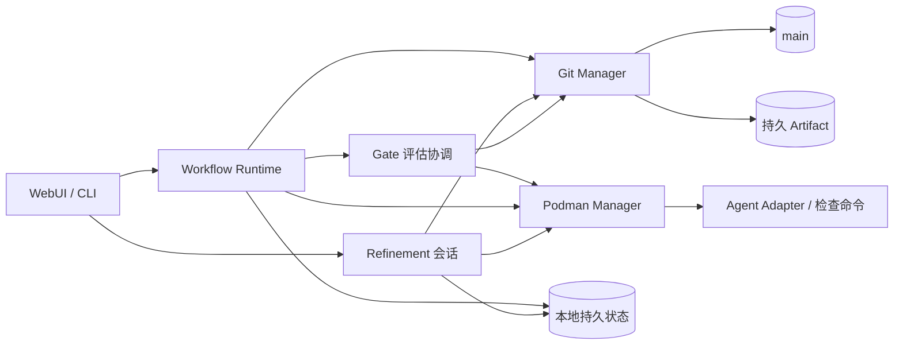

# Services

服务实现 [Requirement](02-requirement.md)、[Governance](03-governance.md) 和 [Execution](04-execution.md) 的协议。本地执行状态与 main 已发布档案各自有明确边界。

## 组件关系



## Workflow Runtime

| 输入 | 动作 |
| --- | --- |
| 固定 DAG、CombinationRun | 调度 pending 且所有直接前驱 satisfied 的节点 |
| 本地 Attempt、Worker 与容器 | 对账、恢复；无法恢复则 failed 并创建 ErrorRecord，不重复启动 |
| main 当前需求指针 | 同步后取消被新版取代的未终态 Run |
| Gate 报告与决策 | 成果全部批准发布后接受；拒绝转错误 Gate；错误动作串行校验额度与依赖，发布后执行 |
| 关键运行事件 | 整理结果与证据，进入待发布队列 |

创建 Attempt、变更状态、接收取消和准备交付，先在本地原子持久化。每个 clone 独立限制并发；同一 Run 由创建它的 Runtime 写入。其它 clone 只读同步，或经拥有者受信接口提交人类操作；首阶段不实现活动运行接管和远程实时状态共享。

```text
.facetloom/.runtime/
├── runs/<run-id>/             # 完整状态、不可变快照和待发布操作
├── transactions/<operation-id>/ # manifest、payloads、COMMITTED、APPLIED
├── worktrees/<attempt-id>/    # detached Worktree
├── workers/<attempt-id>.yaml  # 进程、容器和恢复标记
├── gate-tasks/<report-id>.yaml # 评估任务、取消、接管与恢复标记
├── logs/                     # 完整日志与对话
├── refinements/<id>/          # 会话、候选 Diff、验证结果
├── locks/
└── runtime.sqlite            # 可选索引或缓存
```

本地文件是未发布运行的恢复依据，SQLite 不是必需依赖。丢失本地状态后只能从 Git 恢复已发布证据，不能声称可重建未发布操作或继续原 Worker。

## 本地文件事务

文件是未发布状态的事实来源；SQLite 可以从文件重建。事务覆盖 Run、CombinationRun、Attempt、Worker/评估任务标记、恢复额度及待发布意图，避免逐个 YAML 写入造成半更新。

```text
transactions/<operation-id>/
├── manifest.yaml       # 操作身份、顺序与目标摘要
├── payloads/<n>        # 完整新内容
├── COMMITTED           # 事务决定已持久化，可重放
└── APPLIED             # 全部目标已落地
```

~~~yaml
schema_version: 1
operation_id: <uuid>
aggregate: {kind: run, id: <run-id>}
sequence: 12
kind: schedule_recovery
writes:
  - path: runs/<run-id>/run.yaml
    before_digest: sha256:<old>
    after_digest: sha256:<new>
    payload: payloads/0
side_effects:
  - id: <stable-effect-id>
    kind: publish_archive
    depends_on: []
  - id: <stable-worker-id>
    kind: start_worker
    depends_on: [<stable-effect-id>]
~~~

路径相对 `.runtime/`，禁止越界。新增文件的 before_digest 为 null；删除文件的 after_digest 与 payload 为 null。载荷摘要必须匹配 manifest；side_effects 固定调用对象、输入摘要、参数引用和依赖，实际内容随操作载荷保存。凭据不写入事务。operation_id 用于请求去重；sequence 在同一 aggregate 内递增。

### 提交协议

1. 获取该 Run 的进程级排他文件锁，检查 operation_id、预期摘要、sequence 与运行有效性。同一 Run 的状态、任务和额度变更共用此锁；Refinement 使用会话锁。
2. 写入完整 payloads 与 manifest，逐个 fsync 文件和目录。此时不改目标文件，不执行外部动作。
3. COMMITTED 内容包含 manifest 的 SHA-256，通过临时文件与 rename 发布，再 fsync 文件及事务目录；事务目录首次创建也须 fsync transactions 父目录。此刻事务已提交，之后必须完成重放，不能回滚成未发生。
4. 对每个目标使用同文件系统临时文件、fsync、原子 rename 和目录 fsync 完成替换。删除操作使用 unlink 并 fsync 父目录。当前摘要已是 after_digest 则跳过；等于 before_digest 才写入；两者均不符则隔离该 Run 并报恢复错误，不能覆盖未知更新。
5. 全部目标完成后持久化 APPLIED。释放锁之后，才允许读取完成视图和调度已提交的外部动作。

所有 Runtime 读者通过服务在同一锁下读取，或读取该服务发布的完整版本；不得直接读取落地中的多文件组合。API 请求先在锁内完成遗留重放。提交成功但 APPLIED 尚未落地时对调用者报告“恢复中”，不能暴露半状态。

需要同时持锁时先 Run 锁、后仓库发布锁；不同时获取多个 Run 锁。耗时网络调用在锁外执行，回来后重新校验预期版本。进程退出释放操作系统锁，不靠删除锁文件接管活动运行。

### 恢复顺序与外部动作

```text
暂停调度
    ↓
无 COMMITTED：丢弃暂存事务
有 COMMITTED 无 APPLIED：按 aggregate / sequence 重放
    ↓
验证状态与引用 → 对账 main / Artifact / Worker / 评估调用
    ↓
恢复待发布队列 → 恢复有效评估与执行调度
```

- 同一 aggregate 的后续事务只能在前一事务 APPLIED 后创建，故恢复时不存在合法的越序覆盖。恢复完毕前不启动新 Worker。
- 启动 Worker、评估请求、上传及推送都先持久化意图。容器按稳定 worker ID 查询；调用按 report ID / 请求摘要对账；Artifact 按内容摘要校验；Git 按操作 Trailer 与目标内容校验。
- 推送确认丢失时先刷新 main、在历史中查找操作 ID。即使 Refinement 已清理当前档案，也不能重新追加已执行操作或复活旧记录。
- 外部动作状态为 pending / running / succeeded / failed / unknown / cancelled，确认失败记录原因并等待重试或人工处理；状态变化也通过文件事务保存。恢复动作的扣减、状态和 outbox 同事务提交，重放不重复扣减；取消后不返还已安排额度。
- 错误恢复 Worker 依赖相应决定成功发布；同一 Run 的发布队列按 sequence 串行推进；成果接受及交付也等待对应 main 提交确认。普通 Worker 的启动不要求每个内部状态都提交 Git。
- 无幂等接口且发送结果未知时，先保留 unknown 并对账；无法确认则等待人类，不自动重发，不保证网络调用恰好执行一次。
- APPLIED 事务仅在所有外部动作已对账并完成后才可回收；保留本地操作 ID 去重索引。共享发布结果仍以 Git 历史 Trailer 校验，不以可选 SQLite 为唯一依据。

## Gate 评估协调

这是 Runtime 内的一项职责，不另设持久 GateRun：

1. 启动 Run 时校验成果及错误策略、检查、评估器与引用；错误策略固定在 run.yaml，成果策略在准备成功后固定到 Context Snapshot。能力不足按执行错误或评估器故障分别处理。
2. 成果材料完整后冻结并发布 Attempt.waiting_gate；节点出错或成果拒绝后发布 ErrorRecord 及 CombinationRun.waiting_gate。发布成功才发起对应成果项或 workflow/error 的正式评估；四种模式共用调用基础设施。
3. 调用前保存 report_id、review_input_digest、实际初始评估请求、前一决策 ID 和本地任务状态。发布报告前持久化 request_input_ref，只有请求尚未形成即失败时可为空。任务身份包含 review_kind；错误任务还绑定 error_ref，同一审核对象同时最多一个活动评估。不同项可并行，限制沿用 clone 的并发配置。
4. 按 review_kind 验证结果或处置动作。成果报告引用更新 Attempt，错误报告引用更新 CombinationRun；AI/脚本恢复动作同时校验 Run 级额度和失效范围。评估器自身故障交给人类，不递归调用错误 Gate。
5. 接管、取消、成果拒绝或输入失效时，先持久化撤销相关任务，再停止进程。成果拒绝只撤销原成果评估，另发起错误审核。重启按 report_id 对账；迟到或已失效任务不能推进状态。

成果评估器使用固定代码与审核材料的隔离副本，测试只能产生临时文件；错误评估器读取 ErrorRecord 与可用输入，没有代码时仍可处置。脚本从 source_commit 解析，不能被候选代码替换。AI 评审会话与 Worker 执行会话独立；工具、网络和环境由成果 Snapshot 或 run.yaml 中错误策略的有效配置约束。协议与汇总规则见 [Governance](03-governance.md)。

## Git Manager

Git Manager 是唯一执行受信 Git 写入的组件；管理 main、隔离 Worktree、本地 Checkpoint、bundle 和精简档案。

| 操作 | 校验 |
| --- | --- |
| 创建运行 | source_commit、当前需求、定义、DAG 与 Run ID 唯一性 |
| 保存 Checkpoint | Attempt、输入、修改范围、取消或失效状态 |
| 发布档案 | owner_runtime_id、预期记录摘要、ID、引用和持久证据 |
| 发布成果 waiting_gate | 最终 Tree 的全部检查有结果、agent_input_ref 与执行证据持久可读、固定字段与 review_input_digest 一致 |
| 发布错误 waiting_gate | failed / rejected Attempt、ErrorRecord 与可用证据已保存，错误策略有效；不要求成果字段 |
| 保存成果 Gate | review_kind=result、固定材料摘要、策略、主体、报告/接管依据、Attempt 摘要、前一决策和 evaluated_tree |
| 保存错误 Gate | review_kind=error、active_error_ref、错误策略及摘要、CombinationRun 摘要、前一决定、Run 计数、修复范围与动作 ID |
| 发布定义 | 人类审阅、Requirement 新版规则、定义和 DAG 校验 |
| 集成交付 | current、project_tree、有效输出、Report、人类确认 |
| Refinement 提交 | 来源与目标摘要、确认 Diff、验证结果、清理引用完整性 |

发布档案使用独立的 main 发布 Worktree，不切换用户工作目录，不混入其它未提交修改。先读取远端头，在其上应用仅限本次操作的路径补丁，再正常 Commit 与 fast-forward Push。每个提交包含 `FacetLoom-Operation: <operation-id>` Trailer；成功后记录已发布头与操作 ID。一次操作重构提交时保留同一 ID。

### main 并发写入

```text
A 与 B 基于同一个 main 头
    ↓
A 推送成功；B 推送被拒
    ↓
B 获取最新头，检查自己的预期输入
    ↓
无冲突 → 在最新头重新构造提交并推送
状态或内容已变 → 阻塞原操作，重新审核
```

- 不同 Run 的目录可以自动重新追加；不得用整个旧 Tree 覆盖 main。
- 同一 Run 先串行化本地写入，远端以预期文件摘要和操作 ID 去重。Gate 按 gate_id 校验前一决策；其他 Gate 的更新可在复核固定材料后合并，冲突不采用最后写入者覆盖。
- 已发布后重试先核对操作是否存在，避免重复决策、交付或复活已清理档案。
- main 新增或清理 `.facetloom/runs/` 不改变正式输入；其余路径变化按 Execution 的基线规则处理。
- 同步不可用时保存本地待发布操作，需在线确认的 Gate 与交付等待；不强推，不自动改写历史。

### 本地代码与持久证据

根输入来自 source_commit，汇聚输入来自最终约简 DAG 快照的直接前驱当前有效输出，按 Execution 的稳定逐步三方合并协议构造。活动 Worktree 锚定需要的本地 Commit；关闭前保证有后继 Worktree 或已验证的持久 bundle。记录发布前上传所需 Artifact，验证 bundle 在空仓库中可恢复输入与输出。不用额外命名分支维持快照。

正式成果交付时，保留最新 main 档案，在其上应用已接受代码变更并校验 project_tree。运行完成和交付分别记录；交付回执写入后续 Commit。

## Refinement 协调

Refinement 是 Runtime 提供的本地交互功能，不是独立共享审批服务。会话保存输入 Commit、选中项、采纳/暂留/丢弃决定、候选 Diff 和验证结果。Agent 生成建议，UI/CLI 收集人类确认，Git Manager 负责最后提交与清理。

提交前刷新来源、目标与引用依赖；有并发变化则重新筛选或生成 Diff。验证失败保留原记录；成功提交后再结束会话。用 `FacetLoom-Refinement` Trailer 对账中断恢复，外部 Artifact 不在精炼中自动删除。

## Podman Manager

为每个并行 Attempt 创建独立 Rootless 容器及 Worktree，限制路径、工具、网络、CPU、内存、超时和凭据。共享 Git 元数据、main 工作目录和推送凭据不以可写方式暴露给 Worker。

Gate 评估、最终检查与 Refinement 验证也在隔离环境执行，输入由 Git Manager 固定；测试产生的临时文件不进入候选代码。停止 Worker 后由 Runtime 确认状态，再回收容器和不再需要的 Worktree。

## Agent Adapter

Adapter 先组装并本地保存实际初始请求，再发送原内容；执行请求使用 agent_input_ref，审核请求使用 GateReport.request_input_ref。记录消息、工具声明和附件清单，凭据由传输层注入，不混入留存内容；不以事后重建的提示代替实际请求。

执行与精炼输入为固定上下文、Worktree、允许工具、限制和取消信号；输出为简短结论、变更路径、证据及 Checkpoint 请求。Gate 评审输入为固定审核材料和有效策略，成果输出为 result、rationale、evidence_refs；错误处置输出为 action、rationale、evidence_refs 及条件必填的修复目标和指令。AI 模式下该输出可作为决策依据；Adapter 不自行写入 Decision 或接受成果，不扩大范围，不冒充人类确认，实际状态由 Runtime 推进。
