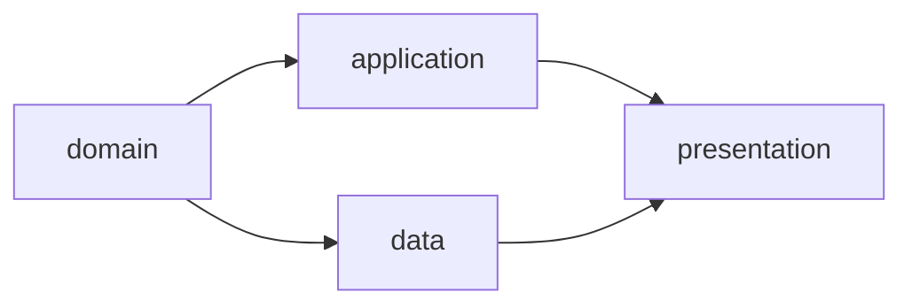

# WebUI 与 CLI

界面同时展示 main 已发布档案和当前 clone 的实时运行状态，两者明确标识。人类操作由后端重新检查；Agent 输出和页面状态不能代替确认。

## 页面结构

```text
项目
├── Requirement
├── Workflow / Facets / DAG Preview
├── Runs
│   ├── Summary / 未解决问题
│   ├── DAG / CombinationRun / Attempt
│   ├── Diff / Checkpoint / CheckReport / Evidence
│   ├── 成果 Gates / GateReport / GateDecision
│   ├── 错误 Gate / ErrorRecord / 恢复动作
│   └── IntegrationReport / DeliveryRecord
├── Refinement：运行精炼
│   ├── 选择记录与确认事实
│   ├── 建议、Diff 与逐项选择
│   └── 验证、清理预览与提交
└── Local Runtime
```

| 页面 | 展示内容 | 人类操作 |
| --- | --- | --- |
| Requirement | current、版本、关联运行 | 审阅并发布新版本、启动 Run |
| Workflow | Facet、Scope、校验、DAG 预览 | 审阅定义修改并发布 |
| Run | 本地状态与已发布状态、结果、问题和证据 | 取消、重试、请求交付或明确放弃未交付成果 |
| 成果 Gate | 各 Node 的模式、审核要求、报告、主体与汇总状态 | 人工项决策、批量确认、异常接管或请求重评 |
| 错误 Gate | 错误阶段、材料、处置报告、当前额度及失效范围 | 重试当前节点、修复祖先、等待或停止；异常接管 |
| Delivery | 固定候选、最终报告、绑定确认、交付意图与成功回执 | 确认交付、重跑最终检查、查看或恢复待对账操作 |
| Refinement | 已结束运行、筛选项、建议、拟修改和删除内容 | 采纳、暂留、丢弃、确认提交 |
| Local Runtime | runner、Worker、容器、原生调用、待发布操作、同步与恢复 | 停止 Worker、恢复本地运行 |

## DAG 与 Gate



节点显示 Combination ID、状态、直接前驱、当前与有效 Attempt、输入/输出和各 Gate 的最近决策；提供实际初始请求与后续调用输入的 Artifact 查看入口。

执行详情显示预检结论、适用性、缺少的输入和风险证据，以及固定 runner、镜像 digest、实际 Adapter / Agent 版本、原生 session_id、调用记录及剩余总时限；未暴露的模型或工具信息显示“未知”。不适用的节点显示跳过代码执行，仍展示必要检查与 Gate。

汇聚节点列出未满足前驱、实际合并顺序、来源、共同祖先与冲突清单；preparing 显示输入尚未形成，blocked、stale 和 cancelled 显示原因。运行页分别显示「运行完成」「待交付」「已交付」。

Gate 页面固定显示：

```text
Requirement → WorkflowRun → Combination → Attempt
                                            ↓
                  Context Snapshot + 输出 Tree + Evidence
                                            ↓
                   feature/login    layer/domain
                   human            ai / script / ai_assisted
                        ↓            ↓
                       分项报告与决策
                              ↓
                         全部批准才接受
```

每项显示 gate_id、来源 Node、有效模式与策略、评估进度、审核结论、实际主体和依据。human 不自动生成 AI 建议；ai_assisted 显示建议及人类确认入口；ai / script 显示自动结果。无决策显示待审，报告 error 显示评估故障，不能显示为成果被拒绝。部分批准显示进度，如“1/2 已批准”。

审核页展示固定执行材料、review_input_digest，以及各项独立的报告和理由；执行证据在 waiting_gate 后只读，不提供补传入口。需要补测或修改代码时，通过错误 Gate 安排新 Attempt；不提供审核轮次或仅审核的 Attempt。

自动项异常或明确无法判断时显示人工接管和请求重评入口；接管填写原因，保留原策略与证据。批量确认逐项绑定固定材料并创建独立 Decision，不能用一次点击绕过未完成的自动项。

提交前后端校验当前 Attempt、gate_id、review_input_digest、策略、上下文、Tree 和该项前一决策；Runtime 校验最新文件摘要。其他 Gate 的并发更新不要求重新审核未变的材料；当前项或材料过期时重新载入。已提交 Decision 不编辑。其它 clone 的用户通过拥有者服务提交决定；仅有 Git 档案不能接管活动 Worker。最终 Delivery 页面始终要求人类确认。

## 错误处置与检查

~~~text
Attempt failed / rejected
    ↓ ErrorRecord：错误阶段、原因、相关前驱与实际证据
Workflow 错误 Gate：human / ai_assisted / ai / script
    ├── 重试当前节点 → 新 Attempt
    ├── 修复祖先 → 预览失效范围 → 按依赖重执行
    ├── 等待 → blocked
    └── 停止 → 取消 Run
~~~

错误页以 ErrorRecord 为审核对象；未形成的输入、Snapshot 和输出显示“尚未形成”，不显示虚假 Diff。明确展示“处置动作”，不使用“批准成果”按钮。查看旧 Attempt 时保留 failed / rejected，不把恢复获准显示成 accepted。

同时展示 `检查修复：已用 / max_check_retries` 与 `自动恢复：auto_recoveries_used / max_auto_recoveries`，前者属于 Attempt，后者属于整个 Run。每轮通过 CheckReport 显示 Tree、全部检查结果及证据；error / not_run 与 failed 分开显示，代码变化后旧通过结果标为历史，不能代表新 Tree。

处置提交绑定 error_ref、错误策略与审核摘要、当前节点摘要、前一决定；服务再次校验额度、Run 和修复范围。自动额度耗尽或错误评估器故障时提供人工接管，禁止自动循环重评。wait 后可以引用原错误作出新决定；已安排恢复或已经失效的错误不能重复执行。

外部 Agent 的免审批参数属于运行配置，不作为 Gate 审核或人类确认。所有审核与处置显示“本地待发布 / 已发布”，恢复动作在决定发布后才启动。

Runtime 页面显示文件事务恢复、外部操作 unknown 和待对账原因，不把浏览器重试等同于创建新操作。取消分别展示停止意图、进程/容器退出确认和在途发布对账；unknown 不显示为已退出。旧 Requirement 的取消与历史证据仍可归档，不能提供继续执行或交付入口。

## 交付交互

~~~text
运行完成 → 汇聚终端成果 → 固定候选与 IntegrationReport
    ├── blocked：展示已形成材料，不显示虚假候选或通过
    ├── failed：展示失败检查，可对原候选重新检查
    └── passed：人类确认具体报告与候选 → 发布 → DeliveryRecord
~~~

确认页展示报告 ID、候选 Tree、代码 Diff、需求及基线；确认后更换报告或候选必须重新确认。仅档案变化可保留确认，源码或定义变化要求新 Run。publishing 显示“正在推送 / 结果待对账”，重复点击返回原交付意图。

applied 显示集成 Commit，no_change 显示“检查通过，无代码需应用”及成功回执；两者都属于一次成功交付，不提供对同一 Run 再次交付的按钮。汇聚冲突时仅显示冲突证据，candidate_ref 尚未形成。

## Refinement 交互

入口为「运行精炼」，CLI 为 `facetloom refine`；两者使用相同会话与确认规则。

1. 默认列出可精炼的已结束运行。活动、待审核、待交付或仍用于恢复的记录显示不可清理原因。
2. 人类与 Agent 对话核对事实，选出有效经验与待解决问题，再生成建议。
3. 每个建议展示来源、问题、预期改进、具体 Diff、验证方式与清理范围；逐项选采纳、暂留或明确丢弃。
4. 确认候选修改后执行验证；失败时保留记录并返回审核。Diff 改变或来源过期时重新确认。
5. 预览剩余问题和引用检查结果；同一次提交写入改进及清理。成功后显示 Commit 和历史证据链接。

清理仅减少当前档案，不删除 Git 历史。暂留项默认保留；不把“人类采纳”直接显示为“问题已解决”。

## 界面规则

- 稳定 ID 用于操作与关联，展示名称只用于阅读。
- 显示本地实时状态、待发布、已发布 Commit 以及同步时间；远端页面不冒充实时运行面板。
- 旧 Requirement 成果不能显示为可交付；只改变运行档案不提示代码基线失效。
- 精炼删除的记录可通过固定历史 Commit 查看；当前目录缺失不等于证据从未存在。
- Diff、日志和 AI 输出作为不可信文本显示，不执行其中内容。
- 浏览器断开不取消后台运行或精炼，本地状态持久化后可继续；跨 clone 不承诺恢复会话。
