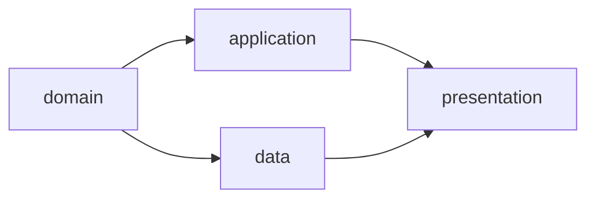

# WebUI 与 CLI

界面分别展示当前 clone 的实时运行状态、main 已采纳档案和可选的 Git 同步状态。未推送不等于未完成，不提供本地/远程项目模式。人类操作由后端重新检查；Agent 输出和页面状态不能代替确认。

## 页面结构

```text
项目
├── Requirement
├── Workflow / Facets / DAG Preview
├── Runs
│   ├── Selection / 原图、筛选结果与执行图
│   ├── Summary / 未解决问题
│   ├── DAG / CombinationRun / Attempt
│   ├── Diff / Checkpoint / CheckReport / Evidence
│   ├── 成果 Gates / GateReport / GateDecision
│   ├── 错误 Gate / ErrorRecord / 恢复动作
│   └── IntegrationReport / DeliveryRecord
├── Refinement：运行精炼
│   ├── 选择记录与确认事实
│   ├── 建议、Diff 与逐项选择
│   └── 验证、清理预览与提交
├── Artifacts：本地内容 / 缺失清单 / 交换包 / 清理
└── Local Runtime
```

| 页面 | 展示内容 | 人类操作 |
| --- | --- | --- |
| Requirement | 起草模式、runner、草稿与 AI Diff、冻结需求、关联 Run、已采纳历史 | 编辑、请求 AI 辅助、切换模式、审阅并冻结、启动 Run；修改冻结需求则创建新 UUID |
| Workflow | 源 Facet 编辑器、Scope、校验、组合预览和影响 Diff | 编辑节点/边/属性、保存工作区 YAML、审阅并提交发布 |
| Run | 筛选进度、原图与实际执行图、本地状态与档案、结果和证据 | 取消、重试、请求交付或明确放弃未交付成果 |
| 成果 Gate | 各 Node 的模式、审核要求、报告、主体与汇总状态 | 人工项决策、批量确认、异常接管或请求重评 |
| 错误 Gate | 错误阶段、材料、处置报告、当前额度及失效范围 | 重试当前节点、修复祖先、等待或停止；异常接管 |
| Delivery | completed Run 的固定候选、成功 IntegrationReport、绑定确认、交付意图与成功回执 | 确认交付、查看交付对账；集成重检或节点修复从错误 Gate 进入 |
| Refinement | 已结束运行、筛选项、建议、拟修改和删除内容 | 采纳、暂留、丢弃、确认提交 |
| Artifacts | 当前 clone 的内容可用性、依赖、占用及导入/清理回执 | 检查缺失、导出交换包、导入、预览并确认本地 purge |
| Local Runtime | runner、Worker、容器、原生调用、本地事务与交付意图、同步与恢复 | 停止 Worker、恢复本地运行 |

需求列表按 main 采纳顺序显示“第几个需求 · 标题 · 短 UUID”；序号仅作导航，详情与操作始终使用 UUID。未采纳草稿和运行单列。Git revert 后仍可查看历史采纳及回撤标记，不提供重新交付原需求的入口。

## 需求起草交互

```text
新需求 → 复制本地默认模式与 runner
    ├─ AI 辅助：输入意图 → 提交请求 → 候选写回 / 待审阅 Diff
    └─ 手动：直接编辑
              ↕ 随时切换，保留正文
        人类审阅当前内容 → 按摘要确认冻结 → 选择 Workflow 并启动
```

起草页展示模式切换、独立 runner 选择、正文编辑器、AI 修改 Diff、待澄清事项和调用状态。设置页提供“新需求默认模式与 runner”，当前需求也可显式保存选择为本 clone 默认；已有草稿不跟随默认值变化。

打开页面和切换模式不自动发起调用。AI 辅助模式中，用户点击“起草 / 整理”才发送当前正文与指令；runner 未选择或不可用时提示配置，并保留手动编辑入口。manual 不调用 AI。冻结前可反复切换，已有改动不会因切换丢失。

结果符合写回条件时更新正文并展示修改前后 Diff；并发编辑导致候选过期时显示“候选待审阅，未覆盖当前草稿”，用户可参考候选继续编辑或重新请求。调用失败展示原因与重试入口，保留原文；待澄清问题与正文分开，不显示为已满足的验收条件。

冻结确认页展示当前完整正文及未解决问题提示，提交绑定该正文摘要。内容变化须重新审阅；成功后编辑、AI 请求和模式切换入口关闭。冻结与启动是独立的人类操作，也可提供组合按钮，但必须先完成冻结确认，再按 WorkflowRun 启动流程校验；起草 Agent 不能触发这些动作。

CLI 与页面调用相同服务，提供下列入口；参数中的 mode 仅为 `ai_assisted` / `manual`：

```text
facetloom requirement create [--mode <mode>] [--runner <id>]
facetloom requirement edit <uuid>           # 编辑副本，保存时校验原摘要
facetloom requirement mode <uuid> <mode>
facetloom requirement runner <uuid> <id>
facetloom requirement assist <uuid> --instruction <text>
facetloom requirement show <uuid>            # 正文、模式、候选 Diff 与问题
facetloom requirement cancel-assist <uuid>
facetloom requirement freeze <uuid>         # 展示并确认当前正文
```

CLI 冻结在确认后提交展示过的摘要；没有人类确认时不自动冻结。CLI 编辑器修改草稿副本，保存时通过同一服务比较原摘要；冲突时保留编辑结果供重新审阅。绕过服务直接编辑 requirement.md 时，应先取消 AI 起草请求；外部文件写入不受 Runtime 锁保护。保存正文、模式切换、取消及冻结的并发规则以 [Requirement](02-requirement.md#需求起草) 为准。

## Workflow 与 Facet 编辑

```text
Workflow 编辑
├── Facet 顺序与引用
├── Source Facet DAG
│   ├── 节点与属性面板
│   ├── 边与分支/汇聚
│   └── Context / Scope / checks / Gate
├── Exclude 与执行配置
├── Combination DAG 只读预览
├── 有效上下文、范围与审核来源
├── 文件与图 Diff、共享定义影响
└── 校验 → 保存工作区 → 审阅并发布
```

画布增删普通节点与依赖，属性面板编辑上下文、Scope、检查和 Gate；拖动位置不改变节点或 Facet 顺序。Workflow 面板单独调整 Facet 顺序。控制节点角色固定，源图删节点后由用户重连；派生 Combination DAG 不可直接编辑。删除或改名展示引用清单，用户修复整个批次后才可保存。

界面区分“未保存编辑”“工作区定义预览”“main 已提交定义”和“Run 固定快照”。未保存编辑可做候选校验；发布前必须保存并重新校验。静态错误定位到文件、字段和源节点，图无效时不显示旧预览为当前结果。正常预览可逐层查看替换积、排除与约简，点击组合查看 members、直接依赖、范围和 Gate 来源。

Diff 将本地 main 与候选对比，显示节点/边及配置变化；共享 Facet 的全部受影响 Workflow 同时列出。审核页明确提示：预览只验证静态定义，不表示需求覆盖或运行成功。文件有外部改动时保留当前编辑，展示外部变更与本次修改，提供重新载入或人工合并入口，不提供强制覆盖。

发布确认显示文件集合、候选摘要及全部受影响图；main 或文件变化后须重新确认。索引有暂存内容或存在无关受跟踪修改时，提示用户先处理；不得把工作区全部修改自动打包。成功显示本地维护 Commit，Git 同步状态单列，不自动运行。协议见 [定义编辑服务](05-services.md#定义编辑服务)。

CLI 使用同一校验与保存服务：

```text
facetloom workflow validate <workflow-id> [--workspace]
facetloom workflow preview <workflow-id> [--workspace]
facetloom workflow impact <workflow-id> [--workspace]
facetloom workflow save <workflow-id>         # stdin 接收 writes 批次
facetloom workflow publish <workflow-id>      # 预览、选定文件并人工确认
```

validate / preview / impact 默认读取本地 main 固定 Commit；`--workspace` 使用工作区。impact 以 main 为比较基线，默认 main 对 main 没有变化；新增 Workflow 仅能用工作区模式，以空图为基线。save 输入格式见 Services，Workflow ID 用于定位入口，实际须检查所有受影响 Workflow；save 不提交，publish 不启动 Run。

新 Run 入口只能选择 main 中已提交且有效的 Workflow，并要求完整 selection 配置及非空 integration.checks；工作区草稿缺少这些配置时可以保存和预览，但显示不可运行并阻止发布与启动。发现未提交定义或引用资料时列出文件，要求提交或恢复。启动后的图只读显示该 Run 固定快照，不能从运行页面直接修改它。

## DAG 与 Gate



节点显示 Combination ID、状态、直接前驱、当前与有效 Attempt、输入/输出和各 Gate 的最近决策；提供实际初始请求与后续调用输入的 Artifact 查看入口。

执行详情显示预检结论、适用性、缺少的输入和风险证据，以及固定 runner、镜像 digest、实际 Adapter / Agent 版本、原生 session_id、调用记录及剩余总时限；未暴露的模型或工具信息显示“未知”。不适用的节点显示跳过代码执行，仍展示必要检查与 Gate。

调用详情列出 Agent 提交的证据相对路径、导入状态、Artifact 摘要和可打开的持久引用。校验失败时显示失败路径与原因，明确标记整份调用结果未发布；不展示可供后续引用的部分导入结果。Gate AI 和 Refinement 的证据使用同一视图，Script Gate 只显示其返回且通过校验的类型化引用。

汇聚节点列出未满足前驱、实际合并顺序、来源、共同祖先与冲突清单；preparing 显示输入尚未形成，blocked、stale 和 cancelled 显示原因。运行页分别显示「筛选中 / 等待采用」「节点执行完成 / 集成中」「运行完成 / 待交付」「已交付」；集成失败显示 IntegrationReport、ErrorRecord 和错误 Gate，不显示为 completed。

Gate 页面固定显示：

```text
Requirement → WorkflowRun → Combination → Attempt
                                            ↓
                  Context Snapshot + 输出 Tree + Evidence
                                            ↓
                   feature/login    layer/domain
                   human            ai / script / ai_assisted
                        ↓            ↓
                       分项报告与决策
                              ↓
                         全部批准才接受
```

每项显示 gate_id、来源 Node、有效模式与策略、评估进度、审核结论、实际主体和依据。human 不自动生成 AI 建议；ai_assisted 显示建议及人类确认入口；ai / script 显示自动结果。无决策显示待审，报告 error 显示评估故障，不能显示为成果被拒绝。部分批准显示进度，如“1/2 已批准”。

检查事实与审核决定分别展示，例如“节点检查：存在失败；成果：已接受”，不能用成果接受的绿色状态覆盖失败项。查看批准时同时展示失败检查 ID、原始报告及 rationale 中的接受理由；人工批准入口提示填写这些理由，AI 建议不能代替人类最终理由。节点检查清单为空时显示“未配置检查”，不能显示“测试全部通过”。

审核页展示固定执行材料、review_input_digest，以及各项独立的报告和理由；执行证据在 waiting_gate 后只读，不提供新增执行证据入口。允许导入与既有引用摘要匹配的原文件，补齐当前 clone 的副本；所需材料缺失时不能提交批准。需要补测或修改代码时，通过错误 Gate 安排新 Attempt；不提供审核轮次或仅审核的 Attempt。

自动项异常或明确无法判断时显示人工接管和请求重评入口；接管填写原因，保留原策略与证据。批量确认逐项绑定固定材料并创建独立 Decision，不能用一次点击绕过未完成的自动项。

提交前后端校验当前 Attempt、gate_id、review_input_digest、策略、上下文、Tree 和该项前一决策；Runtime 校验最新文件摘要。其他 Gate 的并发更新不要求重新审核未变的材料；当前项或材料过期时重新载入。已提交 Decision 不编辑。其它 clone 的用户通过拥有者服务提交决定；仅有 Git 档案不能接管活动 Worker。最终 Delivery 页面始终要求人类确认。

## 运行前筛选交互

Workflow 编辑页分别选择 global / parallel 与 automatic / human，不把它们合并成 Gate 模式；runner 可单独指定。静态 Workflow 预览仍不调用 Agent，需求相关筛选在 Run 启动后展示。

Run 页面并列提供原图、逐组合判断及候选执行图，显示模式、分项进度、keep / exclude / defer、理由和证据；尚未采用时明确标为候选，不展示虚假的 Attempt 或代码输出。automatic 成功后显示采用记录，human 展示一次集中确认入口。用户可恢复 exclude 节点或保留完整图，不能额外排除 keep / defer 节点或修改边；每次恢复后重新计算图和确认摘要。

全部 exclude 时显示“没有可执行节点，等待人工处理”，不能自动确认。用户可恢复至少一个节点后确认、显式重筛或停止。调用失败与有效 defer 区分展示；失败通过错误 Gate 重筛，不能用部分成功结果启动节点。CLI 与 WebUI 共用相同的报告查询、恢复节点预览、采用、重筛和停止校验。

采用后，原图中的被排除节点标为“运行前筛选排除”，只链接筛选理由，不伪装成 accepted / not_applicable 的 Attempt；执行图只展示保留节点。已采用图不可重筛或插入节点，需改变范围时创建新 Run。调用详情提供实际输入与独立会话信息，不声称 KV 缓存必然命中。

## 错误处置与检查

~~~text
Attempt failed / rejected
    ↓ ErrorRecord：错误阶段、原因、相关前驱与实际证据
Workflow 错误 Gate：human / ai_assisted / ai / script
    ├── 重试当前节点 → 新 Attempt
    ├── 修复祖先 → 预览失效范围 → 按依赖重执行
    ├── 等待 → blocked
    └── 停止 → 取消 Run
~~~

错误页以 ErrorRecord 为审核对象，区分 scope=combination、selection 与 integration；未形成的输入、Snapshot 和输出显示“尚未形成”，不显示虚假 Diff。明确展示“处置动作”，不使用“批准成果”按钮。查看旧 Attempt 时保留 failed / rejected，不把恢复获准显示成 accepted。`wait` 仅在固定外部引用仍暂不可读时可选，显示被固定的引用与 Runtime 的可用性检查；引用恢复后禁用 wait，用户可请求按原 Gate 模式重新评估，并沿用原 Context Snapshot。需要新输入时显示创建新 Run；需求内容变化另建新 UUID。可显式停止同 Runtime 的旧 Run，不展示跨 clone 自动取消承诺。

同时展示 `检查修复：已用 / max_check_retries` 与 `自动恢复：auto_recoveries_used / max_auto_recoveries`，前者属于 Attempt，后者属于整个 Run。每轮通过 CheckReport 显示 Tree、全部检查结果及证据；error / not_run 与 failed 分开显示，代码变化后旧通过结果标为历史，不能代表新 Tree。

恢复 Attempt 页面分别展示当前 input_commit、recovery_decision_ref、上一 Attempt 和只读旧成果差异，以及仍需遵守的修复要求。旧输入或输出不存在时显示“未形成”，原材料缺少本地副本时显示导入入口。明确说明 Agent 在当前输入上重新应用合适改动，旧成果未被自动合入，旧批准与检查结果也不继承；修复目标和后继均须重新检查与审核。

处置提交绑定 error_ref、错误策略与审核摘要、所属节点或 Run 的文件摘要、前一决定；服务再次校验额度、Run 和修复范围。自动额度耗尽或错误评估器故障时提供人工接管，禁止自动循环重评。wait 后可以引用原错误作出新决定；已安排恢复或已经失效的错误不能重复执行。

外部 Agent 的免审批参数属于运行配置，不作为 Gate 审核或人类确认。所有审核与处置显示“本地保存中 / 本地已生效”，恢复动作在决定与关联状态事务落地后启动。执行与 Gate 不提交 main，Git 同步仅针对已采纳或维护提交。

Runtime 页面显示文件事务恢复、外部操作 unknown 和待对账原因，不把浏览器重试等同于创建新操作。取消分别展示停止意图和进程/容器退出确认；交付在途则先显示 main 对账。unknown 不显示为已退出。失败、取消和放弃的记录标为“仅本地”，可显式导出，不自动提交 main。

## 交付交互

集成错误页显示 Run、失败 IntegrationReport、候选或冲突清单；combination_id / attempt_id 显示“不适用”，不创建占位 Attempt。四种 Gate 模式沿用错误审核交互，动作仅为“重新集成”“修复节点”“停止运行”。修复时选择一个业务节点、填写指令并预览目标与全部后继的失效范围；无关分支显示保留。重检与修复共享 Run 自动恢复额度；无有效动作或评估器故障时等待人工接管。仅缺少原材料副本时先导入，基线变化则提供新建 Run 的入口。

~~~text
节点全部接受 → integrating：汇聚终端成果并运行 integration.checks
    ├── blocked / failed：保存 IntegrationReport + ErrorRecord → 错误 Gate 重检或修复
    └── passed：Run completed → 人类确认绑定报告与候选 → 发布 → DeliveryRecord
~~~

确认页只接受 completed Run 绑定的 passed IntegrationReport，展示报告 ID、候选 Tree、代码 Diff、需求及基线；completed 的报告与候选不可替换；需要修改或重新验证时新建 Run，不能复用旧确认。仅档案变化可保留确认，源码或定义变化要求新 Run。publishing 显示“正在提交本地 main / 结果待对账”，重复点击返回原交付意图。main 工作目录有未提交修改时提示等待用户处理，不提供自动 stash 或覆盖入口。

节点接受、集成进度和最终报告分别显示；IntegrationReport 为 failed / blocked 或 Run 尚未 completed 时不开放交付确认，服务端同样拒绝。页面不提供人工豁免最终集成检查的入口。

确认页同时预览将进入 main 的需求文件、代码 Diff、精简档案及回执。applied / no_change 均显示同一个采纳 Commit；no_change 说明无代码变化，需求与结论仍被保存。不提供对同一 Requirement 或 Run 再次交付的按钮。汇聚冲突时仅显示冲突证据，candidate_ref 尚未形成。

## Git 同步状态

| 本地情况 | 显示与操作 |
| --- | --- |
| 未配置 remote | 不需要同步，运行与交付照常使用 |
| 已生效提交尚未推送 | 本地已完成、尚未同步；不回退运行状态 |
| 网络失败或推送结果未知 | 展示同步错误或待核对，保留本地结果，不显示业务操作失败 |
| 远端有更新或历史分叉 | 提示显式获取并校验合并；fetch 本身不代表 main 已接纳更新 |
| 文本或业务冲突 | 展示冲突对象与人工处理入口，不提供重写固定引用或最后写入者覆盖 |

首阶段不自动同步；用户通过正常 Git 操作交换历史。页面可显示已配置 remote、最近一次已知同步结果和时间，不能据此声称实时掌握远端。同步后重检本地 main，发现同一需求已采纳或正式输入变化时才阻止旧运行推进；历史决策和交付仍可查看。

## Artifact 交换与清理

运行页和证据页按当前 clone 显示「本地可用」「尚未导入」「已在本地清理」或「缺失/损坏」，不把 Git 已发布显示为文件已在本地。所需材料缺失时可查看摘要、复制缺失清单并请求交换包，需要完整内容的操作暂停。

| 操作 | 交互 |
| --- | --- |
| 导出 | 选择已采纳档案及固定 Commit，或本地运行的冻结记录快照；预览依赖、文件数与字节数，缺项拒绝导出；输出到 Git 外路径 |
| 导入 | 选择独立交换包，核对来源记录与大小；Git 来源缺历史先补齐，本地快照直接校验记录 Artifact；整包成功才显示导入完成 |
| 本地 purge | 展示对象、空间、保护原因及历史读取影响；填写原因并确认预览摘要，状态变化须重新预览 |

CLI 与界面使用相同协议，入口为 `facetloom artifacts`：

```bash
facetloom artifacts status --run <run-id>
facetloom artifacts export --run <run-id> --commit <commit> --output <outside-repo-path>
facetloom artifacts export --run <run-id> --local --output <outside-repo-path>
facetloom artifacts import <bundle-path>
facetloom artifacts purge --preview
facetloom artifacts purge --confirm <preview-digest> --reason <reason>
```

导出必须二选一 `--commit` 或 `--local`。可用重复的 `--record <path>` 限定记录，不传则选择对应 Run 的全部档案；本地模式原子冻结快照，不把活动运行目录直接打包。purge 预览列出全部可清理内容及阻止原因，不接受跳过引用检查的强制删除。状态、导入回执和清理回执只描述当前 clone；导入不会自动执行代码或恢复运行。清理完成后明确提示导出包、其它 clone 和备份仍可能有副本，重新导入可恢复本地内容。

## Refinement 交互

入口为「运行精炼」，CLI 为 `facetloom refine`；两者使用相同会话与确认规则。

1. 默认列出 main 中可精炼的已采纳档案。活动、待审核、待交付或仍用于恢复的记录显示不可清理原因。
2. 人类与 Agent 对话核对事实，选出有效经验与待解决问题，再生成建议。
3. 每个建议展示来源、问题、预期改进、具体 Diff、验证方式与清理范围；逐项选采纳、暂留或明确丢弃。
4. 确认候选修改后执行验证；失败时保留记录并返回审核。Diff 改变或来源过期时重新确认。
5. 预览剩余问题和引用检查结果；同一次提交写入改进及清理。成功后显示 Commit 和历史证据链接。

清理仅减少当前档案，不删除 Git 历史或自动清理 Artifact。暂留项默认保留；不把“人类采纳”直接显示为“问题已解决”。需要释放空间时进入独立的 Artifact purge 预览。

## 界面规则

- 稳定 ID 用于操作与关联，展示名称只用于阅读。
- 分别显示本地执行、待采纳意图、已采纳 Commit 和 Git 同步时间；另一 clone 的档案视图不冒充实时运行面板。
- 已采纳或基线过期的 Run 不显示为可交付；只改变运行档案不提示代码基线失效。
- 精炼删除的 Git 记录可通过固定历史 Commit 查看；引用的 Artifact 仍取决于本地库或交换包，不保证随 Git 回退恢复。
- Diff、日志和 AI 输出作为不可信文本显示，不执行其中内容。
- 浏览器断开不取消后台运行或精炼，本地状态持久化后可继续；跨 clone 不承诺恢复会话。
