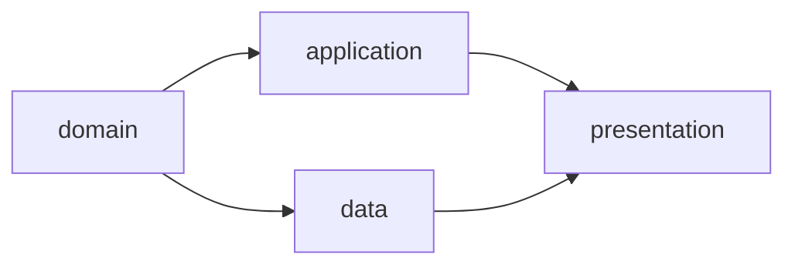

# WebUI 与 CLI

界面同时展示 main 已发布档案和当前 clone 的实时运行状态，两者明确标识。人类操作由后端重新检查；Agent 输出和页面状态不能代替确认。

## 页面结构

```text
项目
├── Requirement
├── Workflow / Facets / DAG Preview
├── Runs
│   ├── Summary / 未解决问题
│   ├── DAG / CombinationRun / Attempt
│   ├── Diff / Checkpoint / Evidence
│   ├── GateDecision
│   └── IntegrationReport / DeliveryRecord
├── Refinement：运行精炼
│   ├── 选择记录与确认事实
│   ├── 建议、Diff 与逐项选择
│   └── 验证、清理预览与提交
└── Local Runtime
```

| 页面 | 展示内容 | 人类操作 |
| --- | --- | --- |
| Requirement | current、版本、关联运行 | 审阅并发布新版本、启动 Run |
| Workflow | Facet、Scope、校验、DAG 预览 | 审阅定义修改并发布 |
| Run | 本地状态与已发布状态、结果、问题和证据 | 取消、重试、请求交付或明确放弃未交付成果 |
| Gate | 固定 Attempt、上下文、代码 Diff、验证、AI 建议 | Approved、Rejected、Escalated、Blocked |
| Delivery | 候选代码、最终报告、当前需求与基线检查 | 确认交付 |
| Refinement | 已结束运行、筛选项、建议、拟修改和删除内容 | 采纳、暂留、丢弃、确认提交 |
| Local Runtime | Worker、容器、待发布操作、同步与恢复 | 停止 Worker、恢复本地运行 |

## DAG 与 Gate



节点显示 Combination ID、状态、直接前驱、当前与有效 Attempt、输入/输出和最近决策。汇聚节点列出未满足前驱；blocked、stale 和 cancelled 显示原因。运行页分别显示「运行完成」「待交付」「已交付」。

Gate 页面固定显示：

```text
Requirement → WorkflowRun → Combination → Attempt
                                            ↓
                  Context Snapshot + 输出 Tree + Evidence
                                            ↓
                              AI 评估建议 + 人类决策
```

提交前后端校验当前 Attempt、文件摘要、上下文、Tree 和前一决策。过期页面要求重新载入，提交成功的 Decision 不编辑。其它 clone 的用户通过拥有者服务提交决定；仅有 Git 档案不能接管活动 Worker。

## Refinement 交互

入口为「运行精炼」，CLI 为 `facetloom refine`；两者使用相同会话与确认规则。

1. 默认列出可精炼的已结束运行。活动、待审核、待交付或仍用于恢复的记录显示不可清理原因。
2. 人类与 Agent 对话核对事实，选出有效经验与待解决问题，再生成建议。
3. 每个建议展示来源、问题、预期改进、具体 Diff、验证方式与清理范围；逐项选采纳、暂留或明确丢弃。
4. 确认候选修改后执行验证；失败时保留记录并返回审核。Diff 改变或来源过期时重新确认。
5. 预览剩余问题和引用检查结果；同一次提交写入改进及清理。成功后显示 Commit 和历史证据链接。

清理仅减少当前档案，不删除 Git 历史。暂留项默认保留；不把“人类采纳”直接显示为“问题已解决”。

## 界面规则

- 稳定 ID 用于操作与关联，展示名称只用于阅读。
- 显示本地实时状态、待发布、已发布 Commit 以及同步时间；远端页面不冒充实时运行面板。
- 旧 Requirement 成果不能显示为可交付；只改变运行档案不提示代码基线失效。
- 精炼删除的记录可通过固定历史 Commit 查看；当前目录缺失不等于证据从未存在。
- Diff、日志和 AI 输出作为不可信文本显示，不执行其中内容。
- 浏览器断开不取消后台运行或精炼，本地状态持久化后可继续；跨 clone 不承诺恢复会话。
