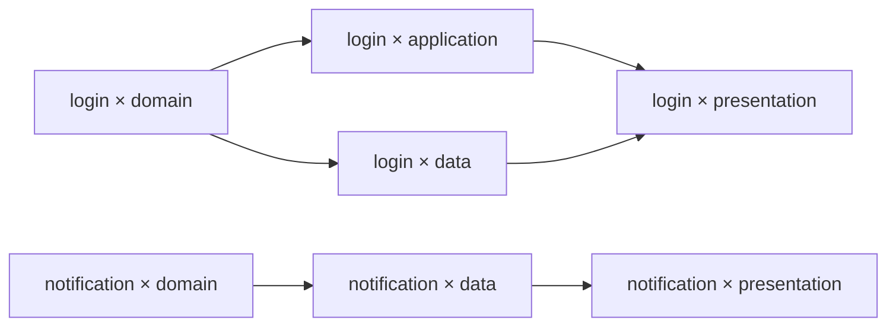

# Demo：登录失败限制与运行精炼

本场景验证单 main 下的 Requirement、DAG 并行、Gate、交付和 Refinement。

## 输入与组合图

需求：连续登录失败五次后暂时限制登录，并显示剩余等待时间。

```text
Feature: start → login → end
         start → notification → end
Layer: domain → application ─┐
       domain → data ────────┴→ presentation
```

Workflow 按 `feature ▷ layer` 生成组合图，静态排除 notification × application：

```yaml
exclude:
  - feature: [notification]
    layer: [application]
execution:
  runner: developer
  checks:
    - id: unit
      argv: [pytest, -q, test/auth]
      timeout_seconds: 120
  max_check_retries: 2
error_gate:
  mode: human
  max_auto_recoveries: 3
integration:
  checks:
    - id: regression
      argv: [pytest, -q]
      timeout_seconds: 900
```



Feature 分支可并行；login 的 application 与 data 在 domain 满足后并行，presentation 汇聚二者。排除 `notification × application` 后，先补上 `notification × domain → notification × presentation`；由于保留路径 `domain → data → presentation` 已表达该顺序，传递约简再删除这条冗余边。上图展示最终约简结果，notification 的 presentation 只需直接汇聚 data 的输出。控制边界和其余规则见 [Workflow](01-workflow.md)。

Verification Facet 可增加节点级验证，其边只约束其余 Facet 选择相同的组合，不自动构成全局验证屏障。最后的整体检查由 integration.checks 执行。

## Node Gate 与并行审核

Workflow 默认 `gate: {mode: human}`。Feature 的 Node 不声明 gate，继承人工审核；Layer 按审核目的配置：

```yaml
# layer Facet 的 Node 配置片段
nodes:
  - id: domain
    role: regular
    gate:
      mode: ai
      evaluator: domain-reviewer
      context:
        objective: 检查锁定、到期恢复与领域隔离
  - id: application
    role: regular
    gate:
      mode: script
      evaluator: dependency-check
  - id: data
    role: regular
  - id: presentation
    role: regular
    gate:
      mode: ai_assisted
      evaluator: ui-reviewer
      context:
        objective: 检查剩余时间和恢复提示是否符合需求
```

执行 runner `developer` 与审核 runner `reviewer` 都固定到预装 Agent 和项目环境的镜像 digest，原生参数配置非交互调用。参数与 runner 文件格式见 [Workflow](01-workflow.md)，示例占位参数必须替换为所用 Agent 版本的真实参数。

`domain-reviewer`、`ui-reviewer` 使用独立审核会话，例如：

```yaml
# .facetloom/evaluators/domain-reviewer.yaml
schema_version: 1
id: domain-reviewer
kind: ai
runner: reviewer
instruction: 检查锁定、到期恢复与领域隔离，引用证据并返回结构化结论。
timeout_seconds: 300
```

`ui-reviewer` 使用相同结构并填写界面审核指令；`dependency-check` 使用脚本配置：

```yaml
# .facetloom/evaluators/dependency-check.yaml
schema_version: 1
id: dependency-check
kind: script
argv: [python3, tools/check_dependencies.py]
timeout_seconds: 120
execution:
  environment_ref: <immutable-environment-ref>
  network: disabled
```

| Combination | feature 的 Gate | layer 的 Gate | 接受条件 |
| --- | --- | --- | --- |
| login × domain | feature/login：human | layer/domain：ai | 人类与 AI 均批准 |
| login × application | feature/login：human | layer/application：script | 人类与脚本均批准 |
| login × data | feature/login：human | layer/data：继承 human | 两项人工批准，可批量确认 |
| login × presentation | feature/login：human | layer/presentation：ai_assisted | 两项人工批准，其中一项附 AI 建议 |

同名 `feature/login` 在不同 Combination / Attempt 中独立审核，不能沿用上一节点的批准。脚本正常返回 Rejected 表示成果不符合要求；脚本超时或退出失败则是评估故障，等待人类处理，其他独立项仍可继续。

## 从运行到交付

1. 人类审阅并在本地 main 提交 Requirement r1、current、Workflow、Facet、runner、原生配置和审核评估器定义，准备好固定 digest 的镜像与本地凭据；无需配置 Git remote。
2. Runtime 固定 source_commit，生成 DAG，先本地持久化，再发布初始精简档案。代码仍未变。
3. Runtime 先创建 preparing Attempt，再固定代码输入与 Context Snapshot 转 pending。Adapter 探测外部 Agent、保存预检请求和 agent_input_ref，以独立只读容器运行 Pre-Assess；版本、argv 与 session_id 保存在 Invocation 中。输入缺失进入错误 Gate；只有 Snapshot 中的固定引用暂时不可读才可 wait，恢复后以相同 Snapshot 创建新 Attempt。需要补充或修改输入时先提交定义并创建关联旧 Run 的替代 Run；若两者由同一 Runtime 拥有，新 Run 发布后取消旧 Run；否则旧 Run 所属 clone 在下次同步时取消。风险随报告供成果 Gate 评审。
4. 预检适用时启动外部 Agent，原生结构化输出经 Adapter 校验并留存 ExecutionResult；不适用时跳过执行并复用输入。Runtime 执行 Workflow 与 Node 累积的必要检查；适用任务失败时 Adapter 可续接会话修复并全量重检，不适用任务不修复但保留完整检查结果。固定最终 Tree 后生成 Checkpoint 和 CheckReport，再以新会话、只读容器运行 Post-Assess；保存预检与自检报告、bundle 和证据，固定 review_input_digest，进入 waiting_gate 并发布 main。
5. Runtime 并行调度各项 Gate，AI 项使用独立外部 Agent 会话，脚本项直接运行程序；调用前保存实际评估请求，报告通过 request_input_ref 引用。各项报告只作为审核输出发布，不改写执行证据；全部批准和关联状态发布成功后，后继才可执行。
6. application 与 data 并行，presentation 按稳定顺序三方汇聚，Agent 解决范围内冲突。若成果 Gate 发现缺少锁定到期恢复行为而拒绝，Attempt rejected，节点转错误处置。人类在错误 Gate 选择 repair_upstream，目标为 domain；决定发布后 domain 及其后继 stale，再按依赖重新执行。
7. 所有节点 satisfied，Run completed。summary 记录结果、返工原因和待改进问题；完成不等于已经交付。
8. 若需要协作，用户此时将另一个 clone 的 Run 档案显式同步到本地 main。main 头变化，但 project_tree 不变，当前运行仍可交付；不需要协作时跳过同步。
9. Git Manager 在本地最新 main 上构造可恢复候选，保留全部最新档案，运行最终检查并保存 IntegrationReport；人类确认绑定报告与 candidate_tree 后提交代码，再追加 DeliveryRecord。结果进入本地 main 后即交付成功；是否 push 单独展示。重复请求返回原交付意图，无代码变化则直接提交 no_change 回执。

如果第 8 步接纳的是正式代码或定义变化，交付要求新 Run；本地 main 同步到 r2 时取消自己拥有的旧版未终态运行，旧成果不能继续交付。同步前另一个 clone 已经完成的交付保留为历史事实；原报告不证明合并后的代码已通过检查。断网只影响同步，不阻止本地 Gate、交付或精炼。

脚本成果 Gate 返回 Rejected 时停止原 Attempt 的其余评估，并交给错误 Gate；已批准项不在旧 Attempt 上重开审核。确认必需测试材料未生成或已不可恢复时，Attempt failed，通过错误处置安排补测的新 Attempt，所有成果 Gate 重新审核；仅当前 clone 未持有原内容则先导入。评估器单纯超时保留原材料，由人类接管或请求重评。

```json
{
  "schema_version": 1,
  "summary": "实现失败计数与锁定剩余时间。",
  "evidence_refs": [],
  "evidence_files": [],
  "conflict_resolutions": []
}
```

Adapter 只接受各 Agent 已探测支持的原生结构化输出。Applicability 来自独立只读 Pre-Assess；Runtime 结合预检与实际 Git Tree 判断 changed/no_change/not_applicable。输出无效、Applicability 不确定或只读副本被修改均进入错误 Gate；Post-Assess 的 `concerns` 报告交由成果 Gate 审核。

Agent 可在独立 `evidence-out/` 中提交证据。Adapter 校验相对路径、普通文件类型、每次最多 100 个文件、单文件 10 MiB 和合计 100 MiB，并将成功导入的内容转成 Artifact 引用。超限、符号链接、越界路径或中途导入失败都使整份结构化结果无效，不发布部分报告。AI Gate 与 Refinement 复用该协议，Script Gate 只返回已校验的类型化引用。

### 自动恢复示例

将 error_gate 配置为 ai 或 script 并提供匹配评估器：输入准备失败后，评估器可决定 retry_current；Runtime 在一个事务中记录动作、递增 auto_recoveries_used 和待发布意图。发布成功后启动新 Attempt。整个 Run 第 3 次自动恢复后再发生问题时，继续恢复须人类决定，不因节点切换或 Runtime 重启重置额度。

检查次数耗尽但最终 Tree 和失败结果完整时，进入成果 Gate；检查无法启动或证据缺失时，进入错误 Gate。Scope 外冲突不自动扩权；Agent 发现前驱需求不对齐则引用前驱和证据报错。错误 Gate 的恢复动作始终不能直接解锁后继。

## 从记录到改进

```text
运行返工记录：多次遗漏锁定到期后的恢复行为
    ↓ 人类与 Agent 核对
有效经验：domain 上下文应检查时间边界与恢复状态
    ↓ Agent 建议与 Diff
为 layer/domain 补充状态边界检查约束
    ↓ 人类采纳、校验 Facet 与组合 DAG
改进通过 + 同 Commit 清理已处理记录
    ↓
未解决的通知问题继续保留；原档案从 Git 历史读取
```

Run 已交付且无其它有效引用依赖时才可清理对应证据。验证失败、部分采纳或会话中断都不直接删除原记录。Commit 描述引用删除前的证据、验证结论及精炼 ID。

## 跨 clone 复核与本地清理

前述运行、Gate、交付与精炼全部可在没有 remote 的仓库完成；提交本地 main 后即生效。协作时双方各自在本地完成自己的操作，再通过 Git 显式交换历史，不因导入别人的记录而重放决定或交付。推送失败时保留本地结果；分叉时构造并校验 merge 候选，竞争的需求版本或替代运行需人工协调，不能靠文本自动合并宣称一致。

```text
协作者 A：完成运行并发布 main 档案
    ↓ 选择固定 Commit 中的 Run，收集依赖
导出 login-evidence.facetloom-artifacts.tar → 通过现有渠道传给 B
                                                   ↓
协作者 B：同步 main → 能看摘要，尚未持有大型证据
    ↓ 校验来源记录及整包摘要后导入
本地证据可读 → 从包内 Git bundle 恢复所需代码 → 复核
```

整个流程无需共享存储服务。交换包不包含活动运行状态，B 不会因导入而接管 A 的 Worker、接受成果或更新正式代码。

A 完成精炼后，Artifact 仍留在 A 的本地库。需要释放空间时单独预览 purge，排除活动、待交付及其它有效记录的完整依赖；人工确认后删除并留下本地回执。Git 历史仍能显示原记录，已删除内容须从尚存交换包或其它副本重新导入；B 的副本不受 A 清理影响。

## 产物

```text
main
├── 项目代码、Requirement、Workflow、Facet
└── .facetloom/runs/<run-id>/
    ├── run.yaml / summary.md / dag.yaml
    ├── contexts/ / combinations/ / attempts/ / errors/
    └── checkpoints/ / decisions/ / reports/ / deliveries/

本地 .runtime/
├── 活动状态、待发布操作和 detached Worktree
├── transactions/<operation-id>/ / locks/
├── workers/<attempt-id>.yaml / invocations/<invocation-id>.yaml
├── 完整日志
├── refinements/<id>/
└── artifacts/
    ├── objects/sha256/<hex> / entries/<hex>.yaml
    └── imports/<operation-id>.yaml / purges/<operation-id>.yaml

Git 外的独立交换文件
└── login-evidence.facetloom-artifacts.tar
    ├── manifest.yaml
    └── objects/sha256/<hex>   # 请求、Git bundle、检查日志与大型证据
```

## 验收场景

| 场景 | 预期结果 |
| --- | --- |
| 无效 Facet、排除引用或图有环 | 创建 Run 前拒绝 |
| 相同定义、不同 clone | 稳定 Combination ID 和 DAG，不同 Run ID |
| 无依赖分支、汇聚 | 并行执行，汇聚等待全部前驱 |
| 排除中间 Combination | 统一补边后传递约简，保持剩余节点间原有可达关系 |
| 无 exclude 但存在冗余边 | 同样进行传递约简，调度与汇聚使用最终直接前驱 |
| 改变节点、边及补边遍历顺序 | 最终边集与 DAG 摘要一致 |
| Runtime 重启、Worker 丢失 | 先重放文件事务再对账；无法恢复则 failed，保存错误并进入错误 Gate |
| 同一 clone 内不同操作并发提交 main | 按预期头与摘要串行校验，尚未生效的无冲突操作可重构，互不覆盖 |
| 无 remote、或已配置 remote 但离线 | 均可完成本地运行、四种 Gate、交付和精炼；提交本地 main 生效 |
| 本地提交完成但 push 失败 / 确认丢失 | 仅同步未完成，业务结果保留；核对远端包含关系，不重复操作 |
| main 已检出且工作区干净 / 存在未提交修改 | 分别正常快进并更新文件 / 保留待提交操作，等待处理，不自动 stash 或覆盖 |
| 当前用户目录在其它分支 | 不切换分支；更新 main 不混入该目录的修改 |
| 同步收到更新但尚未合并到本地 main | 不作为新执行输入，不冒充已接纳或全局最新 |
| 不同 clone 的独立 Run 档案形成分叉 | 在保留双方提交的 merge 候选中校验并合并，不自动 rebase 或覆盖固定 OID |
| Git 无文本冲突，但需求版本或替代 Run 竞争 | 业务校验阻止合并，人工协调后重验，不承诺同步前全局唯一 |
| 外部 Git 操作更新 main 后发现无效档案 | Runtime 暂停相关推进，人工修复后再校验，不执行无效记录 |
| Node 未声明 Gate / 仅声明部分字段 | 继承 Workflow 默认，mode 缺省 human；审核上下文累积且可追溯 |
| human / ai_assisted / ai / script | 分别由人类、人类、AI、程序决策；AI 建议本身不算批准 |
| 自动模式缺少或错配评估器 | 校验失败，不使用本地替代定义 |
| clone 无法满足固定 runner、原生配置或环境 | 执行错误进入错误 Gate；评估器故障人工接管，不静默切换 |
| 必要测试未结束或引用未持久化 | 不进入成果审核；失败保存实际错误，发布不可用时保留本地操作 |
| 实际初始请求留存 | 发送前本地保存；通过持久引用读取并校验字节摘要 |
| runner 或原生配置引用缺失 | 创建 Run 前拒绝，不使用宿主机 Agent 配置兜底 |
| 镜像/Agent 缺失、参数不支持或认证失败 | 保存实际错误，执行转错误 Gate；审核为评估故障 |
| 关闭原生审批及内部沙箱 | 容器隔离、Scope、Runtime 检查与 Gate 继续生效 |
| 检查修复与原生续接不支持 | 前者串行记录每次输入；后者进入错误 Gate，不自建 Agent 循环 |
| 执行结果无效、Applicability 不确定或与实际 Tree 不符 | 保存 Invocation 和错误证据，进入错误 Gate；不猜测 outcome |
| Pre-Assess 输入不足 / 有风险 | 阻塞执行转错误 Gate / 固定风险证据供成果 Gate 审核 |
| Pre-Assess 明确不适用 | 跳过代码执行；必要检查、Post-Assess 和成果 Gate 仍执行 |
| 不适用且必要检查失败 | 不启动修复；完整失败报告交成果 Gate |
| Post-Assess 发现问题 / 返回 concerns | 保留报告供成果 Gate 审核，不直接拒绝或接受 |
| Post-Assess 只读调用改动成果、超时或输出无效 | Attempt 失败并进入错误 Gate；原 CheckReport 和 Checkpoint 保持不变 |
| 原生成功退出但审核结果无效 | 评估故障，不能当作批准或拒绝 |
| 总时限耗尽、Runtime 重启 | 原 deadline 不重置，停止执行并保存 execution_timeout |
| PID 复用、容器状态查询失败或停止超时 | 按容器与进程启动身份对账；unknown 不当作退出，不重复启动 |
| 本地 main 已包含 r2、r1 未结束 | 停止拥有的旧执行；允许取消与历史归档，禁止恢复或交付；其它 clone 同步后才获知 |
| 取消时 advance 未提交 / 本地 main 更新在途 | 分别撤销 / 先对账；保留历史终态，迟到批准不解锁后继 |
| 同步获知新版前旧交付已在另一 clone 完成 | 历史回执保留，不声称撤销既有事实，也不证明合并后代码通过 |
| 评估请求未形成就失败 | error 报告允许 request_input_ref 为 null，说明原因 |
| 修改冻结字段或替换引用内容 | 审核输入/内容摘要校验失败，不能发布决策 |
| 仅更新分项报告、决策或状态 | review_input_digest 不变，其他独立审核仍有效 |
| Gate 检查失败 | 报告属于审核输出，可拒绝成果，不回写 output_refs |
| 审核中确认必需执行证据未生成或已不可恢复 | 原 Attempt failed，错误 Gate 决定是否新建 Attempt 补测；全部成果 Gate 重新审核 |
| 多项 Gate 混合并行、部分批准 | 仍 waiting_gate；全部批准发布后才 satisfied |
| 任一成果 Gate 拒绝 | Attempt rejected，取消其余成果评估，创建 ErrorRecord 转错误 Gate；迟到批准不生效 |
| 超时、非零退出、无效结果或无法判断 | 保存故障/升级证据，暂停该项等待人类处理，不自动通过或拒绝 |
| 人类接管自动项 | 记录原因和原证据，决策主体为 human，原策略保留 |
| 另一 Gate 并发提交 / 当前项过期 | 前者复核固定材料后合并；后者拒绝过期请求 |
| 决策重复发布 / Runtime 重启 | 按 ID 对账，不重复生成决策或解锁后继 |
| 新 Attempt 复用 Context Snapshot | 重新审核全部 Gate，不继承旧批准 |
| 所有节点自动批准 | 运行完成，但交付 main 仍须人类确认 |
| 仅运行档案变化 | 输入不失效，交付保留新档案 |
| 正式输入变化或需求被取代 | 拒绝旧结果交付 |
| 无 S3 / LFS 等共享存储 | 单 clone 完整执行并发布；所需 Artifact 已在发布方本地持久化 |
| 另一 clone 只同步 Git | 可读摘要，所需文件显示尚未导入；缺材料不等于运行失败，不能跳过审核 |
| 导出并导入完整 Artifact 交换包 | 全部依赖可读；从其中 Git bundle 恢复被引用的输入与输出对象，不推进运行 |
| 固定审核引用缺少本地副本 | 导入相同原内容后可重试原操作，不改冻结字段或新建 Attempt |
| 导出范围有缺失记录或 Artifact 依赖 | 列出缺项，拒绝生成完整交换包 |
| 损坏文件、缺少或多余成员、非法路径及链接 | 整包校验失败，不登记有效的部分导入结果 |
| 交换包重复导入、导入中断或事务重放 | 复用摘要相同的内容；未提交内容不可用，已提交事务幂等完成 |
| Git 来源记录尚未同步或与摘要不符 | 要求先同步或拒绝包；清单不替代可信 Git 记录 |
| 清理活动、待审核、待交付、待发布及其它有效记录的依赖 | 阻止 purge，展示保护原因 |
| purge 预览后新增引用或开始使用 | 旧预览失效，重新检查并确认，不删除已受保护内容 |
| 人工删除仅历史依赖的内容、删除中断 | 先记本地回执，删除幂等重放；失败保持待完成，Git 记录与 B 的副本不变 |
| purge 后回退 Git 或重新导入 | 回退只恢复记录；导入相同内容恢复本地可用性，旧清理回执保留 |
| 部分采纳、验证失败、来源变化 | 保留待处理记录，必要时重新确认 |
| 精炼清理或回退 | 历史档案可追溯，回退恢复 Git 记录，无悬空有效引用；不自动删除或恢复 Artifact |
| Worker 尝试写 main 或人类决策 | 容器挂载与凭据边界拒绝 |
| 相同 Commit、多前驱祖先关系、输入顺序变化 | 去重及祖先消除，来源保留；稳定顺序得到相同候选 Tree |
| 部分前驱共享历史并撤销改动 | 每步使用真实共同祖先，不重复应用或复活已撤销修改 |
| 多个最佳共同祖先 | 固定 Git 的标准虚拟基线处理，不任意选择 |
| 文本、二进制、删改、重命名及多方冲突 | 每步冲突和全部内容可恢复；后续干净合并不清除旧冲突 |
| 范围内冲突 / 范围外冲突 / 上游需求错误 | 分别由汇聚 Agent 解决、错误 Gate 处置、带前驱证据请求上游修复 |
| Scope 交集为空 | 只读；读取受 Runtime 策略限制，需要修改报错 |
| Workflow 与 Node 声明同名检查 | 限定 ID 不冲突；检查累积，不能覆盖或移除 |
| 检查失败并修复代码 | 默认最多 2 次修复；每次变更后全量重检，旧通过结果不复用 |
| 最终检查失败但证据完整 / 命令无法启动 | 前者进入成果 Gate，后者进入错误 Gate |
| preparing 阶段失败 | Attempt failed，输入和 Snapshot 可空，仍有不可变 ErrorRecord |
| 四种错误 Gate 模式 | 复用模式和主体规则，输出动作而非成果批准 |
| 错误决定允许重试或修复 | 发布后新建 Attempt，不能直接 satisfied；旧终态保留 |
| 自动恢复达到 3 次、重启或跨节点重试 | Run 共享计数保持，不能超额安排自动恢复 |
| 人工接管、wait 后继续、错误 Gate 自身故障 | 保留前一决定及依据；自身故障不递归处理 |
| 重叠修复与迟到错误决定 | 已 stale、被替换或取消的节点拒绝旧动作 |
| COMMITTED 前 / 后崩溃，APPLIED 前崩溃 | 分别丢弃暂存 / 重放完整事务；读取者不看到半状态 |
| 已提交事务重复恢复 | 状态、恢复额度和动作 ID 只应用一次 |
| Worker 启动或评估请求发送结果未知 | 按稳定 ID 对账，无法确认则人工处理，不自动重发 |
| 提交已进入本地 main 但 Runtime 未确认、档案后来被精炼删除 | 通过操作 Trailer 对账本地历史，不重复恢复或复活档案 |
| Node 的 Scope 为 src/auth/**，另一组为 src/** | all_of 保留交集，只允许 src/auth/**，不扩大到 src/** |
| 空写入组或只读 Scope，未来新增路径 | 空组拒绝全部写入；新路径按原分组规则实时判断 |
| Worker 自报通过但没有 CheckReport | 不能进入成果审核；必须有 Runtime 的真实检查记录 |
| 最终 CheckReport 对应旧 Tree 或缺项 | 拒绝成果材料冻结；旧通过不能证明新代码 |
| no_change / not_applicable 仍修改代码或留下冲突 | 与代码条件不符，不能接受成果 |
| 最终汇聚失败尚无完整候选 | IntegrationReport blocked，candidate_ref / candidate_tree 为 null，保留冲突证据 |
| 最终检查未启动 / 测试执行失败 | 分别为 blocked / failed；未运行项不能当作通过 |
| 检查后候选或所选报告变化 | 旧确认失效；对新报告与候选重新确认 |
| 确认后只有其他 Run 档案提交 | 保留最新档案，允许复用原确认；源码变化则要求新 Run |
| 连续点击交付、不同 operation_id、本地提交确认丢失 | 同一 Run 复用交付意图与 delivery_id，对账后返回一次成功结果 |
| 最终候选与正式输入相同 | 仍须通过最终检查与人类确认，只发布 no_change 回执 |
| 已交付后的代码又被修改，或回执当前文件被清理 | 从历史查到已成功交付，不能用原 Run 重复应用成果 |
| 准备放弃运行但交付结果仍未知 | 先对账，确认未交付后才允许放弃或清理 |
