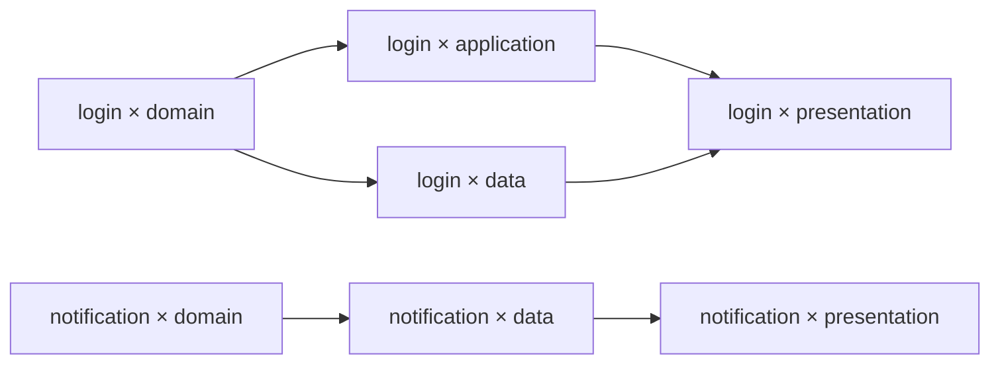
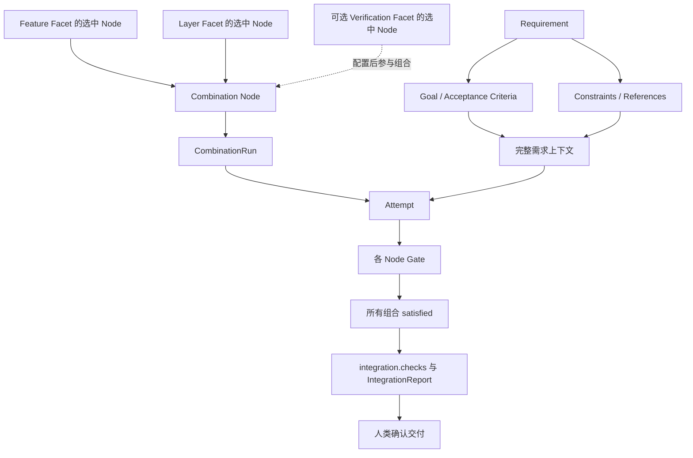

# Demo：登录失败限制与运行精炼

本场景验证单 main 下的 Requirement、DAG 并行、Gate、交付和 Refinement。

## 输入与组合图

需求：连续登录失败五次后暂时限制登录，并显示剩余等待时间。

```text
Feature: start → login → end
         start → notification → end
Layer: domain → application ─┐
       domain → data ────────┴→ presentation
```

Workflow 按 `feature ▷ layer` 生成组合图，静态排除 notification × application：

```yaml
exclude:
  - feature: [notification]
    layer: [application]
execution:
  runner: developer
  checks:
    - id: unit
      argv: [pytest, -q, test/auth]
      timeout_seconds: 120
  max_check_retries: 2
error_gate:
  mode: human
  max_auto_recoveries: 3
integration:
  checks:
    - id: regression
      argv: [pytest, -q]
      timeout_seconds: 900
```



Feature 分支可并行；login 的 application 与 data 在 domain 满足后并行，presentation 汇聚二者。排除 `notification × application` 后，先补上 `notification × domain → notification × presentation`；由于保留路径 `domain → data → presentation` 已表达该顺序，传递约简再删除这条冗余边。上图展示最终约简结果，notification 的 presentation 只需直接汇聚 data 的输出。控制边界和其余规则见 [Workflow](01-workflow.md)。

Verification Facet 可增加验证职责，验证等待哪些前驱取决于 Facet 顺序和 DAG 拓扑。放在 Feature 内层可分别验证各 Feature；外层配置“实施 → 验证”则可形成阶段屏障，见 [顺序对比图](01-workflow.md#facet-顺序与验证位置)。最后的整体检查仍由 integration.checks 执行。

## 同一需求如何从不同角度对齐

每个组合读取完整的冻结需求，再按所选 Node 的职责处理当前部分。下表说明登录限制需求的职责与证据，不新增运行字段或自动覆盖率判定；具体测试需在必要检查或 integration.checks 中配置。



需求提供完整目标与验收依据，Facet 定义提供不同角度的职责；Requirement 不会自动生成或改写 Facet。一个 Acceptance Criteria 可以由多个组合共同实现和验证。本例使用 Feature 与 Layer 两个 Facet；加入 Verification 会生成另一张组合图，最终 integration.checks 始终是独立的交付检查。

| 位置 | 当前职责 | 检查依据与证据 |
| --- | --- | --- |
| login × domain | 定义连续失败阈值、限制期与到期恢复规则 | 冻结需求及认证资料；领域边界测试、代码 Diff、CheckReport |
| login × application | 将领域结果传递给登录接口，返回限制状态和剩余时间 | 领域输出与接口约定；接口测试、CheckReport |
| login × data | 保存并读取规则所需的失败计数和限制状态 | 领域输出与存储约定；仓储测试、CheckReport |
| login × presentation | 汇聚应用与数据成果，展示剩余时间及恢复状态 | 完整需求与前驱输出；界面测试、可复核界面证据、CheckReport |
| 可选 Verification 组合 | 按所选节点职责验证行为、边界或安全性 | 固定验证上下文、按 DAG 汇聚的成果与检查证据 |
| 最终集成与交付 | 验证从失败请求到限制生效、界面提示和恢复的完整行为 | 最终候选上的回归检查、IntegrationReport、人类确认 |

每行是对现有需求与引用资料的职责解释；未明确的业务行为应在冻结前补齐，不能靠表格或 Agent 自行增加要求。领域成果通过审核时，界面尚未完成属于正常依赖顺序；若领域结果无法支持所需的剩余时间，则是当前成果应处理的问题。notification 分支通过 Pre-Assess 判断是否相关，明确不适用时仍保留必要检查及 Gate。

## Node Gate 与并行审核

### Layer 节点配置

Workflow 默认 `gate: {mode: human}`。Feature 的 Node 不声明 gate，继承人工审核；Layer 按审核目的配置：

```yaml
nodes:
  - id: domain
    role: regular
    gate:
      mode: ai
      evaluator: domain-reviewer
      context:
        objective: 检查锁定、到期恢复与领域隔离
  - id: application
    role: regular
    gate:
      mode: script
      evaluator: dependency-check
  - id: data
    role: regular
  - id: presentation
    role: regular
    gate:
      mode: ai_assisted
      evaluator: ui-reviewer
      context:
        objective: 检查剩余时间和恢复提示是否符合需求
```

执行 runner `developer` 与审核 runner `reviewer` 都固定到预装 Agent 和项目环境的镜像 digest，原生参数配置非交互调用。参数与 runner 文件格式见 [Workflow](01-workflow.md)，示例占位参数必须替换为所用 Agent 版本的真实参数。

### AI 评估器配置

`domain-reviewer`、`ui-reviewer` 使用独立审核会话。文件：`.facetloom/evaluators/domain-reviewer.yaml`。

```yaml
schema_version: 1
id: domain-reviewer
kind: ai
runner: reviewer
instruction: 检查锁定、到期恢复与领域隔离，引用证据并返回结构化结论。
timeout_seconds: 300
```

`ui-reviewer` 使用相同结构并填写界面审核指令。

### 脚本评估器配置

文件：`.facetloom/evaluators/dependency-check.yaml`。

```yaml
schema_version: 1
id: dependency-check
kind: script
argv: [python3, tools/check_dependencies.py]
timeout_seconds: 120
execution:
  environment_ref: <immutable-environment-ref>
  network: disabled
```

### 组合接受条件

| Combination | feature 的 Gate | layer 的 Gate | 接受条件 |
| --- | --- | --- | --- |
| login × domain | feature/login：human | layer/domain：ai | 人类与 AI 均批准 |
| login × application | feature/login：human | layer/application：script | 人类与脚本均批准 |
| login × data | feature/login：human | layer/data：继承 human | 两项人工批准，可批量确认 |
| login × presentation | feature/login：human | layer/presentation：ai_assisted | 两项人工批准，其中一项附 AI 建议 |

同名 `feature/login` 在不同 Combination / Attempt 中独立审核，不能沿用上一节点的批准。脚本正常返回 Rejected 表示成果不符合要求；脚本超时或退出失败则是评估故障，等待人类处理，其他独立项仍可继续。

### 节点检查失败仍可接受的例子

假设 `workflow/unit` 包含领域与接口测试。`login × domain` 完成领域规则后，检查已完整执行且同次修复额度耗尽：领域测试通过，接口测试因后续 application 节点尚未接入剩余时间而失败。两个 Gate 分别审核固定证据，可以批准，也可以因领域输出不足而拒绝；不能只因“后续会处理”自动接受。

批准时的 `rationale` 示例：

```text
workflow/unit 失败：登录接口尚未返回 remaining_seconds。
报告中的领域测试及当前 Diff 已验证锁定期限和剩余时间计算；
接口接入属于后继 application 节点，当前领域输出足以支持该工作，故接受。
```

全部 Gate 批准后节点为 accepted / satisfied，但 CheckReport 仍为 failed。若命令未启动或证据未形成，不能使用上述理由批准。后续节点完成后仍须对最终候选执行 integration.checks；节点批准不能替代最终集成通过。

## 从运行到交付

准备定义时，可在可视化编辑器中配置 Feature / Layer 的源节点与依赖，并保存到工作区 YAML。预览应产生上文的分支与汇聚；改变 Facet 顺序、Scope 或 exclude 时先看图与配置 Diff。人类确认发布一个定义维护提交后，新 Run 才读取这些定义。这一准备提交独立于后续 Requirement 的一次 squash 采纳。

以 `login × domain` 为例：Facet 定义中的 login 和 domain Node 组合成一个静态 Combination Node；本次 WorkflowRun 为它保存一条 CombinationRun，首次执行创建 Attempt。错误恢复创建新的 Attempt，同次预算内修复继续使用原 Attempt；审核依据始终绑定对应尝试。对象边界见 [运行对象生命周期](02-requirement.md#运行对象生命周期)。

1. main 已有 Workflow、Facet、runner、审核配置和项目代码；本地准备固定 digest 的镜像与凭据。创建 UUID 草稿时复制本 clone 默认模式（初始为 ai_assisted）；独立选择起草 runner 并提交请求，AI 整理目标和验收条件。用户可随时切换 manual；无可用 Agent 时仍可手动完成，无需 remote 或先选 Workflow。
2. 人类审阅正文、AI Diff 与待澄清事项，按当前草稿摘要确认冻结为 requirement_ref，同时撤销在途起草请求。再选择 Workflow 并启动，Runtime 以此时的 main 固定 source_commit，生成 DAG，本地事务创建 Run；起草基线不代替执行基线。此时 main 不变。
3. Runtime 先创建 preparing Attempt，再固定代码输入和 Context Snapshot。Adapter 探测外部 Agent、保存初始请求，以只读容器和独立会话运行 Pre-Assess；Invocation 记录版本、argv 和 session_id。固定引用暂不可读可进入错误 Gate 等待，补充需求则创建新 UUID，不修改冻结文件。
4. 适用时调用外部 Agent，校验并留存 ExecutionResult；不适用则复用输入。Runtime 执行累积的必要检查，适用任务可在预算内续接修复并全量重检；固定最终 Tree 后保存 Checkpoint、CheckReport、只读 Post-Assess、bundle 与证据，计算 review_input_digest。本地 waiting_gate 事务落地后开始审核。
5. 各成果 Gate 可并行：AI 使用独立会话，脚本直接运行程序。报告是审核输出，不修改执行证据。全部批准与关联状态本地落地后，才解锁后继。
6. application 与 data 并行，presentation 稳定三方汇聚。若成果 Gate 拒绝，旧 Attempt rejected 并进入错误 Gate。人类选择 repair_upstream 修复 domain；决定和失效范围本地落地后重新执行，历史材料保留。
7. 全部节点 satisfied，Run 进入 integrating；Runtime 校验正式输入，汇聚终端成果，原样加入冻结需求文件，固定可恢复候选并运行 integration.checks。
8. 集成通过后绑定 IntegrationReport，Run 才 completed；集成失败保存 ErrorRecord，错误 Gate 可选择 retry_integration 或 repair_combination。修复节点重新执行和审核后再次集成。
9. 人类确认已绑定的成功报告和候选；Git Manager 重验 main 正式输入未变，使用该候选准备采纳。失败、取消或放弃则记录留在本地，不自动提交 main。
10. 选取精简档案及其依赖闭包，构造 DeliveryRecord；一个以最新 main 为父提交的 squash Commit 同时加入需求、代码、档案和回执。Trailer 标识 Requirement / Run / Delivery / Operation，回执不填写自身 Commit OID。main 接纳后即采纳成功，push 状态独立展示。

```text
main: C0 ─────────────────────────────────────────── C1
       │                                             │
       └─ 本地需求 → 执行 → Gate → 集成中 → 集成错误 Gate / 修复 → completed → 人类确认 ──┘
                                                     ├─ requirements/<uuid>.md
                                                     ├─ 项目代码
                                                     └─ runs/<run-id>/（含回执）
```

执行、Gate 和失败重试期间 main 始终为 C0；成功仅增加 C1。没有代码变化时，C1 仍保存需求与 no_change 结论。Refinement 是后续独立维护提交。

若执行期间 main 正式代码、定义或已采纳需求改变，停止旧基线交付，用同一冻结需求和最新 source_commit 创建新 Run；需求本身变了则新建 UUID。仅 runs/ 清理不使输入失效。Git revert C1 可以回撤成果，但保留历史采纳事实，不自动重开原需求。

脚本成果 Gate 返回 Rejected 时停止原 Attempt 的其余评估，并交给错误 Gate；已批准项不在旧 Attempt 上重开审核。确认必需测试材料未生成或已不可恢复时，Attempt failed，通过错误处置安排补测的新 Attempt，所有成果 Gate 重新审核；仅当前 clone 未持有原内容则先导入。评估器单纯超时保留原材料，由人类接管或请求重评。

```json
{
  "schema_version": 1,
  "summary": "实现失败计数与锁定剩余时间。",
  "evidence_refs": [],
  "evidence_files": [],
  "conflict_resolutions": []
}
```

Adapter 只接受各 Agent 已探测支持的原生结构化输出。Applicability 来自独立只读 Pre-Assess；Runtime 结合预检与实际 Git Tree 判断 changed/no_change/not_applicable。输出无效、Applicability 不确定或只读副本被修改均进入错误 Gate；Post-Assess 的 `concerns` 报告交由成果 Gate 审核。

Agent 可在独立 `evidence-out/` 中提交证据。Adapter 校验相对路径、普通文件类型、每次最多 100 个文件、单文件 10 MiB 和合计 100 MiB，并将成功导入的内容转成 Artifact 引用。超限、符号链接、越界路径或中途导入失败都使整份结构化结果无效，不发布部分报告。AI Gate 与 Refinement 复用该协议，Script Gate 只返回已校验的类型化引用。

### 自动恢复示例

将 error_gate 配置为 ai 或 script 并提供匹配评估器：输入准备失败后，评估器可决定 retry_current；Runtime 在一个事务中记录动作、递增 auto_recoveries_used 和动作意图。本地事务落地后启动新 Attempt。整个 Run 第 3 次自动恢复后再发生问题时，继续恢复须人类决定，不因节点切换或 Runtime 重启重置额度。

检查次数耗尽但最终 Tree 和失败结果完整时，进入成果 Gate；检查无法启动或证据缺失时，进入错误 Gate。Scope 外冲突不自动扩权；Agent 发现前驱需求不对齐则引用前驱和证据报错。错误 Gate 的恢复动作始终不能直接解锁后继。

## 从记录到改进

```text
运行返工记录：多次遗漏锁定到期后的恢复行为
    ↓ 人类与 Agent 核对
有效经验：domain 上下文应检查时间边界与恢复状态
    ↓ Agent 建议与 Diff
为 layer/domain 补充状态边界检查约束
    ↓ 人类采纳、校验 Facet 与组合 DAG
改进通过 + 同 Commit 清理已处理记录
    ↓
未解决的通知问题继续保留；原档案从 Git 历史读取
```

Run 已交付且无其它有效引用依赖时才可清理对应证据。验证失败、部分采纳或会话中断都不直接删除原记录。Commit 描述引用删除前的证据、验证结论及精炼 ID。

## 跨 clone 复核与本地清理

前述操作均可在无 remote 的仓库完成。执行与 Gate 本地事务生效，采纳与精炼提交 main；协作通过 Git 交换已完成的提交，不重放其中决定或交付。分叉按正常 Git 流程人工协调，没有需求版本合并流程。

```text
协作者 A：一次 squash 完成采纳
    ↓ 选择固定 Commit 中的 Run，收集依赖
导出 login-evidence.facetloom-artifacts.tar → 通过现有渠道传给 B
                                                   ↓
协作者 B：同步 main → 能看摘要，尚未持有大型证据
    ↓ 校验来源记录及整包摘要后导入
本地证据可读 → 从包内 Git bundle 恢复所需代码 → 复核
```

A 若尚未采纳或运行失败，可选择 `--local` 导出记录快照；索引及记录字节同样作为 Artifact 放入包内，不必先提交 main。B 导入后仅只读复核，不把快照安装成活动 Run。

整个流程无需共享存储服务。交换包不包含活动 Worker 控制状态，B 不会因导入而接管 A 的 Worker、采纳需求或更新正式代码。

A 完成精炼后，Artifact 仍留在 A 的本地库。需要释放空间时单独预览 purge，排除活动、待交付及其它有效记录的完整依赖；人工确认后删除并留下本地回执。Git 历史仍能显示原记录，已删除内容须从尚存交换包或其它副本重新导入；B 的副本不受 A 清理影响。

## 产物

```text
main
├── 项目代码、Requirement、Workflow、Facet
└── .facetloom/runs/<run-id>/
    ├── run.yaml / summary.md / dag.yaml
    ├── contexts/ / combinations/ / attempts/ / errors/
    └── checkpoints/ / decisions/ / reports/ / deliveries/

本地 .runtime/
├── 本地需求草稿、完整状态、交付意图和 detached Worktree
├── transactions/<operation-id>/ / locks/
├── workers/<attempt-id>.yaml / invocations/<invocation-id>.yaml
├── 完整日志
├── refinements/<id>/
└── artifacts/
    ├── objects/sha256/<hex> / entries/<hex>.yaml
    └── imports/<operation-id>.yaml / purges/<operation-id>.yaml

Git 外的独立交换文件
└── login-evidence.facetloom-artifacts.tar
    ├── manifest.yaml
    └── objects/sha256/<hex>   # 请求、Git bundle、检查日志与大型证据
```

## 验收场景

### 需求起草

| 场景 | 预期 |
| --- | --- |
| 首次创建、修改 clone 默认值、逐需求覆盖 | 初始 ai_assisted；默认值只影响新草稿，已有需求保留自己的选择 |
| 未选 Workflow、起草 runner 与执行 runner 不同 | 可独立起草；每次请求固定自身 runner、main 和资料 |
| 打开页面、切换 ai_assisted / manual | 不自动调用；保留正文，manual 不发起 AI 请求 |
| runner 不可用、Agent 失败或无效候选 | 保留原草稿，显示故障，可重试或手动完成；不创建错误 Gate |
| AI 候选身份匹配、原摘要未变 | 原子写回正文并保存 Diff 依据；UUID 不变 |
| AI 返回前人工编辑、或先修改再恢复原文但已撤销请求 | 前者保留候选待审阅，后者不能接收已撤销结果 |
| 切换 manual、更换 runner、冻结时仍有请求 | 保存撤销和停止意图；迟到结果不写回 |
| 人类确认后正文又变化 | 拒绝过期冻结确认，要求重新审阅 |
| 写回或冻结事务提交后崩溃 | 重放已提交结果，不重复写回、冻结或启动 Run |
| 起草完成、请求仍在途或失败 | 均不授予 Agent 冻结、启动或 main 写入权限 |

### 可视化配置

| 场景 | 预期 |
| --- | --- |
| 编辑节点、连边、Scope、检查与 Gate | 校验后写回 YAML；重新加载与组合预览语义一致，画布位置不改变顺序 |
| 删除源 Facet 中间节点 | 移除关联边，要求用户明确重连；不套用 exclude 旁路规则 |
| exclude 删除组合中间节点 | 展示命中规则、旁路与传递约简，最终图保持保留节点的依赖顺序 |
| 交换 Facet 顺序 | 预览展示依赖、并行与汇聚变化，来源 members 对应新顺序 |
| 修改共享 Facet 或重命名节点 | 列出所有受影响 Workflow 与引用；批次修复后才允许保存/发布 |
| 非法 ID、环、悬空引用、未知配置或排除全部节点 | 展示定位信息，禁止保存或发布，不把旧图显示为有效新结果 |
| 外部编辑器先改文件 | 摘要校验拒绝覆盖，保留编辑内容与双方 Diff |
| 多文件保存崩溃、期间外部改动 | 先对账恢复再允许预览/发布/启动；非预期字节保留交人工处理 |
| 定义有效但尚未提交 | 工作区预览可用，新 Run 启动被阻止 |
| 发布集合遗漏引用依赖 | 按 main 加所选文件的候选校验失败，要求明确补选，不偷用工作区未选内容 |
| 发布包含无关代码或索引已有暂存 | 拒绝自动提交，等待用户处理，不 stash 或覆盖 |
| 发布更新 main 后索引同步中断 | 按 Trailer、Tree 与文件摘要对账，不重复维护提交 |
| 新定义发布、旧 Run 仍存在 | 新 Run 用新 source_commit，旧快照不改写；旧基线推进按原规则阻塞 |

### 执行与协作

| 场景 | 预期结果 |
| --- | --- |
| 无效 Facet、排除引用或图有环 | 创建 Run 前拒绝 |
| 相同定义、不同 clone | 稳定 Combination ID 和 DAG，不同 Run ID |
| 无依赖分支、汇聚 | 并行执行，汇聚等待全部前驱 |
| 排除中间 Combination | 统一补边后传递约简，保持剩余节点间原有可达关系 |
| 无 exclude 但存在冗余边 | 同样进行传递约简，调度与汇聚使用最终直接前驱 |
| 改变节点、边及补边遍历顺序 | 最终边集与 DAG 摘要一致 |
| Runtime 重启、Worker 丢失 | 先重放文件事务再对账；无法恢复则 failed，保存错误并进入错误 Gate |
| 同一 clone 内不同操作并发提交 main | 按预期头与摘要串行校验，尚未生效的无冲突操作可重构，互不覆盖 |
| 无 remote、或已配置 remote 但离线 | 均可完成本地运行、四种 Gate、交付和精炼；执行与 Gate 本地事务生效，采纳与精炼提交 main |
| 本地提交完成但 push 失败 / 确认丢失 | 仅同步未完成，业务结果保留；核对远端包含关系，不重复操作 |
| 最终采纳时 main 已检出且工作区干净 / 存在未提交修改 | 分别正常快进并更新文件 / 保留待提交操作，等待处理，不自动 stash 或覆盖 |
| 当前用户目录在其它分支 | 不切换分支；更新 main 不混入该目录的修改 |
| 同步收到更新但尚未合并到本地 main | 不作为新执行输入，不冒充已接纳或全局最新 |
| 外部 Git 操作更新 main 后发现无效档案 | Runtime 暂停相关推进，人工修复后再校验，不执行无效记录 |
| Node 未声明 Gate / 仅声明部分字段 | 继承 Workflow 默认，mode 缺省 human；审核上下文累积且可追溯 |
| human / ai_assisted / ai / script | 分别由人类、人类、AI、程序决策；AI 建议本身不算批准 |
| 自动模式缺少或错配评估器 | 校验失败，不使用本地替代定义 |
| clone 无法满足固定 runner、原生配置或环境 | 执行错误进入错误 Gate；评估器故障人工接管，不静默切换 |
| 必要测试未结束或引用未持久化 | 不进入成果审核；失败保存实际错误，持久化不可用时保留恢复信息 |
| 实际初始请求留存 | 发送前本地保存；通过持久引用读取并校验字节摘要 |
| runner 或原生配置引用缺失 | 创建 Run 前拒绝，不使用宿主机 Agent 配置兜底 |
| 镜像/Agent 缺失、参数不支持或认证失败 | 保存实际错误，执行转错误 Gate；审核为评估故障 |
| 关闭原生审批及内部沙箱 | 容器隔离、Scope、Runtime 检查与 Gate 继续生效 |
| 检查修复与原生续接不支持 | 前者串行记录每次输入；后者进入错误 Gate，不自建 Agent 循环 |
| 执行结果无效、Applicability 不确定或与实际 Tree 不符 | 保存 Invocation 和错误证据，进入错误 Gate；不猜测 outcome |
| Pre-Assess 输入不足 / 有风险 | 阻塞执行转错误 Gate / 固定风险证据供成果 Gate 审核 |
| Pre-Assess 明确不适用 | 跳过代码执行；必要检查、Post-Assess 和成果 Gate 仍执行 |
| 不适用且必要检查失败 | 不启动修复；完整失败报告交成果 Gate |
| Post-Assess 发现问题 / 返回 concerns | 保留报告供成果 Gate 审核，不直接拒绝或接受 |
| Post-Assess 只读调用改动成果、超时或输出无效 | Attempt 失败并进入错误 Gate；原 CheckReport 和 Checkpoint 保持不变 |
| 原生成功退出但审核结果无效 | 评估故障，不能当作批准或拒绝 |
| 总时限耗尽、Runtime 重启 | 原 deadline 不重置，停止执行并保存 execution_timeout |
| PID 复用、容器状态查询失败或停止超时 | 按容器与进程启动身份对账；unknown 不当作退出，不重复启动 |
| 评估请求未形成就失败 | error 报告允许 request_input_ref 为 null，说明原因 |
| 修改冻结字段或替换引用内容 | 审核输入/内容摘要校验失败，不能发布决策 |
| 仅更新分项报告、决策或状态 | review_input_digest 不变，其他独立审核仍有效 |
| Gate 检查失败 | 报告属于审核输出，可拒绝成果，不回写 output_refs |
| 审核中确认必需执行证据未生成或已不可恢复 | 原 Attempt failed，错误 Gate 决定是否新建 Attempt 补测；全部成果 Gate 重新审核 |
| 多项 Gate 混合并行、部分批准 | 仍 waiting_gate；全部批准且本地落地后才 satisfied |
| 任一成果 Gate 拒绝 | Attempt rejected，取消其余成果评估，创建 ErrorRecord 转错误 Gate；迟到批准不生效 |
| 超时、非零退出、无效结果或无法判断 | 保存故障/升级证据，暂停该项等待人类处理，不自动通过或拒绝 |
| 人类接管自动项 | 记录原因和原证据，决策主体为 human，原策略保留 |
| 另一 Gate 并发提交 / 当前项过期 | 前者复核固定材料后合并；后者拒绝过期请求 |
| 决策重复提交 / Runtime 重启 | 按 ID 对账，不重复生成决策或解锁后继 |
| 新 Attempt 复用 Context Snapshot | 重新审核全部 Gate，不继承旧批准 |
| 所有节点自动批准 | 进入 integrating；只有最终集成通过才 completed，交付 main 仍须人类确认 |
| 仅运行档案变化 | 输入不失效，交付保留新档案 |
| 正式输入变化或需求已采纳 | 拒绝旧结果交付 |
| 无 S3 / LFS 等共享存储 | 单 clone 完整执行并采纳；所需 Artifact 已在发布方本地持久化 |
| 另一 clone 只同步 Git | 可读摘要，所需文件显示尚未导入；缺材料不等于运行失败，不能跳过审核 |
| 导出并导入完整 Artifact 交换包 | 全部依赖可读；从其中 Git bundle 恢复被引用的输入与输出对象，不推进运行 |
| 固定审核引用缺少本地副本 | 导入相同原内容后可重试原操作，不改冻结字段或新建 Attempt |
| 导出范围有缺失记录或 Artifact 依赖 | 列出缺项，拒绝生成完整交换包 |
| 损坏文件、缺少或多余成员、非法路径及链接 | 整包校验失败，不登记有效的部分导入结果 |
| 交换包重复导入、导入中断或事务重放 | 复用摘要相同的内容；未提交内容不可用，已提交事务幂等完成 |
| Git 来源记录尚未同步或与摘要不符 | 要求先同步或拒绝包；清单不替代可信 Git 记录 |
| 清理活动、待审核、待交付、交付在途及其它有效记录的依赖 | 阻止 purge，展示保护原因 |
| purge 预览后新增引用或开始使用 | 旧预览失效，重新检查并确认，不删除已受保护内容 |
| 人工删除仅历史依赖的内容、删除中断 | 先记本地回执，删除幂等重放；失败保持待完成，Git 记录与 B 的副本不变 |
| purge 后回退 Git 或重新导入 | 回退只恢复记录；导入相同内容恢复本地可用性，旧清理回执保留 |
| 部分采纳、验证失败、来源变化 | 保留待处理记录，必要时重新确认 |
| 精炼清理或回退 | 历史档案可追溯，回退恢复 Git 记录，无悬空有效引用；不自动删除或恢复 Artifact |
| Worker 尝试写 main 或人类决策 | 容器挂载与凭据边界拒绝 |
| 相同 Commit、多前驱祖先关系、输入顺序变化 | 去重及祖先消除，来源保留；稳定顺序得到相同候选 Tree |
| 部分前驱共享历史并撤销改动 | 每步使用真实共同祖先，不重复应用或复活已撤销修改 |
| 多个最佳共同祖先 | 固定 Git 的标准虚拟基线处理，不任意选择 |
| 文本、二进制、删改、重命名及多方冲突 | 每步冲突和全部内容可恢复；后续干净合并不清除旧冲突 |
| 范围内冲突 / 范围外冲突 / 上游需求错误 | 分别由汇聚 Agent 解决、错误 Gate 处置、带前驱证据请求上游修复 |
| Scope 交集为空 | 只读；读取受 Runtime 策略限制，需要修改报错 |
| Workflow 与 Node 声明同名检查 | 限定 ID 不冲突；检查累积，不能覆盖或移除 |
| 检查失败并修复代码 | 默认最多 2 次修复；每次变更后全量重检，旧通过结果不复用 |
| 节点最后一轮检查失败、修复额度耗尽且证据完整 / 命令无法启动 | 前者进入成果 Gate，后者进入错误 Gate |
| 四种成果 Gate 模式审核完整失败证据 | 均可按职责批准或拒绝；批准理由列明失败检查 ID 及不阻碍当前职责和后继的依据 |
| 检查失败获批 / 仅部分 Gate 批准 | 前者保留 failed 检查事实；后者不接受节点、不解锁后继 |
| Gate 自行运行审核检查 | 结果只进入 GateReport，不补写冻结的 CheckReport 或 output_refs |
| 零项节点检查 | 记录空清单，界面显示“未配置检查”，不声称测试通过 |
| preparing 阶段失败 | Attempt failed，输入和 Snapshot 可空，仍有不可变 ErrorRecord |
| 四种错误 Gate 模式 | 复用模式和主体规则，输出动作而非成果批准 |
| 错误决定允许重试或修复 | 本地事务后新建 Attempt，不能直接 satisfied；旧终态保留 |
| 自动恢复达到 3 次、重启或跨节点重试 | Run 共享计数保持，不能超额安排自动恢复 |
| 人工接管、wait 后继续、错误 Gate 自身故障 | 保留前一决定及依据；自身故障不递归处理 |
| 重叠修复与迟到错误决定 | 已 stale、被替换或取消的节点拒绝旧动作 |
| COMMITTED 前 / 后崩溃，APPLIED 前崩溃 | 分别丢弃暂存 / 重放完整事务；读取者不看到半状态 |
| 已提交事务重复恢复 | 状态、恢复额度和动作 ID 只应用一次 |
| Worker 启动或评估请求发送结果未知 | 按稳定 ID 对账，无法确认则人工处理，不自动重发 |
| 提交已进入本地 main 但 Runtime 未确认、档案后来被精炼删除 | 通过操作 Trailer 对账本地历史，不重复恢复或复活档案 |
| Node 的 Scope 为 src/auth/**，另一组为 src/** | all_of 保留交集，只允许 src/auth/**，不扩大到 src/** |
| 空写入组或只读 Scope，未来新增路径 | 空组拒绝全部写入；新路径按原分组规则实时判断 |
| Worker 自报通过但没有 CheckReport | 不能进入成果审核；必须有 Runtime 的真实检查记录 |
| 最终 CheckReport 对应旧 Tree 或缺项 | 拒绝成果材料冻结；旧通过不能证明新代码 |
| no_change / not_applicable 仍修改代码或留下冲突 | 与代码条件不符，不能接受成果 |
| 最终汇聚失败尚无完整候选 | IntegrationReport blocked，candidate_ref / candidate_tree 为 null，保留冲突证据 |
| 最终集成检查未启动 / 测试执行失败 | 分别为 blocked / failed；未运行项不能当作通过 |
| 所有节点已接受，但最终集成检查失败 | 原 Run 进入集成 ErrorRecord / 错误 Gate，可重检或修复节点；不能交付 |
| 启动时未配置最终集成检查 | 启动校验失败，不创建可执行 Run |
| completed 后提交不同候选或报告 | 拒绝替换与交付；需要修改或重检时新建 Run，不复用旧确认 |
| 确认后只有 runs/ 档案变化 | 保留最新档案，允许复用原确认；源码变化则要求新 Run |
| 连续点击交付、不同 operation_id、本地提交确认丢失 | 同一需求 / Run 复用交付意图与 delivery_id，对账后返回一次成功结果 |
| 最终候选与正式输入相同 | 仍须通过最终集成检查并将 Run 置 completed，再人类确认，一次提交需求、no_change 结论与档案 |
| 已交付后的代码又被修改，或回执当前文件被清理 | 从历史查到已成功交付，不能用原 Run 重复应用成果 |
| 准备放弃运行但交付结果仍未知 | 先对账，确认未交付后才允许放弃或清理 |

## 集成恢复的专项验收

例：最终回归发现登录接口缺少剩余时间，错误 Gate 选择 `repair_combination`，目标为 `login × application`。application 与其后继 presentation 的有效成果失效，domain、data 和 notification 分支保持有效。恢复事务先固定两个节点各自的旧 Attempt 和成果引用，新 Attempt 的 recovery_decision_ref 均指向本次决定。

| 节点 | 当前工作代码 | 旧成果参考与修复职责 |
| --- | --- | --- |
| application | 有效 domain 输出 | 读取自身旧实现、失败集成报告和决定，在当前输入上重新应用接口实现并修正剩余时间返回 |
| presentation | 新 application 与保留的 data 输出汇聚 | 读取自身旧界面实现，按新接口重新对齐，不直接合入旧 presentation 输出 |
| data | 原有效成果 | 不失效、不重执行，不创建新的恢复 Attempt |

两个新 Attempt 的 Snapshot.recovery_context 分别引用自身上一 Attempt 和所需证据；检查及全部成果 Gate 重做，随后全量集成，报告通过才 completed。

| 场景 | 预期结果 |
| --- | --- |
| Workflow 草稿没有集成检查 | 可以保存和预览，标为不可运行；发布与启动拒绝 |
| 全部节点 satisfied | 自动进入 integrating，只有有效 passed 报告可使 Run completed |
| 完整检查失败、环境错误、终端汇聚冲突 | 分别保存 failed / blocked 报告及 scope=integration 的 ErrorRecord，Run blocked；无虚假 Attempt |
| 四种集成错误 Gate 模式 | 使用同一动作协议；ai_assisted 仍由人类决定，自动评估故障不递归处理 |
| retry_integration | 原输入有效、旧任务已停止或隔离后重新汇聚和全量检查；新报告不覆盖旧报告 |
| repair_combination | 只失效目标与全部后继，新 Attempt 重新检查和审核；无关分支成果保留 |
| 选择控制节点、扩展 Scope 或集成错误返回 retry_current / wait | 拒绝无效动作，不安排恢复 |
| 节点恢复两次后自动集成恢复一次 | 同一 Run 共用 3 次额度，再恢复需人工；后继重执行不重复扣减 |
| 重复决定、事务中断、恢复重放 | 额度与失效范围仅生效一次，操作 ID 对账后推进 |
| 集成中取消、旧报告迟到、终端成果或基线已变化 | 旧任务不能将 Run 置 completed；新任务开始前停止或隔离旧进程 |
| 只有原材料副本缺失 | 补齐原内容后恢复未完成操作；不伪造检查失败或自动重新执行已结束检查 |
| completed 后交付或请求重检 | 交付使用绑定成功报告，不自动重检；修改或重新验证须新 Run |

## 恢复上下文的专项验收

| 场景 | 预期结果 |
| --- | --- |
| 普通首次执行 | recovery_decision_ref 与 recovery_context 均为 null |
| 成果拒绝后 retry_current | 新 Attempt 固定恢复决定，新 Snapshot 引用旧 Attempt、ErrorRecord 和拒绝依据；旧代码只读，不继承批准 |
| repair_upstream / repair_combination | 失效前固定每个受影响节点的旧来源；后继关联同一触发决定，但使用自身旧成果和当前有效前驱 |
| 修复 Attempt 再次失败并恢复 | 尚未完成的授权要求保留，决定按授权顺序去重；新决定不静默覆盖旧约束 |
| 准备失败，尚无 Snapshot、输入或输出 | 只提供已形成的错误与决定；界面和请求明确缺项，不从工作目录残留拼出成果 |
| 固定外部引用恢复后的 retry_current | 复用原 Snapshot；仅新 Attempt 保存新的 recovery_decision_ref，不添加指令 |
| 恢复材料缺少副本 / 指令冲突 | 分别补齐原引用内容 / 按准备错误处理，不能无声丢弃旧要求 |
| 清除有效成果后崩溃并重放 | 从已提交恢复意图读取固定来源，不重新选取“最新”旧成果、不重复扣减预算 |
| 旧 Attempt 仍有活动进程 | 先撤销并停止或隔离，终态落地后固定摘要；新 Snapshot 不引用可变记录 |
| 恢复材料导出、归档与清理 | 包含决定、旧 Attempt、错误和代码恢复材料的依赖闭包；有效引用阻止清理 |

## 一次采纳的专项验收

| 场景 | 预期结果 |
| --- | --- |
| 创建需求、执行 Attempt、批准 Gate、错误恢复 | 本地事务落地后生效，main 头始终不变 |
| 失败、取消或放弃 | 无自动 main 提交；记录本地保留并可显式导出 |
| 首次成功采纳 | main 恰增加一个 Commit，同时包含冻结需求、代码、精简档案和 DeliveryRecord |
| 无代码变化 | 同样只有一个采纳 Commit，kind=no_change，不另建空代码提交 |
| 回执构造 | 不包含自身 Commit OID；project_tree 与最终报告一致，需求字节等于 requirement_ref |
| 候选仅存在对象库、尚未进入 main | 不显示成功，重试仍用原 delivery_id |
| main 更新后、本地确认前崩溃 | 通过 Trailer 和内容对账，恢复本地 delivered，不追加回执提交 |
| 同一需求多个 Run 或不同 operation_id 重试 | 最多一次采纳；其它运行停止，不重新交付 |
| 冻结后更改需求内容 | 新 UUID；没有需求修订、当前指针或版本合并 |
| 同一需求换代码 / 定义基线 | 新 Run，固定新 source_commit，复用原始 requirement_ref |
| Git revert 采纳提交 | 回撤正式内容，历史仍判定已采纳，不自动重开；后续变化用新需求 |
| 按需求阅读 | 按 main 采纳顺序展示，使用序号、标题和短 UUID；序号不作为身份 |
| 本地失败记录导出、其它 clone 导入 | 不需要先提交 main；校验快照闭包，只读访问，不恢复调度或采纳 |
