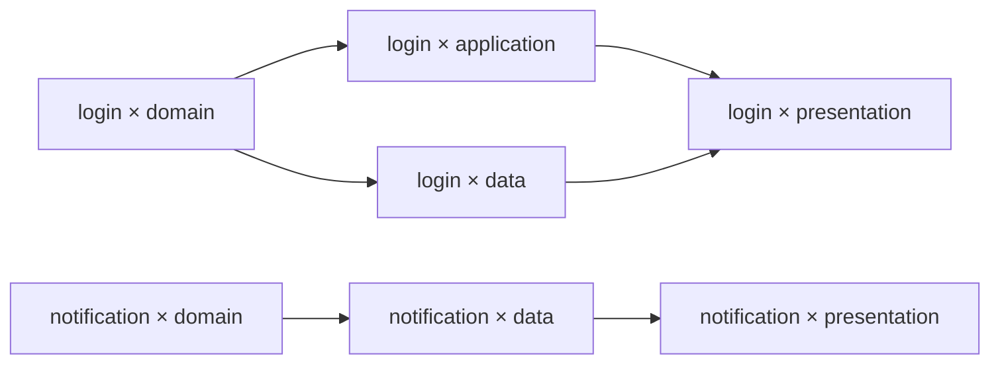

# Demo：登录失败限制与运行精炼

本场景验证单 main 下的 Requirement、DAG 并行、Gate、交付和 Refinement。

## 输入与组合图

需求：连续登录失败五次后暂时限制登录，并显示剩余等待时间。

```text
Feature: start → login → end
         start → notification → end
Layer: domain → application ─┐
       domain → data ────────┴→ presentation
```

Workflow 按 `feature ▷ layer` 生成组合图，静态排除 notification × application：

```yaml
exclude:
  - feature: [notification]
    layer: [application]
integration:
  checks:
    - id: regression
      argv: [pytest, -q]
      timeout_seconds: 900
```



Feature 分支可并行；每个 Feature 的 application 与 data 在 domain 满足后并行，presentation 汇聚二者。排除 `notification × application` 后，`notification × domain → notification × data → notification × presentation` 仍可达，因此无需添加旁路边。只有删除节点后某个原有上下游关系不再可达时才补边，避免跳过保留节点。控制边界和其余规则见 [Workflow](01-workflow.md)。

Verification Facet 可增加节点级验证，其边只约束其余 Facet 选择相同的组合，不自动构成全局验证屏障。最后的整体检查由 integration.checks 执行。

## Node Gate 与并行审核

Workflow 默认 `gate: {mode: human}`。Feature 的 Node 不声明 gate，继承人工审核；Layer 按审核目的配置：

```yaml
# layer Facet 的 Node 配置片段
nodes:
  - id: domain
    role: regular
    gate:
      mode: ai
      evaluator: domain-reviewer
      context:
        objective: 检查锁定、到期恢复与领域隔离
  - id: application
    role: regular
    gate:
      mode: script
      evaluator: dependency-check
  - id: data
    role: regular
  - id: presentation
    role: regular
    gate:
      mode: ai_assisted
      evaluator: ui-reviewer
      context:
        objective: 检查剩余时间和恢复提示是否符合需求
```

`domain-reviewer`、`ui-reviewer` 使用 kind=ai 的配置；`dependency-check` 使用脚本配置：

```yaml
# .facetloom/evaluators/dependency-check.yaml
schema_version: 1
id: dependency-check
kind: script
argv: [python3, tools/check_dependencies.py]
timeout_seconds: 120
execution:
  environment_ref: <immutable-environment-ref>
  tools: []
  network: disabled
```

| Combination | feature 的 Gate | layer 的 Gate | 接受条件 |
| --- | --- | --- | --- |
| login × domain | feature/login：human | layer/domain：ai | 人类与 AI 均批准 |
| login × application | feature/login：human | layer/application：script | 人类与脚本均批准 |
| login × data | feature/login：human | layer/data：继承 human | 两项人工批准，可批量确认 |
| login × presentation | feature/login：human | layer/presentation：ai_assisted | 两项人工批准，其中一项附 AI 建议 |

同名 `feature/login` 在不同 Combination / Attempt 中独立审核，不能沿用上一节点的批准。脚本正常返回 Rejected 表示成果不符合要求；脚本超时或退出失败则是评估故障，等待人类处理，其他独立项仍可继续。

## 从运行到交付

1. 人类审阅并在 main 发布 Requirement r1、current、Workflow 和 Facet。
2. Runtime 固定 source_commit，生成 DAG，先本地持久化，再发布初始精简档案。代码仍未变。
3. Runtime 为根节点创建 Attempt，先保存本地输入再启动 detached Worktree 与容器。各 Worker 独立执行。
4. Git Manager 保存 Checkpoint。进入 waiting_gate 前导出必要 bundle、保存测试证据，并把精简上下文与结果发布 main。
5. Runtime 并行调度该 Attempt 的各项 Gate。分项报告与 Decision 发布；全部批准和关联状态发布成功后，后继才可执行。
6. application 与 data 并行，presentation 汇聚输入。若 Gate 发现缺少锁定到期后的恢复行为并拒绝成果，当前节点 blocked；人类确认修复 domain 后，将其及相关后继标为 stale，再重新执行。
7. 所有节点 satisfied，Run completed。summary 记录结果、返工原因和待改进问题；完成不等于已经交付。
8. 另一个 clone 此时发布自己的 Run 档案。main 头变化，但 project_tree 不变，当前运行仍可交付。
9. Git Manager 在最新 main 上构造代码候选，保留全部最新档案，运行最终检查；人类确认后提交代码，并追加 DeliveryRecord。

如果第 8 步发生的是正式代码或定义变化，交付要求新 Run；同步到 r2 时取消旧版未终态运行，旧成果不能交付。

## 从记录到改进

```text
运行返工记录：多次遗漏锁定到期后的恢复行为
    ↓ 人类与 Agent 核对
有效经验：domain 上下文应检查时间边界与恢复状态
    ↓ Agent 建议与 Diff
为 layer/domain 补充状态边界检查约束
    ↓ 人类采纳、校验 Facet 与组合 DAG
改进通过 + 同 Commit 清理已处理记录
    ↓
未解决的通知问题继续保留；原证据从 Git 历史读取
```

Run 已交付且无其它有效引用依赖时才可清理对应证据。验证失败、部分采纳或会话中断都不直接删除原记录。Commit 描述引用删除前的证据、验证结论及精炼 ID。

## 产物

```text
main
├── 项目代码、Requirement、Workflow、Facet
└── .facetloom/runs/<run-id>/
    ├── run.yaml / summary.md / dag.yaml
    ├── contexts/ / combinations/ / attempts/
    └── checkpoints/ / decisions/ / reports/ / deliveries/

本地 .runtime/
├── 活动状态、待发布操作和 detached Worktree
├── 完整日志
└── refinements/<id>/

持久 Artifact
└── 可恢复代码的 bundle、测试报告与大型证据
```

## 验收场景

| 场景 | 预期结果 |
| --- | --- |
| 无效 Facet、排除引用或图有环 | 创建 Run 前拒绝 |
| 相同定义、不同 clone | 稳定 Combination ID 和 DAG，不同 Run ID |
| 无依赖分支、汇聚 | 并行执行，汇聚等待全部前驱 |
| 排除中间 Combination | 添加跨被排除节点的旁路边，保留原有可达关系 |
| Runtime 重启、Worker 丢失 | 本地对账；无法恢复则 blocked，人工确认重试 |
| 不同 Run 同时推送 | 刷新后自动追加，互不覆盖 |
| Node 未声明 Gate / 仅声明部分字段 | 继承 Workflow 默认，mode 缺省 human；审核上下文累积且可追溯 |
| human / ai_assisted / ai / script | 分别由人类、人类、AI、程序决策；AI 建议本身不算批准 |
| 自动模式缺少或错配评估器 | 校验失败，不隐式切换模式 |
| 多项 Gate 混合并行、部分批准 | 仍 waiting_gate；全部批准发布后才 satisfied |
| 任一 Gate 拒绝 | Attempt rejected，其余活动评估取消；迟到批准不生效 |
| 超时、非零退出、无效结果或无法判断 | 保存故障/升级证据，暂停该项等待人类处理，不自动通过或拒绝 |
| 人类接管自动项 | 记录原因和原证据，决策主体为 human，原策略保留 |
| 另一 Gate 并发提交 / 当前项过期 | 前者复核固定材料后合并；后者拒绝过期请求 |
| 决策重复发布 / Runtime 重启 | 按 ID 对账，不重复生成决策或解锁后继 |
| 新 Attempt 复用 Context Snapshot | 重新审核全部 Gate，不继承旧批准 |
| 所有节点自动批准 | 运行完成，但交付 main 仍须人类确认 |
| 仅运行档案变化 | 输入不失效，交付保留新档案 |
| 正式输入变化或需求被取代 | 拒绝旧结果交付 |
| bundle 在另一 clone 导入 | 可恢复被引用的输入与输出对象 |
| 部分采纳、验证失败、来源变化 | 保留待处理记录，必要时重新确认 |
| 精炼清理或回退 | 历史可追溯，回退恢复记录，无悬空有效引用 |
| Worker 尝试写 main 或人类决策 | 固定工具与凭据边界拒绝 |
