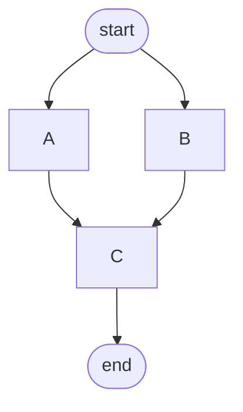
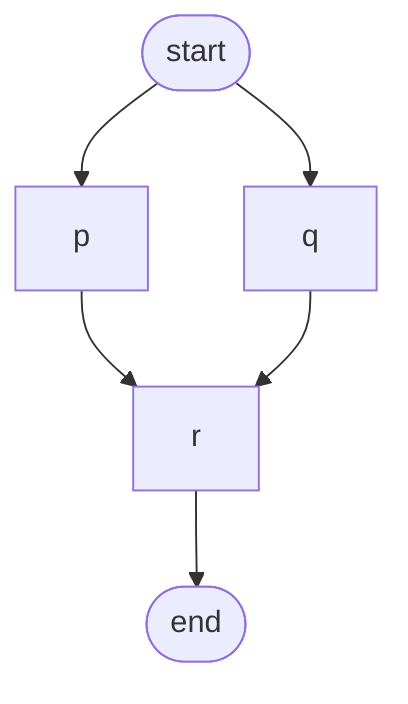
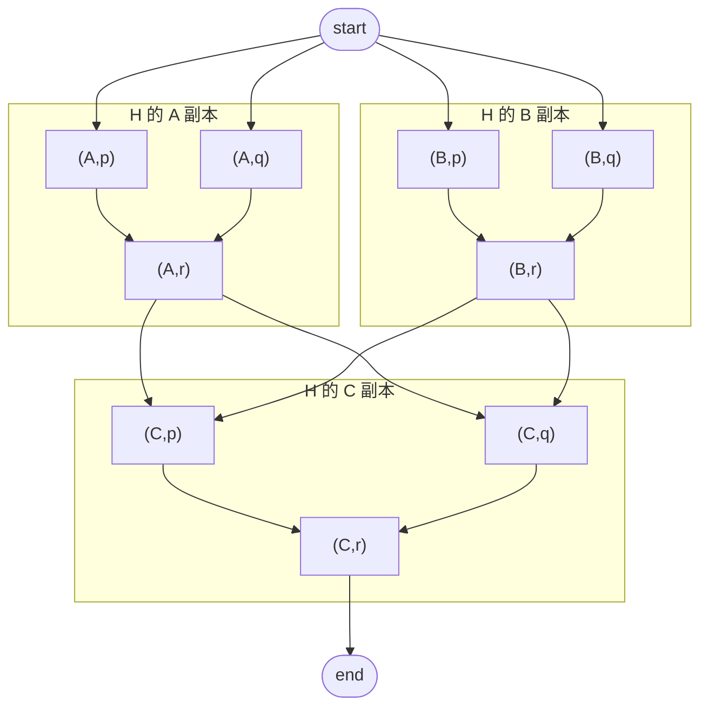

# 带虚拟边界的 DAG 节点替换积

> **用途**：定义 Facet 之间的结构组合运算；Combination 排除与关系桥接规则见 [Workflow](../01-workflow.md)。
> **运算记号**：`G ▷ H`（本规范自定义记号，并非图论中通行的“笛卡尔积”符号）  
> **核心语义**：外层 DAG `G` 决定副本之间的依赖拓扑；内层 DAG `H` 替换 `G` 的每个实际节点；**消除每份内层副本的虚拟 `start/end`，保留最外层的一对虚拟 `start/end`**。

## 1. 设计目标

希望得到一种可递归组合的 DAG 运算，满足：

1. 每个合法 DAG 都有**唯一指定的虚拟 `start` 和 `end`**，用于统一连接接口。
2. 虚拟 `start/end` **不属于实际执行节点**，可以连接任意数量的实际入口和实际出口。
3. 对 `G` 的每个实际节点，替换为 `H` 的一份独立副本。
4. 展开过程中，`H` 副本内部的虚拟 `start/end` **被消除**；连接由它们邻接的实际节点承接。
5. 最终结果仍然是合法 DAG，仍然有且仅有**最外层**的虚拟 `start/end`。
6. 该操作可连续、多层递归使用，并以一致的方式处理分叉、汇合、并行和串行依赖。

**必须区分**：“唯一虚拟入口/出口” ≠ “唯一实际入口/出口”。本规范只要求前者，不限制后者。

## 2. 基础对象与约束

将一个有边界的 DAG 记作：

\[
D=(V_D,E_D,s_D,t_D)
\]

- `V_D`：节点集合；`E_D ⊆ V_D × V_D`：有向边集合。
- `s_D`：唯一指定的虚拟 `start`；`t_D`：唯一指定的虚拟 `end`，二者不同。
- `V_D° = V_D \ {s_D,t_D}`：实际节点集合。
- `E_D° = E_D ∩ (V_D° × V_D°)`：实际节点之间的内部边。

**合法性约束**

- 图有限、无环，`s_D` 入度为 0，`t_D` 出度为 0。
- 至少存在一个实际节点；每个实际节点都位于某条 `start → … → end` 路径上。
- 允许 `start` 连接多个实际节点，也允许多个实际节点连接 `end`。
- 不赋予“跳过任务”“条件选路”之类的 OR 分支语义；边仅表示**必须完成的依赖**。
- 对于非空 DAG，如存在直接边 `start → end`，可以在输入规范化时移除：它对这里的依赖可达性是冗余边。本规范的后续定义均针对规范化后的图。

实际入口、出口集合分别是：

\[
I(D)=\{v\in V_D^\circ\mid(s_D,v)\in E_D\}
\]

\[
O(D)=\{v\in V_D^\circ\mid(v,t_D)\in E_D\}
\]

在上述合法性约束下，`I(D)` 与 `O(D)` 非空，且恰好是实际节点子图中的全部源点和汇点。

### 2.1 依赖的执行语义

规定所有进入同一节点的前驱依赖都是 **AND-join**：只有所有直接前驱完成，节点才就绪。分叉表示可以并行，**不是**只能选择一个分支（OR/XOR）。

## 3. 运算定义

定义二元运算：

\[
\boxed{G\triangleright H}
\]

**读法**：`G` 的每个实际节点由一份 `H` 展开；`G` 为外层、`H` 为内层。顺序有意义。

### 3.1 节点集合

\[
\boxed{V(G\triangleright H)=\{s_G,t_G\}\ \cup\ (V_G^\circ\times V_H^\circ)}
\]

- 最终只保留 `s_G`、`t_G` 这对虚拟边界。
- 对每个 `g ∈ V_G°`，生成一份 `H` 实际节点的副本，内部节点标识为 `(g,h)`。
- 原来的 `g` 不再作为独立执行节点存在。
- `s_H`、`t_H` 不会出现在结果中。

### 3.2 边集合：四条规则

令 `I_H = I(H)`、`O_H = O(H)`，则结果边集是以下四类边的并集。

**规则 A：副本内部边**（复制 H 的实际节点依赖）：

\[
E_A=\{((g,h),(g,h'))\mid g\in V_G^\circ,\ (h,h')\in E_H^\circ\}
\]

**规则 B：外层实际节点间的边**（出口集合 → 入口集合）：

\[
E_B=\{((u,a),(v,b))\mid (u,v)\in E_G^\circ,\ a\in O_H,\ b\in I_H\}
\]

**规则 C：外层 start 的出边**：

\[
E_C=\{(s_G,(v,b))\mid (s_G,v)\in E_G,\ b\in I_H\}
\]

**规则 D：外层 end 的入边**：

\[
E_D=\{((u,a),t_G)\mid (u,t_G)\in E_G,\ a\in O_H\}
\]

因此：

\[
\boxed{E(G\triangleright H)=E_A\cup E_B\cup E_C\cup E_D}
\]

特别注意：规则 B 是**从前一副本的每一个实际出口到后一副本的每一个实际入口**，不是只选取某一对节点。

### 3.3 直观流程

1. 保存 `G` 的最外层虚拟 `start/end`。
2. 为每个 `g ∈ V_G°` 复制 `H` 的实际节点与内部边。
3. 丢弃每份 `H` 副本的虚拟 `start/end`。
4. 对 `G` 的每条实际节点边 `u → v`，把 `H_u` 的所有实际出口连向 `H_v` 的所有实际入口。
5. 对 `G.start → v` 和 `u → G.end`，分别连接 `G.start` 到副本入口、以及副本出口到 `G.end`。
6. 返回仅带 `G.start/G.end` 的平坦 DAG。

## 4. 完整示例

### 4.1 外层 G



- 实际节点：`A,B,C`；
- 实际依赖：`A→C`、`B→C`；
- `A`、`B` 可以并行，`C` 必须等待二者。

### 4.2 内层 H



- 实际节点：`p,q,r`；
- 实际入口：`I(H)={p,q}`；实际出口：`O(H)={r}`；
- `p,q` 可以并行，`r` 必须等待二者。

### 4.3 展开后的 G ▷ H



**观察**：

- 每个 `A/B/C` 都被 `p,q,r` 三个实际节点替换，合计 `3×3=9` 个实际节点。
- 加上最外层 `start/end`，共 **11 个节点**。
- 每份 H 的内部边 `2` 条，合计 `6` 条；G 的 `A→C`、`B→C` 各展开为 `2` 条，共 `4` 条；外部 `start` 连 `4` 条，外部 `end` 连 `1` 条，总计 **15 条边**。
- 不存在 `(A,start)`、`(A,end)`、`(B,start)` 等内部虚拟节点。

## 5. 代数性质

下列性质在 **第 2 节规范化的、非空的双端 DAG 集合**上成立；同构均允许重命名节点及重新结合元组的括号，但必须保持虚拟边界。

| 性质 | 结论 | 说明 |
|---|---|---|
| 封闭性 | 成立 | 运算结果仍是合法、无环、双虚拟边界 DAG |
| 结合律 | 成立（自然同构） | `(G▷H)▷K ≅ G▷(H▷K)` |
| 交换律 | **通常不成立** | `G▷H` 与 `H▷G` 的依赖结构一般不同 |
| 单位元 | 存在 | `I = start → • → end`（**一个实际节点**） |
| 实际节点数 | 相乘 | `n(G▷H)=n(G)×n(H)` |
| 可递归展开 | 成立 | 任意嵌套只保留最终最外层虚拟边界 |

### 5.1 为什么满足结合律

对 `(G▷H)▷K`，实际节点可以表示为 `((g,h),k)`；对 `G▷(H▷K)`，实际节点可以表示为 `(g,(h,k))`。用自然映射

\[
((g,h),k)\mapsto(g,(h,k))
\]

对应所有节点。两边的依赖均分为：`K` 副本内部依赖、`H` 跨节点连接时使用的 `K` 出口到入口依赖、`G` 跨节点连接时使用的 `(H,K)` 组合出口到入口依赖。因此该映射保持边、最外层 start/end，也就给出了图同构。

### 5.2 为什么不满足交换律

取 `G = start → a → b → end`，取 `H = start → {p,q} → end`（`p,q` 相互独立）。

- `G▷H`：先有一层并行 `p,q`，再有一层并行 `p,q`；两个层之间产生 `2×2=4` 条依赖，总边数 **8**。
- `H▷G`：形成两条互不相连的实际节点链（仅共享最外层 `start/end`），总边数 **6**。

边数不同，二者不可能同构。因此这里的“积”**不具有交换律**。

### 5.3 单位元不是空图

定义 `I = start → e → end`，其中 `e` 是唯一实际节点。则：

\[
G\triangleright I\cong G\cong I\triangleright G
\]

只有 `start→end`、没有实际节点的图不是合法操作数，避免空子图替换带来的直通、短路等额外语义。

## 6. 规模与复杂度

记：

- `n_G=|V_G°|`、`n_H=|V_H°|`：实际节点数；
- `m_G=|E_G°|`、`m_H=|E_H°|`：实际节点间的边数；
- `a_G=|I(G)|`、`b_G=|O(G)|`：G 的实际入口/出口数；
- `a_H=|I(H)|`、`b_H=|O(H)|`：H 的实际入口/出口数。

则：

\[
\boxed{|V(G\triangleright H)|=2+n_Gn_H}
\]

\[
\boxed{|E(G\triangleright H)|=n_Gm_H+m_Gb_Ha_H+a_Ga_H+b_Gb_H}
\]

因此多入口/多出口加上较多跨副本连接时，**边数可能快速增长**。对规模很大的工作流，可以考虑保留“所有出口 → 所有入口”的紧凑宏边，在需要进行图分析、执行计划编译或导出时再展开，但它必须具有与显式边相同的依赖语义。

## 7. 参考实现伪代码

```text
function substitute(G, H):
    validateAndNormalize(G)
    validateAndNormalize(H)

    result = DAG()
    result.addNode(G.start, virtual = true)
    result.addNode(G.end,   virtual = true)

    H_in  = successors(H.start)  // H 的实际入口
    H_out = predecessors(H.end)  // H 的实际出口

    for g in G.actualNodes:
        for h in H.actualNodes:
            result.addNode((g, h), virtual = false)
        for (a, b) in H.actualEdges:
            result.addEdge((g, a), (g, b))

    for (u, v) in G.edges:
        if u == G.start:
            for b in H_in:
                result.addEdge(G.start, (v, b))
        else if v == G.end:
            for a in H_out:
                result.addEdge((u, a), G.end)
        else:
            for a in H_out:
                for b in H_in:
                    result.addEdge((u, a), (v, b))

    return result
```

这里的代码假定经过输入规范化后，`G.edges` 不含 `G.start → G.end`，且全部边满足有效的虚拟边界约束。推荐将重复边合并，节点 ID 用结构化元组而不是直接拼接字符串。

## 8. 验证与测试要求

针对实现，至少需要验证：

- **边界不变式**：每个结果只有最外层的一对虚拟 `start/end`；没有任何内层虚拟节点残留。
- **DAG 不变式**：展开之后依然无环；每个实际节点均处于某条 `start→end` 路径上。
- **边正确性**：结果边必须且只能来自规则 A、B、C、D。
- **并行/汇合**：多入口、多出口不产生未经定义的 OR-join；所有前驱满足后才执行。
- **规模公式**：节点数、边数与第 6 节相符。
- **结合律测试**：将两侧结果的实际节点身份规范化为三元组 `(g,h,k)` 后，其节点集合和边集合一致。
- **单位元测试**：`G▷I`、`I▷G` 均与 `G` 同构。
- **非交换性测试**：第 5.2 节的例子应得到不同的边数。

## 9. 实现与系统集成建议

### 9.1 数据结构

```yaml
id: example
start: start
end: end
nodes:
  - id: A
  - id: B
  - id: C
edges:
  - [start, A]
  - [start, B]
  - [A, C]
  - [B, C]
  - [C, end]
```

`start`/`end` 应作为**结构性、非执行边界**，不得被误识别成普通节点。展开后的实际节点 ID 建议保存来源路径，例如 `[(A),(p)]`，多层时扩展为 `(g,h,k)`；同时记录它对应的模板和原始节点 ID，便于日志、故障定位和增量重建。

### 9.2 DAG 与运行时职责分离

本规范只定义**结构性依赖图**，不直接规定任务执行策略。运行时还需要负责节点状态、并发限制、重试、缓存、故障恢复和 Gate 审核等功能。若日后需要 OR/XOR 条件分支、动态生成节点或允许空任务，必须增加独立语义规范，不能仅靠当前的 DAG 边推断。

### 9.3 与 Facet/Combination 的关系（可选）

这种运算适合把外层结构（例如 Feature DAG）中的每个实际节点展开为统一的内层结构（例如 Layer DAG），再把形成的实际节点视为可执行的组合上下文。若不同外层节点采用不同内层图，可以扩展为**按节点映射的替换** `G[H_g]`；它不再是上述统一模板的二元积，需要单独规定不同模板间的出口—入口连接。

## 10. 术语与范围

| 本文术语 | 含义 |
|---|---|
| 带虚拟边界的 DAG | 具有唯一虚拟 start/end 的有向无环依赖图 |
| 实际节点 | 排除虚拟边界之后的节点，可代表任务或上下文 |
| 实际入口/出口集合 | 与虚拟 start/end 相邻的实际节点集合，允许多个 |
| 节点替换积 `▷` | 逐实际节点复制 H，并消除其内部虚拟边界、重新接线的运算 |
| 外层边界 | 始终保留在最终结果中的 G.start/G.end |
| AND-join | 所有输入依赖完成后才允许节点启动 |

**命名提醒**：`G ▷ H` 是本设计引入的记号，**不是**标准图论中的笛卡尔积 `G □ H` 或词典序积 `G[H]`。更准确的描述名称是“**带双端虚拟接口的 DAG 节点替换运算**”（two-terminal DAG node substitution）。

---

**本规范的核心规则，一句话总结：** `G` 中每个实际节点替换成 `H` 的实际子图；原 `G` 的每条实际依赖由“前一份 H 的全部出口 → 后一份 H 的全部入口”承接；只有最外层 `start/end` 得以保留。
