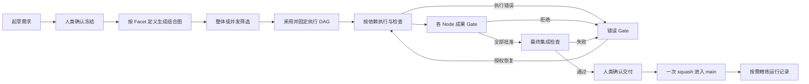
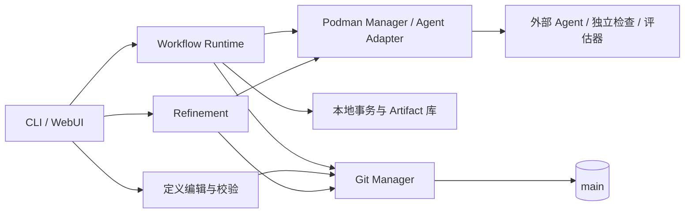

# FacetLoom 设计总览

FacetLoom 围绕一个冻结需求，以多个 Facet 对齐职责，经筛选、执行、审核与集成形成可追溯的一次交付。当前范围包含 CLI、WebUI、定义编辑和 Refinement；跨需求持续治理留在[发展路线](../../plan.md#后续发展方向不属于当前验收范围)。

## 完整流程

每个组合读取完整需求，从所选 Facet Node 的职责出发实现或验证当前部分；互不依赖的分支可并行。组合成果通过各 Node Gate 后才解锁后继，整体交付还须通过最终集成检查和人类确认。详细示例见 [登录失败限制](07-walkthrough.md)。

FacetLoom 编排外部 Agent，不实现模型推理或工具循环。Agent 与项目环境预装在 Podman 镜像中；Runtime 负责输入、调度、独立检查、审核及恢复。

运行与证据默认在产生它们的 clone 内使用。无需 remote 或中心存储即可完成需求；Git 按需同步已采纳成果，大型证据通过独立 Artifact 交换包传递。目录结构见 [存储与交付](05-storage-and-delivery.md#文件布局)。

## 对象与存储

| 对象 | 作用 | 保存位置 |
| --- | --- | --- |
| [Requirement](01-definition.md#requirement-文件与生命周期) | UUID 标识的一次独立需求，冻结后不可变 | 本地草稿与冻结 Artifact；最终采纳写 main |
| [Workflow / Facet / Node / Scope](01-definition.md#facet-与-node) | 执行图与上下文定义 | main |
| [Runner](01-definition.md#外部-agent-调用配置) / [Evaluator](01-definition.md#评估器与执行边界) | 外部 Agent 调用配置及 AI / 脚本审核定义 | main；Run 固定解析结果与来源 |
| [Combination / DAG Snapshot](02-selection-and-dag.md#运行快照) | 固定的业务执行图 | 本地运行状态；采纳时归档 main |
| [WorkflowRun / CombinationRun / Attempt](03-execution.md#workflowrun) | 一次运行、一个节点及一次尝试的状态 | 本地事务生效；采纳时归档必要记录 |
| [Context Snapshot](03-execution.md#context-snapshot) / [Checkpoint](03-execution.md#checkpoint-与代码保留) | 固定一次尝试的输入与代码结果 | 本地不可变记录与持久引用 |
| [ErrorRecord](04-review-and-recovery.md#errorrecord) | 准备、执行或成果拒绝的不可变错误材料 | 本地 errors/，采纳时选入精简档案 |
| [GateReport](04-review-and-recovery.md#成果-gatereport-与评估协议) / [GateDecision](04-review-and-recovery.md#成果-gatedecision) | 成果审核或错误处置的证据与决策 | 本地记录，采纳时加入 main |
| [CheckReport](03-execution.md#checkreport) | 一个 Attempt 的检查轮次、候选 Tree 与执行结果 | 本地 reports/，采纳时选入精简档案 |
| [SelectionReport](02-selection-and-dag.md#selectionreport) | 需求适用性筛选及排除依据；采用记录保存在 run.yaml | 本地记录，采纳时加入 main |
| [IntegrationReport](05-storage-and-delivery.md#integrationreport) / [DeliveryRecord](05-storage-and-delivery.md#deliveryrecord) | 最终候选、检查与一次成功交付回执 | 本地记录，采纳时加入 main |
| [Refinement](06-interaction.md#refinement运行精炼) | 筛选记录、提出并落实改进的交互过程 | 本地会话；结果体现在 main 的修改与 Commit 描述 |
| [Worker / Invocation](03-execution.md#worker调用与会话) | 一个 Attempt 的执行生命周期及一次外部调用 | clone-local；必要调用证据导出为 Artifact |
| [Artifact / Artifact 交换包](05-storage-and-delivery.md#artifact-存储与交换) | 大型证据及其显式跨 clone 传递 | 本地内容库；交换包经现有渠道独立传递 |
| [Runtime State](05-storage-and-delivery.md#本地文件事务) | 队列、容器、本地事务与交付意图 | clone-local；SQLite 可选 |

## 组件关系

| 组件 | 职责与协议 |
| --- | --- |
| Runtime | [运行对象与调度](03-execution.md#workflow-runtime)，协调起草、筛选、Gate 和集成 |
| Podman Manager / Adapter | [隔离、调用、会话与停止](03-execution.md#podman-manager)；执行与评估使用各自固定输入 |
| 本地持久化 | [文件事务](05-storage-and-delivery.md#本地文件事务)保证状态生效边界，[Artifact 库](05-storage-and-delivery.md#本地-artifact-store)保存内容与依赖 |
| Git Manager | [受信 Git 写入](05-storage-and-delivery.md#git-manager)、基线与一次采纳保护 |
| 定义编辑 / Refinement | [编辑与发布](06-interaction.md#可视化编辑与发布)、[运行精炼](06-interaction.md#refinement运行精炼)，供后续运行使用 |

## 五条不变量

1. **输入固定**：source_commit 固定代码、定义与资料；requirement_ref 固定新需求原始字节。runs/ 不参与项目输入。
2. **图固定**：Run 创建时固定 source-dag.yaml；运行前筛选采用后一次固定 dag.yaml，业务节点才开始执行。节点重试和恢复不改图；重新筛选已采用图需新 Run。
3. **本地执行，一次采纳**：中间状态及 Gate 不写 main；最终一个 Commit 同时包含需求、代码、精简档案和回执。每个需求最多采纳一次，按 UUID 与 Git 历史去重。
4. **恢复有边界**：本地事务恢复活动运行，Git 恢复已采纳档案；Artifact 另行保留或导入。提交仅在对象库存在不等于采纳成功。
5. **精炼可追溯**：独立维护提交可清理已处理档案，引用删除前证据；不改写 Git 历史、不自动删除 Artifact。

交付前对比 main 与 source_commit，只有 runs/ 变化不使输入失效，其余变化要求新 Run。无代码变化也需检查及人类确认，提交需求、no_change 结论和档案。回执不引用自身提交 OID，实际采纳提交通过 Trailer 查找。详见 [交付协议](05-storage-and-delivery.md#输入比较与集成交付)。

## 术语

- **Facet / Node / Combination**：分别是 Source Facet、Facet Node、Combination Node 的简称；Combination DAG 承载静态组合节点，CombinationRun / Attempt 保存运行状态。
- **当前有效成果**：CombinationRun 的 `accepted_attempt_id` 指向的输出；历史 accepted Attempt 不一定仍有效。
- **运行完成**：所有业务 CombinationRun 都为 `satisfied`，且最终 `IntegrationReport` 为 `passed`；不表示已经交付。
- **已采纳档案**：与需求和代码一并进入 main 的精简记录；与本地执行状态及同步状态分别展示。
- **采纳顺序**：从 main 的采纳历史生成的阅读顺序；“第几个需求”仅为展示序号，身份始终使用 UUID。
- **精炼**：Refinement，目标是减少当前目录与 Agent 上下文中的已处理记录，不清除 Git 历史。
