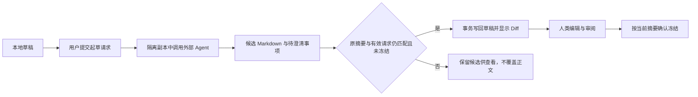

# 需求与执行定义

本章定义需求、Workflow、Facet、Scope、runner 与 evaluator。正式定义来自 main；新需求先在本地冻结，最终随成果采纳。编辑与发布交互见[交互](06-interaction.md#可视化编辑与发布)。

## Requirement 文件与生命周期

```text
.facetloom/.runtime/requirements/<requirement-id>/requirement.md  # 本地草稿
    ↓ 人类确认，首次启动前冻结完整原始字节
artifacts://sha256/<digest>                                    # requirement_ref
    ↓ 多次 Run、最终检查、人类确认采纳
.facetloom/requirements/<requirement-id>.md                     # 一次提交 main
```

```markdown
---
schema_version: 1
requirement_id: 9e2c1f78-6a54-4d92-8e31-05b7a19c2f60
title: 登录失败限制
---

## Goal
登录连续失败五次后暂时限制登录，并显示剩余等待时间。

## Acceptance Criteria
- 连续失败五次后，后续登录请求在限制期内被拒绝。
- 界面显示剩余限制时间。

## Constraints
- 限制期由服务端配置。

## References
- docs/authentication.md
```

首次冻结须由人类确认当前草稿摘要，在 Requirement 锁下复核字节未变，并保存 `.runtime/requirements/<requirement-id>/frozen.yaml`，内容为 `{schema_version: 1, requirement_id, requirement_ref}`。同一事务撤销在途起草请求并保存停止意图；人类确认后若草稿已变，须重新审阅。Artifact 先持久化，冻结绑定提交后不再修改。后续启动只使用该绑定，校验工作副本与冻结字节一致；它与各 Run 共同参与本地引用保护。此锁不与 Run 锁同时持有。

Front matter 必填 `schema_version: 1`、`requirement_id` 和非空 `title`，ID 与文件路径一致；正文必有非空 Goal 和至少一条 Acceptance Criteria。Constraints 和 References 可为空。仓库资料按所属 Run 的 source_commit 解析；外部引用须固定 Commit 或内容哈希，不写入凭据。

| 阶段 | 规则 |
| --- | --- |
| 草稿 | 仅在本地编辑，尚未启动 Run |
| 冻结 | 首次启动前保存原始 Markdown 字节为 Artifact，生成 requirement_ref；以后各 Run 必须使用相同 ID 和字节摘要 |
| 执行 | Run 与 Gate 通过本地文件事务生效，main 不增加中间记录 |
| 采纳 | 将冻结字节原样写到正式路径，与代码、精简档案和回执一起 squash 到 main |
| 失败、取消或放弃 | 保留本地记录；可显式导出，不自动加入 main |

冻结后修改目标、约束或验收条件，创建新 UUID 的 Requirement；代码基线或执行定义变化而需求字节不变时，可用同一需求创建新 Run。已 completed / cancelled 的 Run 不重新打开。新需求不会自动取消其它独立需求，用户显式停止不再需要的本地运行。

启动及交付前检查 main 的可达历史中是否已有该 requirement_id 的采纳记录，包括已被精炼或 revert 的提交；有则返回已有结果，不再运行或重复交付。多次 Run 中仅一次可采纳，其余本地运行停止或标记不可交付。UUID 提供去中心化身份，不依赖全局编号服务；跨 clone 只有同步已知历史后才能发现重复。

展示按 main 历史中的采纳顺序排列，使用“第几个需求 · 标题 · 短 UUID”；序号是当前视图的位置，不写入身份或用于引用。祖先先于后代；手工 Git 合并形成并列历史时，以 Commit OID 稳定排序，序号可随同步改变。草稿与未采纳运行单独展示，不占采纳序号。

Git revert 可回撤采纳的需求、代码和档案，历史采纳事实仍在，不自动重启或再次交付原需求。后续修改使用新需求；Git 回退不恢复已 purge 的 Artifact。

## 需求起草

起草独立于 Workflow，模式也独立于 Gate。AI 可以修改本地草稿，人类负责审阅、冻结和启动运行。

| 模式 | 行为 |
| --- | --- |
| ai_assisted（默认） | 用户提交请求后，调用外部 Agent 起草、整理、指出歧义或完善验收条件；显示修改 Diff |
| manual | 用户直接编辑；不发起 AI 请求，也不要求 runner 或模型服务可用 |

打开页面或切换到 AI 辅助不会自动发起调用。未确定的业务内容作为待澄清事项显示，不能写成已确认事实。草稿可不完整，冻结时才要求完整目标和验收条件。

### 本地设置与文件

```text
.facetloom/.runtime/
├── settings.yaml
└── requirements/<uuid>/
    ├── requirement.md    # 草稿正文；冻结后保持原始字节
    ├── drafting.yaml    # 模式、runner、有效请求及处理结果
    └── frozen.yaml      # 人类确认后的不可变绑定
```

settings.yaml 中的起草设置：

```yaml
schema_version: 1
requirement_drafting:
  mode: ai_assisted
  runner_id: null
```

无设置时使用上述默认值。新需求复制当前 clone 的默认模式和 runner，可单独覆盖；修改默认值只影响之后创建的需求。用户可显式保存当前选择为项目本地默认值。设置文件不进入 Git，不改变 runner 定义；非法模式报配置错误，不静默调用 AI。

drafting.yaml 示例：

```yaml
schema_version: 1
requirement_id: 9e2c1f78-6a54-4d92-8e31-05b7a19c2f60
mode: ai_assisted
runner_id: null
active_invocation_id: null
requests: []
```

`requests` 按请求顺序保存 invocation_id、候选 result_ref、处理结果和简短原因；处理结果为 pending、applied、needs_review、failed 或 cancelled。未形成结果时 result_ref 为 null；applied 同时记录写入后草稿摘要。调用输入保存修改前字节，因此可生成 Diff。候选、交互与引用材料均保留本地并参与 Artifact 引用保护，最终采纳只提交冻结的 Requirement 正文，不自动归档起草过程。

runner 从项目 main 中已有定义独立选择，不要求先选 Workflow；默认未配置或不可用时提示选择或切换手动，不自动借用执行 runner。每次请求固定当时的 main Commit、所选 runner 完整配置及来源、草稿字节与摘要、用户指令和提供的资料。起草 Commit 只用于解释该次建议，不充当之后 WorkflowRun 的 source_commit；启动仍按最新本地 main 固定执行基线。

### 请求、写回与冻结



Agent 只接触草稿副本和只读项目资料；候选由 Runtime 校验 Markdown 格式、schema_version 和原 requirement_id 后写回。它不直接访问正式草稿、冻结绑定或 main，也不能冻结需求或启动 Run。调用失败、身份变化或结果无效均保留原草稿，用户可重试或手动处理，不创建错误 Gate。

同一需求最多一个有效请求。应用结果、手动保存、切换模式和冻结共用 Requirement 锁与本地事务；UI/CLI 保存和冻结必须携带当前已审阅正文的摘要。写回时还检查 active_invocation_id、模式和未冻结状态，不能仅因正文摘要相同就接收已撤销的结果。人工编辑造成摘要变化时，候选标为 needs_review；不得自动合并覆盖新内容。

切换 manual、更换 runner 或取消请求时，先撤销有效请求并保存停止意图，再停止容器。切换保留草稿与历史；迟到结果只作诊断材料，不自动写回。人类冻结同样撤销在途请求；隔离副本不会阻止冻结，但未知进程必须继续对账。重启先恢复事务与调用状态，不重复请求或重复应用；未知结果不当作未执行。具体调用协议见 [起草调用协调](#起草调用协调)。

## 起草调用协调

需求起草由 Runtime 协调，文件和交互规则见 [需求起草](#需求起草)。Invocation 使用 `owner: {kind: requirement, id: <requirement-id>}`、`task_kind: draft`，不创建 Run、Attempt 或 Worker。

每次请求使用新的隔离容器和原生会话。调用输入 Artifact 保存草稿原始字节及摘要、用户指令、提供的交互记录、当时 main 的 base_commit、资料引用，以及与 Run.runners 同结构的完整 runner 配置和来源。Adapter 的 input_ref 记录实际发送内容，禁止只留文件名或依赖易变的 main 引用。请求时限为固定 runner.timeout_seconds。

容器仅挂载草稿副本、固定项目资料的只读副本与独立输出目录；不挂载真实 `.runtime/`、可写主仓库或 Git 管理凭据。没有 Workflow 时仍可使用同一 Podman 与 Adapter 能力。起草输出使用独立的最小结构：

```json
{
  "schema_version": 1,
  "requirement_id": "9e2c1f78-6a54-4d92-8e31-05b7a19c2f60",
  "candidate_markdown": "<完整候选 Markdown，保留原 UUID 和 front matter>",
  "summary": "整理验收条件，限制期仍需用户明确。",
  "questions": ["限制期应配置为多长？"]
}
```

candidate_markdown 和 summary 为非空文本，questions 为字符串列表，可空；候选允许未完成的草稿，但身份与格式必须有效。questions 是待澄清内容，不作验收事实。本阶段不接收 draft 的 evidence_files 或 evidence_refs；用户输入与固定资料随 input_ref 留存，候选随 result_ref 留存，Diff 由原文和候选计算，不增加独立报告或证据协议。

发起请求前先持久化 Invocation、drafting.yaml 请求项与调用意图；input_ref 必须已持久可读。完成时校验结构化结果并保存候选 Artifact，再在 Requirement 锁下复核摘要与请求有效性，将草稿写回、applied 结果及 active_invocation_id 清空作为同一事务提交。需要人工查看的候选记 needs_review；故障记 failed，撤销记 cancelled。任何终态都清除匹配的 active_invocation_id，不清除后来创建的新请求；撤销后的迟到输出不改变 cancelled 结果。原生 succeeded 不等于已应用草稿，重放按 invocation_id 与已保存处理结果去重。

没有有效 runner、启动失败或超时均显示起草故障，保持草稿可手动编辑。恢复先重放事务，再按容器和进程身份对账；unknown 不重复启动。调用已退出且结果可验证时执行同样的写回检查，否则记录失败供用户重试。旧调用尚未确认退出或隔离时，不启动新的起草调用；已撤销调用不能阻止人工编辑或冻结。取消、切换模式与冻结共用停止协议，停止不要求 Agent 自己同意。

起草相关 Artifact 在请求开始前登记保护，候选发布与引用登记复用库协议；锁顺序为 Requirement → Artifact 库，不持有 Run 锁。请求历史和 frozen.yaml 分别保留其引用，默认不自动清理；它们在 purge 时与其它本地有效记录一起检查。项目默认设置仅在新草稿创建时复制，起草模式不影响 Gate 策略。

## 文件布局

~~~text
.facetloom/
├── workflows/<workflow-id>.yaml
├── facets/<facet-id>/facet.yaml
├── facets/<facet-id>/scopes.yaml          # 可选
├── runners/<runner-id>.yaml               # 外部 Agent 调用配置
├── evaluators/<evaluator-id>.yaml         # AI / 脚本审核配置
└── references/...                         # 被 Facet 或 Requirement 引用
~~~

定义文件及引用资料由 WorkflowRun 的 `source_commit` 固定。`.facetloom/runs/` 是输出档案，不得用作定义或资料输入。定义修改供新 Run 使用；交付前须验证当前输入仍匹配运行基线。

## Workflow 文件

路径：.facetloom/workflows/<workflow-id>.yaml

~~~yaml
schema_version: 1
id: development
name: Software Development
facets:
  - ref: ../facets/feature/facet.yaml
  - ref: ../facets/layer/facet.yaml
exclude:
  - feature: [notification]
    layer: [application]
selection:
  mode: global
  confirmation: automatic
execution:
  runner: developer
  checkpoint: git-commit
  checks:
    - id: unit
      argv: [pytest, -q]
      timeout_seconds: 900
  max_check_retries: 2
gate:
  mode: human
error_gate:
  mode: human
  max_auto_recoveries: 3
integration:
  checks:
    - id: regression
      argv: [pytest, -q]
      timeout_seconds: 900
~~~

| 字段 | 必填 | 定义 |
| --- | --- | --- |
| schema_version | 是 | 文件格式，当前为 1 |
| id | 是 | 稳定 Workflow ID；路径文件名必须匹配 |
| name | 否 | 展示名称 |
| facets | 是 | 按稳定顺序排列的 Facet 引用，至少一个 |
| exclude | 否 | 静态排除规则，默认空列表 |
| selection | 发布、启动时必填 | 运行前适用性筛选；方式与结果确认独立配置 |
| execution | 是 | 外部 Agent 调用配置、检查点、必要检查和修复预算；并发由 [Runtime](03-execution.md#workflow-runtime) 管理 |
| gate | 否 | 每个普通 Node 继承的默认 Gate 策略 |
| error_gate | 否 | Workflow 唯一的错误处置策略，独立于各 Node 的成果 Gate |
| integration | 发布、启动时必填 | Run 完成前的最终集成检查；工作区草稿可暂缺 |

Facet 列表顺序定义从外到内的替换顺序：`F1 ▷ F2 ▷ ... ▷ Fn`。不是节点执行顺序。替换积结合，因此多 Facet 的分组不影响结果；但不能交换 Facet 顺序。至少一个 Facet；同一 Workflow 不得重复引用同一 Facet ID。

| 嵌套字段 | 默认值 | 定义 |
| --- | --- | --- |
| selection.mode | 无，必填 | global / parallel，不属于节点 Pre-Assess 的模式 |
| selection.confirmation | 无，必填 | automatic / human，决定完整筛选结果如何采用 |
| selection.runner | execution.runner | 独立筛选会话的 runner ID，解析自 source_commit 并固定到 Run.runners |
| execution.runner | 无，必填 | source_commit 中 runners/<id>.yaml 的调用配置 ID，不使用本地配置兜底 |
| execution.checkpoint | git-commit | 当前只支持此值；代码输出以 Git Commit 保存 |
| execution.checks | 空列表 | Workflow 必要检查；与选中 Node 的检查累积 |
| execution.check_environment | runner 镜像、network=disabled | 可显式配置 image_ref（digest）和 network（disabled / outbound），供必要检查及最终 integration.checks 使用 |
| execution.max_check_retries | 2 | 同一 Attempt 内修复并重检的最大次数，非负整数 |
| error_gate.mode | human | 四种模式之一；evaluator、context 的格式同 gate，不继承成果 gate |
| error_gate.max_auto_recoveries | 3 | 整个 Run 共享的自动恢复动作上限，非负整数 |
| gate.mode | human | `human`、`ai_assisted`、`ai` 或 `script` |
| gate.evaluator | 无 | source_commit 中的 AI / 脚本评估器 ID；自动评估必须提供匹配类型的配置 |
| gate.context | 空 | 审核目标、约束与资料；与 Node 的审核上下文累积 |

`integration.checks` 是非空有序检查列表，每项含 Workflow 内唯一的稳定 `id`、非空参数数组 `argv` 和正整数 `timeout_seconds`。命令按参数数组执行，不经 Shell 展开。工作区草稿可暂缺 `integration` 或使用空检查列表，结构有效时允许保存与图预览，但须标为“不可运行：缺少集成检查”。定义发布与 Run 启动必须校验非空、有效的 integration.checks；不支持只执行节点的运行模式。

并发上限属于每个 clone 的 Runtime 配置，不属于 Workflow 语义。

### 外部 Agent 调用配置

FacetLoom 通过 Adapter 调用 Codex、Claude Code、OpenCode、Pi Agent 等外部程序。模型调用、工具循环、上下文压缩与原生会话由外部 Agent 完成；FacetLoom 负责图调度、任务输入、检查和 Gate。

路径：`.facetloom/runners/<runner-id>.yaml`。以下原生参数是占位符，实际文件须填写对应 Agent 版本支持的参数；不把不同程序的参数名混用。

~~~yaml
schema_version: 1
id: developer
adapter: claude_code
image_ref: registry.example.com/project-agent@sha256:<image-digest>
args: ["<native-non-interactive-arg>", "<native-bypass-approvals-arg>"]
config_refs: []
timeout_seconds: 1800
network: outbound
~~~

| 字段 | 规则 |
| --- | --- |
| schema_version、id | 格式为 1，ID 与文件名一致，格式同 Node ID |
| adapter | 外部 Agent 适配器 ID；接入目标为 codex、claude_code、opencode、pi_agent |
| image_ref | OCI 镜像的不可变 digest 引用，预装对应 Agent、依赖及项目运行环境 |
| args | 原生参数数组，可为空；按参数传递，不经 Shell 展开 |
| config_refs | 相对当前 runner 文件的原生配置文件路径列表，默认空；source_commit 固定内容 |
| timeout_seconds | 正整数，执行时限；1800 只是示例值，必须显式填写 |
| network | 必填，disabled 或 outbound；outbound 允许访问模型服务，仍受 Runtime 网络边界约束 |

可通过 args 或原生配置选择模型、工具、非交互模式，并按需要关闭外部 Agent 的审批和内部沙箱；FacetLoom 不定义通用的 model / parameters / tools Schema。Adapter 只负责映射调用协议，不能补充未记录的模型或权限参数。Runtime 网络策略不足以满足配置时明确报错，不静默更换调用方式。

原生配置文件只读提供给 Adapter 约定的配置位置，映射规则随 Adapter 版本记录；镜像内默认配置由 image_ref 固定。不挂载宿主机 Agent 配置或共享可写会话目录，本地仅注入必要凭据与连接；参数、配置和记录均不得含明文凭据。程序启动时禁止自动升级 Agent 或临时安装依赖。

Run 启动时解析执行与 AI 评估所引用的全部 runner，保存完整 profile、来源文件引用和 profile 的 JCS SHA-256 摘要。source_refs 包含 runner 文件及 config_refs 的全部原生配置文件，均固定到 source_commit 并校验内容摘要；profile_digest 不代替来源文件校验。后续 Attempt 与评估调用只引用这些固定配置；定义缺失或格式错误拒绝创建 Run，运行能力不足按执行错误或评估器故障分别处理。调用与取消协议见 [Podman Manager](03-execution.md#podman-manager)。

## Facet 与 Node

Facet 路径：.facetloom/facets/<facet-id>/facet.yaml

~~~yaml
schema_version: 1
id: layer
name: Architecture Layer
scope:
  mapping: scopes.yaml
context:
  references:
    - ../../references/common.md
nodes:
  - id: start
    role: start
  - id: domain
    role: regular
    scope: auth
    context:
      objective: 维护领域模型及业务规则
      references:
        - ../../references/domain.md
      constraints:
        - 不依赖具体基础设施实现
    gate:
      mode: ai
      evaluator: domain-reviewer
      context:
        objective: 审核领域模型及业务边界
        references:
          - ../../references/domain-review.md
  - id: application
    role: regular
    context:
      objective: 维护用例与应用服务
  - id: data
    role: regular
    context:
      objective: 维护仓储实现与数据访问
  - id: presentation
    role: regular
    context:
      objective: 集成应用服务和数据访问结果
  - id: end
    role: end
edges:
  - {from: start, to: domain}
  - {from: domain, to: application}
  - {from: domain, to: data}
  - {from: application, to: presentation}
  - {from: data, to: presentation}
  - {from: presentation, to: end}
~~~

| 字段 | 必填 | 约束 |
| --- | --- | --- |
| Facet schema_version | 是 | 当前为 1 |
| Facet id | 是 | 稳定 ID；在同一 Workflow 中唯一 |
| Facet name | 否 | 展示名称 |
| Facet scope.mapping | 否 | 相对 Facet 文件的 Scope 映射文件路径 |
| Facet context | 否 | 所有普通 Node 共享的上下文；字段与 Node context 相同 |
| Facet nodes | 是 | 有序 Node 列表，恰有一个 start、一个 end 和至少一个普通 Node |
| Facet edges | 是 | 本 Facet 内的有向边 |
| Node id | 是 | 所属 Facet 内稳定且唯一 |
| Node role | 是 | start、regular 或 end |
| Node name | 否 | 展示名称 |
| Node scope | 否 | scopes.yaml 中的 Scope ID |
| Node context | 否 | 普通 Node 的目标、约束和资料引用 |
| Node execution.checks | 否 | 追加必要检查；不允许覆盖 Workflow 的 runner、检查环境、检查点或重试预算 |
| Node gate | 否 | 当前 Node 的审核模式、评估器与审核上下文；未声明字段继承 Workflow |

Facet 和普通 Node 的 `context` 都是可选的，可包含 `objective`、`references` 和 `constraints`。`objective` 可省略，填写时必须是非空文本；Facet 的目标说明其共享上下文，Node 的目标说明该 Combination 的工作边界。`references` 是相对声明文件的资料路径列表，默认空；`constraints` 是约束文本列表，默认空。`start` / `end` 不得声明 `scope`、`context`、`execution` 或 `gate`。

Scope 示例文件 scopes.yaml：

~~~yaml
schema_version: 1
mappings:
  - scope_id: auth
    paths: [src/auth/**, test/auth/**]
  - scope_id: shared
    paths: [src/shared/**]
~~~

scope.mapping 是相对 Facet 文件解析的路径。每个 scope_id 在该文件中唯一，Node 的 scope 必须能解析到一个 mapping。paths 是仓库相对 POSIX glob：`*` 和 `?` 不跨 `/`，`**` 可跨目录，支持字符集合，不支持否定规则；禁止绝对路径、空路径和包含 .. 的路径。范围交集按每个实际路径同时满足各组匹配条件判断，不对 glob 字符串求交集；Snapshot 使用 execution.write_scope.all_of 保留原始分组和来源，格式见 [Context Snapshot](03-execution.md#context-snapshot)。未声明 Scope 的 Node 没有额外路径范围。

Node 列表顺序只用于稳定表示，不是依赖。每张 Facet DAG 必须满足：

- start 无入边，end 无出边；
- 所有普通 Node 都位于 start 到 end 的路径上；
- 图无环，无自环、重复边或悬空端点。

Scope 约束代码写入，不授予额外访问权。读取项目、依赖和资料受 Runtime 读取策略限制，不取各 Node Scope 的交集。

Workflow 的 Facet 引用相对 Workflow 文件解析；Facet 和 Node 的资料引用相对 Facet 文件解析。路径经规范化并解析符号链接后不得越出仓库。Workflow、Facet、Node 和 Scope 的 ID 使用 `[A-Za-z0-9][A-Za-z0-9_-]*`，避免与路径、Combination ID 分隔符混淆。

## 执行上下文

Context Snapshot 由以下来源合成：

~~~mermaid
flowchart LR
    R[Requirement] --> C[Context Snapshot]
    W[Workflow] --> C
    F[Facet shared context] --> C
    N[Selected Node context + Scope] --> C
    P[Accepted predecessor outputs] --> C
    G[各 Node 的有效 Gate 策略与审核上下文] --> C
~~~

引用资料保留来源并按内容去重；目标和约束累积，不按列表顺序覆盖。约束冲突进入错误 Gate。一个 Scope 内的路径取并集，各选中 Node 的 Scope 之间取交集；未声明 Scope 不增加限制。有效写入范围再与 Runtime 写入策略取交集，读取范围单独由 Runtime 决定。

空交集表示只读，允许有证据的 no_change 或 not_applicable；需要修改则报错，不自动扩权。Runtime 校验新增、删除、文件模式、重命名两端和符号链接目标，禁止通过路径或链接越界。自动汇聚已接受前驱的变更不受当前节点 Scope 重新裁剪；Agent 对汇聚输入的新增修改仍受约束。冲突路径必须全部在有效写入范围内，否则进入错误 Gate；逐项解决清单和确定性 conflict_id 见[冲突与输入清单](03-execution.md#冲突与输入清单)。

Snapshot 保存有效输入清单，Adapter 实际发送的预检上下文另通过 Attempt.agent_input_ref 留存。正式 Pre-Assess 使用独立只读调用；缺少输入进入错误 Gate，风险作为证据交给已配置的成果 Gate。适用性与后续执行结果按[执行协议](03-execution.md#pre-assess)的结构化协议校验；必要测试和只读 Post-Assess 完成后冻结审核输入，再启动各项 Gate。

运行前筛选先确定实际执行 DAG；节点动态 Applicability 和 Pre-Assess 仍在 Attempt 中执行，不再改变已采用的图。明确不适用时跳过代码执行但仍完成必要检查、Post-Assess 和所有成果 Gate；无法判断时进入错误 Gate，不能默认跳过 Workflow 要求的验证。

### 必要检查

Workflow 的 `execution.checks` 提供默认检查，普通 Node 的 `execution.checks` 追加检查。每项含唯一 `id`、非空 `argv` 参数数组和正整数 `timeout_seconds`；ID 格式同 Node ID。允许省略或空列表。命令不经 Shell 展开。

~~~yaml
# Node 片段
id: domain
role: regular
execution:
  checks:
    - id: boundaries
      argv: [pytest, -q, test/auth/test_boundaries.py]
      timeout_seconds: 120
~~~

有效检查按 Workflow → facets 声明顺序 → 各列表顺序累积，不能覆盖或移除。限定 ID 为 `workflow/<id>` 或 `<facet>/<node>/<id>`，同一声明者内部不能重复。`execution.max_check_retries` 仅在 Workflow 配置。修复、全量重检和 CheckReport 对象见[必要检查与同次修复](03-execution.md#必要检查与同次修复)。`integration.checks` 独立用于 Run 的最终集成验证，不替代节点检查。

### Node Gate 与组合审核

每个选中 Node 为 Combination 贡献一项 Gate，标识为 `facet_id/node_id`。`mode` 和 `evaluator` 分别按 Node → Workflow 解析；模式最终缺省为 `human`。Node 未声明 `gate` 时完整继承默认配置。有效模式为 `human` 时不调用评估器，快照中的 evaluator 为 null；其他模式缺少评估器或类型不匹配时校验失败。

Workflow 与 Node 的 `gate.context` 使用 `objective`、`constraints`、`references`，字段格式同任务 context。目标与约束累积，资料去重并保留声明来源；不按 Node 顺序覆盖，运行准备时发现语义冲突则进入错误 Gate。资料路径相对各自声明文件解析，再固定到 source_commit。

~~~text
Combination: feature:login × layer:domain
├── feature/login：继承 Workflow 的 human
└── layer/domain：Node 指定 ai + domain-reviewer
                       ↓
                 两项都批准才接受成果
~~~

各 Gate 审核同一 Attempt 的固定输出，可并行执行；相同模式也分别记录，不按 Facet 顺序执行，不额外增加 Workflow 总审核。Gate 是 Combination 的审核项，不形成 DAG 业务节点，也不让原始 Node 独立执行。决策与异常处理见 [审核与恢复](04-review-and-recovery.md)。

每个 Combination 接收完整 Requirement，并结合所选 Node 的目标、约束与 Scope 确定当前职责。各 Gate 从自己的角度审核该职责内的成果；批准表示当前组合可以继续推进，不表示整个需求已经实现。后续节点负责的工作尚未完成，不单独构成当前组合的拒绝理由，但不能据此忽略当前职责、固定约束或必要检查。

### 错误 Gate

每个 Workflow 只有一项错误 Gate，`gate_id = workflow/error`。它决定重试当前节点、修复祖先、等待或停止，不接受代码成果。省略 `error_gate` 时等同 `mode: human, max_auto_recoveries: 3`；其他模式要求匹配的 evaluator。审核上下文只取自身声明，不继承 Node Gate。

启动 Run 时校验并把完整有效错误策略固定到 run.yaml，因此尚未形成 Context Snapshot 时也能处置错误。错误策略、成果策略、检查及引用无效时拒绝创建 Run，不调用错误 Gate 修复定义。协议见 [审核与恢复](04-review-and-recovery.md)。

## 评估器与执行边界

`gate.evaluator` 只引用 source_commit 中的 `.facetloom/evaluators/<id>.yaml`；评估目标、指令和程序定义进入 Git，没有本地定义回退。AI 评估同样调用外部 Agent，使用 runner 选择镜像、原生参数及配置。

~~~yaml
schema_version: 1
id: domain-reviewer
kind: ai
runner: reviewer
instruction: 根据固定审核材料逐项引用证据，输出要求的结构化结论，无法判断时说明原因。
timeout_seconds: 300
~~~

| kind | 必填配置 |
| --- | --- |
| ai | runner、非空 instruction；runner 必须存在于 source_commit |
| script | 非空 argv 参数数组，以及 execution.environment_ref 与 execution.network |
| 两者共同 | schema_version=1、id、kind、正整数 timeout_seconds |

id 与文件名一致，格式同 Node ID。ai 与 ai_assisted 要求 kind=ai，script 要求 kind=script。script 的 environment_ref 固定到不可变环境；network 为 disabled / outbound；不调用 Agent、不要求 runner。

有效 AI policy.evaluator 保存完整评估定义及解析出的 runner_profile_digest，完整 runner 由 Run.runners 提供；审核 Snapshot 或错误策略同时绑定其摘要。模型与工具由外部 Agent 原生配置决定，评估器对象只保存调用引用和审核指令。

本地仅注入凭据、连接和资源限制，不能替换 runner 或审核指令。无法满足固定调用配置时记录评估故障并允许人工接管。关闭外部 Agent 的原生审批不会批准 FacetLoom Gate；任何审核仍使用独立于执行 Worker 的新会话与隔离副本。

AI 评估的时限取 evaluator.timeout_seconds 与 runner.timeout_seconds 的较小值，超时为评估故障；不消耗节点执行的修复轮次。实际模型、工具及 Agent 版本仅记录程序可观测信息，不能把缺失信息补成确定值。

```text
Worker               → 生成代码与自检证据
AI / 脚本评估器       → 审核固定成果，返回报告
人类                 → 人工决策、异常接管、发布与交付确认
Runtime / Git Manager → 校验主体与策略，本地保存决策并汇总状态
```

评估器不持有 main 推送凭据、不直接修改运行记录或被评估成果。评估环境使用固定输出的隔离副本，允许测试产生临时文件；不能把修改后的内容当作原输出审核。脚本从 source_commit 取得可信脚本及评估配置，以固定输出副本为工作目录；不执行 Attempt 擅自改写的审核脚本。AI 工具输出和脚本返回值不能指定人类身份，主体由 Runtime 根据受信会话或评估调用填写。
