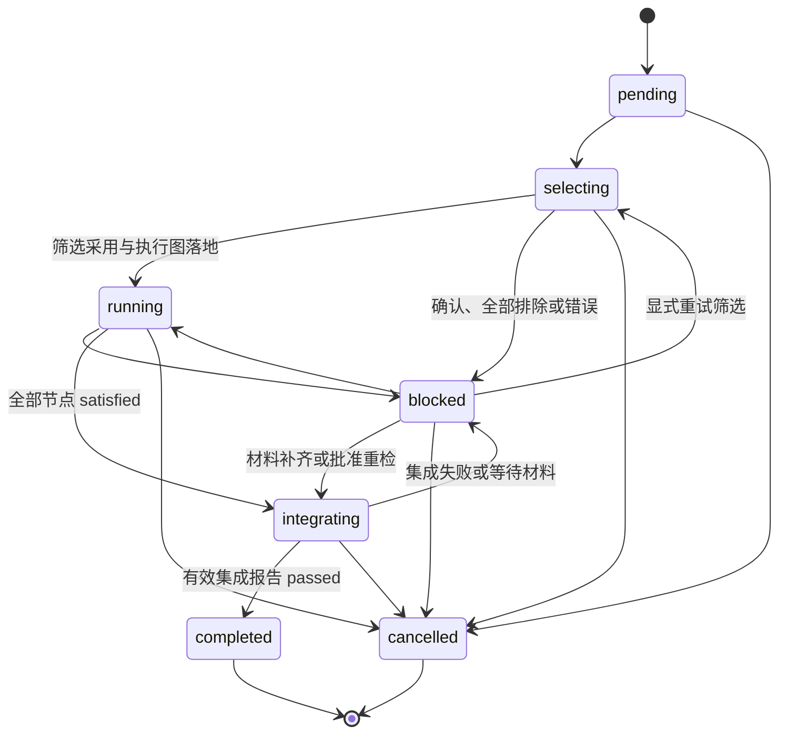
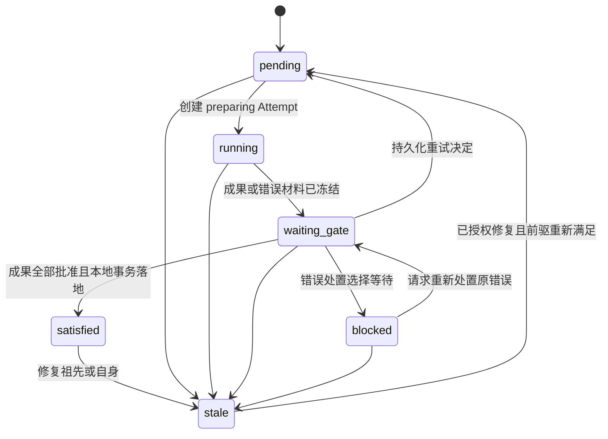
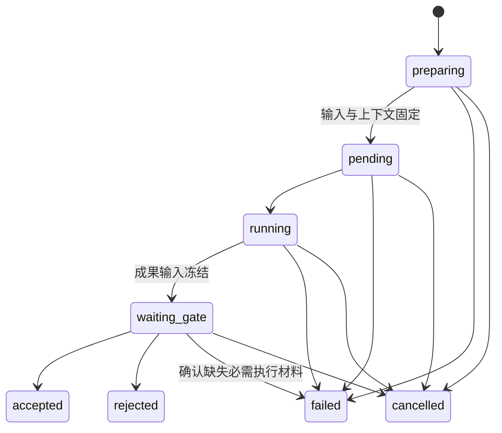
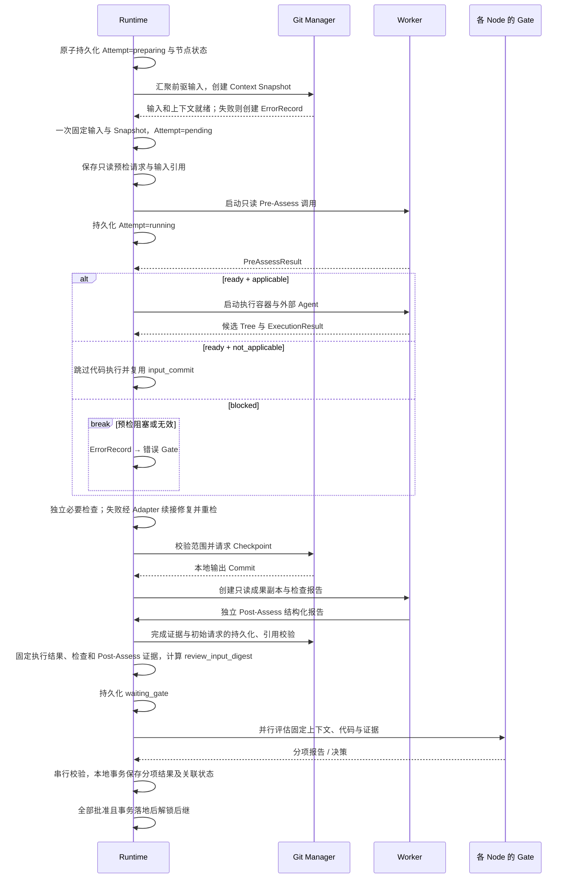

# 运行与执行

本章定义运行对象、输入构造、外部 Agent 调用和成果检查。运行记录先在本地持久化，路径与归档规则见[存储](05-storage-and-delivery.md#文件布局)。

阅读路径：[运行对象](#workflowrun) → [执行时序](#执行时序) → [上下文与输入](#context-snapshot) → [预检、执行与检查](#pre-assess) → [外部 Agent 调用](#podman-manager)。

## WorkflowRun

WorkflowRun 是一次完整 Combination DAG 的执行。`source_commit` 固定 Workflow/Facet、runner、审核配置、引用资料和根代码基线；新需求由独立 `requirement_ref` 固定，不要求预先提交 main。`.facetloom/runs/` 不参与执行输入。每个 clone 独立创建 UUIDv4 `run_id`，同时检查本地和 main 是否已使用该 ID；冲突时重新生成。

本地 `.facetloom/.runtime/runs/<run-id>/` 保存完整运行状态，仅采纳时将精简档案写到 main 的 `.facetloom/runs/<run-id>/`。同一 Run 由创建它的 Runtime 写入，当前设计不支持跨 clone 接管活动 Worker。

WorkflowRun 的必需字段如下：

| 字段 | 必填 | 定义 |
| --- | --- | --- |
| `schema_version` | 是 | WorkflowRun 记录格式版本，当前为 `1`。 |
| `run_id` | 是 | UUIDv4 运行 ID；创建后不变。 |
| `requirement_id` | 是 | 独立需求的 UUIDv4。 |
| `requirement_ref` | 是 | 冻结需求 Markdown 的 ArtifactRef；校验内容摘要及 front matter ID。 |
| `source_commit` | 是 | 同一仓库中定义与根代码基线的不可变 Git Commit。 |
| `replaces_run_id` | 是 | 显式替代的本地未终态 Run；同一 owner_runtime_id，普通运行填 null。按启动流程先停止旧 Run，再创建新 Run；跨 clone 不传递取消控制。 |
| `workflow_id` | 是 | `source_commit` 中使用的 Workflow 稳定 ID。 |
| `workflow_path` | 是 | `source_commit` 中 Workflow 定义的仓库相对路径。 |
| `source_dag_ref`、`source_dag_digest` | 是 | source-dag.yaml 相对路径及文件字节 SHA-256；Run 创建时固定的静态组合图。 |
| `selection` | 是 | 有效 mode、confirmation、runner_id、runner_profile_digest、固定筛选 instruction 与 policy_digest；创建后不变，见[筛选协议](02-selection-and-dag.md#运行前筛选协议)。 |
| `selection_report_ref` | 是 | 当前筛选轮次的 SelectionReport 类型化引用，初始 null；重试时清空，采用后固定。 |
| `selection_adoption` | 是 | 筛选采用记录，初始 null；与执行图同事务设置一次。 |
| `dag_snapshot_ref`、`dag_digest` | 是 | 筛选采用前均为 null；采用时固定为 dag.yaml 及文件字节 SHA-256；之后不改写。 |
| `owner_runtime_id` | 是 | 创建运行的 clone-local Runtime UUIDv4；标识本 Run 唯一调度和记录写入者。 |
| `status` | 是 | WorkflowRun 当前状态。 |
| `error_gate` | 是 | 完整有效错误策略及 `policy_digest`，含模式、完整 evaluator、审核上下文、来源路径和自动恢复上限；启动时固定。 |
| `runners` | 是 | runner_id → `{profile, source_refs, profile_digest}` 的不可变映射，覆盖筛选、执行及 AI 评估所需调用配置。 |
| `merge_engine` | 是 | Runtime 在创建 Run 时固定的 Git 版本、不可变环境引用及有效合并参数；结构见[前驱代码汇聚](#前驱代码汇聚)，Run 内不可切换。 |
| `integration_report_ref` | 是 | 最新 IntegrationReport 类型化引用，初始 null；仅对应当前有效终端成果。修复或重检开始时清空，历史报告保留；completed 后绑定成功报告，不再替换。 |
| `active_error_ref` | 是 | 当前筛选或集成错误的 ErrorRecord 引用，初始 null；节点错误仍由 CombinationRun 保存。 |
| `error_report_ref`、`error_decision_ref` | 是 | 当前 Run 级错误的最新报告与决定，初始 null；处置结束或失效时连同 active_error_ref 清空，历史文件保留。 |
| `auto_recoveries_used` | 是 | 已安排的自动恢复动作次数，初始 0；与动作意图在同一事务递增，重启不重置。 |
| `status_reason` | 条件 | `blocked` 或 `cancelled` 时的原因；结构见[状态原因](04-review-and-recovery.md#状态原因)。 |
| `delivery_abandonment` | 否 | 人类放弃未交付成果时记录 confirmed_by、非空 reason 和 confirmed_at；存在时不可交付。 |
| `created_at`, `updated_at` | 是 | 创建及最近状态更新时间，使用 UTC ISO 8601。 |

固定策略片段（其余字段按上表填写）：

```yaml
selection:
  mode: global
  confirmation: automatic
  runner_id: developer
  runner_profile_digest: sha256:<profile-digest>
  instruction: <完整固定筛选指令>
  policy_digest: sha256:<selection-policy-digest>
error_gate:
  policy:
    mode: human
    evaluator: null
    context: {objectives: [], constraints: [], reference_paths: []}
    source_paths: [.facetloom/workflows/development.yaml]
    max_auto_recoveries: 3
  policy_digest: sha256:<error-policy-digest>
merge_engine:
  git_version: "2.43.0"
  environment_ref: <immutable-environment-ref>
  environment_digest: sha256:<digest>
  strategy: ort
  options: {conflict_style: merge, renames: true, rename_threshold: 50, rename_limit: 0, diff_algorithm: histogram}
```

runners 的每个 profile 保存[runner 文件](01-definition.md#外部-agent-调用配置)的完整字段；source_refs 使用 [git_file 引用](05-storage-and-delivery.md#证据引用)固定 runner 及原生配置文件。上述错误 policy 使用与 [Snapshot 成果策略](#context-snapshot)相同的规范化摘要规则。

启动流程：

1. 校验人类确认的冻结绑定；“冻结并启动”先按起草协议确认当前摘要并完成冻结。检查 UUID 未被采纳，再读取本地 main 完整 OID 为 source_commit，无需 remote 或先 fetch。
2. 按 [定义保存与生效边界](06-interaction.md#保存与生效边界) 检查工作区和索引中的定义及引用资料，无未提交改动后，只从 source_commit 校验 Workflow、Facet、selection、必要检查、非空 integration.checks、执行与筛选 runner、成果及错误 Gate、评估器和资料。拒绝用运行档案作定义输入，也不能将工作区预览直接作为 Run 的图。
3. 生成并校验 source-dag。若显式替代本地未终态 Run，先在旧 Run 锁下持久化替代操作 ID、新 run_id、调度撤销与停止意图，释放锁后再创建新 Run；旧 Run 已停止而新建失败时，以同一操作 ID 幂等重试，不恢复旧执行。不同时持两个 Run 锁。将新 run.yaml、source-dag.yaml、冻结需求引用及初始状态原子持久化；此时尚无执行图。
4. 再次校验正式输入与采纳历史，进入 selecting 并发起筛选；完整报告按配置自动采用或等待人工确认。采用记录、dag.yaml、摘要与 running 状态同事务落地后才调度节点。启动不写 main；正式输入变化则阻塞，要求固定新基线的新 Run。

输入、`source_dag_ref`、`source_dag_digest`、`selection`、`replaces_run_id`、`runners`、`error_gate`、`merge_engine` 和 `owner_runtime_id` 创建后不变。状态、原因与更新时间通过本地事务推进；不得在原 Run 修改 source_commit 或 requirement_ref。交付基线规则见[输入比较与集成交付](05-storage-and-delivery.md#输入比较与集成交付)。

| 状态 | 定义 |
| --- | --- |
| `pending` | 已创建静态图，尚未开始筛选。 |
| `selecting` | 正在整体筛选或并发预筛选，尚无业务 Attempt。 |
| `running` | 正在调度或执行；Combination 可处于不同状态。 |
| `integrating` | 全部业务节点 satisfied，Runtime 正在汇聚终端成果并执行最终集成检查。 |
| `blocked` | 筛选等待确认、全部排除或失败；或节点、集成阶段等待处置与外部条件。status_reason 区分原因。 |
| `completed` | 执行图中所有业务节点 satisfied，且当前有效 IntegrationReport 为 passed；候选与报告已固定，等待人类确认交付。 |
| `cancelled` | 已停止调度；活动 Attempt 已取消或停止请求已持久化。 |

cancelled 表示停止调度；筛选调用、Worker 与集成检查进程是否实际退出单独展示。交付在途时先按 [main 提交保护](05-storage-and-delivery.md#main-提交保护) 对账 main，再决定是否可取消或放弃。

`completed` 和 `cancelled` 为终态；需要改变已完成运行的输入、成果或重新验证时创建新 WorkflowRun。状态转换如下。



筛选等待人工确认或全部排除时为 blocked，采用后转 running；筛选失败按错误 Gate 重试转 selecting。筛选与采用均不能在已有 selection_adoption 后重做。

集成失败时，即使自动错误 Gate 正在评估，Run 也保持 blocked；决定落地后，retry_integration 转 integrating，repair_combination 转 running。状态原因及集成错误引用区分等待处置与节点等待，不新增 IntegrationRun。

本地事务提交并完整落地后，报告、决策、accepted / satisfied 和恢复动作生效；全部成果 Gate 批准才解锁后继。无需向 main 发布正式审核请求或中间状态。事务失败不暴露半状态，恢复先重放再调度；Git 同步状态不进入运行状态机。

## CombinationRun

CombinationRun 是实际执行图中的一个业务 Combination 在某个 WorkflowRun 中的状态记录，唯一键为 `(run_id, combination_id)`。每个业务节点至多一条，控制节点不创建记录；尚未创建等同 pending。只有全部业务直接前驱 satisfied 时可准备执行；start 视为已满足。



Run 取消时停止活动任务，未满足节点转 cancelled；已经 satisfied 的记录保留历史。任何非 cancelled 状态都可能因 Run 取消而停止推进。

| 字段 | 必填 | 定义 |
| --- | --- | --- |
| schema_version | 是 | 记录格式，当前为 1 |
| run_id、combination_id | 是 | 所属 Run 与 DAG 节点 |
| status | 是 | 当前节点状态 |
| current_attempt_id | 否 | 当前活动或最近决定节点状态的 Attempt |
| accepted_attempt_id | 否 | 当前有效成果，仅 satisfied 时非空 |
| active_error_ref | 否 | 当前待处置或等待条件的 ErrorRecord 类型化引用 |
| error_report_ref、error_decision_ref | 否 | active_error_ref 对应的最新错误报告及决定；错误处理结束或输入失效时一并清空，历史对象保留 |
| status_reason | 条件 | blocked、stale、cancelled 时必填 |
| updated_at | 是 | UTC ISO 8601 |

| 状态 | 含义 |
| --- | --- |
| pending | 等待前驱、调度资源或已批准的新尝试 |
| running | 当前 Attempt 正在准备输入、等待 Worker 或执行 |
| waiting_gate | 等待成果审核，或 active_error_ref 对应的错误处置 |
| satisfied | accepted_attempt_id 的成果有效，可以满足后继 |
| blocked | 错误 Gate 选择 wait，或等待人工接管及外部条件 |
| stale | 因自身或祖先修复失效，不可作为后继输入 |
| cancelled | Run 已取消，不再调度 |

同一 CombinationRun 最多一个活动 Attempt；错误处置期间旧 Attempt 可以已经终态。新 Attempt 不能继承旧批准。no_change 和 not_applicable 必须复用 input_commit，且无未解决冲突；三种 outcome 的代码条件见[执行结论与代码一致性](#执行结论与代码一致性)，均须完成必要检查与全部成果 Gate。

### 状态如何推进

| 事件 | Attempt | CombinationRun / 后继 |
| --- | --- | --- |
| 前驱满足且获得调度资格 | 创建 preparing | running |
| 输入与上下文准备完成 | pending；Worker 启动后 running | running |
| Pre-Assess 返回 `blocked`，或结构化输出/证据导入失败 | failed，冻结可形成的 PreAssessReport、Invocation 与 ErrorRecord | waiting_gate，设置 active_error_ref；后继不解锁 |
| 准备或执行失败 | failed，冻结 ErrorRecord | waiting_gate，设置 active_error_ref；后继不解锁 |
| 成果、检查和证据完整 | waiting_gate，冻结成果输入 | waiting_gate；active_error_ref 为空 |
| 成果 Gate 部分批准 | 保持 waiting_gate | 等待其他项 |
| 成果 Gate 全部批准且本地事务成功 | accepted | satisfied，设置 accepted_attempt_id |
| 任一成果 Gate Rejected | rejected，取消其余评估，创建 ErrorRecord | waiting_gate，转错误处置 |
| 发现必需执行材料缺失，决定补测 | failed，保留已有审核记录，创建 ErrorRecord | waiting_gate，转错误处置；不修改冻结成果 |
| 成果评估器故障或无法判断 | 保持 waiting_gate | 原项人工接管或重评，其他项可继续 |
| 错误 Gate 选择 retry_current 并持久化 | 旧终态不变，之后创建新 Attempt | pending，清空当前错误引用；后继仍等待 |
| Pre-Assess 因固定外部引用暂时不可用而 wait | 旧 Attempt 与 ErrorRecord 保留 | blocked，条件恢复后重新处置原错误 |
| 错误 Gate 选择 repair_upstream 并持久化 | 停止失效范围内活动 Attempt | 目标与全部后继 stale，按依赖重新执行 |
| 错误 Gate 选择 wait / 自身故障或额度耗尽 | 旧终态不变 | blocked，保留错误引用与原因 |
| 输入失效 | 活动 Attempt cancelled；终态保持 | stale，清空 accepted_attempt_id |
| Run 取消 | 活动 Attempt cancelled；与本地决定按 Run 锁串行化，既有终态保持 | 未满足节点 cancelled；撤销活动评估 |

只有 satisfied 满足后继依赖。恢复决定获准不等于接受成果；本地事务落地之前不能执行恢复动作。Run 还有可执行分支、活动 Worker 或自动错误处置时保持 running；没有可继续推进的工作且存在人工或外部等待时为 blocked。

## Attempt

Attempt 是一个 Combination 的一次尝试，涵盖准备、执行与成果审核。attempt_id 为全局唯一 UUIDv4，attempt_number 在 CombinationRun 内从 1 递增；最多创建一个 Worker。Worker 是 Runtime 管理的容器、Worktree 和调用记录，可在检查预算内通过 Adapter 续接外部 Agent 多次修复，不另建 Attempt；一次 Worker 不等于一次进程调用。



accepted、rejected、failed、cancelled 为终态，不因错误处置重新打开。错误报告与决定属于 CombinationRun 的当前错误，不附加到旧 Attempt 的成果审核映射。

| 字段 | 必填 | 定义 |
| --- | --- | --- |
| schema_version、attempt_id | 是 | 格式为 1，ID 为 UUIDv4 |
| run_id、combination_id、attempt_number | 是 | 所属节点与本节点递增序号 |
| recovery_decision_ref | 是 | 触发本次执行的 GateDecision 类型化引用；普通首次执行为 null，恢复及受影响后继重执行时必填；创建后不变 |
| context_snapshot_ref | 条件 | preparing 时可空；准备成功时固定为 contexts/<sha256>.yaml，按字节摘要校验 |
| input_commit | 条件 | 与 context_snapshot_ref 一起设置一次，必须等于 Snapshot.input_commit，随后不可变 |
| agent_input_ref | 条件 | 初始请求形成后设置一次，发送前固定；未形成请求可空 |
| pre_assess_ref | 条件 | Worker 启动后引用不可变 PreAssessReport 的运行目录相对路径；未形成报告时为空 |
| status | 是 | 当前 Attempt 状态 |
| outcome | 条件 | Runtime 按 PreAssessReport 与 Git Tree 判定 changed / no_change / not_applicable；执行失败可空 |
| summary | 条件 | waiting_gate 或终态必填；not_applicable 说明理由 |
| execution_result_ref | 条件 | 外部 Agent 最终有效 ExecutionResult 的 Artifact；not_applicable 或执行未启动时为空 |
| output_refs | 是 | 初始为空；成果 waiting_gate 时恰有一个 role: code 引用，并引用 PreAssessReport、最终 CheckReport、Post-AssessReport，以及存在时的 ExecutionResult 和其他必要证据 |
| review_input_digest | 条件 | 成果 waiting_gate 前固定，算法见[固定审核输入](04-review-and-recovery.md#固定审核输入)；准备失败可空 |
| gate_report_refs、gate_decision_refs | 是 | 成果 gate_id 到最新报告 / 决定引用的映射，初始空 |
| status_reason | 条件 | failed / cancelled 必填 |
| created_at、updated_at | 是 | UTC ISO 8601 |
| started_at、finished_at | 否 | Worker 开始及 Attempt 进入终态的时间 |

| 状态 | 定义 |
| --- | --- |
| preparing | 已记录尝试身份，正在构造输入与上下文 |
| pending | 输入固定，尚未启动 Worker |
| running | Worker 执行及预算内修复重检 |
| waiting_gate | 成果材料冻结，等待各 Node 审核 |
| accepted | 全部成果 Gate 批准且本地事务落地，输出可登记为有效成果 |
| rejected | 成果 Gate 拒绝，旧成果仅作证据 |
| failed | 准备或执行失败，或确认必需执行材料缺失 |
| cancelled | 尝试已停止或失效 |

身份创建后不变。preparing 中已形成的部分清单、输入构造结果及错误证据由本地操作记录和 ErrorRecord 引用；不分次改写半成品 Snapshot。准备失败不伪造 input_commit、Snapshot 或输出 Tree。

进入成果 waiting_gate 时 pre_assess_ref、execution_result_ref、outcome、summary、output_refs、review_input_digest 一并冻结；pre_assess_ref 指向的报告须与 output_refs 的 run_record 路径、摘要一致，非空 execution_result_ref 须等于 output_refs 中相应 Artifact 引用。其引用内容不得追加或替换。审核映射键必须来自 Snapshot 的成果 Gate 列表，目标须匹配同一 Attempt、策略、摘要与输出 Tree。审核期间仅推进状态、时间、状态原因与成果报告/决定引用。

worker_ref 属于本地状态，不写入 Git。新 Attempt 最多创建一个 Worker，无法对账的旧 Worker 先确认停止或隔离，再按错误决定恢复；停止意图、原生会话与进程对账见[停止与恢复](#停止与恢复)。

## Workflow Runtime

| 输入 | 动作 |
| --- | --- |
| 静态 source-dag 与 selection | 调度 global / parallel 筛选，报告汇总与采用后固定执行图，未采用前不创建业务运行对象 |
| 固定执行 DAG、CombinationRun | 调度 pending 且所有直接前驱 satisfied 的节点 |
| 本地 Attempt、Worker 与容器 | 对账、恢复；无法恢复则 failed 并创建 ErrorRecord，不重复启动 |
| main 正式输入、采纳历史与 replaces_run_id | 检测基线变化、阻止重复采纳；显式替代仅停止同 Runtime 的本地 Run |
| Gate 报告与决策 | 成果全部批准后以本地事务接受；拒绝转错误 Gate；恢复动作与额度同事务落地后执行 |
| 节点恢复意图 | 失效前固定旧 Attempt、输入/输出及待完成修复要求；以固定来源构造恢复上下文，重放不重新选取历史成果 |
| 集成与运行完成 | 节点全部满足后调度集成任务；成功报告绑定后才将 Run 置 completed，失败进入集成错误 Gate |

创建 Attempt、变更状态、接收取消和准备交付，先在本地原子持久化。每个 clone 独立限制并发；同一 Run 由创建它的 Runtime 写入。其它 clone 只读同步，或经拥有者受信接口提交人类操作；当前设计不实现活动运行接管和远程实时状态共享。

Runtime 首次使用 clone 时生成 UUIDv4，保存为 `.runtime/identity.yaml` 的 `runtime_id`，后续启动复用。它是运行拥有者标识，不是人类身份或授权凭据。新 clone 生成自己的身份；同一 Git common directory 的 linked Worktree 共用原 clone 的 Runtime、身份与状态目录，不创建第二个调度者。

本地目录及文件职责统一见[文件布局](05-storage-and-delivery.md#文件布局)。identity.yaml 含 `schema_version: 1` 与 `runtime_id`，不进入 Git。

本地文件是未采纳运行的恢复依据，SQLite 不是必需依赖。丢失本地状态后，Git 只恢复已采纳档案，Artifact 字节须从保留库或交换包恢复；不能声称可重建丢失的本地操作或继续原 Worker。回收 Worktree、Worker 或临时日志时不清空 Artifact 库，备份和迁移须将其作为持久数据。

## 执行时序



本地 waiting_gate 事务落地后即可审核，决策及关联状态事务落地后解锁后继。main 暂不可写只影响最终采纳；本地持久化暂不可用则停止相关推进，先恢复事务，不暴露半状态。

## Context Snapshot

路径：`.facetloom/runs/<run-id>/contexts/<sha256>.yaml`。先在本地运行目录构造，仅最终采纳时随精简档案提交 main。文件按字节 SHA-256 命名，输入变化创建新文件与新 Attempt。

```yaml
schema_version: 1
run_id: <run-id>
source_commit: <full-commit-oid>
requirement_id: 9e2c1f78-6a54-4d92-8e31-05b7a19c2f60
requirement_ref:
  type: artifact
  uri: artifacts://sha256/<requirement-digest>
  digest: sha256:<requirement-digest>
  media_type: text/markdown
workflow_id: development
combination_id: development/feature:login/layer:domain
input_commit: <full-commit-oid>
direct_predecessors: []
input_merge_ref: null                 # 多前驱时引用汇聚清单 Artifact
merge_conflicts: []
recovery_context: null               # 普通首次执行无恢复上下文
context:
  objectives: [实现登录失败限制领域规则]
  source_paths:
    - .facetloom/workflows/development.yaml
    - .facetloom/facets/feature/facet.yaml
    - .facetloom/facets/layer/facet.yaml
  constraints: [不依赖具体基础设施实现]
  reference_paths: [docs/authentication.md]
gates:
  - gate_id: feature/login
    policy:
      mode: human
      evaluator: null
      context:
        objectives: []
        constraints: []
        reference_paths: []
      source_paths: [.facetloom/workflows/development.yaml, .facetloom/facets/feature/facet.yaml]
    policy_digest: sha256:<feature-gate-policy-digest>
  - gate_id: layer/domain
    policy:
      mode: ai
      evaluator:
        schema_version: 1
        id: domain-reviewer
        kind: ai
        runner: reviewer
        runner_profile_digest: sha256:<reviewer-runner-digest>
        instruction: 根据审核要求检查固定输出，逐项引用证据，返回结构化结论。
        timeout_seconds: 300
      context:
        objectives: [审核领域模型及业务边界]
        constraints: []
        reference_paths: [.facetloom/references/domain-review.md]
      source_paths: [.facetloom/workflows/development.yaml, .facetloom/facets/layer/facet.yaml, .facetloom/evaluators/domain-reviewer.yaml]
    policy_digest: sha256:<domain-gate-policy-digest>
execution:
  runner_id: developer
  runner_profile_digest: sha256:<developer-runner-digest>
  resources: {cpus: 2, memory_mb: 4096}
  check_environment:
    image_ref: registry.example.com/project-agent@sha256:<image-digest>
    network: disabled
  read_paths: ["**"]
  write_scope:
    all_of:
      - source: feature/login
        paths: [src/auth/**, test/auth/**]
      - source: layer/domain
        paths: [src/**, test/**]
      - source: runtime
        paths: ["**"]
  checks:
    - check_id: workflow/unit
      argv: [pytest, -q]
      timeout_seconds: 900
      source_path: .facetloom/workflows/development.yaml
  max_check_retries: 2
```

| 内容 | 规则 |
| --- | --- |
| 来源文件 | source_paths 和 reference_paths 相对仓库根，由 source_commit 固定；需求另由 requirement_ref 固定；不含运行档案 |
| Node 与 Scope | 按 DAG members 解析；write_scope.all_of 保留每组路径与来源，禁止把交集压平成路径并集 |
| 前驱输入 | direct_predecessors 各项固定 combination_id、attempt_id、output_commit |
| 执行环境 | 引用 Run.runners 中的固定调用配置及摘要，记录独立读写范围、资源限制、检查环境、检查列表与预算；凭据只记录用途 |
| 修复要求 | recovery_context 引用授权决定、上一 Attempt 与必要证据；指令从决定解析，旧代码仅作参考；规则见[恢复上下文与旧成果](04-review-and-recovery.md#恢复上下文与旧成果) |
| Gate 策略 | gates 按 Facet 声明顺序列出每个选中 Node 的 gate_id、完整有效 policy 与 policy_digest；缺项、重复项或来源不匹配时拒绝启动 |

`execution.write_scope.all_of` 按 Facet 顺序保留有 Scope 的 Node，最后一组为 Runtime 写入策略；无 Scope 的 Node 不增加组。某路径只有同时匹配每组 paths 中至少一条规则才允许写入；组内 paths 为空即拒绝全部写入。Scope 不允许写入的定义、资料及运行档案仍由 Runtime 固定规则保护。read_paths 独立生效。

例如上面的范围只允许 `src/auth/**` 和 `test/auth/**`；不能因另一组包含 `src/**` 而放宽到整个 src。Snapshot 保存匹配规则，执行时对实际路径判断，无需枚举未来可能创建的文件。

`policy.context.objectives` 按 Workflow → Node 顺序累积目标，其他约束和资料保留来源。policy.evaluator 保存完整有效审核定义，AI 项再带 runner_profile_digest；执行 runner 和 AI 审核 runner 的摘要都必须与所属 Run.runners 一致。解析时校验 Run、profile 及固定 Git 来源；保存 Snapshot / Attempt 时必须保留所属 Run 和 DAG，不允许清理其固定配置来源。

runner 包含镜像、原生参数与配置，FacetLoom 不重建外部 Agent 的模型或工具系统。本地仅提供凭据、连接和资源上限；无法满足执行配置进入错误 Gate，评估器故障人工接管。check_environment 与 Agent 调用分开，默认使用执行 runner 的镜像并禁网；需要网络等额外检查环境时必须显式固定在 Workflow.execution.check_environment，不根据 Agent 的联网配置自动放宽检查。

`policy_digest` 对 policy 按 RFC 8785（JCS）规范化后的 UTF-8 JSON 字节求 SHA-256；仅允许该规范支持的 JSON 值。Decision / GateReport 的 gate_policy_digest 必须等于对应项摘要。Snapshot 文件名仍对完整 YAML 文件字节求摘要。任务输入变化需要新 Snapshot 与新 Attempt；Workflow、Node 或评估器定义变化需要新 Run。

## 前驱代码汇聚

根节点复用 source_commit；直接前驱取筛选后已采用的 DAG 快照中每个节点的当前有效输出。只有前驱全部 satisfied 才开始准备。

```text
有效前驱及来源映射
    ↓ 按 Combination ID 排序
Commit 去重 → 去掉被其他输入包含的祖先 Commit
    ↓
累积输入 M + 下一个前驱 H
    ↓ 从真实历史计算共同祖先，执行三方合并
候选 Tree + 冲突清单 → 保留 M、H 为父提交的临时 Commit
    ↓ 重复至全部前驱合并
固定 input_commit → Agent 解决全部冲突 → 执行与检查
```

### 确定性算法

1. 保存所有前驱的 combination_id、attempt_id、output_commit。相同 OID 只参与一次计算，以字典序最小 Combination ID 作为排序键；祖先判定使用 Git 提交图，不比较 Tree。去重和祖先消除不能删除来源映射。
2. 只有一个独立输入时直接复用，不创建空汇聚提交；多个输入按上述键升序折叠。
3. 每一步使用 `git merge-tree --write-tree M H` 的 ort 三方合并。共同祖先由 Git 在双方真实历史中计算；多个最佳共同祖先由固定版本 Git 合成虚拟基线，不任意挑一个，不固定使用 source_commit。不允许无共同历史合并。
4. 每步返回的候选 Tree 写成父提交为 `[M, H]` 的临时 Commit，供下一步计算祖先。临时提交的作者与提交者固定为 `FacetLoom <runtime@facetloom.local>`，时间固定为 `2000-01-01T00:00:00Z`，消息为 `facetloom input merge <step>`（末尾一个 LF，step 从 1 递增），保持同一输入 OID 集合的中间 OID 与冲突标签稳定；最终 input_commit 保留整个父链。
5. Git 工具环境使用 run.yaml.merge_engine 的不可变环境，默认 Git 2.43.0、ort、conflict_style=merge、renames=true、rename_threshold=50%、rename_limit=0（不限制）、diff_algorithm=histogram。隔离用户/系统 Git 配置，禁用 rerere、外部合并驱动、过滤器和换行转换，不允许本地属性覆盖；仓库属性来自固定输入。完整有效参数进入清单，Run 内不切换环境。
6. 退出码 0 为干净结果，1 为有冲突的候选结果，其他值为输入准备错误。缺失对象或共同历史、工具故障及不支持的合并能力进入错误 Gate。

相同输入 OID、顺序和工具环境必须生成相同候选 Tree 与冲突清单。正式输入和 Checkpoint Commit 的时间等元数据不要求跨次 OID 相同。最终多个终端成果的集成汇聚使用相同算法；若有未解决冲突，保存 blocked IntegrationReport 和集成 ErrorRecord，由错误 Gate 在原 Run 内安排节点修复。

### 冲突与输入清单

每步冲突都累积保留，即使后续步骤对同一路径未报冲突，也不能自动删除旧冲突。文本候选保留 Git 冲突标记；二进制、重命名、删改及文件/目录冲突保留 Git 候选 Tree，并在清单列出所有涉及路径、类型、步骤、两侧提交、共同祖先以及各 stage 的 Blob OID / 模式，删除的一侧为 null。清单和需要的 Git 对象随 bundle 持久保存，不能只保留屏幕日志。

~~~yaml
schema_version: 1
kind: input_merge
predecessors: []              # 全部来源，包括去重或被包含的输入
independent_heads: []         # 实际参与计算的有序 Commit
engine: <run.yaml.merge_engine 的完整有效配置>
steps: []                     # M、H、最佳共同祖先、候选 Tree、中间 Commit、冲突
input_commit: <commit-oid>
conflicts: []                 # 各步冲突并集；每项含确定性 conflict_id，不自动标记已解决
~~~

清单作为不可变 Artifact，通过 Context Snapshot.input_merge_ref 引用。每个冲突项的 conflict_id 为 `sha256:` 加该项按 RFC 8785 规范化 JSON 的摘要，摘要输入为 step、排序后的路径及各路径冲突类型。Agent 必须逐项给出解决结果与证据，Runtime 校验 conflict_id 集合完整且不重复、路径范围、Git 对象完整性以及无未合并 index 项；不能只用搜索文本标记判断二进制冲突是否解决。任一冲突 unresolved 时不进入成果 Gate，保留实际材料进入错误 Gate。

汇聚 Agent 负责正常的代码集成冲突。冲突路径超出有效写入范围时在准备阶段报 permission_denied，不启动有越界权限的 Worker。Agent 判断问题来自前驱已批准行为与需求不对齐时，报 upstream_misaligned，引用具体前驱和证据，由错误 Gate 决定是否修复上游；不得静默更改上游责任。

## Pre-Assess

筛选采用后，每个保留节点的 Attempt 仍先由 Adapter 使用固定 runner 发起独立只读调用与新原生会话。输入为 Context Snapshot、Requirement、选中 Node 上下文及已接受前驱证据；不挂载可写 Worktree、Git 凭据、Git 元数据或 Podman Socket。Adapter 必须在 `probe` 时确认原生结构化输出能力，不从自然语言推测字段。

~~~json
{
  "schema_version": 1,
  "readiness": "ready",
  "applicability": "applicable",
  "summary": "输入足以实现并验证锁定期限行为。",
  "missing_inputs": [],
  "risk_findings": [],
  "evidence_refs": [],
  "evidence_files": []
}
~~~

| 字段 | 规则 |
| --- | --- |
| readiness | `ready` 或 `blocked` |
| applicability | `ready` 时必填 `applicable` 或 `not_applicable`；`blocked` 时必须为 null |
| summary | 非空说明 |
| missing_inputs | `blocked` 时至少一项，`ready` 时为空；每项含说明、可选的 Snapshot `source_refs` 和支撑说明的 evidence_refs |
| risk_findings | 风险说明及 evidence_refs；只传入成果 Gate，不动态新增 Gate，不阻塞执行 |
| evidence_refs | Agent 原始输出只能引用本次输入明确提供的类型化证据；规范化 Report 保存校验后的引用。not_applicable 至少一项 |
| evidence_files | Agent 原始输出中的新证据相对路径列表，按[证据协议](#agent-输出证据协议)导入；不进入 PreAssessReport |

`ready + applicable` 才启动代码执行。`ready + not_applicable` 跳过代码执行并复用 input_commit，但仍执行必要检查、Post-Assess 和所有成果 Gate；若 input_merge 清单含未解决冲突，则不能据此跳过冲突处理，转错误 Gate。有效 `blocked` 报告创建 stage=`pre_assess`、code=`pre_assess_blocked` 的 ErrorRecord，不启动执行；Runtime 保留报告供恢复决策。只有报告在 `missing_inputs[].source_refs` 明确列出 Snapshot 中的固定引用，且 Runtime 验证它当前仅因可恢复的外部可用性故障暂不可读时，才记录 `wait_condition` 并允许错误 Gate 选择 wait。需求内容本身不足、引用不存在、摘要不匹配、输出结构无效或 Applicability 不明确都不能 wait；修改需求需创建新 Requirement；仅执行定义变化时提交定义并创建新 Run。风险发现是固定成果审核输入的一部分，不临时扩充策略。

PreAssessReport 保存在 `.facetloom/runs/<run-id>/reports/<report-id>.yaml`，`report_type: pre_assess`，内容不可变。报告包含 schema_version、report_id、run_id、combination_id、attempt_id、invocation_ref、readiness、applicability、summary、missing_inputs、risk_findings、evidence_refs、created_at。invocation_ref 是不含报告自身的不可变 Invocation 证据 Artifact。有效报告通过 Attempt.pre_assess_ref 引用；blocked 时 ErrorRecord.evidence_refs 引用报告。预检未形成有效报告时，ErrorRecord 引用可用的调用输入、原生输出与故障证据，不伪造报告。输入不足不伪造成 ExecutionResult 或 CheckReport。

## 外部执行结果

每次执行或修复调用都要求 Adapter 从 Agent 原生结构化输出解析 `ExecutionResult`。运行时要求的结构化输出能力由 Adapter `probe` 确认；缺失、格式错误、字段越界或证据引用无效均为执行故障，进入错误 Gate，不从自然语言猜测结论。

~~~json
{
  "schema_version": 1,
  "summary": "实现锁定期限校验与剩余时间返回。",
  "evidence_refs": [],
  "evidence_files": [],
  "conflict_resolutions": []
}
~~~

| 字段 | 规则 |
| --- | --- |
| schema_version | 必须为 1 |
| summary | 非空简述 |
| evidence_refs | Agent 原始输出只能引用本次输入明确提供的类型化证据；规范化 ExecutionResult 保存校验后的引用 |
| evidence_files | Agent 原始输出中的新证据相对路径列表，按[证据协议](#agent-输出证据协议)导入；不进入 ExecutionResult |
| conflict_resolutions | 无输入冲突时为空；有冲突时必须逐项覆盖输入清单中的每个 conflict_id，记录 `resolved` 和 evidence_refs；resolved=false 时转错误 Gate |

`ExecutionResult` 不声明是否适用或是否有代码变化。Runtime 比较最终输出与 input_commit 的 Git Tree，结合 PreAssessReport、Scope 和冲突清单决定 outcome：适用且有改动为 `changed`；适用且无改动为 `no_change`；预检不适用且无改动为 `not_applicable`。修复调用必须返回完整新 `ExecutionResult`；Runtime 只采用最终候选对应的结果，旧结果保留为 Invocation 历史。不适用 Attempt 不产生 ExecutionResult，其 Post-AssessReport 将 execution_result_ref 设为 null 并引用 PreAssessReport。

## 必要检查与同次修复

三类检查分别回答不同问题：

| 检查 | 执行与记录 | 对接受或交付的作用 |
| --- | --- | --- |
| 节点必要检查 | Runtime 检查当前候选，写入 CheckReport | 必须完整执行；失败证据可由成果 Gate 按当前节点职责判断 |
| Gate 审核检查 | 评估器检查固定成果，写入 GateReport | 支持本项审核决定，不补写或替换 Attempt 的冻结材料 |
| 最终集成检查 | Runtime 检查完整交付候选，写入 IntegrationReport | 非空 integration.checks 必须全部通过，才允许请求人类交付确认 |

“必要”指必须执行并形成完整证据，不表示每项失败都自动拒绝节点成果。成果接受规则见 [成果 Gate](04-review-and-recovery.md#gate-模式与职责)；检查事实与审核决定分别保留。

Runtime 从 Workflow 和选中 Node 累积必要检查，将限定 ID、argv、超时、来源、环境和 max_check_retries 固定到 Snapshot。检查程序由 Runtime 在独立候选副本中运行，不依赖外部 Agent 自己执行或汇报。检查由 Runtime 调度并记录真实退出结果，Worker 自报通过不能替代检查记录。命令配置来自 source_commit；受信检查入口脚本从该 Commit 提供，不能被候选代码替换。被检查的实现和测试内容来自本轮候选 Tree。

```text
Agent 执行 / 解决冲突
    ↓ 固定本轮候选 Tree
全部必要检查
    ├── 全部通过 → 最终 Checkpoint → 独立只读 Post-Assess → 冻结成果材料
    ├── 检查失败、任务适用且还有额度 → 同一 Worker 修复 → 全量重检
    ├── 检查失败且任务不适用 → 保留失败报告 → Post-Assess → 成果 Gate
    ├── 额度耗尽且证据完整 → 最终 Checkpoint → 独立只读 Post-Assess → 成果 Gate
    └── 无法执行或必要证据未形成 / 不可恢复 → ErrorRecord → 错误 Gate
```

仅当前 clone 缺少已形成证据的副本时，暂停依赖该材料的操作并补齐原引用内容；不伪造失败结果，也不重新生成冻结证据。

- 默认先检查一次，失败后最多修复并重检 2 次；max_check_retries=0 时首轮之后直接提交完整结果。
- 每轮按有效列表顺序执行全部检查，不因测试失败跳过其余项；命令无法启动等执行错误可中止该轮，其余项记 not_run。每项记录 check_id、round（从 1 开始）、evaluated_tree、passed / failed、退出码或 timeout、证据引用及使用环境。
- 检查在该候选 Tree 的隔离副本运行，可写临时产物；不能把测试生成或修改的受跟踪文件带回成果。任何 Agent 代码修改都会使已有检查结果对新 Tree 失效，需要全量重检。
- 已启动命令的非零退出或超时属于 failed 证据。命令无法启动、环境不可用或结果证据丢失属于执行错误，不用虚假 failed 结果补齐列表。
- 任务适用且检查失败时，Adapter 续接执行会话反馈，外部 Agent 自行修复；每次续接先返回新的 ExecutionResult。无法安全续接则报错转错误 Gate，不在 Runtime 内实现模型/工具循环。不适用时没有执行会话，不启动修复；检查结果完整即交成果 Gate。修复轮次用尽后只允许对最终已检查 Tree 生成正式 Checkpoint；代码再变化必须新 Attempt。零项检查记录空清单，不能虚称有测试通过。
- 每轮日志保存在 Artifact；精简档案保留最终 Tree、有效检查结论、修复次数及各轮证据引用。最终 Checkpoint Tree 必须等于最后一轮 evaluated_tree。

检查修复预算只约束当前 Worker；错误 Gate 创建新 Attempt 或安排上游修复使用独立的 Run 级自动恢复额度。最终交付条件见 [IntegrationReport](05-storage-and-delivery.md#integrationreport)。

### Post-Assess

Post-Assess 由 Adapter 使用同一固定 runner 发起独立调用和新原生会话。输入是最终 Checkpoint、对应 CheckReport、PreAssessReport、可选 ExecutionResult 与只读审核任务；不适用 Attempt 没有 ExecutionResult。容器将成果和报告只读挂载，另提供隔离的可写临时目录，不挂载 Git 写入凭据、Git 元数据或 Podman Socket。Runtime 核验候选 Tree 未变化；尝试写入只读成果、退出失败、超时或返回无效结构均为错误 Gate。容器和 Invocation 与执行阶段分别记录，但计入同一 Worker 的 deadline；不创建第二个 Worker。

~~~json
{
  "schema_version": 1,
  "status": "complete",
  "summary": "代码变更满足任务范围，检查报告覆盖最终 Tree。",
  "findings": [],
  "evidence_refs": [],
  "evidence_files": []
}
~~~

`status` 为 `complete` 或 `concerns`。`concerns` 必须带非空 findings；两种状态都须有非空 summary。Agent 原始输出的 `evidence_refs` 只能引用本次输入明确提供的证据，`evidence_files` 按统一协议导入；规范化 Post-AssessReport 仅保存类型化 `evidence_refs`。报告按 Attempt 的 output_refs 固定为执行证据。`concerns` 不自动判失败，由成果 Gate 审核；只读调用试图改成果、退出失败、超时或返回无效结构均使 Post-Assess 失败，形成 ErrorRecord 并进入错误 Gate。不得重新运行自检来覆盖此前报告。

Post-AssessReport 保存在 `.facetloom/runs/<run-id>/reports/<report-id>.yaml`，`report_type: post_assess`，内容不可变。必需字段为 schema_version、report_id、run_id、combination_id、attempt_id、evaluated_tree、pre_assess_ref、check_report_ref、execution_result_ref、invocation_ref、status、summary、findings、evidence_refs、created_at。invocation_ref 是不含报告自身的不可变调用证据 Artifact；execution_result_ref 在 not_applicable 时为 null，其它 outcome 必须引用有效结果。本地保存前校验报告 Tree 等于最终 Checkpoint Tree、输入引用均可读取且匹配摘要；报告自身作为 role=evidence 的 run_record 加入 Attempt.output_refs。

### CheckReport

路径：`.facetloom/runs/<run-id>/reports/<report-id>.yaml`。这是 Runtime 的检查执行记录，不是 GateReport。每个 Attempt 结束检查或因检查报错时固定一份，后续不覆盖；轮次中的实时进度只存本地。

| 字段 | 定义 |
| --- | --- |
| schema_version、report_type、report_id | 格式为 1，report_type=checks，UUIDv4 |
| run_id、combination_id、attempt_id | 所属尝试 |
| context_snapshot_ref | 包含完整有效检查清单和环境的 Snapshot |
| max_check_retries、repairs_used | 固定预算与已使用修复次数 |
| rounds | 按 round 升序记录候选 Tree 与各项执行结果 |
| status | passed / failed / error；error 表示无法形成完整的节点最后一轮检查结论 |
| final_round | passed / failed 时必填，指向完整最终轮次；error 时 null |
| reason、created_at | failed / error 的原因，以及 UTC 时间 |

~~~yaml
schema_version: 1
report_type: checks
report_id: <uuid>
run_id: <run-id>
combination_id: development/feature:login/layer:domain
attempt_id: <attempt-id>
context_snapshot_ref: contexts/<sha256>.yaml
max_check_retries: 2
repairs_used: 0
status: passed
final_round: 1
rounds:
  - round: 1
    evaluated_tree: <full-tree-oid>
    results:
      - check_id: workflow/unit
        status: passed
        exit_code: 0
        timed_out: false
        evidence_refs: []
created_at: "2026-11-09T12:00:00Z"
~~~

每轮 results 按 Snapshot 清单逐项对应，状态为 passed / failed / error / not_run。passed 要求命令真实启动、正常退出且 exit_code=0；超时为 failed、timed_out=true；无法启动为 error，之后未执行项为 not_run。没有真实退出码时 exit_code=null，日志经 evidence_refs 引用。

仅最终轮次完整、每项均为 passed / failed 时可填写 final_round；全部 passed 则报告 passed，否则为 failed。error / not_run 不能算作已经完成的必要检查。零项检查记录 results=[]，报告 passed 只表示没有待完成的配置检查，不声称执行过测试。

成果 output_refs 必须有 role=evidence 的 run_record 引用指向该 CheckReport；final_round 的 evaluated_tree 必须等于代码输出 Tree，且 repairs_used 不超过预算。任务适用且检查失败、仍有修复额度时继续修复；不适用且检查完整时不修复，保留失败结果交成果 Gate。检查错误时把报告引用写入 ErrorRecord.evidence_refs，不能把 error 报告包装成完整成果。

## 实际初始输入

Context Snapshot 是有效输入清单；Adapter 实际交给外部 Agent 的初始任务、启动参数、工作目录、配置摘要及附件清单作为 Artifact 留存；工具声明仅在调用协议实际提供时记录。附件内容内联或使用可恢复的不可变引用，不能只记录临时路径。动态工具结果与后续对话按日志规则保存，不要求写入初始输入 Artifact。

| 引用 | 所属记录 | 保存时机 |
| --- | --- | --- |
| agent_input_ref | Attempt | 首次 Pre-Assess 调用前保存实际初始请求；waiting_gate 前验证持久可读 |
| request_input_ref | GateReport | 调用自动评估器前保存实际初始请求；保存报告前验证持久可读 |

```yaml
agent_input_ref:
  type: artifact
  uri: artifacts://sha256/<input-file-bytes-digest-hex>
  digest: sha256:<input-file-bytes-digest-hex>
  media_type: application/json
```

Adapter 先将实际输入原子保存到本地 Artifact 库并计算摘要，再传入同一内容，不能事后根据定义重新生成来代替原请求。引用在请求形成时固定，后续导出或导入不改变它，也不改写 Attempt 输入。调用是否送达未知时按本地调用记录对账，不能声称请求一定送达或自动重复发送。

留存内容只覆盖 FacetLoom 交给外部 Agent 的输入；它不等于 Agent 发给模型服务的完整请求。凭据由运行环境或连接层注入，不进入留存内容。不记录无法观测的原生系统提示、模型内部状态或内部压缩结果；Agent 未报告的模型及工具版本记 null，不宣称已固定。Gate 请求不包含自身 request_input_ref，避免自引用。

每次启动或续接都分配独立 invocation_id，先保存输入再调用。同次修复反馈携带实际检查结果与请求引用；不能用 agent_input_ref 代表后续全部对话。完整调用清单作为不可变 Artifact，至少记录 runner/profile 摘要、镜像 digest、Adapter 与程序版本、原生 session_id（可空）、各次输入引用、实际 argv（脱敏）、事件/结果日志和退出状态。

成果冻结前将调用清单加入 output_refs 的 evidence；执行失败加入 ErrorRecord 证据；Gate 使用 GateReport.evidence_refs；Refinement 保存于本地会话及其提交依据。它们不记录原生隐藏推理，也不把原生 exit_code=0 当作检查或审核通过。调用清单不得引用包含它的对象，避免循环摘要。

## Checkpoint 与代码保留

```text
source_commit
    ├── detached Worktree A → output A
    └── detached Worktree B → output B
                                  ↓
                         汇聚 input_commit
                                  ↓
                        Worker → output_commit
```

Git Manager 为有代码变化的 Attempt 创建一个输出 Commit，以 input_commit 为唯一父提交；无修改沿用输入 Commit，不创建空 Commit。Post-Assess 必须基于该固定输出，不能在生成 Checkpoint 后继续改代码；进入 waiting_gate 前只登记最终 Checkpoint，较早的中间本地快照不作为正式输出。修改范围由 Runtime 校验，Worker 不能修改固定定义、任何 Requirement 文件或 `.facetloom/runs/`；采纳时由 Git Manager 写入冻结需求。资料和定义的改善由人类发布或 Refinement 完成。

| Checkpoint 字段 | 定义 |
| --- | --- |
| schema_version、checkpoint_id | 格式为 1，ID 为 UUIDv4 |
| run_id、combination_id、attempt_id | 所属对象 |
| input_commit、output_commit、output_tree | 代码输入与结果 |
| changed_paths | 仓库相对路径列表 |
| recovery_bundle_ref | 输出仅在本地存在时必填；main 历史已保留或已有持久 bundle 时可引用既有恢复来源 |
| created_at | UTC ISO 8601 |

本地使用 `.runtime/worktrees/` 下的 detached Worktree 锚定仍需恢复的输入与输出 Commit；中间对象在有后继锚定或 bundle 验证通过前不移除 Worktree。无需 Run、Input 或 Checkpoint 命名分支。

跨 clone 或长期引用、且未由 main 历史保留的代码输出，必须先导出自包含 Git bundle，覆盖复核所需的输入、输出、父提交与 Tree，再保存到本地 Artifact 库。用空临时仓库验证 bundle 可导入且包含所需对象，校验摘要后才保存引用。跨 clone 传递时将该文件收入 Artifact 交换包；接收方校验后才能从中恢复对象。日志中的裸 OID 不作为持久化保证。没有代码变化也需保证 input_commit 来自 main 可达历史或已有有效 bundle。

## Agent 输出证据协议

筛选、Pre-Assess、执行/修复、Post-Assess、AI Gate 与 Refinement 的外部 Agent 使用同一证据输出协议。每次 Invocation 获得一个全新的专用可写目录 `evidence-out/`，在容器内固定挂载为 `/facetloom/evidence-out`；它只用于提交本次调用生成的证据，不是项目工作目录。调用输入明确指示 Agent 将新文件写入该目录，并在结构化输出的 `evidence_files` 中给出相对路径。已有证据仍通过 `evidence_refs` 引用，但每个引用必须与本次 Invocation 输入中的引用完全一致；不得自行构造 URI 或引用未提供的 Artifact。

Adapter 逐个验证并导入文件到不可变 Artifact Store，之后把 Agent 引用与新生成的类型化 Artifact 引用合并到规范化结果的 `evidence_refs`。Agent 引用必须是本次输入白名单中的引用且不得重复；规范化结果按 Agent 引用的原有次序保留，再按 `evidence_files` 声明次序追加导入引用。导入引用包含 URI、内容摘要和媒体类型；Invocation 记录提交路径、摘要及导入结果。`evidence_files` 只存在于 Agent 原始输出，不写入正式 Report、GateReport 或 Decision。

Invocation 的导入回执保留 Agent 路径到不可变 Artifact 的映射：

```yaml
evidence_imports:
  - submitted_path: pre-assess/input-check.json
    status: committed
    byte_length: 821
    digest: sha256:<file-digest>
    media_type: application/json
    artifact_ref:
      type: artifact
      uri: artifacts://sha256/<file-digest-hex>
      digest: sha256:<file-digest-hex>
```

`status` 为 `committed` / `rejected` / `not_imported`；仅 `committed` 项有 `artifact_ref`。只有整批导入清单提交成功后才能将项目标为 committed。批次失败时记录错误路径及原因，其余未导入项目不产生 Artifact 引用。

```json
{
  "evidence_refs": [
    {"type": "artifact", "uri": "artifacts://sha256/<hex>", "digest": "sha256:<hex>"}
  ],
  "evidence_files": ["pre-assess/input-check.json", "screenshots/login.png"]
}
```

导入器只接受专用目录内的普通文件；调用结束并确认容器退出后冻结目录，再拒绝绝对路径、`.` / `..` 路径段、非规范相对路径、反斜线、任一层级的符号链接、硬链接、重复路径、目录及其它非普通文件。每次调用最多 100 个文件，单文件最多 10 MiB，合计最多 100 MiB。Adapter 先把全部文件暂存并验证摘要，再一次性发布导入清单；任一文件校验、读取或持久化失败时，整份结构化结果无效，不发布部分 Report 或 `evidence_refs`。未引用的暂存 Artifact 不作为运行证据，可在确认无引用后清理。

Agent 可以省略 `evidence_files`，视为空列表。无效路径、超限、重复/未提供的引用或证据导入失败均使该调用无效。筛选故障按 selection 范围进入 Workflow 错误 Gate；Worker 的 Pre-Assess、执行与 Post-Assess 故障按节点范围进入错误 Gate；AI Gate 以 `GateReport.status: error` 交人类接管，不递归调用错误 Gate；Refinement 保留失败会话供人处理。Adapter 不猜测、改写或补造证据。Script Gate 继续直接返回已校验的类型化 `evidence_refs`，不使用文件导入协议。

## 执行结论与代码一致性

| outcome | 代码条件 | 额外条件 |
| --- | --- | --- |
| changed | 输出 Tree 不同于 input_commit 的 Tree | 全部变更满足有效写入范围，冲突已逐项解决 |
| no_change | 输出 Commit 直接复用 input_commit | 任务适用，已有输入满足目标，无需修改 |
| not_applicable | 输出 Commit 直接复用 input_commit | PreAssessReport 声明不适用，附原因和证据 |

比较包含路径、内容和 Git 文件模式，不能仅比较文件列表。输入仍有未解决冲突时不得以 no_change / not_applicable 绕过解决义务。changed 和 no_change 要求 PreAssessReport.applicability=applicable；not_applicable 要求预检明确不适用且零变更。三种结论都需要最终 CheckReport、只读 Post-Assess 和全部成果 Gate；not_applicable 不删除 DAG 节点或跳过必要检查。

output_refs 在成果 waiting_gate 前可为空；Attempt 处于 waiting_gate 时必须有且仅有一个 role: code 引用。错误 Gate 不要求代码输出，使用独立 ErrorRecord。outcome 为 changed、no_change 或 not_applicable；不适用结论须有可核对的理由，且经过该 Attempt 的全部 Gate。拒绝、失败或取消的输出不能满足后继。

## Podman Manager

镜像在运行前安装对应外部 Agent、项目语言与依赖。Runtime 按 runner.image_ref 的 digest 启动 Rootless Podman；不在 Attempt 内安装、升级 Agent 或修复镜像环境。每个 Worker 使用独立 Worktree、配置与会话目录，执行 main 的 Git 凭据和共享 Git 元数据不以可写方式暴露。

允许 runner.args 使用对应 Agent 支持的免交互、绕过审批及关闭内部沙箱参数。外层 Podman 承担文件挂载、网络、进程与资源边界；Runtime 继续独立校验 Scope、必要检查和 Gate，免审批不等于免审核。Scope 的路径规则与最终 Diff 都要校验，不依赖 Agent 自律执行。

启动前 Adapter 在同一镜像环境中探测程序是否存在、实际版本、原生参数及输入/输出能力。程序缺失、参数不支持或配置无法加载时保存明确错误；不可静默降级为交互模式。模型服务认证或连接错误同样保存实际失败证据。

网络为 disabled / outbound；outbound 供外部 Agent 访问模型服务，并受 Runtime 可实施的网络策略限制。只有明确提供可达本地服务或不需要联网的任务才可使用 disabled；纯脚本及必要检查可独立禁网。拒绝无法满足的配置，不将禁网失败误报为代码测试失败。

成果 AI Gate 在新容器/会话中读取固定候选的只读副本，缓存和临时产物位于独立可写目录；错误 Gate 读取 ErrorRecord 与可用证据。支持证据文件输出的 Agent Invocation 另有新的专用 `evidence-out/` 目录，以只读输入和可写输出挂载给容器；它与项目 Worktree、原始候选和 Artifact Store 隔离。AI Gate 与 Refinement 的外部 Agent 使用同一证据文件导入协议；Script Gate 只返回已校验的类型化证据引用。即使原生 Agent 关闭内部沙箱，也不能写原 Worker 成果或 main。集成任务与精炼验证使用独立候选副本；集成失败由 Workflow 错误 Gate 在原 Run 内安排重检或节点修复。

### Worker、调用与会话

| 对象 | 含义 | 本地位置 |
| --- | --- | --- |
| Worker | 一个 Attempt 的 Worktree 和执行生命周期；可先后持有执行及 Post-Assess 容器 | workers/<attempt-id>.yaml |
| Invocation | 一次外部 CLI 启动或原生协议请求，含 task_kind | invocations/<invocation-id>.yaml |
| Native session | 外部 Agent 自己维护的会话；ID 可为空 | 每次任务独立目录；Invocation 保存引用 |

一个 Attempt 最多创建一个 Worker；同一 Worker 可在预算内发起多个串行 Invocation，不能并行修改同一 Worktree。Pre-Assess 与 Post-Assess 分别使用独立的只读容器和新会话；不创建额外 Worker。只读指项目输入与候选成果，证据输出目录单独可写。只有原生支持并能核实身份时才续接执行/修复会话；续接失败进入错误 Gate，预检和自检不续接执行会话。

~~~yaml
schema_version: 1
worker_id: <attempt-id>
run_id: <run-id>
attempt_id: <attempt-id>
owner_runtime_id: <runtime-id>
runner_id: developer
runner_profile_digest: sha256:<profile-digest>
execution_container_id: <podman-container-id>
pre_assess_container_ids: []
post_assess_container_ids: []
status: running
invocation_ids: [<invocation-id>]
started_at: "2026-11-09T12:00:00Z"
deadline_at: "2026-11-09T12:30:00Z"
stop_requested_at: null
stop_reason: null
stop_grace_seconds: 30
stop_deadline_at: null
stopped_at: null
~~~

Worker 状态为 pending / running / stop_requested / stopped / unknown，独立于 Attempt 状态。进程引用不能只记 PID：同时记录容器 ID、进程启动身份与 invocation_id，避免 PID 复用误停止其他任务。退出状态以原生调用结果与实际容器对账为准。

Invocation 文件使用以下字段；支持证据文件输出的调用将独立目录挂载为 `/facetloom/evidence-out`。筛选、AI Gate、Refinement 和需求起草也共用此记录，不为它们创建业务 Attempt 或 Worker；draft 的 evidence_dir 为 null，evidence_imports 与 evidence_refs 为空列表。

| 字段 | 定义 |
| --- | --- |
| schema_version、invocation_id | 格式为 1，调用 ID 为 UUIDv4 |
| owner、task_kind | owner 为 `{kind: worker/gate/refinement/requirement/selection, id: <所属 ID>}`；task_kind 为 pre_assess / execute / repair / post_assess / evaluate / refine / draft / select |
| runner_id、runner_profile_digest | 所属 Run、精炼会话或起草请求内的固定调用配置 |
| adapter_version、agent_version、image_ref | 实际 Adapter / Agent 版本及镜像 digest；程序尚未探测成功时版本可为 null |
| argv、input_ref、native_output_ref、result_ref | 实际参数、发送前固定的输入 Artifact、原生结构化输出与 Adapter 规范化结果；不含凭据。失败时规范化结果可为空 |
| evidence_dir、evidence_imports、evidence_refs | 每次调用独立的临时输出目录、逐文件导入回执及成功导入的不可变证据引用；目录本身不是持久引用 |
| native_session_id、previous_invocation_id | 原生会话与上一调用；首次或原生不支持时可为 null |
| container_id、process_identity | 本次调用的容器及进程启动身份；启动前可为空 |
| status | pending / running / stop_requested / succeeded / failed / cancelled / unknown；succeeded 只表示原生调用成功退出 |
| started_at、deadline_at、finished_at | UTC ISO 8601；未开始或未结束的相应字段为 null，执行调用不得超出 Worker deadline |
| stop_requested_at、stop_reason、stop_deadline_at | 持久化停止意图、原因与强制终止截止时间；无停止请求时为 null |
| exit_code、event_refs | 实际退出码与可观测事件引用；未形成时为空 |

支持证据文件输出的 Invocation 在调用前创建空的独立 `evidence-out/`，只将该目录挂载到对应容器。容器退出确认后 Adapter 冻结该目录，保存原生输出，校验结构化响应与本次输入提供的证据引用白名单，再按 [证据协议](#agent-输出证据协议)的路径规则、单文件和总量上限暂存、摘要校验并导入文件。全部文件导入成功后才生成 `result_ref` 与规范化 `evidence_refs`；失败时两者均不得作为成功结果发布，Invocation 记录故障，ErrorRecord 可引用原生输出及可用诊断材料。导入中已写入但无有效引用的 Artifact 不构成部分 Report，可在确认没有引用后回收。

续接只能引用同一 Attempt 的 execute / repair 调用、相同固定 runner 的原生会话；Post-Assess 不得复用可写执行容器或会话。恢复时重新核实镜像、程序版本及 Adapter 兼容性，不能静默切换运行方式。

runner.timeout_seconds 从首次 Pre-Assess 调用发出前持久化 started_at / deadline_at 开始计时，覆盖预检、执行、同次修复、检查和只读 Post-Assess；排队、输入准备、Gate 等待和最终采纳不计入。Runtime 重启不重置 deadline。达到总时限为 execution_timeout，停止当前调用或检查并保存实际结果，Attempt failed 后转错误 Gate；单个检查自身先超时仍按 CheckReport 的 failed 处理。每次 Agent 调用还受同一 runner.timeout_seconds 单次限制。筛选、AI Gate 评估、Refinement 与需求起草不属于 Attempt，采用各自调用的时限。

### 停止与恢复

1. 在本地事务保存 stop_requested、停止原因和原任务撤销标记，立即禁止其迟到结果推进状态；取消、同一需求已采纳、上游修复及执行超时使用同一协议。
2. 请求原生调用正常退出，停止 Worker 容器；默认宽限期 30 秒，实际值及停止截止时间随意图持久化，超时强制终止。
3. 确认进程及容器退出后记 stopped，再回收 Worktree、会话与资源额度。查询失败记 unknown，不当作已退出，也不重复启动。
4. 无法停止则保留资源引用，隔离旧任务并转人工对账。隔离须确认旧任务无法再访问新 Worktree 或受信写入接口；仅写一个“已隔离”标记不够。

Runtime 重启先恢复文件事务，再按容器/Invocation 身份对账；已有活跃进程可重新监控，不新启动第二个进程。只有支持原生恢复且能证明原调用已退出时才恢复同一会话；若不能安全恢复，原 Attempt 失败，经错误 Gate 创建新 Attempt。筛选、Gate、精炼和起草调用同样先撤销、再停止，迟到输出不恢复旧任务。

## Agent Adapter

Adapter 是外部程序协议适配层，不实现模型推理、工具循环或上下文压缩。面向 codex、claude_code、opencode、pi_agent 分别处理版本与原生参数，不假设其参数、输出或会话 API 相同。当前设计优先非交互 CLI；每个 Adapter 声明支持的程序版本和能力。

| 操作 / 能力 | 规则 |
| --- | --- |
| probe | 探测版本、参数、任务输入、所需任务的结构化结果及事件能力；draft 校验候选协议，其它 Agent 任务校验包含 `evidence_refs` 与可选 `evidence_files` 的协议；不支持时显式报错 |
| start | 使用固定 runner 启动外部 Agent，传入工作目录、任务及资料；args 不经 Shell 展开 |
| continue | 把检查失败或用户反馈传给原生会话；不支持时进入错误处置，不自己补一个 Agent 循环 |
| recover | 可选；核实已有进程、原生会话及调用状态，不能把 unknown 当作未发送 |
| stop | 按调用身份停止，配合容器退出确认 |

Adapter 先保存每次实际调用输入，再原样传入外部程序；首次 Pre-Assess 输入使用 agent_input_ref，执行与修复等后续调用分别由 Invocation 引用输入，审核输入使用 GateReport.request_input_ref。证据输出由 Agent 通过 `evidence_files` 提交，已有证据使用 `evidence_refs`；导入规则及上限见[Agent 输出证据协议](#agent-输出证据协议)。AI Gate 与 Refinement 也使用该协议，Refinement 会话记录其导入引用，Script Gate 只能引用输入中已有且已校验的类型化证据。模型服务凭据由环境或连接层注入，不进入记录；不挂载宿主机原生配置或跨 Attempt 共享会话。

draft 调用按起草协议解析候选；pre_assess 调用的原生结构化输出解析成 PreAssessReport 内容，execute / repair 解析成 ExecutionResult，post_assess 解析成 Post-AssessReport 内容，均存于 result_ref。AI Gate 输出解析为 result 或 action、rationale、evidence_refs、evidence_files 及条件必填修复字段；Refinement 返回的建议使用相同的证据字段。Adapter 将 `evidence_files` 转为正式 Artifact `evidence_refs` 后才保存规范化结果；持久报告不包含 Agent 临时路径。结构化输出不完整、证据引用越权、导入失败或仅有成功退出码时，调用不能视为成功；Adapter 不发起第二模型调用补写结果，不创建 Decision 或接受成果。

FacetLoom 只承诺保存自己提供的输入和可观测事件；外部 Agent 的内部系统提示、隐藏推理、压缩过程及未暴露的模型/工具信息不在可追溯承诺内。任务执行、AI 评估、精炼与需求起草使用各自隔离的原生会话。接入协议属于设计目标，不表示四种 Adapter 已全部实现。
