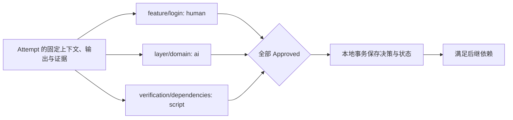
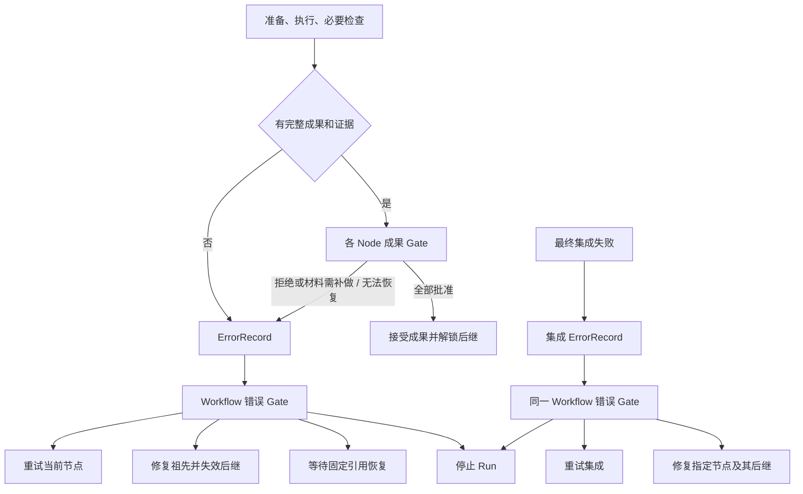

# 审核与恢复

成果 Gate 判断当前组合职责是否满足；错误 Gate 安排恢复，不直接接受代码。最终集成通过后仍须人类确认交付。

## Gate 模式与职责

| gate.mode | 评估方式 | 最终决策者 |
| --- | --- | --- |
| human | 人类直接审阅材料，不自动请求 AI 建议 | 人类 |
| ai_assisted | AI 生成建议，人类确认或作出不同结论 | 人类 |
| ai | AI 独立评审并给出决策 | AI |
| script | 程序按规则评审并返回结构化结果 | 程序 |

以上四种模式同时适用于成果 Gate 和错误 Gate。每个选中 Node 都贡献一项成果 Gate，未声明字段继承 Workflow 默认；解析规则见 [Gate 继承规则](01-definition.md#node-gate-与组合审核)。`gate_id = facet_id/node_id`，在当前 Combination 内唯一。Gate 评估该 Combination 的当前 Attempt；Requirement 不另设 Gate，最终交付保持人类确认。

审核依据是完整 Requirement、当前组合的职责与固定策略。以 `login × domain` 为例，Feature Gate 判断锁定行为是否符合需求，Layer Gate 判断领域规则与依赖边界是否合格；界面提示由后续组合实现，不要求领域组合提前完成。发现当前成果违背需求或无法支持后续工作时仍应指出问题。全部局部 Gate 批准只代表节点成果被接受，整体验收仍须最终集成检查与人类确认。

节点检查的执行与修复流程见 [必要检查与同次修复](03-execution.md#必要检查与同次修复)。进入成果审核后，human、ai_assisted、ai、script 四种模式均可接受包含失败检查的完整成果。作出 Approved 的 GateReport / GateDecision 须在现有 `rationale` 中列明最终 CheckReport 的失败检查 ID，说明失败原因及为何不阻碍当前职责完成和后继执行；不属于本项职责的失败也须说明判断依据。ai_assisted 的建议和人类最终决定分别遵守此要求。

Runtime 校验材料完整性、固定 Tree、引用与输出结构，并要求 rationale 非空；理由是否充分由配置的决策主体负责，不通过关键词推断。批准不会把 CheckReport 的 failed 改成 passed，也不产生额外豁免对象或“允许失败”开关。error / not_run、必要材料未形成或缺失时不能批准；补齐原证据与错误处置遵循下文规则。



各项可并行，相同模式不自动合并。人类可以一次确认多项，但每项分别保存 Decision。Runtime 汇总全部结果，不增加一次额外总审核。Post-Assess 是隔离的只读自检证据，不产生 Gate 决策；AI Gate 使用独立评审会话，不直接沿用执行会话的自我批准。

## 成果 GateReport 与评估协议

路径：`.facetloom/runs/<run-id>/reports/<report-id>.yaml`。GateReport 不可变，schema_version 为 1，report_id 使用 UUIDv4，report_type 为 `gate`。本节为 `review_kind: result`；错误协议见下文。

| 字段 | 定义 |
| --- | --- |
| review_kind | result；与错误处置协议区分 |
| run_id、combination_id、attempt_id、gate_id | 所属执行与审核项 |
| context_snapshot_ref、evaluated_tree、gate_policy_digest | 被评估的固定输入与策略 |
| review_input_digest | 必须匹配 Attempt 的固定审核输入摘要 |
| request_input_ref | 实际初始评估请求的持久 Artifact 引用；仅请求尚未形成即失败时可为 null |
| previous_decision_id | 发起评估时该 Gate 的前一决策，首次为 null |
| evaluator | 评估器 ID、kind；实际外部 Agent 与 Adapter 版本、runner 摘要、原生会话及可观测模型/工具信息另记在此；未知项为 null |
| status | completed 或 error |
| result | completed 时为 Approved、Rejected、Escalated 或 Blocked；error 时为 null |
| rationale、evidence_refs | 非空说明和证据引用列表；error 时说明故障。AI 原始输出的引用只能选自本次请求提供的白名单 |
| evidence_files | 仅 AI 原始输出使用：本次调用生成证据的相对路径；Adapter 导入后只在持久 GateReport 中保存 Artifact `evidence_refs` |
| created_at | UTC ISO 8601 |

Runtime 在调用前分配 report_id，持久化本地任务与实际初始请求；保存报告前将请求保存为持久 Artifact 并校验引用，留存范围见[实际初始输入](03-execution.md#实际初始输入)。请求固定上述身份、上下文、策略、输入/输出 Commit 和冻结的执行证据。审核者可读取 Requirement、任务上下文及自己的审核要求；运行档案只按显式证据引用提供，不作为项目定义输入。

Artifact 的可读性按执行审核的 clone 检查。Git 已同步但本地未持有材料时，先导入匹配原引用的交换包；不把本地缺失当作成果被拒绝，也不能跳过材料直接批准。补齐原内容不改变冻结审核输入；新增执行证据仍须新 Attempt。

脚本通过 stdin 接收 JSON 请求：`schema_version`、`review_kind: result`、`report_id`、`run_id`、`combination_id`、`attempt_id`、`gate_id`、`context_snapshot_ref`、`gate_policy_digest`、`review_input_digest`、`previous_decision_id`、`input_commit`、`output_commit`、`evaluated_tree`、`evidence_refs`，以及已解析的 `context_snapshot` 和完整 `review_input`。review_input 是 Execution 定义的五字段摘要对象，请求中重复出现的字段必须一致。请求中的 evidence_refs 只取固定 output_refs 的执行证据，包括最终 CheckReport，不包含其他 Gate 的报告。引用由 Runtime 提供只读材料供评估器访问。stdout 仅返回一个 JSON 对象，日志写 stderr：

```json
{
  "result": "Approved",
  "rationale": "领域依赖检查通过",
  "evidence_refs": [],
  "evidence_files": []
}
```

外部 Agent 经 Adapter 返回同样的结果结构。其 `evidence_refs` 只能包含评估请求显式提供的证据引用；`evidence_files` 按 [Agent 输出证据协议](03-execution.md#agent-输出证据协议)验证和导入。持久 GateReport 只保存规范化的类型化 `evidence_refs`，不保留 `evidence_files`。原生成功退出但未返回完整有效结构时为 error，不由 Runtime 用另一模型补写决策。`rationale` 必须非空。脚本正常退出且返回有效结果才为 completed；退出非零、超时、无效输出或缺失/越权引用为 error，不能把退出码直接当成拒绝。程序可以正常退出并返回 Rejected。

AI 调用的初始请求与执行回执按 Execution 规则留存，实际后续输入和原生事件通过本项报告证据引用。

`ai_assisted` 的报告只提供建议，不推进状态；人类 Decision 必须引用该报告，可以不同意建议并说明理由。`ai` / `script` 的 completed 报告由 Runtime 转成相同 result 的 Decision；错误报告没有决策主体，不伪造 AI / 程序决策。报告可与 Attempt 的 gate_report_refs 在本地事务中保存；需要协作时显式导出记录快照。

Gate 运行检查产生的报告属于审核输出：检查失败可以返回 Rejected，不能把该报告补入 Attempt 的 output_refs。每项 Gate 都读取固定执行材料，不自动消费其他 Gate 的结果；ai_assisted 的人类可读取本项 AI 建议，人工接管可读取本项故障/升级记录。

## 成果 GateDecision

路径：`.facetloom/runs/<run-id>/decisions/<decision-id>.yaml`。

| 字段 | 必填 | 定义 |
| --- | --- | --- |
| schema_version、decision_id | 是 | 格式为 1；ID 为 UUIDv4 |
| review_kind | 是 | result |
| run_id、combination_id、attempt_id、gate_id | 是 | 被评估对象及审核项 |
| context_snapshot_ref | 是 | contexts/<sha256>.yaml，由文件名校验内容摘要 |
| evaluated_tree、gate_policy_digest | 是 | 固定输出 Tree 与该项有效策略摘要 |
| review_input_digest | 是 | Attempt 的固定审核输入摘要；与报告及评估请求一致 |
| expected_attempt_digest | 是 | Runtime 本次写入前校验的本地持久化 Attempt 文件 SHA-256 |
| previous_decision_id | 是 | 同 Attempt、同 gate_id 的前一决策，首次为 null |
| result | 是 | Approved、Rejected、Escalated 或 Blocked |
| rationale、evidence_refs | 是 | 非空理由与证据引用列表，可无额外证据 |
| report_ref | 条件 | AI 辅助、AI 或脚本决策必填；指向 GateReport 的类型化引用 |
| decided_by | 是 | `{kind: human/ai/script, id: <主体 ID>}`，Runtime 填写 |
| takeover | 条件 | 人工接管自动 Gate 时填写 reason 和 source_refs |
| created_at | 是 | UTC ISO 8601 |

```yaml
schema_version: 1
decision_id: <uuid>
review_kind: result
run_id: <run-id>
combination_id: development/feature:login/layer:domain
attempt_id: <attempt-id>
gate_id: feature/login
context_snapshot_ref: contexts/<sha256>.yaml
evaluated_tree: <full-tree-oid>
review_input_digest: sha256:<review-input-digest>
expected_attempt_digest: sha256:<attempt-file-digest>
previous_decision_id: null
gate_policy_digest: sha256:<gate-policy-digest>
result: Approved
rationale: 锁定与恢复行为均符合需求
evidence_refs: []
decided_by:
  kind: human
  id: user:ling
created_at: "2026-11-09T12:00:00Z"
```

`human` / `ai_assisted` 只接受 human 主体；`ai` / `script` 正常决策主体必须与模式及报告评估器一致。自动模式异常或明确无法判断时暂停该项，允许人类补充决策或请求原模式重评；人工接管需记录原因、原报告或升级决策引用，保留原策略。ai_assisted 建议生成失败时，人类可引用错误报告继续审核并记录原因。评估器故障不自动循环重试。

缺少必要执行证据时返回 Blocked / Escalated。仅本地副本缺失时先导入原内容；Runtime 确认证据从未形成、已不可恢复或需要新增时，才将 Attempt 标记 failed，创建 ErrorRecord 交给错误 Gate。需要补测、重新执行或修改代码时，通过错误处置安排新 Attempt；人工接管不能追加材料绕过冻结规则。单纯解释已有材料写入 Decision 的 rationale。审核者额外要求新增测试时以 Rejected 说明理由，再由错误 Gate 安排新 Attempt，不能把额外要求当成已配置检查缺失。

### 汇总、并发与持久化

Attempt 使用 `gate_decision_refs` 按 gate_id 保存各项最新 Decision；GateReport 用 `gate_report_refs` 记录各项最新报告。未产生决策的项视为待审，不单独建立 GateRun 对象。

| 情况 | Attempt / CombinationRun |
| --- | --- |
| 部分 Approved，其余未完成 | 保持 waiting_gate |
| 全部最新决策为 Approved | accepted / satisfied，本地事务落地才解锁后继 |
| 任一 Rejected | Attempt rejected，取消其余评估；创建 ErrorRecord，CombinationRun waiting_gate 等待错误处置 |
| Escalated、Blocked 或评估 error | 保持 waiting_gate，转交人类处理；其他独立项可继续 |
| 输入失效、取消或已有终态 | 取消该 Attempt 的成果评估，不接收迟到结果；failed / rejected 的错误处置另行校验 |

发起评估、人工确认和人工接管都绑定同一 `(attempt_id, gate_id, review_input_digest, context_snapshot_ref, evaluated_tree, gate_policy_digest, previous_decision_id)`；报告任务还绑定 report_id。同一审核项同时最多一个活动评估任务。接管或明确重评前撤销旧任务，本地持久化撤销信息；迟到报告不进入有效引用，也不能自动生成 Decision。

Runtime 串行接收各项结果，校验 Run 有效、Attempt 仍为当前 waiting_gate，并重新计算 review_input_digest、校验引用内容及该项前一决策。分项报告、决策和状态不参与 review_input_digest；其他 Gate 更新导致完整 Attempt 文件摘要变化时，可以在重新校验后合并，不要求重新评审未变的成果。`expected_attempt_digest` 记录合并时实际读取的版本，Runtime 仍以该摘要进行原子校验。该项前一决策变化或材料变化时拒绝过期操作。新报告不允许替换已 Approved 的项；Rejected 后整个 Attempt 已终止。

Decision 与关联状态作为同一本地事务保存；引用报告须已持久化或同事务落地且摘要匹配。事务失败不提前接受成果，重放完成后再调度。以报告/决策 ID 去重，重启或重放不得重复生成决策。新评估使用新 ID，历史文件不覆盖。新 Attempt 的所有成果 Gate 都须重新审核，即使复用 Context Snapshot 也不能继承批准。

## 固定审核输入

```text
执行、必要测试与 Post-Assess 完成
    ↓
代码、执行证据及初始请求持久化并校验
    ↓
固定审核输入 → 本地事务保存 waiting_gate
    ↓
各 Gate 审核 → 分项报告与决策 → 全部批准
```

进入成果 waiting_gate 前，Runtime 确认有效 PreAssessReport、全部必要检查和 Post-Assess 对应最终代码，适用任务还有执行结论，所有引用可读且摘要匹配。检查结束不等于检查通过；预算耗尽或不适用时的完整失败结论可以交由成果 Gate 判断。无法形成必要材料时创建 ErrorRecord，走错误 Gate。

`review_input_digest` 为以下五个字段组成对象按 RFC 8785（JCS）规范化后的 UTF-8 JSON 字节的 SHA-256，格式为 `sha256:<hex>`：

```json
{
  "context_snapshot_ref": "contexts/<sha256>.yaml",
  "input_commit": "<full-commit-oid>",
  "outcome": "changed",
  "summary": "实现登录失败限制，执行检查已完成",
  "output_refs": [
    {"role": "code", "ref": {"type": "git_object", "object_type": "commit", "oid": "<output-commit-oid>"}}
  ]
}
```

示例仅展示摘要结构；实际 output_refs 包含全部执行证据及必要的 bundle 引用。上述字段进入 waiting_gate 后冻结，连同引用内容均不得修改、追加或替换。代码引用解析出的 Tree 必须等于 evaluated_tree；agent_input_ref 在发送前已固定，不随审核变化。

状态、时间及 gate_report_refs / gate_decision_refs 可继续推进，但不进入审核输入摘要。各 Gate 的报告、建议和决策理由是审核输出，不写回 output_refs，也不自动成为其他 Gate 的输入。评估请求、GateReport 和 GateDecision 都携带 review_input_digest；Runtime 重新计算并校验，不能仅相信记录中的摘要。

缺少执行证据时成果 Gate 返回 Blocked / Escalated。仅当前 clone 缺少已固定引用的内容时，先导入原内容，不修改审核材料、不使 Attempt 失败，也不新建 Attempt；需要这些材料的审核暂停。Runtime 确认必需证据从未形成、已不可恢复或必须新增材料时，将旧 Attempt 置为 failed，通过 ErrorRecord 交由错误 Gate 决定是否新建 Attempt。成果拒绝同样转错误处置；新 Attempt 的全部成果 Gate 必须重新审核，不新增审核轮次或仅审核的 Attempt 类型。评估器故障可由人类请求对原固定材料重评；人类仅解释已有材料时，将理由记录在 Decision 中。

## 错误 Gate：处置执行问题



错误 Gate 复用 human、ai_assisted、ai、script 模式及 GateReport / GateDecision，不增加 GateRun。每个节点同一时刻只有一个 active_error_ref；筛选与集成错误在各自阶段共用 run.yaml 的一个 active_error_ref，均使用 `gate_id: workflow/error`。筛选与集成处置不创建 Attempt，Run 保持 blocked 直到恢复决定落地。不同节点的错误可分别评估，恢复动作由 Runtime 串行校验；重叠修复范围先撤销过期错误任务，避免重复恢复。

| 情况 | 路径 |
| --- | --- |
| 输入构造失败、上下文冲突、Applicability 未知、Worker 丢失 | failed Attempt → ErrorRecord → 错误 Gate |
| Pre-Assess 输入不足 / 发现风险 | 输入不足转错误 Gate；风险作为固定证据交成果 Gate，不新增审核项 |
| 越界冲突、Agent 发现上游需求或行为不对齐 | 保存路径、前驱 ID 与证据 → 错误 Gate |
| 检查修复次数用尽，但最终代码和失败证据完整 | 成果 Gate，可接受或拒绝，不直接报执行错误 |
| 成果 Gate Rejected | rejected Attempt → ErrorRecord → 错误 Gate |
| 成果评估器异常或无法判断 | 原成果项人工接管或对原材料重评 |
| 错误评估器异常、无法形成请求或无法提出有效动作 | 保留故障报告，blocked，交给人类；不递归错误处置 |
| 本地事务或 Artifact 持久化暂不可用 | 保留恢复信息，完成持久化前不开始正式审核或推进状态 |
| main 暂不可写 | 仅阻塞最终采纳，不阻塞已满足本地条件的执行与 Gate |
| Git 远端同步暂不可用 | 不改变本地已生效决定，不阻塞满足本地条件的审核、恢复或交付 |
| 筛选调用失败、超时、无效输出或证据错误 | error SelectionReport → selection ErrorRecord → 错误 Gate；不将失败伪装成 defer |
| 筛选全部 exclude / 等待人工采用 | completed SelectionReport 与 Run.blocked，直接等待人工；不创建错误或自动恢复循环 |
| 最终汇聚冲突、集成检查失败或执行错误 | IntegrationReport blocked / failed → 集成 ErrorRecord → 错误 Gate，仍在原 Run 内恢复 |
| 正式输入变化、需求已采纳 | 阻止继续；不提供同 Run 恢复动作，按基线或采纳规则处理 |
| completed 后交付写入失败或结果未知 | 保留成功集成报告，按原交付意图对账；不重开 Run |

### ErrorRecord

路径：`.facetloom/runs/<run-id>/errors/<error-id>.yaml`。ID 为 UUIDv4，文件创建后不可变；大日志只存引用。

| 字段 | 定义 |
| --- | --- |
| schema_version、error_id | 格式为 1，UUIDv4 |
| scope | combination / selection / integration，区分节点尝试与 Run 级筛选、集成错误 |
| run_id、combination_id、attempt_id | combination 时指向失败或拒绝的尝试；selection / integration 时仅 run_id 有值，其余为 null |
| stage | combination 使用 preparation / pre_assess / execution / checks / post_assess / result_review；selection / integration 分别固定为同名阶段 |
| code、message | 机器可读原因码与非空说明；常用原因包括 `pre_assess_blocked`、`pre_assess_failed`、`post_assess_failed`、`evidence_import_failed`、`evidence_reference_invalid` |
| context_snapshot_ref、input_commit | 节点已形成的固定输入；未形成可为 null。selection / integration 时均为 null，固定输入从对应报告读取 |
| evidence_refs | 已保存的实际材料；selection 必须包含本轮 error SelectionReport；integration 必须包含本轮 IntegrationReport 类型化引用，可经报告读取候选、失败检查或冲突；不要求有代码输出或 Agent 请求 |
| wait_condition | 可空；仅对有效的 `pre_assess` / `pre_assess_blocked` ErrorRecord，且其 PreAssessReport 的 `missing_inputs[].source_refs` 列出该引用时填写 `{kind: fixed_reference_unavailable, source_ref, observation, checked_at}`。`source_ref` 是 Snapshot 中完整类型化引用，摘要必须匹配；`checked_at` 为 UTC ISO 8601。Agent 自述不能单独建立此字段 |
| related_predecessors | 相关 combination_id、attempt_id、output_commit；未知时空列表 |
| trigger_decision_ref | 成果拒绝时必填；其他情况可空 |
| created_at | UTC ISO 8601 |


筛选与集成 ErrorRecord 的 wait_condition、trigger_decision_ref 为 null，related_predecessors 为空；筛选错误 code=selection_failed，固定输入来自 SelectionReport。集成终端来源以 IntegrationReport.terminal_outputs 为准。集成错误常用 code 为 integration_failed（完整检查失败）或 integration_blocked（冲突、执行错误或证据不可恢复）。

集成错误文件示例：

```yaml
schema_version: 1
error_id: <uuid>
scope: integration
run_id: <run-id>
combination_id: null
attempt_id: null
stage: integration
code: integration_failed
message: 登录接口未返回剩余等待时间
context_snapshot_ref: null
input_commit: null
evidence_refs:
  - type: run_record
    run_id: <run-id>
    path: reports/<integration-report-id>.yaml
    digest: sha256:<report-digest>
wait_condition: null
related_predecessors: []
trigger_decision_ref: null
created_at: "2026-11-11T12:00:00Z"
```

节点冲突详情通过 evidence_refs 保存，实际记录须能定位路径和各方内容。Runtime 将错误事实、可用材料和关联状态共同持久化；不为满足成果审核字段而创建虚假 Commit 或 Snapshot。

### 错误评估协议与决定

错误 GateReport 和 GateDecision 都使用 `review_kind: error`，保存在现有 reports/、decisions/，沿用 UUID、时间、主体、报告、接管和证据引用规则。其余差异如下：

| 字段 | 规则 |
| --- | --- |
| scope、run_id、combination_id、attempt_id | 与 ErrorRecord 一致；selection / integration 时两个节点身份字段为 null，active_error_ref 从 run.yaml 读取 |
| gate_id | 固定 workflow/error |
| error_ref | 必填，ErrorRecord 的类型化引用 |
| gate_policy_digest | 必须匹配 run.yaml 的有效错误策略 |
| review_input_digest | 错误审核摘要，算法见下文 |
| previous_decision_id | 同一错误的上一决定；首次 null，wait 后可以新决定继续处置 |
| result | 不使用此字段，避免把动作解释成成果批准 |
| action | completed 报告及 Decision 必填；combination 支持 retry_current / repair_upstream / wait / stop_run；integration 只支持 retry_integration / repair_combination / stop_run；selection 只支持 retry_selection / stop_run |
| repair_target_combination_id、repair_instruction | repair_upstream / repair_combination 必填，单一业务节点 ID 与非空指令；其他动作不填 |
| context_snapshot_ref、evaluated_tree | 不作为错误协议字段；可用输入从 ErrorRecord 读取 |
| expected_combination_digest | combination Decision 必填，保护当前错误与节点状态；selection / integration 不填 |
| expected_run_digest | selection / integration Decision 必填，run.yaml 完整文件 SHA-256；combination 不填，Run 预算仍由本地事务校验 |

review_input_digest 为 `{review_kind: "error", error_ref, gate_policy_digest}` 按 RFC 8785 JCS 规范化后的 SHA-256。审核请求带 scope、完整 ErrorRecord、错误策略、当前所属对象状态、剩余额度及此摘要对象；集成请求另提供本轮 IntegrationReport、终端成果与修复目标预览所需的固定 DAG；筛选请求提供本轮 SelectionReport、静态 source-dag 与筛选策略，不伪造执行图。状态和额度是操作可行性提示，不属于不可变错误事实，落地前必须重新校验。

脚本仍由 stdin 接收 JSON，stdout 返回一个对象；AI Adapter 使用相同返回结构。AI 原始输出可另含 `evidence_files`，Script Gate 不支持该字段：

```json
{
  "action": "retry_current",
  "rationale": "环境已恢复，按原固定输入重新执行",
  "evidence_refs": [],
  "evidence_files": []
}
```

报告沿用 status=completed / error。AI 原始 `evidence_refs` 限于审核请求提供的白名单，`evidence_files` 使用统一证据导入协议；持久 GateReport 仅保留规范化类型化引用。error 报告不填 action，保存实际 request_input_ref；请求未形成才允许 null。human / ai_assisted 最终决定由人类作出，ai / script 的有效报告由 Runtime 转成同一动作的 Decision。人工接管保留原策略与故障依据。错误报告按 scope 更新 CombinationRun.error_report_ref 或 run.yaml.error_report_ref，不写入旧 Attempt 的成果映射。报告的 scope 与身份由 Runtime 根据请求填写并校验，评估器不能自行切换审核对象。

Runtime 在生成 Decision 前按 ErrorRecord 和当前外部引用状态校验恢复动作。`wait` 仅在 `wait_condition` 非空且引用仍因暂时性可用性故障不可读时有效。若无等待条件，或引用已经恢复可读，评估器返回的 `wait` 都按无效动作处理为评估故障，不生成 Decision，也不改变 CombinationRun 状态；转人工接管或重新评估。人类界面同样不提供不符合条件的 wait 操作。恢复后由用户显式请求按固定 Gate 模式重新评估，Runtime 不自动轮询。

| 动作 | Runtime 校验与效果 |
| --- | --- |
| retry_current | 原节点输入仍有效，旧 Worker 已停止或隔离；本地事务落地后新建 Attempt。对 `pre_assess_blocked`，仅在 `wait_condition` 非空且 Runtime 确认同一引用已恢复、内容摘要匹配时可重试，并须复用原 Context Snapshot；若缺少需求信息或需变更输入，不能在该 Run 重试，必须创建新 Run；需求内容变化时同时创建新 Requirement |
| repair_upstream | 目标为同 Run 祖先，指令非空；本地事务落地后目标及全部后继失效、按 DAG 重执行 |
| wait | 仅当 ErrorRecord.wait_condition 非空且该引用仍暂时不可读时有效；节点 blocked 并保留 active_error_ref，不自动轮询或重发。引用恢复后需显式按固定 Gate 模式重新评估；retry_current 创建的新 Attempt 复用原 Snapshot |
| retry_selection | 仅 selection；尚未采用执行图，固定需求、基线、源图及策略有效，旧调用已停止或隔离；新轮次完整重筛，Run 转 selecting，不创建 Attempt |
| retry_integration | 仅 integration；正式输入与报告中有效终端成果未变，旧集成任务已停止或隔离。新操作重新汇聚并执行全部集成检查，Run 转 integrating，不创建 Attempt |
| repair_combination | 仅 integration；目标为同 Run 已采用执行图中的一个业务节点，不能重新插入筛选排除节点；指令不扩展 Scope 或固定定义。目标及全部后继失效，Run 转 running，按现有 DAG 输入规则创建新 Attempt；无关分支成果保留 |
| stop_run | 取消尚未结束的 Run，停止其活动任务；已接受历史不改写 |

集成恢复决定落地时清空 run.yaml 的当前集成报告及错误引用，取消旧评估任务，报告、错误和决定文件保留为本地历史，清理仍遵循既有引用保护规则。修复目标和受影响后继通过 Attempt.recovery_decision_ref 关联本次决定，Snapshot.recovery_context 引用必要材料；旧候选仅作参考，不自动成为输入，规则见 [恢复上下文与旧成果](#恢复上下文与旧成果)。各节点重新执行自己的检查和全部成果 Gate，再触发新一轮集成。错误 Gate 不直接修改候选；无法在现有 Scope 内修复时停止并调整定义后新建 Run。

一次决定只选一个修复目标；需修复多个无依赖分支时，可依据后续集成结果继续处置，每次动作分别计入预算。集成 scope 不支持 wait；无有效动作或评估器故障时保持 blocked，等待人工接管。仅缺少已有材料副本时先补齐，不伪造新的错误事实。

错误决定文件示例：

~~~yaml
schema_version: 1
decision_id: <uuid>
review_kind: error
scope: combination
run_id: <run-id>
combination_id: development/feature:login/layer:presentation
attempt_id: <failed-attempt-id>
gate_id: workflow/error
error_ref:
  type: run_record
  run_id: <run-id>
  path: errors/<error-id>.yaml
  digest: sha256:<error-record-digest>
gate_policy_digest: sha256:<error-policy-digest>
review_input_digest: sha256:<error-review-digest>
expected_combination_digest: sha256:<combination-file-digest>
previous_decision_id: null
action: stop_run
rationale: 需人类调整 Scope 定义并启动新 Run
evidence_refs: []
decided_by: {kind: human, id: "user:ling"}
created_at: "2026-11-09T12:00:00Z"
~~~

AI/脚本的 retry_current、repair_upstream、retry_selection、retry_integration、repair_combination 每次消耗一个 Run 级额度；默认 3 次。Runtime 在同一事务中校验并增加 auto_recoveries_used、记录动作 ID、关联状态和恢复动作意图；同一决定不重复扣减。耗尽后保留报告交给人类，不执行超额动作。人类恢复不消耗自动额度，不重置计数。

决定落地前重新校验 Run 非终态、当前错误及前一决定未变、有效策略和材料摘要匹配；恢复动作另要求需求尚未采纳、输入有效、修复范围和额度可用，stop_run 不因基线失效而被禁止。记录并发写入按 scope 使用 expected_combination_digest 或 expected_run_digest；Run 计数也在同一事务比较更新。筛选决定还须匹配当前 selection_report_ref 和活动轮次，且 selection_adoption 为 null；集成决定还须匹配当前 integration_report_ref、终端 accepted_attempt_id / 输出引用及前一错误决定，其他分项更新后重新读取并校验，不能凭旧报告修复。其他错误决定若已让该节点 stale、替换 Attempt 或取消 Run，当前动作作废。旧错误及决定保留，不能自动重放成新动作。

Decision、额度和关联状态作为同一个本地事务保存，完整落地后才安排筛选调用、恢复 Worker 或集成任务。错误处置永不设置 accepted_attempt_id；新 Attempt 的所有成果 Gate 重新审核。定义与权限边界不能通过动作扩展：修改需求创建新 UUID；修改 Scope 或策略由人类提交定义，再创建新 Run。

## 重试与向上游修复

```text
准备/执行失败 或 成果拒绝 → ErrorRecord → Workflow 错误 Gate
    ├── retry_current → 新 Attempt
    ├── repair_upstream → 祖先及全部后继 stale → 按依赖新建 Attempt
    ├── wait → blocked → 固定引用恢复后重新处置原错误
    └── stop_run → 取消未结束运行
```

动作前提、自动预算和事务边界统一见[错误评估协议与决定](#错误评估协议与决定)。一次恢复触发的后继重执行不额外消耗额度；ai_assisted 经人类确认的恢复按人工动作处理。

修复时原子清除目标及全部可达后继的有效成果引用，持久化停止意图并拒收迟到结果；无依赖分支继续。目标等待其前驱满足，后继等待新成果。历史终态不改写，新 Attempt 仍以当前有效前驱为输入；旧成果选取与连续恢复要求见[恢复上下文与旧成果](#恢复上下文与旧成果)。

| 需要改变的内容 | 处理 |
| --- | --- |
| 原输入下的执行或代码成果 | 错误 Gate 授权新 Attempt；重做检查与全部成果审核 |
| 固定外部引用的可用性 | 补齐原内容，显式重评原错误；获准 retry_current 后复用原 Snapshot |
| Workflow、Facet、Scope、runner 或资料 | 人类提交定义后创建新 Run；需求字节未变可复用 requirement_ref |
| 需求目标、约束或验收条件 | 新 UUID 的 Requirement |
| completed 后的成果或检查 | 新 Run；不能替换已绑定报告 |
| 交付写入结果未知 | 对账原交付意图，不重新执行节点 |

新 Run 可用 replaces_run_id 显式停止同 Runtime 的未终态旧 Run，不控制其它 clone 的独立运行。错误 Gate 不扩展需求、Scope 或审核策略。

## 状态原因

WorkflowRun 在 blocked / cancelled、CombinationRun 在 blocked / stale / cancelled、Attempt 在 failed / cancelled 时填写 status_reason。rejected 的原因见成果 GateDecision。状态恢复后可清空当前原因，本地不可变决定保留；采纳后由 Git 保存精简档案。

```yaml
status_reason:
  code: upstream_invalidated
  message: domain 需修复，重新评估其后继
  related_refs:
    - type: run_record
      run_id: <run-id>
      path: decisions/<decision-id>.yaml
      digest: sha256:<digest>
```

code 为机器可读字符串，message 非空，related_refs 使用[证据引用](05-storage-and-delivery.md#证据引用)的类型化格式。常用码包括 selection_pending_confirmation、selection_empty、selection_failed、integration_failed、integration_blocked、preparation_failed、pre_assess_blocked、pre_assess_failed、post_assess_failed、evidence_import_failed、evidence_reference_invalid、worker_lost、execution_failed、gate_rejected、gate_pending、upstream_invalidated、upstream_misaligned、requirement_already_adopted、permission_denied、input_conflict、recovery_budget_exhausted、error_gate_failed、user_cancelled。

## 恢复上下文与旧成果

新 Attempt 的工作代码仍从根基线或当前有效前驱生成。Runtime 将旧实现作为只读参考交给 Agent，由 Agent 在当前输入上重新应用合适的改动；不自动 checkout、cherry-pick 或合并旧节点输出。旧检查结果与 Gate 批准不继承。

| 字段 | 定义 |
| --- | --- |
| Attempt.recovery_decision_ref | 触发本次执行的 GateDecision 类型化引用；普通首次执行为 null，恢复及受影响后继重执行时必填，创建后不变 |
| Snapshot.recovery_context | 普通首次执行为 null；需传递恢复材料时保存下列三个字段 |
| decision_refs | 当前仍需遵守的恢复决定引用，按 Runtime 授权落地顺序去重；修复指令从决定解析，不复制正文 |
| prior_attempt_ref | 本节点被替代的上一 Attempt 的 run_record 引用；尚无旧 Attempt 时为 null |
| evidence_refs | 本次所需的 ErrorRecord、失败报告、相关旧成果等类型化引用；旧输入与输出可经 prior_attempt_ref 解析，用于查看差异 |

恢复 Snapshot 的字段片段：

```yaml
recovery_context:
  decision_refs:
    - type: run_record
      run_id: <run-id>
      path: decisions/<decision-id>.yaml
      digest: sha256:<decision-digest>
  prior_attempt_ref:
    type: run_record
    run_id: <run-id>
    path: attempts/<prior-attempt-id>.yaml
    digest: sha256:<prior-attempt-digest>
  evidence_refs:
    - type: run_record
      run_id: <run-id>
      path: errors/<error-id>.yaml
      digest: sha256:<error-digest>
```

恢复事务在清除有效成果引用前，将各受影响节点的旧 Attempt 身份、已固定的输入/输出引用及继承的恢复要求写入现有恢复操作意图，与决定、额度和失效范围一起保存。准备新 Snapshot 只读取这组固定来源，不重新查询“最近一次运行”。旧 Attempt 尚在执行时先撤销并停止或隔离，终态落地后才固定其 run_record 摘要；新 Attempt 不引用仍会变化的记录。无旧输入或输出时明确标为未形成，不使用遗留工作目录拼出旧成果。

decision_refs 保留上一轮尚未完成的恢复要求，再追加本次决定；本节点的新成果被接受前，不因再次失败、取消或换一个恢复动作而丢弃要求。已完成的旧指令通过历史引用追溯，不自动当作新任务；新授权不得静默覆盖旧约束。受影响后继结合自身职责执行修复后的重新对齐，不机械照搬目标节点的任务。材料不足或指令冲突按现有 preparation 错误流程处理，仅缺原材料副本时先补齐。

仅恢复固定外部引用可用性的 retry_current 继续复用原 Snapshot：本次决定只记录在新 Attempt.recovery_decision_ref，原 recovery_context 保持不变，不新增指令。其他改变任务要求或加入恢复材料的情况生成新 Snapshot；普通恢复的 decision_refs 包含本次 recovery_decision_ref。拒绝后的 retry_current 从 ErrorRecord 及其成果拒绝决定解析原因，不把 rationale 当作可扩展需求或 Scope 的授权。

实际 Agent 请求按以下结构明确区分材料，并通过 agent_input_ref 留存：

```text
当前工作代码   → 新 input_commit，可在有效 Scope 内修改
旧成果参考     → 上一 Attempt、旧输入/输出与差异，只读
失败原因       → ErrorRecord、节点或集成失败报告
授权修复要求   → recovery_decision_ref 与 recovery_context.decision_refs 中的决定
```

Adapter 将解析出的必要引用加入本次证据白名单；不存在的旧输出显示“未形成”，不能声称已提供。差异由固定旧输入与输出计算；若作为独立文件交给 Agent，则先保存为 Artifact 并记录引用。所有恢复引用参与既有可读性、摘要校验、Artifact 保护、导出及归档依赖闭包，不改写旧报告或历史 Attempt。

## Gate 评估协调

这是 Runtime 内的一项职责，不另设持久 GateRun：

1. 启动 Run 时校验成果及错误策略、检查、评估器与引用；错误策略固定在 run.yaml，成果策略在准备成功后固定到 Context Snapshot。能力不足按执行错误或评估器故障分别处理。
2. 成果材料完整后本地冻结 Attempt.waiting_gate；节点出错或成果拒绝后持久化 ErrorRecord 及 CombinationRun.waiting_gate；筛选或集成失败时持久化对应报告、scope=selection / integration 的 ErrorRecord 与 Run.blocked。本地事务落地后才发起对应成果项或 workflow/error 的正式评估；四种模式共用调用基础设施。
3. 调用前保存 report_id、review_input_digest、实际初始评估请求、前一决策 ID 和本地任务状态。保存报告前持久化 request_input_ref，只有请求尚未形成即失败时可为空。任务身份包含 review_kind；错误任务还绑定 error_ref，同一审核对象同时最多一个活动评估。不同项可并行，限制沿用 clone 的并发配置。
4. 按 review_kind 验证结果或处置动作。成果报告引用更新 Attempt，错误报告按 scope 更新 CombinationRun 或 run.yaml；AI/脚本恢复动作同时校验 Run 级额度和失效范围。评估器自身故障交给人类，不递归调用错误 Gate。
5. 接管、取消、成果拒绝或输入失效时，先持久化撤销相关任务，再停止进程。成果拒绝只撤销原成果评估，另发起错误审核。重启按 report_id 对账；迟到或已失效任务不能推进状态。

成果评估器使用固定代码与审核材料的隔离副本，测试只能产生临时文件；错误评估器读取 ErrorRecord 与可用输入，没有代码时仍可处置。脚本从 source_commit 解析，不能被候选代码替换。AI 评审使用 Run.runners 中的固定配置及独立会话，脚本按评估器的有效环境与网络配置运行。汇总规则见[汇总、并发与持久化](#汇总并发与持久化)。
