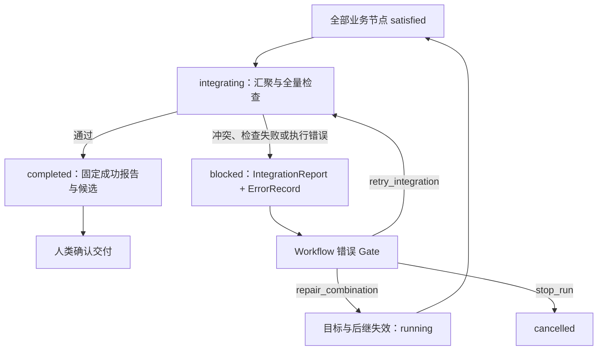

# 存储与交付

本地文件保存活动状态，Artifact 保存大型证据；一次采纳将需求、代码、精简档案和回执写入 main。Git remote 仅同步历史，SQLite 只作可选索引或缓存。

阅读路径：[目录与归档](#文件布局) → [引用与 Artifact](#证据引用) → [集成与交付](#输入比较与集成交付) → [文件事务](#本地文件事务) → [Git 写入与同步](#git-manager)。

## 文件布局

```text
.facetloom/
├── requirements/<requirement-id>.md      # 采纳时保存冻结需求
├── workflows/<workflow-id>.yaml
├── facets/<facet-id>/
│   ├── facet.yaml
│   └── scopes.yaml                       # 可选
├── runners/<runner-id>.yaml               # 镜像、原生参数与配置引用
├── evaluators/<evaluator-id>.yaml         # AI / 脚本评估配置
├── references/
├── runs/<run-id>/                        # main 上的精简档案
│   ├── run.yaml
│   ├── summary.md
│   ├── source-dag.yaml                   # 静态组合图
│   ├── dag.yaml                          # 筛选后实际执行图
│   ├── contexts/<sha256>.yaml
│   ├── combinations/<sha256>.yaml
│   ├── attempts/<attempt-id>.yaml
│   ├── errors/<error-id>.yaml
│   ├── checkpoints/<checkpoint-id>.yaml
│   ├── decisions/<decision-id>.yaml
│   ├── reports/<report-id>.yaml           # SelectionReport / CheckReport / GateReport / IntegrationReport
│   └── deliveries/<delivery-id>.yaml
└── .runtime/                             # 加入 gitignore
    ├── identity.yaml                     # 当前 clone 的稳定 runtime_id
    ├── settings.yaml                     # 新需求默认起草模式与 runner
    ├── requirements/<uuid>/
    │   ├── requirement.md                # 本地草稿，冻结后字节不变
    │   ├── drafting.yaml                 # 模式、runner、有效请求与处理记录
    │   └── frozen.yaml                   # ID 与 requirement_ref 的不可变绑定
    ├── runs/<run-id>/                    # 完整记录与 delivery.yaml 交付意图
    ├── transactions/<operation-id>/       # 事务清单、载荷与提交标记
    ├── definition-operations/<id>/       # 工作区保存与定义发布恢复日志
    ├── locks/
    ├── worktrees/<attempt-id>/
    ├── workers/<attempt-id>.yaml          # Worker 与停止意图
    ├── invocations/<invocation-id>.yaml    # 版本、输入、会话与退出状态
    ├── gate-tasks/<report-id>.yaml         # 活动评估、取消与恢复
    ├── artifacts/                        # 持久内容库、导入与本地清理回执
    ├── logs/
    ├── refinements/<refinement-id>/
    └── runtime.sqlite                    # 可选
```

每个对象独立保存，便于引用和按项清理；文件内容保持简短。main 不收录完整 Agent 对话、心跳与临时输出。可追溯输入指 FacetLoom 实际交给外部程序的内容，不能等同于外部 Agent 发给模型的内部请求。大型证据保存在本地 Artifact 库，档案保存内容 URI 和摘要。`.runtime/` 同时包含活动状态与持久内容，不能作为缓存整体清空。

## 运行档案

采纳档案使用[文件布局](#文件布局)中的 runs/ 结构；执行期间相同相对路径位于 `.runtime/runs/<run-id>/`。

| 归档内容 | 选择规则 |
| --- | --- |
| run.yaml、summary.md、source-dag.yaml、dag.yaml、已采用 SelectionReport | 必选，保留筛选依据、排除集合、最终结果与关键返工 |
| CombinationRun 与 accepted Attempt | 每个业务节点的最终有效状态与成果必选 |
| Snapshot、检查、Checkpoint、成果决策、IntegrationReport、DeliveryRecord | 保留上述成果的全部必需依据及引用闭包 |
| 历史失败、拒绝和错误处置 | 选取能解释最终成果的必要记录；被保留对象引用时必须收录 |
| 完整调用、日志及大文件 | 留在 Artifact，档案只存引用；不收录 Worker、心跳或队列 |

未选中的历史材料保留本地，不得留下只在本地才能解析的 run_record。归档不改写 Attempt 冻结字段或不可变报告。

对象文件只保存身份、输入引用、状态、简短结论和证据引用，不复制完整对话或原始日志。summary.md 是人类阅读的入口，列出目标、结果、关键决策、验证和未解决问题。

Context Snapshot 按文件字节 SHA-256 命名且不可原地修改。CombinationRun 文件名为 `combination_id` UTF-8 字节的 SHA-256 小写十六进制；Attempt、ErrorRecord、Checkpoint、Decision、Report 和 Delivery 使用各自 UUIDv4。读取时校验 ID、文件名、摘要和引用关系。

**Attempt 必须先在本地原子持久化，再启动 Worker。** 关联状态和证据通过本地事务共同保存；只有最终采纳的精简档案进入 main。其它 clone 看到的是采纳档案，不是活动 Worker 的恢复状态。失败或取消的 Run 可以通过本地记录快照交换包分享。

WorkflowRun completed 与交付分开；一个 Requirement 最多一次成功采纳，因此一个 Run 也最多交付一次；重复请求返回既有结果。检查报告见[CheckReport](03-execution.md#checkreport)，集成与交付对象见[交付协议](#输入比较与集成交付)。待交付运行保留所需记录。人类可明确放弃 completed 且未交付运行；publishing 结果未知时先对账，不能先放弃或清理。在 run.yaml 保存 delivery_abandonment，不改变 Run 终态；此后需新 Run 才能交付。已采纳且不再服务恢复或审核的档案可进入 Refinement；未采纳记录只在本地保留或显式导出。精炼按项清理并保留未解决问题，不能删除有效引用的目标而不更新引用。

## 证据引用

引用本体使用 `{type, ...}`，例如 git_object、git_file、artifact、run_record。`output_refs` 使用 `{role, ref}` 包装引用本体；`evidence_refs`、`related_refs` 及单个通用引用字段直接使用本体，不再套 role/ref。已明确定义为内部路径的 context_snapshot_ref 等字段保持其紧凑格式。

小型对象留在运行档案；实际初始请求、大日志、完整对话、截图与 bundle 留在 Git 外。main 只保存简短结论、URI 和摘要。以下是 output_refs 的代码引用及恢复来源：

```yaml
output_refs:
  - role: code
    ref:
      type: git_object
      object_type: commit
      oid: <full-commit-oid>
      recovery_bundle_ref:
        type: artifact
        uri: artifacts://sha256/<bundle-digest-hex>
        digest: sha256:<bundle-digest-hex>
        media_type: application/x-git-bundle
  - role: evidence
    ref:
      type: artifact
      uri: artifacts://sha256/<digest-hex>
      digest: sha256:<digest-hex>
      media_type: application/json
```

已经由 main 可达历史保留的代码 Commit 可以省略 recovery_bundle_ref。Artifact 引用使用内容身份，不使用发布方本地路径；发布前验证发布方本地库中的内容可读且摘要匹配。其它 clone 通过交换包获取内容，Git 中的引用本身不保证当地可用；普通临时文件路径不满足持久化要求。

仓库文件引用固定到 Commit，Refinement 清理后仍可解析：

```yaml
evidence_refs:
  - type: git_file
    commit: <full-commit-oid>
    path: .facetloom/runs/<run-id>/summary.md
    blob_oid: <full-blob-oid>
    digest: sha256:<file-bytes-digest>
```

同一 Run 中的不可变小文件可按内容引用，避免新文件引用自身所在 Commit 的循环：

```yaml
related_refs:
  - type: run_record
    run_id: <run-id>
    path: decisions/<decision-id>.yaml
    digest: sha256:<file-bytes-digest>
```

run_record 的路径相对对应运行目录，不得越出目录。Context Snapshot、ErrorRecord、Decision、Checkpoint 和 Report 引用的目标须在本地完成视图中存在且摘要匹配；本地快照按索引解析。最终归档时所有 run_record 目标须同 Commit 收录或已存在于保留档案中，不能留下只在拥有者本地可解析的小文件引用。清理时保留有效引用目标；仅当引用字段可更新时，才可先转换成删除前 Commit 的 git_file。不可变对象或 Attempt 的冻结字段仍被保留时，其依赖也保留。Attempt 用稳定 ID 关联；审核材料由 review_input_digest 校验，记录并发写入另用完整 Attempt 文件摘要。

## Artifact 存储与交换

Artifact Store 是每个 clone 自有的持久文件库。单 clone 执行不依赖 S3、Git LFS 或共享存储；Git 共享档案与引用，Artifact 内容按需用独立文件传递。S3 等后端留作后续扩展。

日常证据主要在产生它的 clone 内使用。导出 Artifact 交换包是可选协作操作，不是运行完成或采纳的前置条件；代码恢复所需 Git bundle 的本地生成与保留要求仍按上节执行。

### 对象与目录

| 对象 | 定义 | 保存位置 |
| --- | --- | --- |
| ArtifactRef | 文件原始字节的 SHA-256 身份，不包含存储位置或凭据 | 运行记录及其它类型化证据 |
| 本地 Artifact 库 | 按摘要保存的不可变文件及依赖元数据 | 当前 clone 的 `.facetloom/.runtime/artifacts/` |
| Artifact 交换包 | 清单与完整依赖文件的独立归档，供协作者手动传递 | 用户指定的 Git 外路径 |
| Git bundle | 自包含的代码恢复文件，也是普通 Artifact | 本地库；需要分享时收入交换包 |
| 本地清理回执 | 一次人工 purge 的范围、原因、进度与结果 | 本地库，不进入 main |

```text
.facetloom/.runtime/artifacts/       # 持久数据，不作为临时缓存清空
├── objects/sha256/<hex>            # 原始文件；同 clone 内按摘要去重
├── entries/<hex>.yaml              # 大小、类型及直接 dependency_refs
├── staging/<operation-id>/         # 尚未提交的导入或导出材料
├── imports/<operation-id>.yaml     # 整包导入回执
└── purges/<operation-id>.yaml      # 本地清理回执 / tombstone
```

各项目 clone 使用独立目录，不跨项目共享对象。内容身份只由字节确定，媒体类型描述用途，不参与摘要。ArtifactRef 沿用 `{type, uri, digest, media_type}`；URI 固定为 `artifacts://sha256/<64位小写hex>`，digest 为相同值的 `sha256:<hex>`。URI 不是网络下载地址，也不说明其它 clone 是否持有内容。

写入先暂存、计算摘要、fsync，再原子发布文件与有效 entry；entry 的提交复用本地文件事务。已有对象重新校验后复用，不能覆盖摘要不符的文件。Runtime 在保存结构化输入、调用清单等内容时，同时登记其中的直接类型化依赖；普通日志、图片等无依赖。导入失败留下的文件不生成有效 entry，不可通过目录扫描冒充已提交内容。完整日志的持久引用须先进入此库，临时日志路径不能作为 ArtifactRef。

### 可用性与使用边界

| 当前 clone 的情况 | 展示与处理 |
| --- | --- |
| 有有效 entry，文件及摘要匹配 | 本地可用 |
| 无内容且没有清理回执 | 尚未导入；列出缺失摘要 |
| 内容已由本地 purge 删除 | 已在本地清理；展示原因，可重新导入相同内容 |
| 已登记但文件丢失或摘要不符 | 缺失或损坏；阻止使用，不视为检查失败 |

可用性按当前文件检查，不写回不可变引用或审核摘要；重新导入成功后优先显示本地可用，旧清理回执仍保留。拥有者采纳归档前验证所需内容已在自己的库中持久可读，不要求其它 clone 已持有。同步 Git 只获得记录；从 Git 回退记录也不会恢复已删除的 Artifact。

查看摘要无需所有文件。审核、执行、代码恢复或导出需要的材料缺失时，列出缺项并暂停该操作，不能跳过检查或视为通过。导入既有引用的原内容不属于追加执行证据，不改变冻结字段。界面只读查看仍可继续；恢复内容后由用户重试原操作，不自动推进活动 Run。

### 显式导出与导入

```text
clone A：固定 Git 记录 或 本地不可变快照 → 收集依赖 → 导出交换包
                                                        ↓ 现有渠道
clone B：校验来源、摘要与依赖闭包 → 原子导入本地库 → 按需复核
```

交换包是独立未压缩 tar，包内只有 `manifest.yaml` 和 `objects/sha256/<hex>` 普通文件。来源有两种，可在同一包中组合：

```yaml
schema_version: 1
kind: artifact_exchange
source_records:
  - type: git_file                     # 已采纳档案，Git 历史另行同步
    commit: <full-commit-oid>
    path: .facetloom/runs/<run-id>/attempts/<attempt-id>.yaml
    blob_oid: <blob-oid>
    digest: sha256:<record-file-digest>
  - type: local_snapshot               # 未采纳、失败或取消的本地记录
    run_id: <run-id>
    index_ref:
      type: artifact
      uri: artifacts://sha256/<snapshot-index-digest>
      digest: sha256:<snapshot-index-digest>
      media_type: application/yaml
artifacts:
  - digest: sha256:<hex>
    byte_length: 821
    media_type: application/yaml
    dependency_refs: []
```

| 来源 | 固定方式与校验 |
| --- | --- |
| git_file | 校验 Commit、路径、Blob 和字节摘要；本地缺少历史时先通过 Git 补齐，不强制联网 |
| local_snapshot | Run 锁下冻结选中记录及其闭合依赖，各文件原始字节保存为 Artifact；索引按路径排序，列出 `{run_id, path, record_ref}`，record_ref 为文件 ArtifactRef；索引本身也是 Artifact |

本地快照使用相对运行目录的路径解析 run_record；引用其它 Run 的不可变记录时也列入索引，无法固定其内容或同一 `(run_id, path)` 对应不同摘要时拒绝导出。run_record 的 digest 必须等于 record_ref.digest。索引和结构化记录的 entry 登记真实类型化依赖；run_record 经该索引解析，不能混用同路径的当前运行文件。固定完成后在锁外打包，所需 Artifact 保持保护。它是只读证据快照，不携带队列、Worker 身份、凭据或恢复执行的权限。

1. **导出**：选择 Git 记录或本地 Run 记录。沿 run_record、git_file、git_object 的恢复来源及 Artifact.dependency_refs 收集完整传递依赖，按内容去重，拒绝非法循环。结构化对象按已知 Schema 识别引用，不扫描任意文本猜测；缺少必要记录或内容时整包失败，列出缺项。
2. **形成文件**：只打包必需 Artifact，包括本地快照的索引与记录字节；不打包整个 `.runtime/`。临时文件全部校验并持久化后原子改名到用户指定 Git 外路径。git_file 指向的历史仍由 Git 传递，快照不冒充 main 中的已采纳记录。
3. **校验**：核对来源、依赖闭包、大小和逐文件摘要；拒绝缺项、多余成员、重复条目/摘要、链接、非普通文件、绝对或越界路径。只流式读取规定成员，不任意解压。清单大小、文件数和总字节数受本地资源上限约束，导入前展示总量；不套用单次 Agent 证据上限，以允许较大的 bundle。
4. **导入**：全部校验后，通过本地事务一次提交 entry 与整包回执；重复内容复核后复用。未提交内容不可见，已提交事务幂等重放；失败不发布有效的部分导入结果。快照只存为 Artifact，不覆盖 `.runtime/runs/` 或 main 档案。

摘要证明内容匹配，不代表来源可信或成果已批准。导入不执行脚本、不修改 main、不采纳需求、不接管 Worker，也不启动或恢复 Run。代码恢复是后续显式操作，仍须验证 Git bundle。

### 保留与人工 purge

默认长期保留，不自动按 TTL 删除，也不因导出成功删除源内容。Refinement 仅整理 Git 记录，与物理清理独立。

| 引用或使用情况 | 本地删除规则 |
| --- | --- |
| 活动运行、待审核、待交付、交付在途、仍用于恢复 | 保护其完整依赖，不允许 purge |
| main 当前保留的其它有效记录仍依赖 | 保留，包括经 git_file 固定到历史文件的依赖 |
| 本地精炼会话、未完成事务或导入/导出正在使用 | 暂时保护；完成或显式结束后重新评估 |
| 仅 Git 历史记录依赖，或已确认无引用 | 人工预览、确认后可 purge；历史内容将无法在本地取回 |

purge 先重新读取本地 main，扫描当前保留记录与全部本地使用者的传递依赖，生成包含对象、字节数、历史影响和阻止原因的预览。无需联网或获取远端更新，也不承诺检查其它 clone 尚未同步的引用。无法完成本地引用检查时不允许删除；预览后有新引用或状态变化须重新计算并确认，不依靠“Run 已完成”判断。

确认后先持久化本地回执，记录 operation_id、对象摘要、操作者、原因、确认范围摘要及进度，再逐项删除文件和有效 entry 并验证。新引用、导入/导出和删除使用同一库锁协调；锁内重新检查保护范围。中断后按回执重放，已不存在的目标按已删除处理；删除失败保留待完成状态，不虚报成功。并发锁及重放职责见[本地 Artifact Store](#本地-artifact-store)。

回执只说明当前 clone 的副本已被清理，不表示全局销毁。它不进入 Git，不改写 ArtifactRef、Attempt 或历史决策。重新导入相同字节恢复本地可用性；导出包、其它 clone 和备份由各持有者管理。普通运行目录或 Worktree 回收必须保留 Artifact 库；项目备份与迁移需显式包含它。

## 输入比较与集成交付

**一次采纳对应一个 main Commit**，同时包含冻结需求、最终代码、精简档案和 DeliveryRecord。成功边界是该提交进入本地 main；push/pull 仅同步历史。

定义 `project_tree(commit)`：保留所有 Git 跟踪路径、内容与模式，仅移除 `.facetloom/runs/` 子树及因此为空的目录。代码、执行定义、资料和已采纳需求均参与基线比较。运行档案仅按显式证据提供，不作为项目输入。

```text
project_tree(main) == project_tree(source_commit)？
    ├── 否 → 阻塞旧交付，用最新基线创建新 Run
    └── 是 → 应用有效终端代码 + 写入冻结需求文件
                          ↓
                   candidate_tree（不含 runs/）
                          ↓ 最终集成检查、人类确认
             加入精简档案和回执 → 一次 squash 到 main
```

1. 所有业务 Combination satisfied 后 Run 自动进入 integrating。先保存稳定 operation_id、report_id、终端成果清单与集成任务意图，再汇聚有效输出；同一 Run 同时最多一个活动集成任务。
2. 校验需求未被采纳、没有 delivery_abandonment，且最新 main 与 source_commit 的 project_tree 相同。冻结需求的正式路径必须不存在；历史已有采纳时返回既有结果。
3. 在隔离 Worktree 上应用相对 source_commit 的成果变更，保留最新 main 档案。Worker 的变更仍受执行 Scope 约束；Git Manager 将 requirement_ref 的原始字节写到 `.facetloom/requirements/<requirement-id>.md`，此受信写入独立于 Worker Scope。
4. 固定 candidate_ref 和 candidate_tree，运行 source_commit 中全部 integration.checks，保存 IntegrationReport。检查可以生成临时文件，不得改写候选的被跟踪内容。全部通过且输入仍有效时，将成功报告与 completed 状态同事务保存；失败或可恢复的执行问题交集成错误 Gate。
5. 人类确认 completed Run 已绑定的成功报告、需求与候选；交付不重新执行集成检查。Git Manager 重验 main 后加入精简档案及 DeliveryRecord，以最新 main 为唯一父提交创建一个 squash Commit，并更新 main。

`candidate_tree = project_tree(candidate_ref)`，**包含本次需求文件**，因此即使无代码变化也不是空提交。最终采纳提交的 project_tree 必须等于 candidate_tree。档案和回执不参与此 Tree，避免报告或回执引用自身所在 Commit 的循环。

DeliveryRecord.kind 的判定另比较候选在移除本次新需求文件后的 project_tree 与 source_commit：不同为 applied，相同为 no_change。不得排除其它需求或执行定义。两种情况均检查和确认，再提交需求、结论和档案；no_change 不创建额外空代码提交。

### IntegrationReport

路径：`.facetloom/runs/<run-id>/reports/<report-id>.yaml`，创建后不可变。汇聚或基线校验阶段失败也保存报告，不伪造候选代码。

| 字段 | 定义 |
| --- | --- |
| schema_version、report_type、report_id、run_id | 格式为 1，report_type=integration，UUIDv4 |
| source_commit、target_branch | 固定运行输入与 main |
| target_head_before | 本次读取的 main 头；读取失败时可空 |
| terminal_outputs | 最终 DAG 中直连 end 的全部业务节点，按 Combination ID 排序，含 accepted_attempt_id 与可恢复 output_ref |
| merge_input_ref | 多输入汇聚清单 Artifact；尚未形成或无需合并时 null |
| candidate_ref | 可恢复的候选 Commit 类型化引用；尚未形成完整候选时 null |
| candidate_tree | project_tree(candidate_ref)，无完整候选时 null |
| checks | 最终配置检查的逐项结果，格式同 CheckReport.results，不包含修复轮次 |
| evidence_refs | 汇聚冲突、基线校验、实际环境及其他阶段材料的类型化引用列表 |
| status、reason | passed / failed / blocked；非 passed 必填原因 |
| created_at | UTC ISO 8601 |

~~~yaml
schema_version: 1
report_type: integration
report_id: <uuid>
run_id: <run-id>
source_commit: <full-commit-oid>
target_branch: main
target_head_before: <full-commit-oid>
terminal_outputs:
  - combination_id: development/feature:login/layer:presentation
    accepted_attempt_id: <attempt-id>
    output_ref:
      type: git_object
      object_type: commit
      oid: <output-commit-oid>
      recovery_bundle_ref: <artifact-ref>
merge_input_ref: null
candidate_ref:
  type: git_object
  object_type: commit
  oid: <candidate-commit-oid>
  recovery_bundle_ref: <artifact-ref>
candidate_tree: <project-tree-oid>
status: passed
evidence_refs: []
checks:
  - check_id: regression
    status: passed
    exit_code: 0
    timed_out: false
    evidence_refs: []
created_at: "2026-11-09T12:00:00Z"
~~~

| 情况 | 报告结论 |
| --- | --- |
| 完整候选、基线有效、非空 integration.checks 全部通过 | passed；本地事务绑定报告并将 Run 置 completed，允许请求人类交付确认 |
| 检查完整结束，至少一项失败 | failed，保留候选与失败证据，交集成错误 Gate |
| 输入汇聚冲突、环境不可用、证据未形成或不可恢复 | blocked，保存已形成材料，交集成错误 Gate |
| 基线过期或需求已采纳 | blocked，阻止继续；不提供同 Run 恢复动作 |
| 仅缺已有材料的本地副本 | blocked，先补齐原引用内容，不创建新的错误事实 |

合并冲突时可以保留候选冲突 Tree 的证据，但 candidate_ref / candidate_tree 仍为 null；它不属于可交付候选。未运行的检查记 not_run，无法启动的项记 error；只要存在 error / not_run 就不能报告 passed / failed。启动前已要求非空检查；若运行中发现固定配置无效，按数据完整性错误阻塞并交人工处理，不能以 checks=[] 通过。

节点全部被接受只表示可以进入 integrating，不代表 Run 完成。IntegrationReport 为 failed / blocked 时不能交付；节点 Gate 的批准与人类交付确认都不能豁免最终集成检查。

检查命令与受信入口来自 source_commit，实际环境、日志和结果进入证据；不能用候选代码改写审核入口。candidate_ref 必须在报告本地保存前可由 main 历史或自包含 bundle 恢复，报告的 candidate_tree 从恢复出的 Commit 重新计算。

集成失败后的重检通过 retry_integration 授权，保存新报告；需要修改代码时通过 repair_combination 安排节点修复。只有 completed 后需要修改或重检才创建新 Run。新报告不覆盖旧报告；未完成集成时不存在交付确认。

main 在检查后只有 runs/ 变化时，可保留最新档案重构尚未采纳的完整 Commit，复用相同候选与报告的确认。代码、定义或已采纳需求变化要求新 Run；completed 后候选、有效成果或报告不匹配时拒绝交付，不能通过重新确认原地替换。

### 集成恢复与任务一致性



集成报告、ErrorRecord、run.yaml 的引用与 blocked 状态同事务落地后才发起错误评估；材料持久化失败先恢复本地事务。恢复动作、额度和任务意图也共用本地事务。动作的字段与范围见 [错误评估协议](04-review-and-recovery.md#错误评估协议与决定)。修复后新 Snapshot 明确引用失败报告和旧成果作为证据，根基线及前驱输入规则不变。

任务使用现有本地操作日志，不新增 IntegrationRun 文件。绑定 operation_id、report_id、run_id、source_commit、按 Combination ID 排序的终端 accepted_attempt_id 与输出引用、可空的恢复决定引用；报告只可由该活动任务发布一次。Runtime 在 Run 锁下复核任务未撤销、Run 仍 integrating、终端成果和正式输入未变后，才接收报告并推进状态。重检分配新操作与报告 ID；旧报告不可替换新任务结果。

重启先重放已提交事务并对账集成进程及已有报告；结果未知时保持待对账，不自动重复启动。取消或修复先持久化撤销与停止意图；旧进程必须停止或隔离后才安排新任务，迟到结果仅保留诊断，不能完成 Run 或覆盖有效引用。补齐原材料只恢复未完成任务；若需重新执行已结束的检查，须由错误 Gate 批准重检。基线失效或需求已采纳时停止推进，不能以恢复动作或旧 passed 报告完成 Run。

### 交付意图与确认

只有 completed 且绑定有效 passed IntegrationReport 的 Run 才能创建交付意图。报告与候选从 run.yaml.integration_report_ref 读取，接口不能另选报告；交付只校验绑定、可读性及输入有效性，不重跑检查。

同一 Run 在拥有者 Runtime 中最多一份活动交付意图，保存在 `.runtime/runs/<run-id>/delivery.yaml`，使用既有文件事务持久化。

~~~yaml
schema_version: 1
delivery_id: <uuid>
run_id: <run-id>
status: ready
integration_report_ref: <typed-report-ref>
candidate_tree: <project-tree-oid>
confirmation: null
result_commit: null
~~~

状态为 preparing → ready → confirmed → publishing → delivered；publishing 指正在将候选提交到本地 main，与远端同步无关。材料暂不可读、工作目录暂不可写或正式输入变化时为 blocked。材料补齐、工作目录恢复干净后可重新准备同一成功候选；正式输入变化则要求新 Run，不能原地重检；本地提交结果未知时保持 publishing，完成对账之前不新建交付。completed 的候选与报告不可替换；不匹配则拒绝操作，delivery_id 不用于另一份不同成果的交付。

人类确认记录 `confirmed_by`、`confirmed_at`，并固定以下对象的 JCS SHA-256 摘要为 confirmation.digest：

~~~json
{
  "delivery_id": "<uuid>",
  "run_id": "<run-id>",
  "requirement_id": "<requirement-id>",
  "requirement_ref": {
    "type": "artifact",
    "uri": "artifacts://sha256/<requirement-digest>",
    "digest": "sha256:<requirement-digest>",
    "media_type": "text/markdown"
  },
  "target_branch": "main",
  "source_commit": "<source-commit-oid>",
  "integration_report_ref": {
    "type": "run_record",
    "run_id": "<run-id>",
    "path": "reports/<report-id>.yaml",
    "digest": "sha256:<report-digest>"
  },
  "candidate_tree": "<project-tree-oid>"
}
~~~

报告引用包含内容摘要；需求 UUID 未采纳、冻结需求、有效终端成果、基线、候选 Tree 和报告必须重新校验。确认不绑定会因档案变化而更新的 main 头，也不允许用旧确认替换报告或候选。

```text
固定报告与候选 → 人类确认并持久化
    ↓ 读取本地 main，查已有交付，再次校验正式输入
只有档案变化 → 保留档案，复用确认
正式输入变化 → blocked，要求新 Run
    ↓
一次提交需求、代码、档案和回执到 main → 对账结果
```

Runtime 串行安排交付，Git Manager 在仓库发布锁下重新读取本地 main，再按 [main 提交保护](#main-提交保护) 的预期头和工作目录保护规则提交。本地更新结果未知时先对账是否已经成功；未成功且仅档案变化时使用同一 delivery_id 重构尚未生效的提交，不能覆盖并发正式代码。已生效交付即使 push 失败也不回退到 publishing。

重复点击或请求重放返回同一活动意图；已经有成功 DeliveryRecord 或匹配的交付提交时直接返回结果。即使请求带不同 operation_id，也不能为同一 Run 或 Requirement 重复交付。同步到档案被精炼删除的状态时，仍通过 Git 历史 Trailer 查已完成交付。

### DeliveryRecord

DeliveryRecord 是成功采纳的不可变回执，路径为 `deliveries/<delivery-id>.yaml`，**与需求、代码和精简档案同 Commit**。schema_version 为 1，所有 ID 均为 UUIDv4。

```yaml
schema_version: 1
delivery_id: <uuid>
operation_id: <operation-id>
kind: applied                         # applied / no_change
run_id: <run-id>
requirement_id: 9e2c1f78-6a54-4d92-8e31-05b7a19c2f60
requirement_ref:
  type: artifact
  uri: artifacts://sha256/<requirement-digest>
  digest: sha256:<requirement-digest>
  media_type: text/markdown
target_branch: main
integration_report_ref:
  type: run_record
  run_id: <run-id>
  path: reports/<report-id>.yaml
  digest: sha256:<report-digest>
target_head_before: <actual-parent-commit>
candidate_tree: <project-tree-oid>
confirmation_digest: sha256:<confirmation-digest>
confirmed_at: "2026-11-06T13:09:00Z"
applied_by: user:ling
applied_at: "2026-11-06T13:10:00Z"
```

回执不保存自身所在提交的 OID。实际采纳提交从 main 可达历史查找以下 Trailer，再验证提交内容和唯一父提交 `target_head_before`；不能仅凭 Trailer 文本或本地时间宣告成功。

```text
FacetLoom-Requirement: <requirement-id>
FacetLoom-Run: <run-id>
FacetLoom-Delivery: <delivery-id>
FacetLoom-Operation: <operation-id>
```

candidate_tree 与报告一致，包含冻结需求文件；confirmation_digest 可由回执身份、报告和固定候选重算，applied_by 和 confirmed_at 来自本地人类确认。applied_at 是提交中记录的 UTC 时间。仅本地交付意图可在成功后填 `result_commit` 作为派生缓存，不再为它追加 main 提交。

| 中断点 | 恢复 |
| --- | --- |
| 候选 Commit 仅存在对象库 | 未采纳；校验基线、确认和保护规则后可用原 delivery_id 继续 |
| main 更新结果未知 | 保持 publishing，先查询 Trailer、需求 UUID 和实际文件；不创建第二个意图 |
| main 已包含完整采纳提交，本地未记 delivered | 校验 project_tree、冻结需求、档案闭包、同 Commit 回执和确认摘要，再补本地状态；不追加回执提交 |
| 当前档案被精炼删除或成果被 revert | 查 Git 历史认定已采纳，不重新运行或交付原需求；需要变化时创建新需求 |

成功后即使 main 又发生代码变化，该 Run 也不再次交付；需要重新应用或变更成果时创建新 Requirement。所有回执引用的报告、候选和确认依据都受 Refinement 的引用与保留规则约束，不能在交付结果待对账期间清理。

## 本地文件事务

文件是本地执行状态的事实来源；SQLite 可以从文件重建。事务覆盖 Requirement 草稿、起草请求与冻结绑定、Run、CombinationRun、Attempt、Worker、Invocation、评估任务标记、恢复额度及外部动作意图，避免逐个 YAML 写入造成半更新。

```text
transactions/<operation-id>/
├── manifest.yaml       # 操作身份、顺序与目标摘要
├── payloads/<n>        # 完整新内容
├── COMMITTED           # 事务决定已持久化，可重放
└── APPLIED             # 全部目标已落地
```

~~~yaml
schema_version: 1
operation_id: <uuid>
aggregate: {kind: run, id: <run-id>}
sequence: 12
kind: schedule_recovery
writes:
  - path: runs/<run-id>/run.yaml
    before_digest: sha256:<old>
    after_digest: sha256:<new>
    payload: payloads/0
side_effects:
  - id: <stable-worker-id>
    kind: start_worker
    depends_on: []                     # 决定、额度和新 Attempt 已在本事务落地
~~~

路径相对 `.runtime/`，禁止越界。新增文件的 before_digest 为 null；删除文件的 after_digest 与 payload 为 null。载荷摘要必须匹配 manifest；side_effects 固定调用对象、输入摘要、参数引用和依赖，实际内容随操作载荷保存。凭据不写入事务。operation_id 用于请求去重；sequence 在同一 aggregate 内递增。

### 提交协议

1. 获取该 Run 的进程级排他文件锁，检查 operation_id、预期摘要、sequence 与运行有效性。同一 Run 的状态、任务和额度变更共用此锁；Refinement 使用会话锁。草稿保存、起草请求、模式切换与冻结使用 Requirement 锁及 `aggregate: {kind: requirement, id: <requirement-id>}`，释放后再获取 Run 锁。settings.yaml 使用 clone 设置锁与 `aggregate: {kind: settings, id: local}`，默认设置复制到草稿时不同时持有两类锁。
2. 写入完整 payloads 与 manifest，逐个 fsync 文件和目录。此时不改目标文件，不执行外部动作。
3. COMMITTED 内容包含 manifest 的 SHA-256，通过临时文件与 rename 发布，再 fsync 文件及事务目录；事务目录首次创建也须 fsync transactions 父目录。此刻事务已提交，之后必须完成重放，不能回滚成未发生。
4. 对每个目标使用同文件系统临时文件、fsync、原子 rename 和目录 fsync 完成替换。删除操作使用 unlink 并 fsync 父目录。当前摘要已是 after_digest 则跳过；等于 before_digest 才写入；两者均不符则隔离该 Run 并报恢复错误，不能覆盖未知更新。
5. 全部目标完成后持久化 APPLIED。释放锁之后，才允许读取完成视图和调度已提交的外部动作。

所有 Runtime 读者通过服务在同一锁下读取，或读取该服务发布的完整版本；不得直接读取落地中的多文件组合。API 请求先在锁内完成遗留重放。提交成功但 APPLIED 尚未落地时对调用者报告“恢复中”，不能暴露半状态。

需要同时持锁时先 Run 锁、后仓库发布锁；不同时获取多个 Run 锁。耗时网络调用在锁外执行，回来后重新校验预期版本。进程退出释放操作系统锁，不靠删除锁文件接管活动运行。

### 恢复顺序与外部动作

```text
暂停调度
    ↓
无 COMMITTED：丢弃暂存事务
有 COMMITTED 无 APPLIED：按 aggregate / sequence 重放
    ↓
验证状态与引用 → 对账 main / Artifact / Worker / 评估调用
    ↓
恢复交付及其它外部意图 → 恢复有效评估与执行调度
```

- 同一 aggregate 的后续事务只能在前一事务 APPLIED 后创建，故恢复时不存在合法的越序覆盖。恢复完毕前不启动新 Worker。
- 启动 Worker、评估请求、Artifact 导入/导出/清理及 Git 提交都先持久化意图。容器按稳定 worker ID 查询；调用按 report ID / 请求摘要对账；Artifact 按内容摘要及本地操作回执校验；Git 按本地 main 的操作 Trailer 与目标内容校验。
- 本地 main 更新结果未知时先在历史中查找操作 ID。即使 Refinement 已清理当前档案，也不能重新追加已执行操作或复活旧记录。push 确认丢失只需核对远端是否已含原提交，不重放业务操作。
- 外部动作状态为 pending / running / succeeded / failed / unknown / cancelled，确认失败记录原因并等待重试或人工处理；状态变化也通过文件事务保存。恢复动作的扣减、状态和动作意图同事务提交，重放不重复扣减；取消后不返还已安排额度。
- 错误恢复 Worker 依赖相应决定和额度事务 APPLIED；成果接受同样在本地落地后生效。只有最终采纳及独立 Refinement 等 Git 写入等待 main 确认，普通执行与 Gate 不提交 Git。
- 无幂等接口且发送结果未知时，先保留 unknown 并对账；无法确认则等待人类，不自动重发，不保证网络调用恰好执行一次。
- APPLIED 事务仅在所有必要动作已对账并完成后才可回收；保留本地操作 ID 去重索引。Git 写入结果仍以本地 Git 历史 Trailer 校验，不以可选 SQLite 为唯一依据，也不等待远端同步。

## Git Manager

Git Manager 是唯一执行受信 Git 写入的组件；管理 main、隔离 Worktree、本地 Checkpoint、bundle 和精简档案。

| 操作 | 校验 |
| --- | --- |
| 准备运行与 Checkpoint | source_commit、UUID、DAG、Scope、outcome、输入/输出 Tree 与取消状态 |
| 固定审核材料 | 最终 Tree 的实际检查、请求与执行证据本地持久可读，冻结字段和 review_input_digest 一致 |
| 保存 Gate | Runtime 以本地事务校验主体、材料、策略、前一决定、状态与额度；Git Manager 不将其逐次提交 main |
| 导入 Agent 证据 | 输入白名单、文件路径与类型、数量/大小上限、摘要及持久性 |
| 最终采纳 | 需求未采纳、基线有效、终端成果、报告与确认匹配；需求、代码、档案及回执一次提交 |
| 定义 / Refinement 维护 | 人类确认 Diff、定义和 DAG 校验、证据与清理引用完整性 |

### 本地执行与最终采纳

```text
执行 / Gate / 恢复决定 → 本地事务 COMMITTED → APPLIED → 生效与继续调度
                                                           ↓ 集成通过、人类确认
                                    需求 + 代码 + 精简档案 + DeliveryRecord
                                                           ↓ 一次 squash
                                                       本地 main
                                                           ↓ 可选、显式 Git 同步
                                                       其它 clone
```

一个 Requirement 对应一次采纳提交；运行过程中不写 main。失败、取消和放弃的记录留在本地，可显式导出。定义维护及 Refinement 是各自独立的人类确认操作，不是原需求的追加日志提交。remote 只同步历史，无需 remote 即可完成全部本地操作。

### main 提交保护

以下通用协议用于最终采纳和 Refinement；定义维护使用前述 [定义发布协议](06-interaction.md#定义发布协议)，同样遵守预期头保护、操作去重与恢复对账。

1. 先保存本地操作意图。在 detached Worktree 中基于最新 main 构造候选，以当前头为唯一父提交；不混入用户修改，不创建命名执行分支。候选带 `FacetLoom-Operation` Trailer，采纳再带 Requirement、Run、Delivery 标识。
2. 最终采纳持有 Run 锁后再取仓库写入锁，重查操作、需求采纳历史、确认及基线。预期头变化时先查是否已成功；未成功且只有 runs/ 变化可保留最新档案重构，正式输入变化要求新 Run，不把多个需求的成果自动合并。
3. main 未检出时以预期旧 OID 比较更新引用；已检出时，最终采纳与 Refinement 要求工作区和索引干净、无将被覆盖的未跟踪文件，才正常快进并同步文件。定义维护按 [定义发布协议](06-interaction.md#定义发布协议) 提交已审阅的工作区文件。不切换其它分支，不自动 stash、reset 或覆盖用户修改。
4. 提交进入 main 的可达历史才成功，候选仅存在对象库不算成功。结果未知时先核对 main、Git 索引和 Trailer，校验需求字节、候选 Tree、档案闭包和同 Commit 回执，再完成本地确认。无法判断工作目录是否完整落地时暂停新 Git 写入，人工处理后恢复。

锁串行化当前 clone 的受信写入，同时使用 Git 引用/索引锁与预期头校验。仅 main 工作目录中的普通代码改动不会阻塞本地执行或 Gate，但会阻塞采纳；未提交定义按 Workflow 规则阻止新 Run 启动。重复请求按 operation_id、delivery_id、run_id 和 requirement_id 对账；档案已被精炼删除也查历史，不能重新采纳或复活记录。

### 取消与并发

本地成果接受、恢复和取消共用 Run 锁及文件事务，按实际提交顺序确定结果。取消先封禁执行身份、持久化停止与撤销意图；迟到报告不推进状态。accepted / rejected 等既有终态保留，节点失效则清除当前有效引用。取消不向 main 追加日志。

最终采纳也持有 Run 锁；只有 completed 且绑定 passed IntegrationReport 的 Run 才能创建交付意图；未进入 publishing 时可取消意图，publishing 或 main 结果未知时须先对账。采纳已进入 main 则保留成功事实，不再取消或重放；撤回正式成果使用 Git revert。completed Run 的未交付成果可由人类明确放弃，规则见[运行档案](#运行档案)。

不同需求可并行执行；main 采纳串行进行。先采纳的需求改变正式输入后，其它旧基线 Run 需在新 source_commit 下重跑，即使文本可自动合并也不复用旧候选检查。仅 runs/ 的精炼清理不改变执行输入。Run 目录有不同 UUID 只解决文件命名，不证明代码或定义兼容。

### Git 异步同步

不区分本地与远程项目。未配置 remote 时无需同步；配置后由用户执行正常 Git 操作，FacetLoom 不增加自动同步服务，也不要求每次执行前 fetch。

| 情况 | 处理 |
| --- | --- |
| push 成功 | 共享已采纳提交和维护提交；不重放其中的 Gate 或交付 |
| 网络失败、push 被拒或确认丢失 | 保留本地结果，核对远端包含关系后再同步；不重复采纳 |
| 接收更新可快进 | 校验定义、UUID、档案和引用，按 main 工作目录保护规则更新 |
| 历史分叉或代码冲突 | 停止自动接纳，由用户按 Git 协作流程协调；不提供需求版本合并、自动重放或强推流程 |
| 同一需求 UUID 出现多次采纳或不一致内容 | 报告冲突，由人类处理；文本可合并不能视为业务合法 |

Git 同步不要求同时导入所有 Artifact；可先读摘要，所需原始内容另用交换包补齐。同步采用保留固定 Commit 引用的历史；外部重写导致引用不可恢复时须人工修复，不静默换 OID。

接纳更新后，在调度、接收决定与交付前重新检查 main 的正式输入及需求采纳历史：基线变化阻塞旧 Run 并要求新 Run，同一需求已采纳则停止本地其它运行。fetch 仅获取对象，未进入本地 main 的更新不成为执行输入。其它独立需求不会因名称或时间关系而自动取代本地需求，也没有跨 clone 运行取消服务。

通过普通 Git 在服务外更新 main 时执行同样校验；无效定义、重复 UUID 或破损档案暂停相关操作。历史采纳和 Gate 保留原上下文，不证明同步后代码已经通过旧检查，也不承诺离线 clone 间即时唯一或即时停止。

### 本地代码与持久证据

Git Manager 按[前驱代码汇聚](03-execution.md#前驱代码汇聚)构造输入，按[Checkpoint 与代码保留](03-execution.md#checkpoint-与代码保留)持久化输出和恢复 bundle。交付候选、确认与意图统一见[输入比较与集成交付](#输入比较与集成交付)；本地执行及交付共用 Run 锁，提交 main 时再取仓库发布锁。

## 本地 Artifact Store

这是 Runtime 内的存储职责，不是独立部署的服务。Git Manager 与 Adapter 通过它保存、解析和校验内容；Worker 只获得本次输入的只读材料和独立证据输出目录，不直接挂载整个库。

| 操作 | 责任 |
| --- | --- |
| 保存 / 读取 | 校验字节摘要，原子登记文件及直接依赖；解析内容 URI 为当前 clone 的受控文件 |
| 检查可用性 | 区分本地可用、尚未导入、已在本地清理及缺失/损坏；缺内容不改运行事实 |
| 导出 / 导入 | 按固定 Git 记录或本地记录快照收集闭合依赖，校验独立交换包，整包提交；不操作正式代码或活动 Run |
| 预览 / purge | 检查全部本地使用者及本地 main 的保留引用，人工确认后记录回执并删除；无需联网 |

协议和文件结构统一见 [Artifact 存储与交换](#artifact-存储与交换)。存储写入、引用登记与保护标记使用同一 clone 级库锁；本地运行、交付意图、精炼和交换操作在使用前登记保护，结束后释放。登记与有效状态通过文件事务一起提交，恢复时先重放并重建保护集合，再允许 purge。

需要多类锁时，顺序为 Run 或 Refinement 会话锁 → Artifact 库锁 → 仓库发布锁，不同时获取多个 Run 锁。purge 在库锁下读取已提交的引用/保护视图，不反向获取 Run 锁；发现变化或无法核对完整依赖则中止并重新预览。耗时打包与 Git 同步在锁外进行，使用期间持久保护所需对象。删除意图提交后，相关对象不可新增引用或开始导出，直到删除完成；再次导入须先完成或对账该清理操作。

库自身的导入与清理事务使用 `aggregate: {kind: artifact_store, id: <runtime-id>}`，以库锁串行化；仍遵循 COMMITTED / APPLIED 协议。导入原子发布 entry 和回执，未提交字节不对外可用；purge 先记录清理意图，再幂等删除并逐项更新结果。清理失败保留待完成回执，恢复时优先对账，不报全局删除成功。该锁只约束当前 clone，不声称保护其它离线副本；未来 S3 或 LFS 后端不属于当前依赖。

## 持久化与恢复

| 情况 | 恢复方式 |
| --- | --- |
| Runtime 重启 | 先重放文件事务，再对账 Worker、评估和交付意图，最后恢复调度 |
| Worker 无法对账 | Attempt failed，保存 ErrorRecord，由错误 Gate 决定恢复 |
| 本地状态事务失败 | 不暴露半状态；COMMITTED 后必须重放，落地前不解锁后继 |
| 最终 main 更新失败或结果未知 | 保留交付意图，按 UUID、操作 Trailer 和提交内容对账，不重复采纳 |
| main 推送失败或暂时离线 | 仅同步未完成，不回退本地执行或已完成的采纳 |
| 本地状态丢失 | Git 恢复已采纳档案；Artifact 从保留库或交换包恢复。未采纳运行依赖本地备份，不保证恢复活动 Worker |
| 另一 clone 查看 | 已采纳档案通过 Git；未采纳记录可显式导出快照。材料导入不接管 Worker、不恢复调度 |

本地文件是恢复依据，SQLite 仅为可选索引和缓存。多对象事务与外部动作对账见[本地文件事务](#本地文件事务)；档案清理见[运行精炼](06-interaction.md#refinement运行精炼)。
