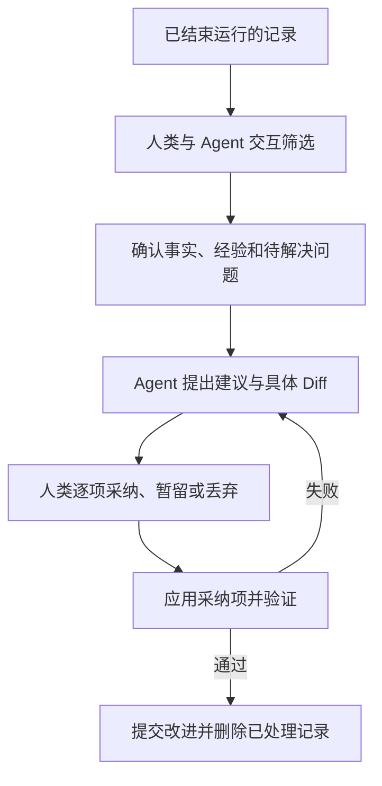

# 交互与运行精炼

CLI 与 WebUI 共用服务和校验规则。本章定义用户入口、定义编辑与发布、Refinement；运行行为由对应协议章节约束。

## 页面结构

```text
项目
├── Requirement
├── Workflow / Facets / DAG Preview
├── Runs
│   ├── Selection / 原图、筛选结果与执行图
│   ├── Summary / 未解决问题
│   ├── DAG / CombinationRun / Attempt
│   ├── Diff / Checkpoint / CheckReport / Evidence
│   ├── 成果 Gates / GateReport / GateDecision
│   ├── 错误 Gate / ErrorRecord / 恢复动作
│   └── IntegrationReport / DeliveryRecord
├── Refinement：运行精炼
│   ├── 选择记录与确认事实
│   ├── 建议、Diff 与逐项选择
│   └── 验证、清理预览与提交
├── Artifacts：本地内容 / 缺失清单 / 交换包 / 清理
└── Local Runtime
```

| 页面 | 展示内容 | 人类操作 |
| --- | --- | --- |
| Requirement | 起草模式、runner、草稿与 AI Diff、冻结需求、关联 Run、已采纳历史 | 编辑、请求 AI 辅助、切换模式、审阅并冻结、启动 Run；修改冻结需求则创建新 UUID |
| Workflow | 源 Facet 编辑器、Scope、校验、组合预览和影响 Diff | 编辑节点/边/属性、保存工作区 YAML、审阅并提交发布 |
| Run | 筛选进度、原图与实际执行图、本地状态与档案、结果和证据 | 取消、重试、请求交付或明确放弃未交付成果 |
| 成果 Gate | 各 Node 的模式、审核要求、报告、主体与汇总状态 | 人工项决策、批量确认、异常接管或请求重评 |
| 错误 Gate | 错误阶段、材料、处置报告、当前额度及失效范围 | 重试当前节点、修复祖先、等待或停止；异常接管 |
| Delivery | completed Run 的固定候选、成功 IntegrationReport、绑定确认、交付意图与成功回执 | 确认交付、查看交付对账；集成重检或节点修复从错误 Gate 进入 |
| Refinement | 已结束运行、筛选项、建议、拟修改和删除内容 | 采纳、暂留、丢弃、确认提交 |
| Artifacts | 当前 clone 的内容可用性、依赖、占用及导入/清理回执 | 检查缺失、导出交换包、导入、预览并确认本地 purge |
| Local Runtime | runner、Worker、容器、原生调用、本地事务与交付意图、同步与恢复 | 停止 Worker、恢复本地运行 |

需求列表按 main 采纳顺序显示“第几个需求 · 标题 · 短 UUID”；序号仅作导航，详情与操作始终使用 UUID。未采纳草稿和运行单列。Git revert 后仍可查看历史采纳及回撤标记，不提供重新交付原需求的入口。

## 可视化编辑与发布

YAML 文件是定义的事实来源，可视化编辑器与本地文本编辑器共用工作区文件。编辑器直接保存 `.facetloom/` 下的定义，不另建配置数据库或持久草稿。未保存改动只存在于编辑缓冲区；保存不提交 Git，发布才创建本地 main 的普通维护提交。

```text
Workflow / Facet 源图与属性编辑
    ↓ 校验候选与受影响引用
工作区 YAML → 工作区 Combination DAG 预览
    ↓ 人类审阅文件 Diff、源图与组合图变化
发布到 main → 新 WorkflowRun 固定 source_commit
```

### 编辑对象

| 对象 | 可编辑内容 |
| --- | --- |
| Workflow | Facet 引用及顺序、exclude、执行 runner、必要检查、Gate 与 integration.checks |
| Facet | ID、名称、共享上下文、Scope 映射引用和源 DAG |
| 普通 Node | ID、名称、目标、约束、资料、Scope、检查和 Gate |
| 源 DAG 边 | 新增或删除 Facet 内的依赖；节点位置仅用于显示，不决定顺序 |
| Scope 映射 | scope_id 与路径规则；按现有交集规则预览有效写入条件 |
| Combination DAG | 只读派生图，不能直接增删节点、改成员或连边 |

start/end 的控制角色固定，不能转换为普通节点，也不能通过删除控制节点使 Facet 失去边界。添加普通节点时可在编辑缓冲区暂存不完整连边，保存前必须形成合法源 DAG。删除普通节点同时移除关联边，用户明确重连；源图编辑不自动旁路。只有 exclude 删除派生组合节点时才执行既定桥接与传递约简。

改名、删除 Facet / Node 或 Scope 时，先列出引用它的所有 Workflow、边和 exclude 等配置，允许在同一保存批次明确更新引用。身份更改在图 Diff 中显示为旧 ID 删除、新 ID 增加，历史 Run 的成员和 ID 不重写；仍有悬空引用或无效图时禁止保存与发布。

### 校验与影响预览

校验、预览和影响分析共用同一解析器与图生成算法。默认读取本地 main 的固定 Commit；工作区模式读取本轮固定字节集，标记“工作区定义预览”。读取期间文件变化则重新取样，不把不同时间的配置混成有效结果。

| 校验层 | 内容 |
| --- | --- |
| 文件与引用 | YAML、ID、路径、Scope、检查、runner、evaluator、Gate 配置及引用是否有效 |
| 源 Facet DAG | 环、自环、重复边、悬空端点、控制边界、start/end 可达性 |
| 最终组合图 | 有序节点替换积、exclude、桥接、传递约简及结果合法性 |

编辑共享定义时扫描 main 与工作区的 Workflow 引用关系，列出直接和间接受影响项；无法解析的引用标为未完成分析，不能把它们当作“未受影响”。保存批次与发布候选分别通过所有受影响 Workflow 的草稿校验与完整运行校验；允许暂缺的筛选或集成配置须显示不可运行诊断。磁盘上的结构、引用或图错误可以查看诊断，但不能生成标为有效的最终预览或发布。

预览展示源图、原始组合节点数、排除后的节点数、最终边数和各节点 members、直接前驱/后继、分支与汇聚；可展开查看命中的 exclude、桥接边和约简删除的边。边来源仅为解释视图，不添加到 dag.yaml 的运行格式。

选中组合时展示静态解析的目标与约束、资料来源、Scope 分组交集、累积检查及每项 Gate 的有效模式与来源。此时没有 Attempt、前驱代码或运行证据，不能伪造完整 Context Snapshot；Scope 显示匹配规则，不能仅靠当前文件列表断言未来路径交集为空。

影响视图比较本地 main 与候选，显示文件 Diff、源图及组合图节点/边变化、配置和有效上下文变化；工作区有新建 Workflow 时以空定义作基线。静态通过不代表自然语言约束没有冲突、需求已被完整覆盖或外部环境可运行，不执行 Agent、检查命令或 Gate。

### 保存与生效边界

保存使用 YAML AST 或等价可往返模型，保留未编辑字段和注释；无法安全表示的内容提示使用文本编辑，不能静默丢弃。Node 列表保持定义顺序，边按 `(from, to)` 稳定排序；Facet 顺序、检查等有序列表保持语义顺序，不跟随画布布局排序。

每次保存绑定已读取文件的字节摘要，新文件要求路径不存在。文件被外部修改时拒绝覆盖，保留编辑缓冲区并展示双方 Diff，要求重新载入或人工合并。保存采用可恢复的批次写入，发布绑定已校验候选与人类确认；协议见 [定义编辑服务](#定义编辑服务)。

工作区保存的定义不能直接启动正式 Run。启动前要求工作区和索引中的正式定义、配置及其引用资料与 main 一致；未提交改动须提交或恢复，代码等其它未提交文件仍按原有隔离运行规则处理。已存在 Run 保持原快照，定义发布后基线变化按原规则阻塞旧 Run 的后续推进，使用新 Run 执行。

## 定义编辑服务

| 组件 | 职责 |
| --- | --- |
| Definition Editor | 源 DAG 与属性编辑、YAML 往返序列化、摘要比较和工作区保存 |
| Definition Validator | 固定输入解析、引用与图校验、有效配置和影响分析；不执行 Agent 或检查脚本 |
| Git Manager | 已确认定义的 main 维护提交、索引保护和操作恢复 |

服务供 CLI 与 WebUI 共用，用户流程见 [可视化编辑与发布](#可视化编辑与发布)。编辑器绑定已检出 main 的工作区，不自动切换分支；其它分支可读取 main 预览，保存与发布须由用户先切回 main。

### 工作区保存协议

保存请求为一批 `writes`，每项含仓库相对 path、before_digest 和完整 UTF-8 content；新增的 before_digest 为 null，删除的 content 为 null。请求来自 UI 缓冲区或 CLI stdin。目标限于 Workflow、Facet、Scope 定义文件；runner、evaluator 和资料可通过文本编辑维护。拒绝越界、重复目标、符号链接以及 `.runtime/`、runs/、Requirement 正文作为目标。

1. 在内存中应用整批候选，校验文件、引用及所有受影响 Workflow。缺少 selection.mode / confirmation 或缺少、空的 integration.checks 仅在工作区保存时作为“不可运行”诊断；其他结构、引用或图错误拒绝保存，保持磁盘内容及编辑缓冲区。发布与启动使用完整校验，要求完整筛选配置及非空、有效的集成检查。
2. 获取 clone 定义写入锁，复核 HEAD、目标摘要及本轮引用文件摘要；新增路径已存在、外部修改或索引有未合并项时拒绝保存。
3. 在 `.runtime/definition-operations/<operation-id>/` 保存 kind=save、目标清单、前后摘要、原字节、新载荷及 COMMITTED 标记并 fsync。这是恢复日志，不是独立配置版本。
4. 各文件在目标目录写临时文件、fsync、再次核对原摘要后原子 rename，并 fsync 父目录；删除只移除摘要匹配的目标。全批完成后写 APPLIED。多文件批次未完成时服务拒绝预览、发布和启动，不消费中间状态。
5. 崩溃后逐项对账：等于 after_digest 视为完成，等于 before_digest 继续应用，两者都不符则暂停并保留外部内容，交人工协调，不强制覆盖。

保存不改变 Git 索引。目标位于仓库工作区，不能复用仅允许 `.runtime/` 相对路径的运行事务写入器。外部编辑器不服从服务锁，摘要能检测已发生的修改，但不能承诺与任意外部写入原子互斥；保存期间避免同时写同一文件，恢复时再次核对字节。

### 定义发布协议

发布是独立的人类确认维护提交。预览绑定 base_commit、明确文件集合及摘要，展示 Git Diff、全部受影响 Workflow 的源图、组合图和配置变化。集合仅包含用户选择的定义、配置和引用资料，可以包含相应 runner、evaluator、原生配置和资料；不能混入代码成果、Requirement 或运行档案。

候选从 main 加上所选集合构造并重新校验，未选择的工作区修改不能充当依赖。缺少依赖时要求补选或修复，不自动纳入脏文件。main 已检出且有待发布定义修改时，使用以下专用路径：

1. 人类确认 base_commit、文件集合与候选 Tree。索引须干净，受跟踪工作区改动须全部属于发布集合；无关修改先由用户处理。不相关且不会被写入的未跟踪文件保留。
2. 在 definition-operations 中保存 kind=publish、operation_id、基线、候选和确认。锁顺序为定义写入锁 → 仓库发布锁，不持有 Run 锁。重新检查 main、HEAD、索引和文件摘要，变化则要求刷新确认。
3. 使用临时索引从确认的字节构造一个普通 Commit，父提交为 base_commit，带 `FacetLoom-Operation` Trailer。持有 Git 索引锁，以预期头比较更新 main，再同步索引为候选 Tree；工作区已是确认内容，不执行 stash、reset 或整树覆盖。
4. main 更新后索引尚未同步或结果未知时，暂停新 Git 写入，按 Trailer、Commit、Tree 及工作区/索引摘要对账；已发布只完成匹配的索引同步和回执，不重复提交。发现外部改动则保留并交人工协调。发布不自动推送或启动 Run。

这条路径允许提交已审阅的定义改动；最终采纳和 Refinement 仍要求干净工作区。用户直接通过 Git 提交定义同样有效，后续操作校验提交内容。新定义不改写旧 Run，基线变化按现有规则阻塞推进并要求新 Run。恢复日志在实际文件或 main/索引状态确认完成前保留。

## 需求起草交互

```text
新需求 → 复制本地默认模式与 runner
    ├─ AI 辅助：输入意图 → 提交请求 → 候选写回 / 待审阅 Diff
    └─ 手动：直接编辑
              ↕ 随时切换，保留正文
        人类审阅当前内容 → 按摘要确认冻结 → 选择 Workflow 并启动
```

起草页展示模式切换、独立 runner 选择、正文编辑器、AI 修改 Diff、待澄清事项和调用状态。设置页提供“新需求默认模式与 runner”，当前需求也可显式保存选择为本 clone 默认；已有草稿不跟随默认值变化。

打开页面和切换模式不自动发起调用。AI 辅助模式中，用户点击“起草 / 整理”才发送当前正文与指令；runner 未选择或不可用时提示配置，并保留手动编辑入口。manual 不调用 AI。冻结前可反复切换，已有改动不会因切换丢失。

结果符合写回条件时更新正文并展示修改前后 Diff；并发编辑导致候选过期时显示“候选待审阅，未覆盖当前草稿”，用户可参考候选继续编辑或重新请求。调用失败展示原因与重试入口，保留原文；待澄清问题与正文分开，不显示为已满足的验收条件。

冻结确认页展示当前完整正文及未解决问题提示，提交绑定该正文摘要。内容变化须重新审阅；成功后编辑、AI 请求和模式切换入口关闭。冻结与启动是独立的人类操作，也可提供组合按钮，但必须先完成冻结确认，再按 WorkflowRun 启动流程校验；起草 Agent 不能触发这些动作。

CLI 与页面调用相同服务，提供下列入口；参数中的 mode 仅为 `ai_assisted` / `manual`：

```text
facetloom requirement create [--mode <mode>] [--runner <id>]
facetloom requirement edit <uuid>           # 编辑副本，保存时校验原摘要
facetloom requirement mode <uuid> <mode>
facetloom requirement runner <uuid> <id>
facetloom requirement assist <uuid> --instruction <text>
facetloom requirement show <uuid>            # 正文、模式、候选 Diff 与问题
facetloom requirement cancel-assist <uuid>
facetloom requirement freeze <uuid>         # 展示并确认当前正文
```

CLI 冻结在确认后提交展示过的摘要；没有人类确认时不自动冻结。CLI 编辑器修改草稿副本，保存时通过同一服务比较原摘要；冲突时保留编辑结果供重新审阅。绕过服务直接编辑 requirement.md 时，应先取消 AI 起草请求；外部文件写入不受 Runtime 锁保护。保存正文、模式切换、取消及冻结的并发规则以 [需求起草](01-definition.md#需求起草) 为准。

## Workflow 与 Facet 编辑

界面区分“未保存编辑”“工作区定义预览”“main 已提交定义”和“Run 固定快照”。源图与属性可编辑，Combination DAG 和运行快照只读；操作及校验规则见[可视化编辑与发布](#可视化编辑与发布)。

| 视图 | 必须呈现 |
| --- | --- |
| 图与属性 | Facet 顺序独立于画布位置；组合成员、直接依赖、Scope、检查与 Gate 来源 |
| 影响 Diff | main 与候选的文件、节点、边及配置变化；共享定义的全部受影响 Workflow |
| 校验 | 文件、字段与节点定位；错误时不把旧图当作当前结果；缺少筛选或集成配置标为不可运行 |
| 外部修改 | 保留编辑缓冲区，展示双方 Diff；重新载入或人工合并 |
| 发布 | 明确文件集合、候选摘要及受影响图；暂存或无关受跟踪修改须先处理；成功展示维护 Commit |

静态预览不代表需求已覆盖或运行成功。启动入口只用已提交且完整有效的定义，发现未提交定义与资料时列出待处理文件；发布不自动启动 Run。

CLI 使用同一服务：

```text
facetloom workflow validate <workflow-id> [--workspace]
facetloom workflow preview <workflow-id> [--workspace]
facetloom workflow impact <workflow-id> [--workspace]
facetloom workflow save <workflow-id>         # stdin 接收 writes 批次
facetloom workflow publish <workflow-id>      # 预览、选定文件并人工确认
```

validate / preview / impact 默认读取 main，`--workspace` 使用工作区。impact 始终以 main 为比较基线，默认比较 main 自身；新增 Workflow 使用工作区模式并以空图为基线。save 输入见[工作区保存协议](#工作区保存协议)，Workflow ID 仅定位入口，校验仍覆盖全部受影响项。

## DAG 与 Gate

| 视图 | 展示与操作 |
| --- | --- |
| DAG 节点 | Combination ID、状态、直接前驱、当前及有效 Attempt、输入/输出和各 Gate 决策 |
| 执行详情 | Pre-Assess 的适用性、缺项与风险；固定 runner、镜像、实际 Adapter / Agent 版本、session_id 与剩余总时限；未暴露信息标“未知” |
| 调用证据 | 每次实际输入；新证据相对路径、导入结果、摘要及持久引用；整批失败不提供部分成功结果 |
| 汇聚 | 未满足前驱、实际合并顺序、来源、共同祖先与冲突；未形成输入显示 preparing |
| 成果 Gate | gate_id、来源、有效策略、评估进度、结论、实际主体和依据；部分批准显示如“1/2” |

```text
Requirement → Run → Combination → Attempt
                                  ↓ 固定 Snapshot、输出 Tree 与 Evidence
                         各 Node 独立报告与决策
                                  ↓ 全部批准
                                satisfied
```

human 不自动生成 AI 建议；ai_assisted 展示建议与人工确认入口；ai / script 展示自动结果。报告 error 显示评估故障，不能显示为成果拒绝。人工接管须填原因，保留原策略与证据；批量确认逐项绑定材料并创建独立 Decision，不跳过自动项。

检查事实与成果决定分别展示。节点即使已接受，也保留失败检查及批准理由；零项检查显示“未配置检查”。审核材料冻结后只读：可以导入既有引用的原内容，不能追加执行证据；补测或修改经错误 Gate 创建新 Attempt。

提交绑定当前 Attempt、gate_id、策略、review_input_digest、上下文、Tree 与该项前一决定；服务复核最新记录。其它 Gate 更新不使未变材料过期，当前项或材料变化则重新载入，Decision 不可编辑。其它 clone 须通过拥有者受信接口操作；Git 档案不能接管活动 Worker。

## 运行前筛选交互

Workflow 编辑页分别选择 global / parallel 与 automatic / human，不把它们合并成 Gate 模式；runner 可单独指定。静态 Workflow 预览仍不调用 Agent，需求相关筛选在 Run 启动后展示。

Run 页面并列提供原图、逐组合判断及候选执行图，显示模式、分项进度、keep / exclude / defer、理由和证据；尚未采用时明确标为候选，不展示虚假的 Attempt 或代码输出。automatic 成功后显示采用记录，human 展示一次集中确认入口。用户可恢复 exclude 节点或保留完整图，不能额外排除 keep / defer 节点或修改边；每次恢复后重新计算图和确认摘要。

全部 exclude 时显示“没有可执行节点，等待人工处理”，不能自动确认。用户可恢复至少一个节点后确认、显式重筛或停止。调用失败与有效 defer 区分展示；失败通过错误 Gate 重筛，不能用部分成功结果启动节点。CLI 与 WebUI 共用相同的报告查询、恢复节点预览、采用、重筛和停止校验。

采用后，原图中的被排除节点标为“运行前筛选排除”，只链接筛选理由，不伪装成 accepted / not_applicable 的 Attempt；执行图只展示保留节点。已采用图不可重筛或插入节点，需改变范围时创建新 Run。调用详情提供实际输入与独立会话信息，不声称 KV 缓存必然命中。

## 错误处置与检查

错误页使用[错误 Gate](04-review-and-recovery.md#错误-gate处置执行问题)协议，显示“处置动作”，不使用“批准成果”按钮。

| 信息 | 展示与边界 |
| --- | --- |
| 审核对象 | ErrorRecord 与 scope=combination / selection / integration；未形成的输入、Snapshot 或输出明确标缺项 |
| 恢复动作 | 按 scope 和前提提供重试、修复、等待或停止；修复前预览失效范围 |
| 等待 | 仅固定引用仍暂不可读时提供 wait；恢复后请求重评原错误，不自动轮询 |
| 两类预算 | Attempt 的 repairs_used / max_check_retries；Run 的 auto_recoveries_used / max_auto_recoveries |
| 检查轮次 | Tree、完整结果与证据；error / not_run 与 failed 分开，旧 Tree 的通过只作历史 |
| 恢复上下文 | 当前输入、触发决定、上一 Attempt、只读旧成果差异与未完成要求；缺副本提供导入入口 |
| 执行状态 | 决定本地保存中 / 已生效；停止意图与实际退出分别展示，unknown 显示待对账 |

恢复获准不改变旧 Attempt 的 failed / rejected 事实，也不继承旧批准。新输入要求新 Run，需求变化要求新 UUID；可显式停止同 Runtime 旧 Run。处置确认绑定错误、策略、审核摘要、节点或 Run 文件摘要及前一决定，服务复核状态、范围和额度；过期或已安排动作不能重复执行。

自动额度耗尽或评估器故障提供人工接管，禁止自动循环重评。原生免审批参数不替代 Gate 或人类确认。失败、取消、放弃记录标为仅本地，允许显式导出；交付在途先对账 main，浏览器重试不创建新操作。

## 交付交互

```text
全部节点 satisfied → integrating
    ├── failed / blocked → 集成错误 Gate → 重检 / 修复节点 / 停止
    └── passed → completed → 人类确认 → 提交 main → DeliveryRecord
```

| 页面 | 展示与操作 |
| --- | --- |
| 集成错误 | Run、IntegrationReport、候选或冲突清单；节点与 Attempt ID 标“不适用”，不创建占位记录 |
| 修复选择 | 一个已采用业务节点、修复指令、目标和后继失效范围；无关分支显示保留，使用 Run 共享预算 |
| 交付确认 | 仅 completed 且绑定 passed 报告；展示报告、候选 Tree、基线、需求、代码 Diff、精简档案和回执 |
| publishing | 正在提交本地 main / 结果待对账；重复点击返回原意图，工作区不干净时等待用户处理 |
| 完成 | applied / no_change 对应同一个采纳 Commit；同步状态独立，不提供原需求重复交付入口 |

缺原材料先导入，正式基线变化或需修改 completed 候选时新建 Run；只有档案变化可保留确认。无完整候选时只显示实际冲突证据。界面和服务均拒绝提前交付或人工豁免最终检查，不自动 stash 或覆盖工作目录。完整确认及对账字段见[交付意图与确认](05-storage-and-delivery.md#交付意图与确认)。

## Git 同步状态

| 本地情况 | 显示与操作 |
| --- | --- |
| 未配置 remote | 不需要同步，运行与交付照常使用 |
| 已生效提交尚未推送 | 本地已完成、尚未同步；不回退运行状态 |
| 网络失败或推送结果未知 | 展示同步错误或待核对，保留本地结果，不显示业务操作失败 |
| 远端有更新或历史分叉 | 提示显式获取并校验合并；fetch 本身不代表 main 已接纳更新 |
| 文本或业务冲突 | 展示冲突对象与人工处理入口，不提供重写固定引用或最后写入者覆盖 |

当前设计不自动同步；用户通过正常 Git 操作交换历史。页面可显示已配置 remote、最近一次已知同步结果和时间，不能据此声称实时掌握远端。同步后重检本地 main，发现同一需求已采纳或正式输入变化时才阻止旧运行推进；历史决策和交付仍可查看。

## Artifact 交换与清理

运行页和证据页按当前 clone 显示「本地可用」「尚未导入」「已在本地清理」或「缺失/损坏」，不把 Git 已发布显示为文件已在本地。所需材料缺失时可查看摘要、复制缺失清单并请求交换包，需要完整内容的操作暂停。

| 操作 | 交互 |
| --- | --- |
| 导出 | 选择已采纳档案及固定 Commit，或本地运行的冻结记录快照；预览依赖、文件数与字节数，缺项拒绝导出；输出到 Git 外路径 |
| 导入 | 选择独立交换包，核对来源记录与大小；Git 来源缺历史先补齐，本地快照直接校验记录 Artifact；整包成功才显示导入完成 |
| 本地 purge | 展示对象、空间、保护原因及历史读取影响；填写原因并确认预览摘要，状态变化须重新预览 |

CLI 与界面使用相同协议，入口为 `facetloom artifacts`：

```bash
facetloom artifacts status --run <run-id>
facetloom artifacts export --run <run-id> --commit <commit> --output <outside-repo-path>
facetloom artifacts export --run <run-id> --local --output <outside-repo-path>
facetloom artifacts import <bundle-path>
facetloom artifacts purge --preview
facetloom artifacts purge --confirm <preview-digest> --reason <reason>
```

导出必须二选一 `--commit` 或 `--local`。可用重复的 `--record <path>` 限定记录，不传则选择对应 Run 的全部档案；本地模式原子冻结快照，不把活动运行目录直接打包。purge 预览列出全部可清理内容及阻止原因，不接受跳过引用检查的强制删除。状态、导入回执和清理回执只描述当前 clone；导入不会自动执行代码或恢复运行。清理完成后明确提示导出包、其它 clone 和备份仍可能有副本，重新导入可恢复本地内容。

## Refinement 交互

入口为「运行精炼」，CLI 为 `facetloom refine`；两者使用相同会话与确认规则。

1. 默认列出 main 中可精炼的已采纳档案。活动、待审核、待交付或仍用于恢复的记录显示不可清理原因。
2. 人类与 Agent 对话核对事实，选出有效经验与待解决问题，再生成建议。
3. 每个建议展示来源、问题、预期改进、具体 Diff、验证方式与清理范围；逐项选采纳、暂留或明确丢弃。
4. 确认候选修改后执行验证；失败时保留记录并返回审核。Diff 改变或来源过期时重新确认。
5. 预览剩余问题和引用检查结果；同一次提交写入改进及清理。成功后显示 Commit 和历史证据链接。

清理仅减少当前档案，不删除 Git 历史或自动清理 Artifact。暂留项默认保留；不把“人类采纳”直接显示为“问题已解决”。需要释放空间时进入独立的 Artifact purge 预览。

## 界面规则

- 稳定 ID 用于操作与关联，展示名称只用于阅读。
- 分别显示本地执行、待采纳意图、已采纳 Commit 和 Git 同步时间；另一 clone 的档案视图不冒充实时运行面板。
- 已采纳或基线过期的 Run 不显示为可交付；只改变运行档案不提示代码基线失效。
- 精炼删除的 Git 记录可通过固定历史 Commit 查看；引用的 Artifact 仍取决于本地库或交换包，不保证随 Git 回退恢复。
- Diff、日志和 AI 输出作为不可信文本显示，不执行其中内容。
- 浏览器断开不取消后台运行或精炼，本地状态持久化后可继续；跨 clone 不承诺恢复会话。

## Refinement：运行精炼

Refinement 将已采纳运行的有效经验转化为具体改进，同时清理已处理档案；作为独立维护提交，不为原需求追加执行日志。未采纳的失败记录留在本地，可显式导出，不通过精炼自动归档 main。界面入口为「运行精炼」，CLI 为 `facetloom refine`。



### 会话与输入

会话 ID 为 UUIDv4，状态保存于 `.facetloom/.runtime/refinements/<id>/session.yaml`，Diff、交互内容和验证输出位于同目录。

会话创建时固定最新 main 为 base_commit，从中选择 runner，并以与 Run.runners 相同的结构将完整 profile、摘要及来源保存到 session.yaml 的 runners 映射；runner_id 指定本会话使用项。不继承执行或评审会话。每次 AI 请求使用独立调用记录，实际时限取该 runner.timeout_seconds。

会话状态为 `selecting → suggesting → reviewing → validating → completed`；验证失败返回 reviewing，取消为 cancelled。本地原子保存，浏览器断开不取消会话。以下示例省略 runners 映射内容，实际须完整保存。

```yaml
schema_version: 1
refinement_id: <uuid>
status: reviewing
base_commit: <main-commit>
runner_id: developer
runners: {}  # 此处省略；实际保存与 Run.runners 相同的完整映射
items:
  - id: restore-on-expiry
    source_refs:
      - type: git_file
        commit: <main-commit>
        path: .facetloom/runs/<run-id>/summary.md
        blob_oid: <blob-oid>
        digest: sha256:<digest>
    finding: 多次返工来自未明确锁定到期后的恢复行为
    recommendation: 在领域上下文中补充边界状态检查
    disposition: adopt
    target_paths: [.facetloom/facets/layer/facet.yaml]
    cleanup_paths: []
approved_diff_digest: null
```

`disposition` 为 `adopt`、`keep` 或 `discard`，均由人类确认；未选择按 keep 处理。来源固定到 Commit、路径与摘要。建议可修改 Workflow、Facet、引用资料、实现或测试；涉及需求目标变化时创建新的独立 Requirement，不改写已采纳需求。人类审阅的 Diff 包含实际改进和拟清理内容，确认后记录摘要，Diff 变化必须重新确认。

### 清理规则

| 情况 | 处理 |
| --- | --- |
| 活动运行、待 Gate、待交付或仍用于恢复的记录 | 不进入清理范围 |
| 采纳但未应用或验证失败 | 保留原记录与本地会话 |
| 已应用且验证通过 | 可清理对应已解决记录 |
| 人类明确丢弃且无其它依赖 | 可清理，Commit 说明丢弃理由 |
| 暂留或未处理问题 | 保留，并在 summary 中继续列出 |
| 同一文件含多个问题 | 仅整理已处理部分；未处理内容与引用保留 |
| 仍被保留的有效记录引用 | 保留文件；引用来源可更新时，先固定到删除前 Git Commit |

一个 Run 完成不代表可立即删除：已完成但等待交付的记录仍受保护。未交付且不再需要交付的成果，先由人类在 run.yaml 确认 delivery_abandonment，再重新评估清理条件。清理前检查全项目保留记录的引用（包括 ErrorRecord 和错误处置决定），而不只检查本次选择。不可变 Decision、Context Snapshot 等文件可整体删除或保留，不在原路径改写其评估内容或引用；Attempt 的冻结字段也不得为了清理而改写。保留的有效引用仍依赖目标时，目标一并保留。历史由 Git 保存。

### 应用与提交

1. 重新读取本地 main，确认来源和目标文件仍匹配会话基线；变化则重新筛选或生成 Diff，并重新确认，不强制获取远端更新。
2. 在隔离 Worktree 应用采纳项。验证定义 Schema、引用和 DAG；代码改动运行相关测试；有 integration.checks 时执行最终检查。仅丢弃记录也要校验引用完整性。
3. 一个 main Commit 同时包含改进、必要引用更新和已处理记录的清理。Git Manager 校验确认的 Diff 摘要，提交进入本地 main 后将会话设为 completed；后续推送不参与精炼状态。
4. 本地预期头变化时重新读取并复核；只有无关运行目录变化可自动重新构造尚未生效的提交。所选来源、引用依赖或目标变化时重新审核和验证。已生效提交不为解决 push 失败而重新执行或改写。

Commit 描述包含：`FacetLoom-Refinement: <id>`、人类确认主体、问题与改进、验证结论、清理或丢弃理由，以及删除前的 `<commit>:<path>`。应用后崩溃时按 Trailer 查找并校验已提交内容，恢复会话，避免重复应用。

不生成永久的精炼审批目录。回退改进 Commit 会同时恢复该 Commit 删除的 Git 记录，但不会恢复另行 purge 的 Artifact；缺失内容须从仍持有的交换包或其它副本导入。需求成果也可用 Git revert 回撤；原采纳仍在历史中，不重启或重新交付原需求。

### 保留目标

精炼控制 main 当前目录和 Agent 上下文大小。Git 历史保留原记录，不执行历史重写，也不承诺减小历史仓库体积。完整对话和大日志在进入 Git 前就分离；外部 Artifact 的物理删除不属于此流程。需要释放本地空间时，另行执行 [Artifact 人工 purge](05-storage-and-delivery.md#保留与人工-purge)，检查当前保留记录、活动状态及完整依赖后确认；Git 历史保留引用不保证 Artifact 仍有副本可读取。

## Refinement 协调

Refinement 由 Runtime 协调本地会话，Agent 提出建议，UI/CLI 收集确认，Git Manager 提交。状态与输入见[会话与输入](#会话与输入)，对账与清理见[应用与提交](#应用与提交)。
