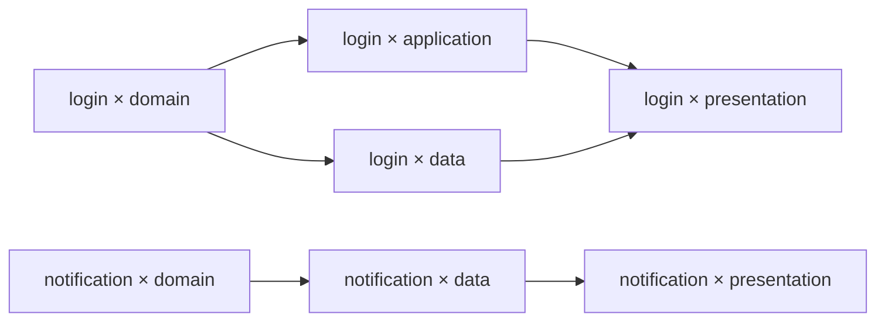

# 示例：登录失败限制

需求：连续登录失败五次后暂时限制登录，并显示剩余等待时间。本例贯穿定义、筛选、并行执行、审核、修复与采纳；字段与协议查阅前六章，边界验收见 [plan.md](../../plan.md#验收清单)。

## 输入与组合图

准备两个 Facet；下图省略 Layer 的控制边界：

```text
Feature: start → login → end
         start → notification → end
Layer: domain → application ─┐
       domain → data ────────┴→ presentation
```

Workflow 按 `feature ▷ layer` 组合。本例配置片段如下，完整文件格式见 [Workflow 文件](01-definition.md#workflow-文件)：

```yaml
exclude:
  - feature: [notification]
    layer: [application]
selection:
  mode: parallel
  confirmation: human
execution:
  runner: developer
  checks:
    - id: unit
      argv: [pytest, -q, test/auth]
      timeout_seconds: 120
  max_check_retries: 2
gate:
  mode: human
error_gate:
  mode: human
  max_auto_recoveries: 3
integration:
  checks:
    - id: regression
      argv: [pytest, -q]
      timeout_seconds: 900
```

静态组合图为：



静态排除 `notification × application` 时先补 `domain → presentation`，再因已有 `domain → data → presentation` 路径而约简这条冗余边。结果保存为 source-dag；此时尚未判断本次需求是否需要 notification 分支。

## 筛选与裁剪示例

假设 notification 的定义明确只负责外发通知，本次需求没有通知职责。并发筛选逐组合读取完整需求、当前职责及拓扑摘要，返回：

| 组合 | 判断 | 依据 |
| --- | --- | --- |
| login × domain / application / data / presentation | keep | 分别实现限制规则、接口、存储与界面 |
| notification × domain / data / presentation | exclude | 引用冻结需求与“仅外发通知”的职责定义 |

人类确认后，实际执行图只保留 login 分支，notification 不创建 Attempt。资料不足时必须 defer 并保留，不能仅因未来代码尚未生成而排除节点。采用后每个保留节点仍执行自己的 Pre-Assess。

若排除链 `A → B → C` 中的 B，则桥接为 `A → C`；若同时保留 `A → D → C`，约简后只需后者。筛选不改 C 的 Scope、检查或 Gate。两种筛选方式和采用规则见[运行前适用性筛选](02-selection-and-dag.md#运行前适用性筛选)。

## 同一需求如何从不同角度对齐

每个组合都读取完整冻结需求，再按 Feature 与 Layer 的职责处理当前部分。需求不自动改写 Facet；未明确的业务行为须在冻结前澄清。

| 组合 | 当前职责 | 证据 |
| --- | --- | --- |
| login × domain | 连续失败阈值、限制期与到期恢复规则 | 领域边界测试、Diff、CheckReport |
| login × application | 登录接口返回限制状态与剩余时间 | 接口测试、CheckReport |
| login × data | 保存失败计数和限制状态 | 仓储测试、CheckReport |
| login × presentation | 汇聚前驱成果，显示剩余时间和恢复状态 | 界面测试与可复核界面证据 |
| 最终集成 | 验证从失败请求到限制生效、界面提示与恢复的完整行为 | IntegrationReport、人类确认 |

domain 通过时界面尚未完成属于正常顺序；但领域输出若不能支持剩余时间计算，就是当前职责的问题。增加 Verification Facet 时，其等待范围取决于组合顺序，见 [Facet 顺序与验证位置](02-selection-and-dag.md#facet-顺序与验证位置)。最终集成检查仍独立存在。

## Node Gate 与并行审核

Feature 节点继承 Workflow 的 human Gate，Layer 节点按需要覆盖模式：

| Combination | feature/login | Layer Gate | 接受条件 |
| --- | --- | --- | --- |
| login × domain | human | ai：domain-reviewer | 人类与 AI 均批准 |
| login × application | human | script：dependency-check | 人类与脚本均批准 |
| login × data | human | 继承 human | 两项人工批准，可批量确认 |
| login × presentation | human | ai_assisted：ui-reviewer | 两项人工批准，其中一项附 AI 建议 |

Node 配置片段：

```yaml
id: domain
role: regular
gate:
  mode: ai
  evaluator: domain-reviewer
  context:
    objective: 检查锁定、到期恢复与领域隔离
```

AI 评估器使用固定审核 runner 的独立会话；脚本直接运行固定程序。完整定义见[评估器与执行边界](01-definition.md#评估器与执行边界)。同名 feature/login 在各 Combination / Attempt 中分别审核，不复用上一次批准。

假设 domain 的必要检查全部执行，但接口测试因后继 application 尚未接入而失败。修复预算用尽后，两个 Gate 可以根据领域测试、Diff 和失败报告批准当前成果，理由须说明领域输出足以支持后继；CheckReport 仍保留 failed。命令未启动或证据未形成不能这样批准，最终 integration.checks 也必须全部通过。

脚本正常返回 Rejected 会进入错误 Gate；脚本超时是评估故障，由人类接管或重评，不能等同于成果拒绝。完整协议见[审核与恢复](04-review-and-recovery.md)。

## 从运行到交付

1. **准备定义**：编辑源 Facet、Scope 和检查，预览组合图；人类确认后发布定义维护提交。准备预装 Agent 和环境的固定镜像，本地提供凭据。
2. **起草并冻结需求**：新草稿默认 AI 辅助，可切换 manual。人类审阅正文与 Diff，按摘要冻结为 requirement_ref；起草不要求先选 Workflow。
3. **创建 Run 与筛选**：启动时用 main 固定 source_commit，保存 source-dag。按上例并发筛选并集中确认，采用记录与执行图原子落地后才启动业务节点。
4. **执行 domain**：先创建 preparing Attempt，再固定输入与 Context Snapshot。独立只读 Pre-Assess 后调用外部 Agent；Runtime 执行必要检查，预算内续接修复并全量重检，保存最终 Checkpoint、只读 Post-Assess 和证据。
5. **审核与并行**：冻结成果输入，两项 Gate 全部批准后 domain satisfied；application 与 data 并行，presentation 等待两者并汇聚代码。错误恢复创建新 Attempt，同次预算内修复沿用原 Attempt。
6. **集成**：所有业务节点 satisfied 后进入 integrating，汇聚终端输出并原样加入冻结需求文件，执行非空 integration.checks。失败进入错误 Gate；成功绑定报告后 Run 才 completed。
7. **采纳**：人类确认成功报告和候选，Git Manager 重验输入与采纳历史，一个 squash Commit 同时保存需求、代码、精简档案和 DeliveryRecord。

```text
main: C0 ───────────────────────────────────── C1
       │                                       ↑
       └─ 本地筛选 → 执行 / Gate → 集成 → 确认 ─┘
                                               ├─ requirements/<uuid>.md
                                               ├─ 项目代码
                                               └─ runs/<run-id>/（含回执）
```

执行、审核与失败重试期间 main 不变；无代码变化也需检查和确认，C1 保存需求与 no_change 结论。push 仅同步既有提交，不决定本地采纳是否成功。

执行期间若 main 正式输入变化，用同一冻结需求创建新基线 Run；需求本身变化则新 UUID。仅 runs/ 清理不使输入失效。Git revert C1 不抹除历史采纳事实，不能重新交付原需求。

## 集成失败后的修复

最终回归发现接口遗漏剩余时间，错误 Gate 选择 `repair_combination`，目标为 application。其自身及后继 presentation 失效，domain 和 data 保持有效。恢复事务先固定旧成果，新 Attempt 都引用本次恢复决定：

| 节点 | 当前工作代码 | 修复职责 |
| --- | --- | --- |
| application | 当前有效 domain 输出 | 参考自身旧实现与失败报告，重新应用接口实现并修正返回值 |
| presentation | 新 application 与保留 data 的汇聚输出 | 参考旧界面实现，按新接口重新对齐 |
| data | 原有效成果 | 不失效、不重执行 |

旧代码只是参考，不直接合入新输入；Snapshot.recovery_context 保存各自旧 Attempt 与证据。两次新尝试都重做检查和全部成果审核，再全量集成。若错误 Gate 改为自动模式，整个 Run 默认最多自动恢复 3 次；节点切换与重启不重置额度。

## 从记录到改进

```text
返工记录：遗漏锁定到期后的恢复行为
    ↓ 人类与 Agent 核对有效经验
建议：在 layer/domain 上下文补充状态边界检查
    ↓ 人类采纳具体 Diff，验证定义与组合 DAG
维护 Commit：保存改进 + 清理已处理记录
```

未解决问题及有效引用目标保留，验证失败不删记录。精炼提交引用删除前证据，原档案仍可从 Git 历史查阅；Artifact 不自动删除。规则见[运行精炼](06-interaction.md#refinement运行精炼)。

## 跨 clone 复核与本地清理

日常运行无需分享大型证据。需要协作复核时：

```text
A：固定 Run 记录 → 导出独立 Artifact 交换包 → 现有渠道传给 B
B：同步 Git 读摘要 → 校验并导入交换包 → 按需恢复代码、复核证据
```

未采纳记录可用 `--local` 导出不可变快照；导入只读，不接管 Worker 或推进 Run。清理空间须另行预览并人工确认 purge；它只影响当前 clone，保留本地回执。Git 回退不恢复已删除内容，需从现存副本重新导入。

## 产物

| 位置 | 保留内容 |
| --- | --- |
| main 的一次采纳提交 | 冻结需求、代码、精简运行档案与回执 |
| 本地 Runtime | 完整执行、调用及恢复记录 |
| 本地 Artifact 库 | 请求、证据、大日志和代码恢复 bundle |
| 可选交换包 | 所选记录与依赖闭包 |

文件结构与保留边界统一见[存储与交付](05-storage-and-delivery.md#文件布局)。
